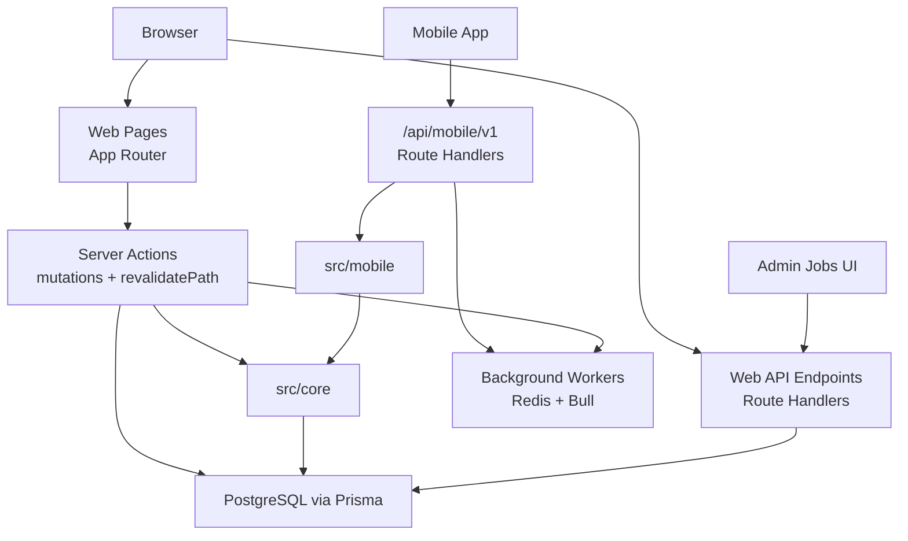
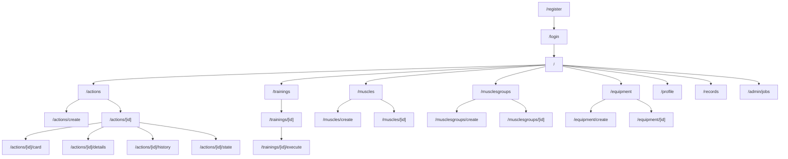
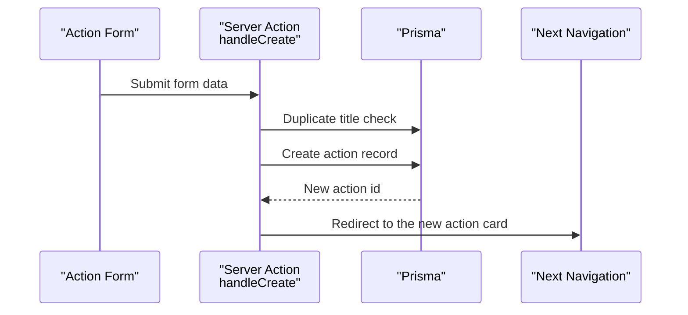
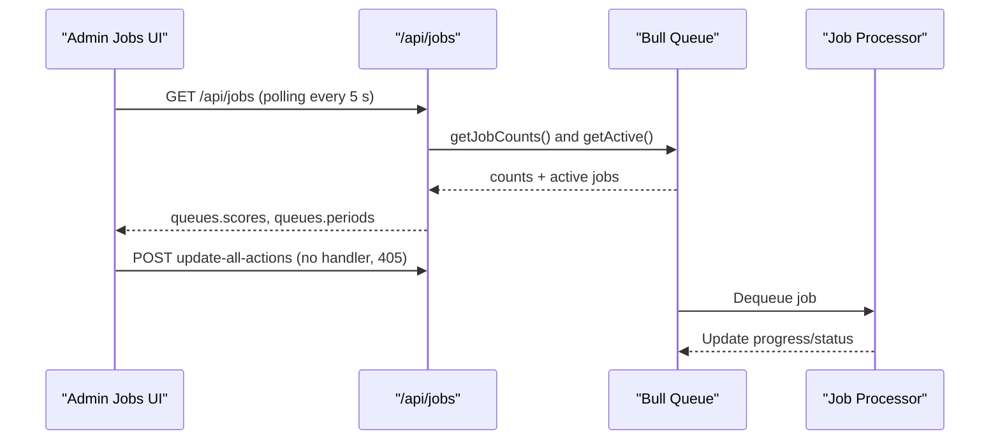
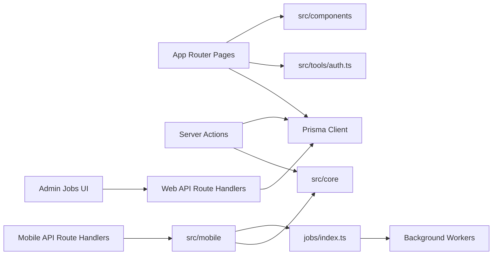

# App Pages and Routes

<cite>
**Referenced Files in This Document**
- [layout.tsx](file://src/app/layout.tsx)
- [page.tsx](file://src/app/page.tsx)
- [actions_page.tsx](file://src/app/actions/page.tsx)
- [action_details_page.tsx](file://src/app/actions/[id]/page.tsx)
- [trainings_page.tsx](file://src/app/trainings/page.tsx)
- [execute_page.tsx](file://src/app/trainings/[id]/execute/page.tsx)
- [muscles_page.tsx](file://src/app/muscles/page.tsx)
- [equipment_page.tsx](file://src/app/equipment/page.tsx)
- [profile_page.tsx](file://src/app/profile/page.tsx)
- [records_page.tsx](file://src/app/records/page.tsx)
- [login_page.tsx](file://src/app/login/page.tsx)
- [register_page.tsx](file://src/app/register/page.tsx)
- [musclesgroups_page.tsx](file://src/app/musclesgroups/page.tsx)
- [admin_jobs_page.tsx](file://src/app/admin/jobs/page.tsx)
- [nextauth_route.ts](file://src/app/api/auth/[...nextauth]/route.ts)
- [api_auth_register_route.ts](file://src/app/api/auth/register/route.ts)
- [api_actions_scores_route.ts](file://src/app/api/actions/scores/route.ts)
- [api_actions_search_route.ts](file://src/app/api/actions/search/route.ts)
- [api_exercises_similar_route.ts](file://src/app/api/exercises/similar/route.ts)
- [api_images_route.ts](file://src/app/api/images/route.ts)
- [api_jobs_route.ts](file://src/app/api/jobs/route.ts)
- [api_mobile_auth_exchange_route.ts](file://src/app/api/mobile/v1/auth/exchange/route.ts)
- [api_mobile_auth_register_route.ts](file://src/app/api/mobile/v1/auth/register/route.ts)
- [api_mobile_exercises_route.ts](file://src/app/api/mobile/v1/exercises/route.ts)
- [api_mobile_me_route.ts](file://src/app/api/mobile/v1/me/route.ts)
- [api_mobile_records_route.ts](file://src/app/api/mobile/v1/records/route.ts)
- [api_mobile_trainings_route.ts](file://src/app/api/mobile/v1/trainings/route.ts)
- [api_mobile_trainings_scores_route.ts](file://src/app/api/mobile/v1/trainings/scores/route.ts)
- [api_mobile_weights_route.ts](file://src/app/api/mobile/v1/weights/route.ts)
- [api_muscle_images_route.ts](file://src/app/api/muscle-images/route.ts)
- [api_training_execution_complete_route.ts](file://src/app/api/trainings/exercise/execution/complete/route.ts)
- [api_training_execution_uncomplete_route.ts](file://src/app/api/trainings/exercise/execution/uncomplete/route.ts)
- [actions_server_actions.ts](file://src/app/actions/actions.ts)
- [muscles_server_actions.ts](file://src/app/muscles/actions.ts)
- [execute_server_actions.ts](file://src/app/trainings/[id]/execute/actions.ts)
- [periods_server_actions.ts](file://src/app/trainings/periods/actions.ts)
- [profile_server_actions.ts](file://src/app/profile/actions.ts)
</cite>

## Table of Contents
1. [Introduction](#introduction)
2. [Project Structure](#project-structure)
3. [Core Components](#core-components)
4. [Architecture Overview](#architecture-overview)
5. [Detailed Component Analysis](#detailed-component-analysis)
6. [Dependency Analysis](#dependency-analysis)
7. [Performance Considerations](#performance-considerations)
8. [Troubleshooting Guide](#troubleshooting-guide)
9. [Conclusion](#conclusion)

## Introduction
This document provides a complete route map for the application, covering all page routes, server actions, and API endpoints. It is organized to help both technical and non-technical readers understand how navigation, data mutations, and external integrations are structured across the Next.js 14 App Router application.

**Updated** since the previous revision: the `/records` page, the `/login` and `/register` pages and all dynamic segments are now listed, the mobile API v1 has grown from four to eight endpoints, and exercises can be duration-based, which surfaces in the catalog, the execution form and the records UI.

## Project Structure
The application uses the Next.js App Router with file-based routing under `src/app`. Each directory corresponds to a URL path segment, including dynamic segments such as `[id]`. Server Actions are co-located in `actions.ts` files within each route directory. API endpoints are defined under `src/app/api` as Route Handlers; the mobile client has its own versioned subtree at `src/app/api/mobile/v1`.

```mermaid
graph TB
Root["Root Layout<br/>src/app/layout.tsx"] --> Home["Home Page<br/>src/app/page.tsx"]
Root --> Actions["Actions Catalog<br/>src/app/actions/page.tsx"]
Root --> ActionDetail["Action Detail<br/>src/app/actions/[id]"]
Root --> Trainings["Trainings List<br/>src/app/trainings/page.tsx"]
Root --> TrainingDetail["Training Card<br/>src/app/trainings/[id]"]
Root --> TrainingExecute["Execution<br/>src/app/trainings/[id]/execute"]
Root --> Muscles["Muscles List<br/>src/app/muscles/page.tsx"]
Root --> Equipment["Equipment List<br/>src/app/equipment/page.tsx"]
Root --> Profile["Profile Page<br/>src/app/profile/page.tsx"]
Root --> Records["Personal Records<br/>src/app/records/page.tsx"]
Root --> MuscleGroups["Muscle Groups List<br/>src/app/musclesgroups/page.tsx"]
Root --> AdminJobs["Admin Jobs Monitor<br/>src/app/admin/jobs/page.tsx"]
Root --> Login["Login<br/>src/app/login/page.tsx"]
Root --> Register["Register<br/>src/app/register/page.tsx"]
```

**Diagram sources**
- [layout.tsx:15-30](file://src/app/layout.tsx#L15-L30)
- [page.tsx:14-124](file://src/app/page.tsx#L14-L124)
- [actions_page.tsx:12-107](file://src/app/actions/page.tsx#L12-L107)
- [trainings_page.tsx:1-196](file://src/app/trainings/page.tsx#L1-L196)
- [execute_page.tsx:1-129](file://src/app/trainings/[id]/execute/page.tsx#L1-L129)
- [muscles_page.tsx:1-190](file://src/app/muscles/page.tsx#L1-L190)
- [equipment_page.tsx:1-74](file://src/app/equipment/page.tsx#L1-L74)
- [profile_page.tsx:1-56](file://src/app/profile/page.tsx#L1-L56)
- [records_page.tsx:99-330](file://src/app/records/page.tsx#L99-L330)
- [musclesgroups_page.tsx:1-35](file://src/app/musclesgroups/page.tsx#L1-L35)
- [admin_jobs_page.tsx:38-203](file://src/app/admin/jobs/page.tsx#L38-L203)
- [login_page.tsx:1-87](file://src/app/login/page.tsx#L1-L87)
- [register_page.tsx:1-162](file://src/app/register/page.tsx#L1-L162)

**Section sources**
- [layout.tsx:1-30](file://src/app/layout.tsx#L1-L30)

## Core Components
- Authentication: the NextAuth handler at `/api/auth/[...nextauth]` manages login, logout and session state with a **credentials provider and JWT sessions** (OAuth providers are disabled); `/login` and `/register` are the app's own pages, the latter posting to `/api/auth/register`.
- Data persistence: Prisma ORM used throughout pages and server actions to read/write PostgreSQL data.
- Background jobs: the admin UI polls `/api/jobs` to monitor queues; workers process jobs asynchronously.
- **New** Personal records: `/records` renders the record history and the currently valid records, and `RecordsPanel` shows the latest ones on the home page.

Key entry points:
- Root layout wraps every page with `AuthProvider` (a NextAuth `SessionProvider`), the shared `Layout` component and Bootstrap styles.
- Home page shows today's planned trainings, the weight panel/form/chart, the training time score and the personal-records panel.
- Feature pages (actions, trainings, muscles, equipment, profile, records, muscle groups) provide listing and management interfaces.

**Section sources**
- [layout.tsx:1-30](file://src/app/layout.tsx#L1-L30)
- [nextauth_route.ts:1-6](file://src/app/api/auth/[...nextauth]/route.ts#L1-L6)
- [page.tsx:14-124](file://src/app/page.tsx#L14-L124)

## Architecture Overview
The app follows a layered architecture:
- Presentation layer: Next.js App Router pages render UI and fetch data server-side.
- Business logic layer: Server Actions encapsulate mutations and revalidation, delegating rules to `src/core`.
- API layer: Route handlers expose REST endpoints for web clients and, under `/api/mobile/v1`, for the mobile app.
- Data layer: Prisma interacts with PostgreSQL; Redis + Bull powers background job processing.

**Section sources**
- [page.tsx:14-124](file://src/app/page.tsx#L14-L124)
- [api_jobs_route.ts:1-50](file://src/app/api/jobs/route.ts#L1-L50)

## Detailed Component Analysis

### Page Routes Map
All page components are async React Server Components unless marked as a client component.

| Route | Purpose |
|---|---|
| `/` | Home: today's planned trainings with a create form, weight panel/form/chart, training time score and the personal-records panel. |
| `/login` | Credentials sign-in form posting to NextAuth. |
| `/register` | Registration form; fetches the CSRF token and posts to `/api/auth/register`. |
| `/actions` | Exercise catalog, filterable by muscle group, ordered by `base` descending; **updated** to select `isDurationBased` so duration exercises can be marked in the list. |
| `/actions/create` | Admin-only form for a new exercise. |
| `/actions/[id]` | Admin edit form; **non-admin users are redirected to `/actions/[id]/card`**. |
| `/actions/[id]/card` | Read-only exercise card with the user's personal records for it. |
| `/actions/[id]/details` | Exercise metadata and per-purpose details. |
| `/actions/[id]/history` | Score history charts for the exercise. |
| `/actions/[id]/state` | Approach-group management and the per-purpose initial states (strength/mass/loss). |
| `/trainings` | Monthly training list with search and muscle-group filters. |
| `/trainings/[id]` | Training card: planned exercises, difficulty boost, time score, repeat form, process panel. |
| `/trainings/[id]/execute` | Live execution screen: warm-up card, top panel, per-exercise execution forms and the completion panel. |
| `/muscles` | Muscle list with sorting controls; admin sees `sizeFactor`/`priorityRank` editing. |
| `/muscles/create` | Admin-only muscle creation form. |
| `/muscles/[id]` | Muscle detail with descriptions and linked exercises. |
| `/musclesgroups` | Muscle groups list. |
| `/musclesgroups/create` | Admin-only group creation form. |
| `/musclesgroups/[id]` | Group detail with descriptions. |
| `/equipment` | The user's equipment sets, ordered by `isDefault` then name. |
| `/equipment/create` | Equipment creation form. |
| `/equipment/[id]` | Equipment detail/edit. |
| `/profile` | User profile form, weight panel/chart, training-period manager and the progression options form; also the sign-out link. |
| `/records` | **New** personal records with two tabs (`history` / `current`), filterable by record type and purpose through query parameters; duration-based records render seconds instead of kilograms. |
| `/admin/jobs` | Background job monitoring dashboard (client component, polls every 5 s). |

Note that `src/app/progression/` is **not** a route — it holds `SimpleProgressionOptsForm.tsx`, which the profile page renders. Likewise `src/app/trainings/create/` and `src/app/trainings/exercises/` contain only `actions.ts` and no `page.tsx`.

**Section sources**
- [page.tsx:14-124](file://src/app/page.tsx#L14-L124)
- [actions_page.tsx:12-107](file://src/app/actions/page.tsx#L12-L107)
- [actions_page.tsx:10-16 (detail)](file://src/app/actions/[id]/page.tsx#L10-L16)
- [trainings_page.tsx:1-196](file://src/app/trainings/page.tsx#L1-L196)
- [execute_page.tsx:1-129](file://src/app/trainings/[id]/execute/page.tsx#L1-L129)
- [muscles_page.tsx:1-190](file://src/app/muscles/page.tsx#L1-L190)
- [musclesgroups_page.tsx:1-35](file://src/app/musclesgroups/page.tsx#L1-L35)
- [equipment_page.tsx:11-74](file://src/app/equipment/page.tsx#L11-L74)
- [profile_page.tsx:1-56](file://src/app/profile/page.tsx#L1-L56)
- [records_page.tsx:99-330](file://src/app/records/page.tsx#L99-L330)
- [admin_jobs_page.tsx:38-203](file://src/app/admin/jobs/page.tsx#L38-L203)
- [login_page.tsx:1-87](file://src/app/login/page.tsx#L1-L87)
- [register_page.tsx:1-162](file://src/app/register/page.tsx#L1-L162)

### Server Actions Map
Fourteen `actions.ts` modules carry the write path. Every one of them starts with `"use server"`.

| Module | Exported actions |
|---|---|
| `src/app/actions/actions.ts` | `handleUpdate`, `handleCreate` — exercise catalog; `handleUpdate` recomputes `base` with `calcActionBase` and rebuilds the `search` column |
| `src/app/actions/[id]/actions.ts` | `handleCreateStrengthInitial`, `handleCreateMassInitial`, `handleCreateLossInitial` |
| `src/app/approaches/actions.ts` | `handleUpdateApproachGroup`, `handleCreateNewApproachesGroup` |
| `src/app/equipment/actions.ts` | `handleEquipmentCreate`, `handleEquipmentUpdate`, `handleEquipmentDelete` |
| `src/app/muscles/actions.ts` | `handleMuscleAddDesc`, `handleMuscleUpdateDesc`, `handleMuscleDeleteDesc`, `handleMuscleCreate`, `handleMuscleUpdate` (calls `recalcBaseForMuscle`), `handleDelete` |
| `src/app/musclesgroups/[id]/actions.ts` | `handleMuscleGroupDelete`, `handleMuscleGroupAddDesc`, `handleMuscleGroupUpdateDesc`, `handleMuscleGroupDeleteDesc` |
| `src/app/profile/actions.ts` | `handleProfileUpdate` |
| `src/app/trainings/create/actions.ts` | `handleCreateTraining` |
| `src/app/trainings/exercises/actions.ts` | `handleAddExercise`, `handleDeleteExercise`, `handleChangeExercisePriority` |
| `src/app/trainings/[id]/actions.ts` | `handleRepeatTraining`, `handleTrainingUpdate`, `handleTrainingDelete` |
| `src/app/trainings/[id]/difficulty/actions.ts` | `handleApplyDifficultyBoost`, `handleRevertDifficultyBoost` |
| `src/app/trainings/[id]/execute/actions.ts` | the execution state machine: warm-up skip/complete, training start, exercise start/pass/executed, extra approach, process completed training, manual completion, exercise replacement |
| `src/app/trainings/periods/actions.ts` | `createTrainingPeriodAction`, `endTrainingPeriodAction`, `handleUpdateProgressionStrategySimpleOpts` |
| `src/app/weights/actions.ts` | `handleWeightSave`, `handleWeightDelete` |

**Updated** `handleTrainingExerciseExecuted` passes `info.isDurationBased` as the fourth argument to `calculateStats`, so duration exercises accumulate seconds and a difficulty parameter instead of kilograms.

**Diagram sources**
- [actions_server_actions.ts:198-221](file://src/app/actions/actions.ts#L198-L221)

**Section sources**
- [actions_server_actions.ts:1-221](file://src/app/actions/actions.ts#L1-L221)
- [execute_server_actions.ts:163-282](file://src/app/trainings/[id]/execute/actions.ts#L163-L282)
- [periods_server_actions.ts:1-33](file://src/app/trainings/periods/actions.ts#L1-L33)
- [profile_server_actions.ts:1-24](file://src/app/profile/actions.ts#L1-L24)
- [actions_server_actions.ts:73-101 (muscles)](file://src/app/muscles/actions.ts#L73-L101)

### API Endpoints Map
- **Authentication**
  - `GET`/`POST` `/api/auth/[...nextauth]` — NextAuth handler (credentials provider, JWT sessions).
  - `POST` `/api/auth/register` — **new** email/password registration with CSRF, password-policy and uniqueness checks; returns `201` and the user id.
- **Actions and Exercises**
  - `GET /api/actions/scores` — retrieve action scores.
  - `GET /api/actions/search` — search exercises.
  - `GET /api/exercises/similar` — fetch similar exercises.
- **Images**
  - `POST`/`GET`/`PATCH`/`DELETE /api/images` — exercise image upload, listing, main-image switch and removal.
  - `POST`/`GET`/`PATCH`/`DELETE /api/muscle-images` — the same surface for muscle images.
- **Background Jobs**
  - `GET /api/jobs` — queue counts and active jobs for the `scores` and `periods` queues. **There is no `POST` handler**, even though the admin page still posts `{ action: "update-all-actions" }` to it; that button currently fails with 405.
- **Training Execution**
  - `POST /api/trainings/exercise/execution/complete` — mark an execution complete.
  - `POST /api/trainings/exercise/execution/uncomplete` — revert it.
- **Mobile API v1** (own JWT/HMAC auth, see [Mobile API System](Mobile%20API%20System.md))
  - `POST /api/mobile/v1/auth/register` — HMAC-signed registration, returns a token and the user id.
  - `POST /api/mobile/v1/auth/exchange` — exchange an HMAC-signed email for a JWT.
  - `GET /api/mobile/v1/me` — **new** full profile including `userInfo`.
  - `GET /api/mobile/v1/exercises` — paged exercise catalog.
  - `GET /api/mobile/v1/trainings` — paged training history.
  - `POST /api/mobile/v1/trainings` — idempotent batch upsert of completed trainings; schedules the `trainings` job.
  - `POST /api/mobile/v1/trainings/scores` — **new** stateless time and difficulty preview.
  - `GET /api/mobile/v1/weights` — paged body-weight history.
  - `POST /api/mobile/v1/weights` — batch body-weight import.
  - `GET /api/mobile/v1/records` — **new** paged personal records.

**Diagram sources**
- [api_jobs_route.ts:4-50](file://src/app/api/jobs/route.ts#L4-L50)
- [admin_jobs_page.tsx:44-90](file://src/app/admin/jobs/page.tsx#L44-L90)

**Section sources**
- [nextauth_route.ts:1-6](file://src/app/api/auth/[...nextauth]/route.ts#L1-L6)
- [api_auth_register_route.ts:7-95](file://src/app/api/auth/register/route.ts#L7-L95)
- [api_actions_scores_route.ts:1-41](file://src/app/api/actions/scores/route.ts#L1-L41)
- [api_actions_search_route.ts:1-51](file://src/app/api/actions/search/route.ts#L1-L51)
- [api_exercises_similar_route.ts:1-79](file://src/app/api/exercises/similar/route.ts#L1-L79)
- [api_images_route.ts:1-235](file://src/app/api/images/route.ts#L1-L235)
- [api_muscle_images_route.ts:1-211](file://src/app/api/muscle-images/route.ts#L1-L211)
- [api_jobs_route.ts:1-50](file://src/app/api/jobs/route.ts#L1-L50)
- [api_mobile_auth_register_route.ts:1-31](file://src/app/api/mobile/v1/auth/register/route.ts#L1-L31)
- [api_mobile_auth_exchange_route.ts:1-32](file://src/app/api/mobile/v1/auth/exchange/route.ts#L1-L32)
- [api_mobile_me_route.ts:1-28](file://src/app/api/mobile/v1/me/route.ts#L1-L28)
- [api_mobile_exercises_route.ts:1-32](file://src/app/api/mobile/v1/exercises/route.ts#L1-L32)
- [api_mobile_trainings_route.ts:1-102](file://src/app/api/mobile/v1/trainings/route.ts#L1-L102)
- [api_mobile_trainings_scores_route.ts:45-100](file://src/app/api/mobile/v1/trainings/scores/route.ts#L45-L100)
- [api_mobile_weights_route.ts:1-128](file://src/app/api/mobile/v1/weights/route.ts#L1-L128)
- [api_mobile_records_route.ts:1-51](file://src/app/api/mobile/v1/records/route.ts#L1-L51)
- [api_training_execution_complete_route.ts:26-66](file://src/app/api/trainings/exercise/execution/complete/route.ts#L26-L66)
- [api_training_execution_uncomplete_route.ts:8-15](file://src/app/api/trainings/exercise/execution/uncomplete/route.ts#L8-L15)

## Dependency Analysis
- Pages depend on Prisma for data fetching and on `src/tools/auth.ts` (`getCurrentUser`, `getCurrentUserId`, `findUserInfo`) for session handling.
- Server Actions perform mutations and trigger revalidation to keep UI consistent; the ones with domain rules import from `src/core`.
- Web API endpoints are mostly read-only helpers for client components; the mobile endpoints additionally schedule background jobs.
- The admin jobs page depends on `GET /api/jobs` for real-time queue visibility.
- Role gating is done inside the page (`user.role !== UserRole.ADMIN` → redirect or hide controls), not in middleware — there is no `middleware.ts` in this project.

**Diagram sources**
- [page.tsx:1-13](file://src/app/page.tsx#L1-L13)
- [actions_server_actions.ts:1-9](file://src/app/actions/actions.ts#L1-L9)
- [api_jobs_route.ts:1-3](file://src/app/api/jobs/route.ts#L1-L3)
- [admin_jobs_page.tsx:1-5](file://src/app/admin/jobs/page.tsx#L1-L5)
- [api_mobile_trainings_route.ts:1-20](file://src/app/api/mobile/v1/trainings/route.ts#L1-L20)

**Section sources**
- [page.tsx:1-124](file://src/app/page.tsx#L1-L124)
- [actions_server_actions.ts:1-221](file://src/app/actions/actions.ts#L1-L221)
- [api_jobs_route.ts:1-50](file://src/app/api/jobs/route.ts#L1-L50)
- [admin_jobs_page.tsx:38-203](file://src/app/admin/jobs/page.tsx#L38-L203)

## Performance Considerations
- Prefer server-side data fetching in pages to reduce client payload and leverage caching; aggregate queries that can run in parallel are wrapped in `Promise.all` (see the two raw count queries on `/actions`).
- Use `revalidatePath` in server actions to invalidate only affected routes after mutations.
- For heavy operations (training processing, score calculation, record detection), enqueue background jobs instead of doing the work in the request.
- Reuse the React `cache()` helpers (`getCurrentUser`, `findUserInfo`, `getCachedMuscleGroups`) so several components on one page do not repeat the same query.
- Index frequently queried fields in Prisma schema migrations; the records page relies on the `[userId, actionId, purpose, type, achievedAt desc]` index of `PersonalRecord` and on Prisma's `distinct` to compute the "current" tab in one query.
- The admin jobs page polls every 5 seconds — it is the only page with a client-side polling loop, so keep its payload small.

[No sources needed since this section provides general guidance]

## Troubleshooting Guide
- **Login rejected**: the credentials `authorize` returns `null` both for an unknown email and for a user without a password hash; NextAuth surfaces both as the same generic error.
- **Registration fails with 403**: `/api/auth/register` compares the submitted CSRF token with the `next-auth.csrf-token` (or `__Host-` prefixed) cookie; the form must read the token from `/api/auth/csrf` first.
- **Admin-only page shows the card instead of the form**: `/actions/[id]` redirects non-admins to `/actions/[id]/card` by design.
- **"Trigger Update All Actions" button errors**: `/api/jobs` implements `GET` only, so the page's `POST` returns 405.
- **Job scheduling failures**: confirm Redis connectivity and that `npm run workers` is running; `/api/jobs` reports only the `scores` and `periods` queues.
- **Image uploads rejected**: `/api/images` and `/api/muscle-images` enforce a 3 MB limit and the `gif/png/jpg/jpeg` MIME allow-list, write into `public/uploads` (created on demand) and then `chown`/`chmod` the file to the current process uid/gid — a read-only filesystem or a mismatched uid will fail here.
- **Training execution endpoints**: they validate the session and ownership before marking executions complete/uncomplete; a 404 usually means the execution belongs to another user.
- **Records page shows nothing**: the defaults are `tab=history`, type `MAX_WEIGHT` and the purpose currently selected in the user's profile; an empty `type` or `purpose` query parameter is treated as "nothing selected", not as "no filter". The history tab additionally requires `previousValue` to be set, and the current tab only shows records with `isAllTime: true`.

**Section sources**
- [nextauth_route.ts:1-6](file://src/app/api/auth/[...nextauth]/route.ts#L1-L6)
- [api_auth_register_route.ts:12-27](file://src/app/api/auth/register/route.ts#L12-L27)
- [api_jobs_route.ts:1-50](file://src/app/api/jobs/route.ts#L1-L50)
- [api_images_route.ts:1-101](file://src/app/api/images/route.ts#L1-L101)
- [api_training_execution_complete_route.ts:26-66](file://src/app/api/trainings/exercise/execution/complete/route.ts#L26-L66)
- [api_training_execution_uncomplete_route.ts:8-15](file://src/app/api/trainings/exercise/execution/uncomplete/route.ts#L8-L15)
- [records_page.tsx:36-120](file://src/app/records/page.tsx#L36-L120)

## Conclusion
This route map consolidates all page routes, server actions, and API endpoints into a single reference. It clarifies how the application organizes presentation, business logic, and integration points, enabling developers to navigate, extend, and troubleshoot the system effectively. Two things to keep in mind when extending it: the mobile API v1 is a first-class, separately authenticated surface rather than an afterthought, and role gating lives inside page components, so a new admin route must repeat the `UserRole.ADMIN` check itself.