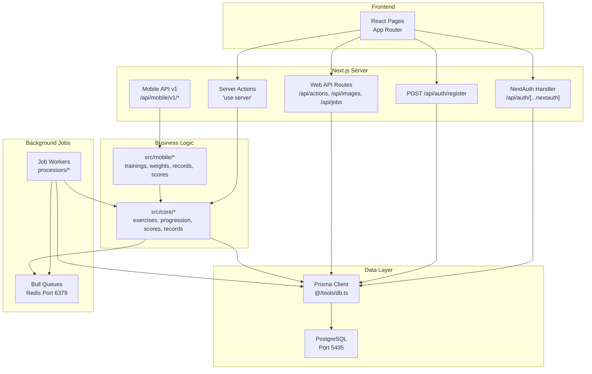
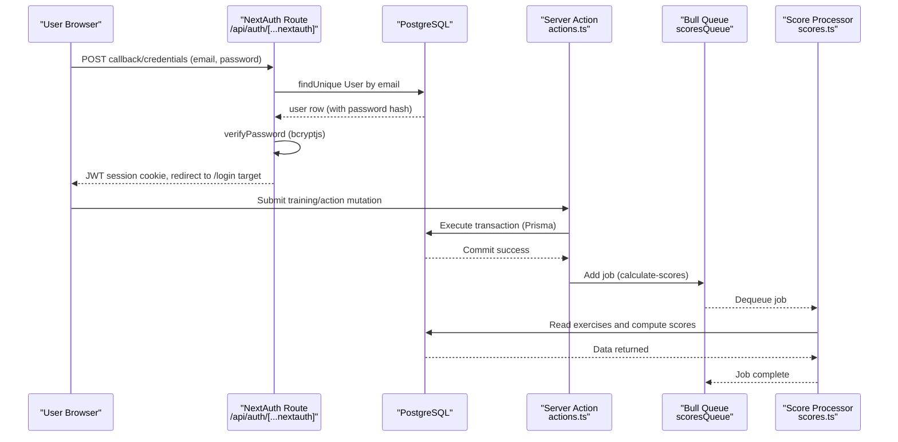
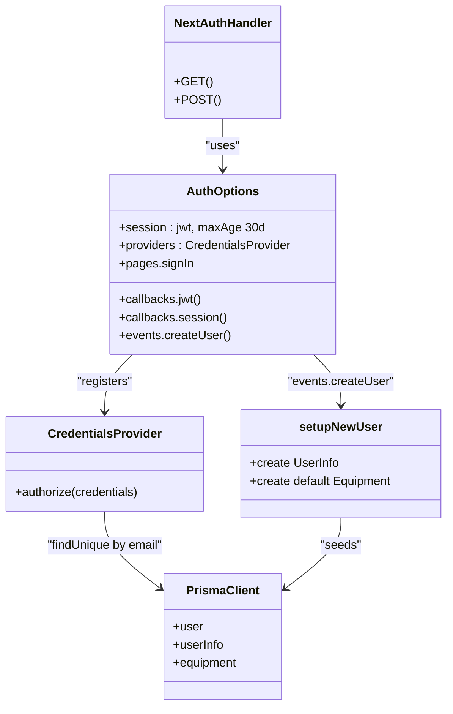
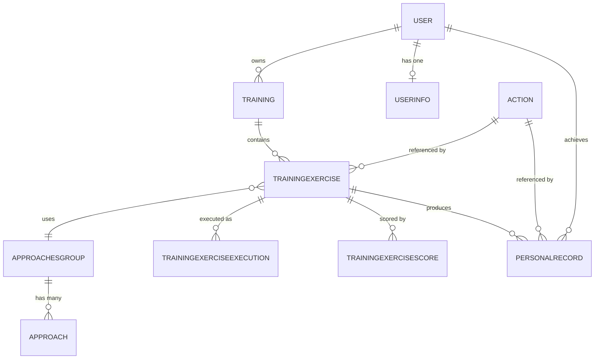
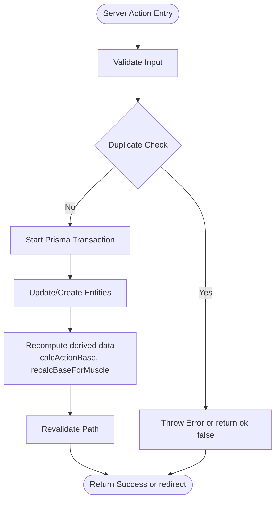
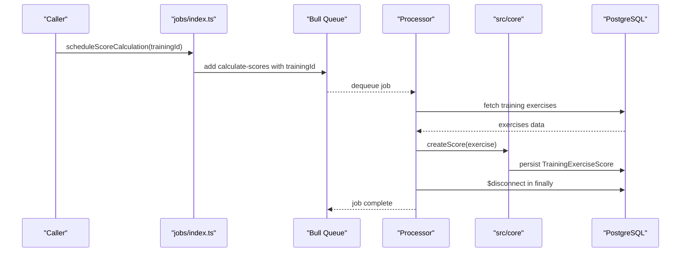
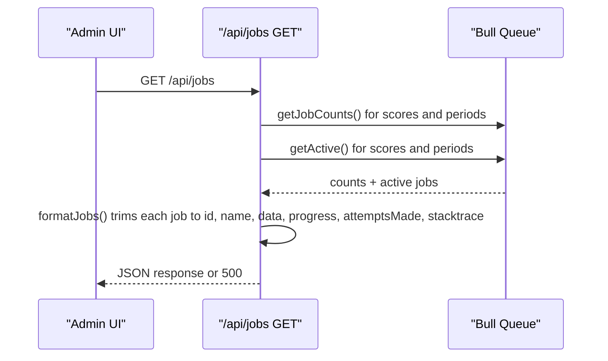
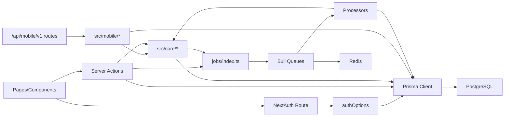

# Architecture Overview

<cite>
**Referenced Files in This Document**
- [layout.tsx](file://src/app/layout.tsx)
- [AuthProvider.tsx](file://src/components/AuthProvider.tsx)
- [route.ts (NextAuth)](file://src/app/api/auth/[...nextauth]/route.ts)
- [route.ts (web register)](file://src/app/api/auth/register/route.ts)
- [auth.ts](file://src/tools/auth.ts)
- [password.ts](file://src/tools/password.ts)
- [db.ts](file://src/tools/db.ts)
- [schema.prisma](file://prisma/schema.prisma)
- [docker-compose.yml](file://docker-compose.yml)
- [index.ts (jobs)](file://src/jobs/index.ts)
- [queues.ts](file://src/jobs/queues.ts)
- [config.ts](file://src/jobs/config.ts)
- [scores.ts (job processor)](file://src/jobs/processors/scores.ts)
- [trainings.ts (job processor)](file://src/jobs/processors/trainings.ts)
- [trainingProcessing.ts](file://src/core/trainingProcessing.ts)
- [exercises.ts](file://src/core/exercises.ts)
- [actions.ts](file://src/app/actions/actions.ts)
- [actions.ts (muscles)](file://src/app/muscles/actions.ts)
- [route.ts (jobs monitor)](file://src/app/api/jobs/route.ts)
- [route.ts (mobile trainings)](file://src/app/api/mobile/v1/trainings/route.ts)
</cite>

## Table of Contents
1. [Introduction](#introduction)
2. [Project Structure](#project-structure)
3. [Core Components](#core-components)
4. [Architecture Overview](#architecture-overview)
5. [Detailed Component Analysis](#detailed-component-analysis)
6. [Dependency Analysis](#dependency-analysis)
7. [Performance Considerations](#performance-considerations)
8. [Troubleshooting Guide](#troubleshooting-guide)
9. [Conclusion](#conclusion)

## Introduction
This document provides a high-level system architecture for the Next.js 14 App Router application, showing how authentication (NextAuth), Prisma (PostgreSQL), and Bull queues (Redis) integrate to serve user requests, persist data, and process background jobs. It focuses on the monolithic structure with clear module boundaries: UI routes and server actions, API endpoints, database access via Prisma, and asynchronous job processing through Bull.

Two clarifications matter for anyone reading this document against the code:

- **Updated** Web authentication uses the NextAuth **CredentialsProvider** (email + bcrypt-hashed password) with **JWT sessions**; the Prisma adapter and the GitHub/Google OAuth providers are commented out and gated behind the `ENABLE_OAUTH = false` constant in `src/tools/auth.ts`. The `Account`, `Session` and `VerificationToken` Prisma models are still present in the schema but are not written to at runtime. The switch is meant to be temporary — the commented-out providers must not be deleted.
- **New** A second, independent API surface serves the mobile app under `/api/mobile/v1/*`. It does **not** use NextAuth: it has its own HMAC-SHA256 token exchange and HS256 JWT verification (`MOBILE_HMAC_SECRET` / `MOBILE_JWT_SECRET`). See the dedicated [Mobile API System](Mobile%20API%20System.md) document.

## Project Structure
The application follows a feature-based layout under `src/app` with co-located server actions (`actions.ts` next to each `page.tsx`), API routes, and page components. Business logic lives in `src/core` (web) and `src/mobile` (mobile API); route handlers stay thin and only validate input. Authentication is configured as an API route using NextAuth with a credentials provider, and registration is a separate `POST /api/auth/register` route. Background jobs are managed by Bull with Redis, exposed via helpers in `src/jobs/index.ts` and monitored through an admin API.

**Diagram sources**
- [layout.tsx:1-30](file://src/app/layout.tsx#L1-L30)
- [AuthProvider.tsx:1-11](file://src/components/AuthProvider.tsx#L1-L11)
- [route.ts:1-6](file://src/app/api/auth/[...nextauth]/route.ts#L1-L6)
- [auth.ts:1-173](file://src/tools/auth.ts#L1-L173)
- [db.ts:1-7](file://src/tools/db.ts#L1-L7)
- [index.ts:1-73](file://src/jobs/index.ts#L1-L73)
- [queues.ts:1-26](file://src/jobs/queues.ts#L1-L26)
- [config.ts:1-41](file://src/jobs/config.ts#L1-L41)
- [scores.ts:1-36](file://src/jobs/processors/scores.ts#L1-L36)
- [route.ts:1-50](file://src/app/api/jobs/route.ts#L1-L50)

**Section sources**
- [layout.tsx:1-30](file://src/app/layout.tsx#L1-L30)
- [AuthProvider.tsx:1-11](file://src/components/AuthProvider.tsx#L1-L11)
- [route.ts:1-6](file://src/app/api/auth/[...nextauth]/route.ts#L1-L6)
- [auth.ts:1-173](file://src/tools/auth.ts#L1-L173)
- [db.ts:1-7](file://src/tools/db.ts#L1-L7)
- [schema.prisma:1-825](file://prisma/schema.prisma#L1-L825)
- [docker-compose.yml:1-29](file://docker-compose.yml#L1-L29)
- [index.ts:1-73](file://src/jobs/index.ts#L1-L73)
- [queues.ts:1-26](file://src/jobs/queues.ts#L1-L26)
- [config.ts:1-41](file://src/jobs/config.ts#L1-L41)
- [scores.ts:1-36](file://src/jobs/processors/scores.ts#L1-L36)
- [route.ts:1-50](file://src/app/api/jobs/route.ts#L1-L50)

## Core Components
- Next.js App Router pages and server actions handle UI rendering and server-side mutations.
- NextAuth API route exposes a single CredentialsProvider and uses JWT sessions (no database adapter).
- `POST /api/auth/register` creates users directly: it validates the CSRF double-submit cookie, checks the password policy, hashes with bcrypt and calls `setupNewUser` inside a transaction.
- Prisma client instance centralizes database connectivity, using a `globalThis` singleton so hot reloads in development do not exhaust the connection pool.
- Bull queues manage background tasks: score calculation, inactive-period checks, orphaned image cleanup and completed-training processing.
- **New** The mobile API v1 (`/api/mobile/v1/*`) is a parallel HTTP surface with its own auth, delegating to the pure services in `src/mobile/*`, which in turn reuse `src/core/*`.
- Admin API exposes queue statistics and active jobs for monitoring.

Key integration points:
- Authentication flows through the NextAuth handler into the `User` model; `events.createUser` calls `setupNewUser`, which seeds `UserInfo` and the default "Тренажерный зал" equipment set.
- Server actions perform transactions and revalidation after updates.
- Background workers consume jobs from Redis and delegate to `src/core` (`processCompletedTrainingCore`, `createScore`) rather than implementing logic themselves.

**Section sources**
- [route.ts:1-6](file://src/app/api/auth/[...nextauth]/route.ts#L1-L6)
- [route.ts:7-95](file://src/app/api/auth/register/route.ts#L7-L95)
- [auth.ts:25-143](file://src/tools/auth.ts#L25-L143)
- [password.ts:1-12](file://src/tools/password.ts#L1-L12)
- [db.ts:1-7](file://src/tools/db.ts#L1-L7)
- [index.ts:1-73](file://src/jobs/index.ts#L1-L73)
- [queues.ts:1-26](file://src/jobs/queues.ts#L1-L26)
- [config.ts:1-41](file://src/jobs/config.ts#L1-L41)
- [scores.ts:1-36](file://src/jobs/processors/scores.ts#L1-L36)
- [trainings.ts:1-28](file://src/jobs/processors/trainings.ts#L1-L28)
- [route.ts:1-50](file://src/app/api/jobs/route.ts#L1-L50)

## Architecture Overview
The system integrates five main layers:
- Presentation layer: React pages and components wrapped with `AuthProvider` (a `SessionProvider`) inside `RootLayout`.
- Application layer: NextAuth API route, web API routes, server actions and the mobile API v1 routes.
- Business layer: `src/core/*` for web flows and `src/mobile/*` for the mobile API; both are plain TypeScript modules with no HTTP concerns.
- Data layer: Prisma client interacting with PostgreSQL.
- Background processing layer: Bull queues backed by Redis with processors executing scheduled and ad-hoc jobs.

**Diagram sources**
- [route.ts:1-6](file://src/app/api/auth/[...nextauth]/route.ts#L1-L6)
- [auth.ts:66-143](file://src/tools/auth.ts#L66-L143)
- [password.ts:1-12](file://src/tools/password.ts#L1-L12)
- [db.ts:1-7](file://src/tools/db.ts#L1-L7)
- [actions.ts:1-221](file://src/app/actions/actions.ts#L1-L221)
- [index.ts:1-73](file://src/jobs/index.ts#L1-L73)
- [queues.ts:1-26](file://src/jobs/queues.ts#L1-L26)
- [scores.ts:1-36](file://src/jobs/processors/scores.ts#L1-L36)

## Detailed Component Analysis

### Authentication Integration (NextAuth + Credentials)
**Updated** NextAuth is mounted at `/api/auth/[...nextauth]` by a two-line handler that just wraps `authOptions`. The configuration:

- `session: { strategy: "jwt", maxAge: 30 days }` — sessions live in the signed cookie, **not** in the database. The `PrismaAdapter` import and the `adapter` key are commented out, so the `Account`, `Session` and `VerificationToken` models in the schema are inert leftovers of the previous OAuth setup.
- `providers`: a single `CredentialsProvider` (`email` + `password`). `authorize` loads the user by email, returns `null` when the user is missing or has no password, verifies the hash with `verifyPassword` (bcryptjs) and strips the `password` field before returning.
- `ENABLE_OAUTH = false` wraps the GitHub/Google provider entries. Both are commented out; the flag exists so the OAuth path can be restored without rewriting the array. A `VkProvider` import is present but unused.
- `callbacks.jwt` copies `user.id` into `token.sub` and the role into `token.role`; `callbacks.session` re-reads the `User` row on every session request and attaches it (minus `password`) to `session.user`.
- `pages.signIn = "/login"` — the app ships its own login page instead of the NextAuth default.
- `events.createUser` calls `setupNewUser(userId)` unless a user with the same email already exists. `setupNewUser` seeds `UserInfo` and the default equipment "Тренажерный зал" with four rigs (BARBELL, BLOCKS, DUMBBELL, KETTLEBELL) and three requirements (BENCH, UPBAR, SIMULATOR). With the credentials flow the event rarely fires, so `POST /api/auth/register` calls `setupNewUser` explicitly inside the same transaction that creates the user.

Server-side helpers: `auth()` wraps `getServerSession`, `getCurrentUser()` is a React `cache()`-wrapped accessor that calls `notFound()` without a session, `getCurrentUserId()` derives the id, and `findUserInfo()` lazily creates a missing `UserInfo` row.

**Diagram sources**
- [route.ts:1-6](file://src/app/api/auth/[...nextauth]/route.ts#L1-L6)
- [auth.ts:25-143](file://src/tools/auth.ts#L25-L143)
- [auth.ts:27-62](file://src/tools/auth.ts#L27-L62)
- [db.ts:1-7](file://src/tools/db.ts#L1-L7)

**Section sources**
- [route.ts:1-6](file://src/app/api/auth/[...nextauth]/route.ts#L1-L6)
- [route.ts:7-95](file://src/app/api/auth/register/route.ts#L7-L95)
- [auth.ts:25-173](file://src/tools/auth.ts#L25-L173)
- [password.ts:1-12](file://src/tools/password.ts#L1-L12)
- [db.ts:1-7](file://src/tools/db.ts#L1-L7)

### Database Access (Prisma + PostgreSQL)
Prisma client is instantiated centrally and used across server actions, API routes and processors. The schema defines core entities like User, Training, TrainingExercise, ApproachesGroup/Approach, PersonalRecord and TrainingExerciseScore. Migrations evolve the schema over time.

> **Note**: Exercises do not point at approaches directly — a `TrainingExercise` references a shared `ApproachesGroup`, and the group owns the `Approach` rows. Executions then link back to individual approaches.

**Diagram sources**
- [schema.prisma:19-47](file://prisma/schema.prisma#L19-L47)
- [schema.prisma:347-392](file://prisma/schema.prisma#L347-L392)
- [schema.prisma:399-536](file://prisma/schema.prisma#L399-L536)
- [schema.prisma:595-671](file://prisma/schema.prisma#L595-L671)

**Section sources**
- [db.ts:1-7](file://src/tools/db.ts#L1-L7)
- [schema.prisma:1-825](file://prisma/schema.prisma#L1-L825)

### Server Actions and Data Flow
Server actions are declared in `actions.ts` files co-located with the route segment they serve (`src/app/actions/actions.ts`, `src/app/muscles/actions.ts`, `src/app/trainings/[id]/execute/actions.ts`, `src/app/trainings/periods/actions.ts` and so on). They encapsulate the write path: duplicate checks, Prisma transactions, cache revalidation and redirects. Business rules are delegated to `src/core` — for example `handleUpdate` recomputes the exercise base with `calcActionBase`, and `handleMuscleUpdate` calls `recalcBaseForMuscle` so that changing a muscle's `sizeFactor` propagates to every exercise that uses it.

Two error-reporting conventions coexist and both are intentional:

| Style | Used by | Behaviour |
|---|---|---|
| `throw new Error("...")` | `handleUpdate`, `handleCreate` in `src/app/actions/actions.ts` | surfaces through the Next.js error boundary |
| `ServerActionResult` (`{ ok, error }`) | `handleMuscleUpdate`, `handleMuscleCreate` | returned to the client form, which renders the message inline |

**Diagram sources**
- [actions.ts:31-166](file://src/app/actions/actions.ts#L31-L166)
- [actions.ts:198-221](file://src/app/actions/actions.ts#L198-L221)
- [actions.ts:73-101 (muscles)](file://src/app/muscles/actions.ts#L73-L101)
- [exercises.ts:43-131](file://src/core/exercises.ts#L43-L131)

**Section sources**
- [actions.ts:1-221](file://src/app/actions/actions.ts#L1-L221)
- [actions.ts:1-106 (muscles)](file://src/app/muscles/actions.ts#L1-L106)

### Background Jobs (Bull + Redis)
Four Bull queues are created in `src/jobs/queues.ts` and each is wired to exactly one processor at module load: `scores` → `calculationScoreProcessor`, `periods` → `checkInactivePeriodsProcessor`, `images` → `cleanupImagesProcessor`, `trainings` → `trainingProcessingProcessor`. `src/jobs/index.ts` imports the processor modules for their side effects, re-exports the queues and provides the scheduling helpers.

Two of those helpers are cron-based and are **invoked immediately when the module is imported** (lines 58–62), which registers the repeating jobs on every process start:

| Helper | Queue | Job name | Trigger |
|---|---|---|---|
| `scheduleScoreCalculation(trainingId)` | scores | `calculate-scores` | on demand |
| `scheduleTrainingProcessing(trainingId, userId)` | trainings | `process-completed-training` | on demand, after a mobile sync |
| `scheduleCheckInactivePeriods()` | periods | `check-inactive-periods` | cron `0 0 * * *` (daily at midnight) |
| `scheduleCleanupOrphanedImages()` | images | `cleanup-orphaned-images` | cron `0 3 * * *` (daily at 03:00) |

All jobs share `defaultJobOptions`: 3 attempts, exponential backoff starting at 5 s, and `removeOnComplete: true` — completed jobs disappear from Redis, so history is not queryable. Every processor calls `prisma.$disconnect()` in a `finally` block because workers are short-lived Node processes.

**Diagram sources**
- [index.ts:1-73](file://src/jobs/index.ts#L1-L73)
- [queues.ts:1-26](file://src/jobs/queues.ts#L1-L26)
- [config.ts:1-41](file://src/jobs/config.ts#L1-L41)
- [scores.ts:1-36](file://src/jobs/processors/scores.ts#L1-L36)
- [trainings.ts:1-28](file://src/jobs/processors/trainings.ts#L1-L28)
- [trainingProcessing.ts:31-194](file://src/core/trainingProcessing.ts#L31-L194)

**Section sources**
- [index.ts:1-73](file://src/jobs/index.ts#L1-L73)
- [queues.ts:1-26](file://src/jobs/queues.ts#L1-L26)
- [config.ts:1-41](file://src/jobs/config.ts#L1-L41)
- [scores.ts:1-36](file://src/jobs/processors/scores.ts#L1-L36)
- [trainings.ts:1-28](file://src/jobs/processors/trainings.ts#L1-L28)
- [route.ts:1-50](file://src/app/api/jobs/route.ts#L1-L50)

### Monitoring API for Jobs
`GET /api/jobs` returns job counts and active jobs, enabling the admin dashboard at `/admin/jobs`. It currently inspects **only the `scores` and `periods` queues** — `images` and `trainings` are not reported, which is a known gap when debugging mobile sync processing.

**Diagram sources**
- [route.ts:1-50](file://src/app/api/jobs/route.ts#L1-L50)

**Section sources**
- [route.ts:1-50](file://src/app/api/jobs/route.ts#L1-L50)

### Mobile API Layer
**New** `/api/mobile/v1/*` is an independent HTTP surface for the mobile client. Route handlers only verify the JWT and validate the payload with zod; all logic lives in `src/mobile/*`, which reuses `src/core/*` so both clients share one implementation of progression, scoring and records.

Authentication does not use NextAuth: the client signs a timestamp with `MOBILE_HMAC_SECRET` and exchanges it (plus the email) for an HS256 JWT signed with `MOBILE_JWT_SECRET`. Endpoints: `POST /auth/register`, `POST /auth/exchange`, `GET /me`, `GET /exercises`, `GET|POST /trainings`, `POST /trainings/scores`, `GET|POST /weights`, `GET /records`. The training-sync write path ends by scheduling the `trainings` Bull job, which is how mobile data reaches the same scoring and personal-record pipeline as the web app.

**Section sources**
- [route.ts:1-102](file://src/app/api/mobile/v1/trainings/route.ts#L1-L102)
- [trainingProcessing.ts:31-194](file://src/core/trainingProcessing.ts#L31-L194)
- [index.ts:65-73](file://src/jobs/index.ts#L65-L73)

## Dependency Analysis
The following diagram shows key dependencies between modules. The arrows point from the caller to the callee; `src/core` and `src/mobile` never import from `src/app`, which keeps them testable in isolation (`npm run test:core`, `npm run test:mobile`).

Notable couplings:
- `src/tools/auth.ts` is imported both by the NextAuth route and by `src/app/api/auth/register/route.ts` (for `setupNewUser`), so registration seeding and OAuth-era seeding cannot drift apart.
- `src/jobs/index.ts` has import side effects: importing it registers the daily cron jobs. Any module that only wants to *schedule* a job also triggers that registration.
- The `trainings` processor is the single bridge between the mobile sync path and the web-side progression/records logic (`processCompletedTrainingCore`).

**Diagram sources**
- [layout.tsx:1-30](file://src/app/layout.tsx#L1-L30)
- [AuthProvider.tsx:1-11](file://src/components/AuthProvider.tsx#L1-L11)
- [route.ts:1-6](file://src/app/api/auth/[...nextauth]/route.ts#L1-L6)
- [auth.ts:1-173](file://src/tools/auth.ts#L1-L173)
- [db.ts:1-7](file://src/tools/db.ts#L1-L7)
- [index.ts:1-73](file://src/jobs/index.ts#L1-L73)
- [queues.ts:1-26](file://src/jobs/queues.ts#L1-L26)
- [scores.ts:1-36](file://src/jobs/processors/scores.ts#L1-L36)
- [trainings.ts:1-28](file://src/jobs/processors/trainings.ts#L1-L28)

**Section sources**
- [layout.tsx:1-30](file://src/app/layout.tsx#L1-L30)
- [AuthProvider.tsx:1-11](file://src/components/AuthProvider.tsx#L1-L11)
- [route.ts:1-6](file://src/app/api/auth/[...nextauth]/route.ts#L1-L6)
- [route.ts:7-95](file://src/app/api/auth/register/route.ts#L7-L95)
- [auth.ts:1-173](file://src/tools/auth.ts#L1-L173)
- [db.ts:1-7](file://src/tools/db.ts#L1-L7)
- [index.ts:1-73](file://src/jobs/index.ts#L1-L73)
- [queues.ts:1-26](file://src/jobs/queues.ts#L1-L26)
- [scores.ts:1-36](file://src/jobs/processors/scores.ts#L1-L36)

## Performance Considerations
- Use Prisma transactions for multi-step writes to ensure consistency and reduce round-trips.
- Offload heavy computations (e.g. score calculation, personal-record detection, training processing) to background jobs to keep request latency low; `POST /api/mobile/v1/trainings` returns as soon as the batch is persisted and schedules the rest.
- Configure retry and backoff policies for resilient job processing — `defaultJobOptions` already sets 3 attempts with exponential backoff.
- Leverage Next.js caching and revalidation to minimize redundant server work. Request-scoped deduplication uses React `cache()` (`getCurrentUser`, `findUserInfo`, `getCachedMuscleGroups`); reuse those helpers instead of re-querying.
- `callbacks.session` issues one `user.findUnique` per session read, so the JWT strategy trades a DB round-trip for the absence of a `Session` table.
- Ensure Redis and PostgreSQL connections are properly sized and monitored; `src/tools/db.ts` caches the client on `globalThis` in non-production builds to avoid pool exhaustion during hot reload.
- `removeOnComplete: true` keeps Redis small but also means historical job data must come from application logs, not from the queue.

[No sources needed since this section provides general guidance]

## Troubleshooting Guide
- **Login rejected with valid credentials**: `authorize` returns `null` when the user is missing *or* when `user.password` is empty — accounts created through the old OAuth flow have no password and cannot log in until one is set.
- **Registration returns 403 "CSRF token mismatch"**: `POST /api/auth/register` compares the submitted token against the `__Host-next-auth.csrf-token` (HTTPS) or `next-auth.csrf-token` (localhost) cookie; the page must obtain the token from NextAuth's `/api/auth/csrf` first.
- **New user has no `UserInfo` or equipment**: with credentials auth the `events.createUser` hook does not fire, so check that the registration transaction actually called `setupNewUser`.
- **Stale UI after a mutation**: confirm the server action calls `revalidatePath` for the affected route (or `redirect`, which also revalidates).
- **Job processing errors**: inspect worker logs; `/api/jobs` only reports the `scores` and `periods` queues, so `trainings` and `images` failures are visible only in the worker output (`npm run workers`).
- **Scores never appear after a mobile sync**: score calculation is gated on `userInfo.trainingProgression !== NONE` in `processCompletedTrainingCore`; personal records are detected regardless.
- **Training processed twice / not at all**: `processCompletedTrainingCore` throws when the training is not completed and returns early when `processedAt` is already set.
- **Database issues**: validate connection strings (`DATABASE_PRISMA_URL` / `DATABASE_URL_NON_POOLING`) and migrations; monitor Prisma query performance.

**Section sources**
- [auth.ts:83-104](file://src/tools/auth.ts#L83-L104)
- [route.ts:12-27](file://src/app/api/auth/register/route.ts#L12-L27)
- [route.ts:1-50](file://src/app/api/jobs/route.ts#L1-L50)
- [scores.ts:1-36](file://src/jobs/processors/scores.ts#L1-L36)
- [trainingProcessing.ts:31-194](file://src/core/trainingProcessing.ts#L31-L194)
- [actions.ts:1-221](file://src/app/actions/actions.ts#L1-L221)

## Conclusion
The application combines Next.js App Router, NextAuth (credentials + JWT), Prisma and Bull to deliver a cohesive workout planning and tracking platform. Requests flow through authenticated routes and server actions, persisting data via Prisma while offloading intensive tasks — scoring, personal-record detection, training processing, maintenance — to background jobs. The mobile API v1 is a second, thinner entry point that shares the same `src/core` business logic and the same job pipeline, so web and mobile data converge on one implementation. The modular design keeps HTTP handlers free of business rules and supports scalability and maintainability, with clear boundaries between UI, API, business logic, data and processing layers.

[No sources needed since this section summarizes without analyzing specific files]