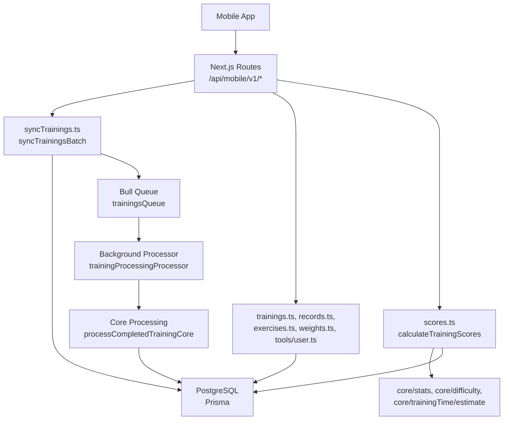
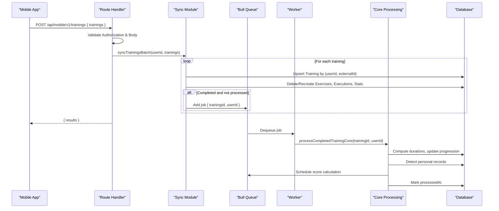
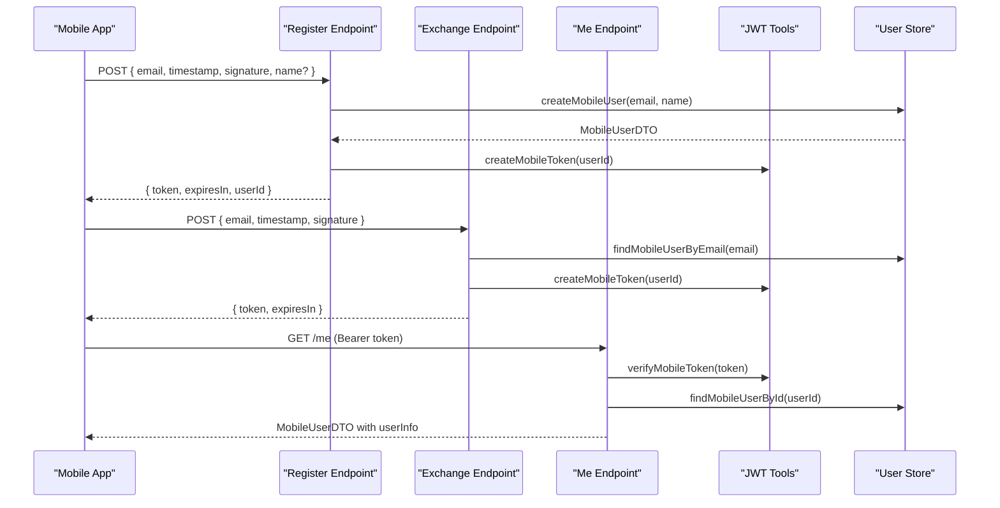
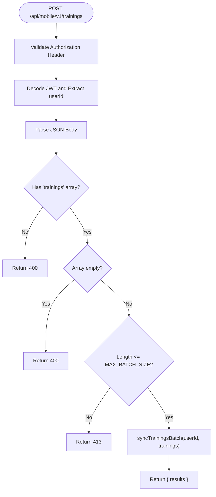
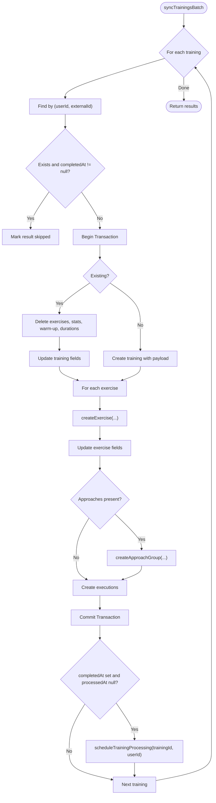
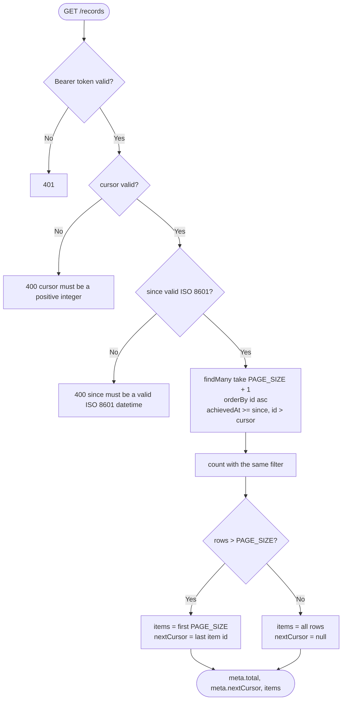
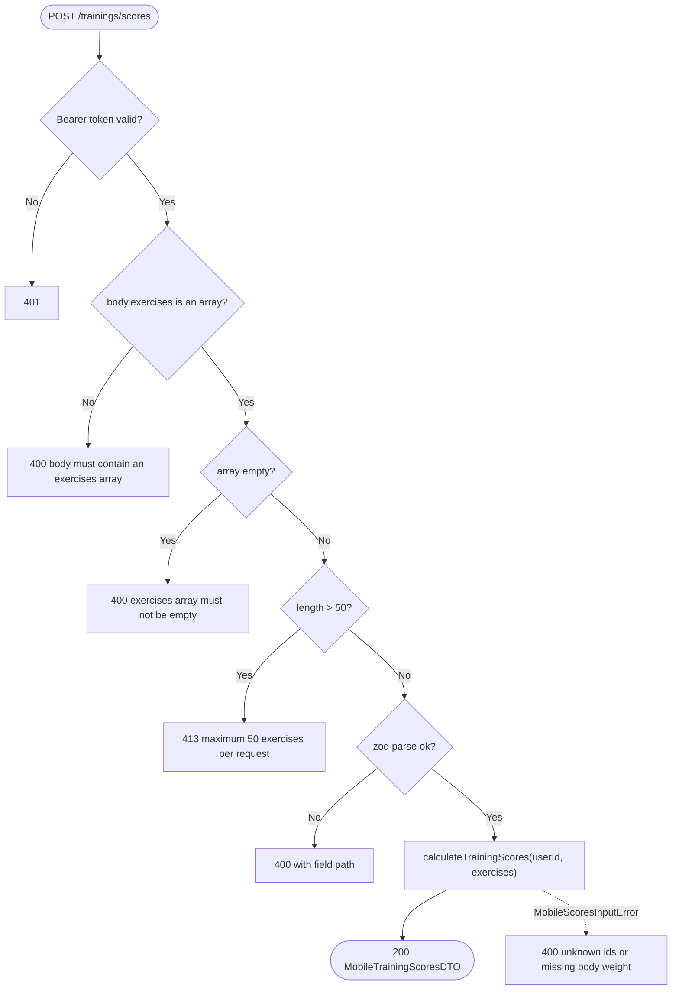
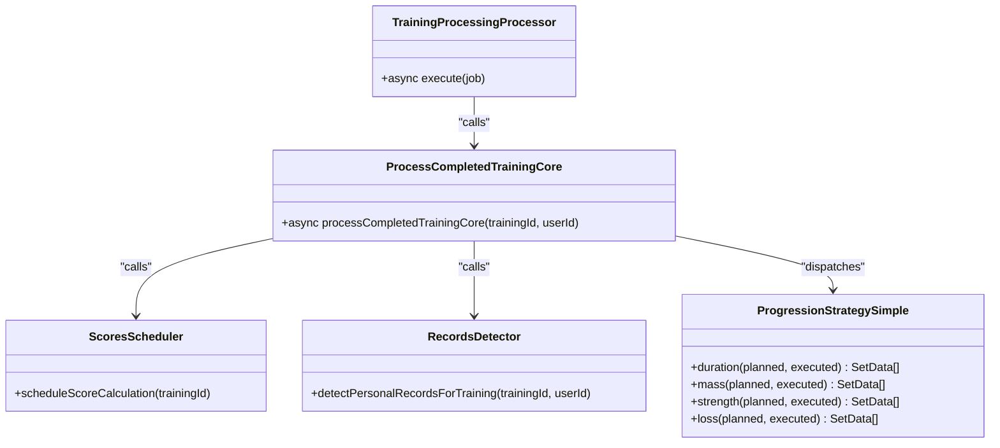
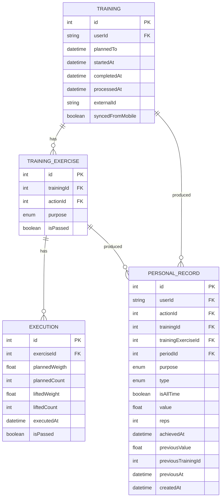
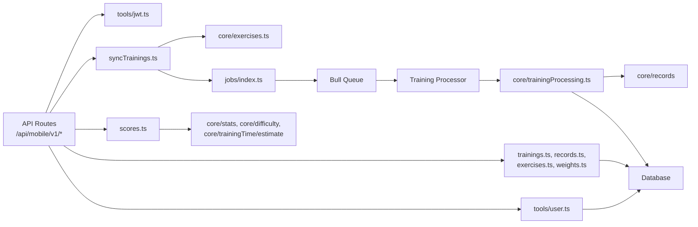

# Mobile API System

<cite>
**Referenced Files in This Document**
- [route.ts](file://src/app/api/mobile/v1/trainings/route.ts)
- [scores route.ts](file://src/app/api/mobile/v1/trainings/scores/route.ts)
- [me route.ts](file://src/app/api/mobile/v1/me/route.ts)
- [records route.ts](file://src/app/api/mobile/v1/records/route.ts)
- [exercises route.ts](file://src/app/api/mobile/v1/exercises/route.ts)
- [weights route.ts](file://src/app/api/mobile/v1/weights/route.ts)
- [syncTrainings.ts](file://src/mobile/syncTrainings.ts)
- [trainings.ts](file://src/mobile/trainings.ts)
- [records.ts](file://src/mobile/records.ts)
- [scores.ts](file://src/mobile/scores.ts)
- [exercises.ts (mobile)](file://src/mobile/exercises.ts)
- [user.ts](file://src/mobile/tools/user.ts)
- [trainingProcessing.ts](file://src/core/trainingProcessing.ts)
- [config.ts](file://src/jobs/config.ts)
- [queues.ts](file://src/jobs/queues.ts)
- [index.ts](file://src/jobs/index.ts)
- [trainings.ts processor](file://src/jobs/processors/trainings.ts)
- [exercises.ts](file://src/core/exercises.ts)
- [detect.ts](file://src/core/records/detect.ts)
- [schema.prisma](file://prisma/schema.prisma)
- [jwt.ts](file://src/mobile/tools/jwt.ts)
- [exchange.ts](file://src/mobile/exchange.ts)
- [register.ts](file://src/mobile/register.ts)
- [mobile-trainings-api.md](file://docs/mobile-trainings-api.md)
- [records.test.ts](file://src/tests/mobile/records.test.ts)
- [records-route.test.ts](file://src/tests/mobile/records-route.test.ts)
- [scores.test.ts](file://src/tests/mobile/scores.test.ts)
- [scores-route.test.ts](file://src/tests/mobile/scores-route.test.ts)
</cite>

## Table of Contents
1. [Introduction](#introduction)
2. [Project Structure](#project-structure)
3. [Core Components](#core-components)
4. [Architecture Overview](#architecture-overview)
5. [Detailed Component Analysis](#detailed-component-analysis)
6. [Dependency Analysis](#dependency-analysis)
7. [Performance Considerations](#performance-considerations)
8. [Troubleshooting Guide](#troubleshooting-guide)
9. [Conclusion](#conclusion)
10. [Appendices](#appendices)

## Introduction
This document describes the Mobile API System for syncing completed trainings from a mobile app to the server. It covers authentication, batch sync endpoints, background processing via Redis and Bull, data models, and end-to-end flows. The system is built on Next.js 14 App Router with PostgreSQL (Prisma ORM) and Redis-backed job queues.

**Updated**: the surface has grown well beyond training sync. Alongside `POST /trainings` the API now serves the athlete's profile (`GET /me`), the exercise catalog (`GET /exercises`), body-weight history (`GET`/`POST /weights`), training history (`GET /trainings`), personal records (`GET /records`) and a stateless score preview (`POST /trainings/scores`). Every endpoint shares one bearer-token guard, one cursor pagination convention and one error envelope.

## Project Structure
The mobile API surface resides under `src/app/api/mobile/v1`. Routes are thin: they verify the token, validate the payload with zod, and delegate to a service function under `src/mobile`. The `POST /api/mobile/v1/trainings` endpoint accepts a batch of trainings, upserts them by (userId, externalId), skips already-completed trainings, recreates child records when updating, and enqueues background processing for progression, scoring and personal records.

**Diagram sources**
- [route.ts:60-102](file://src/app/api/mobile/v1/trainings/route.ts#L60-L102)
- [syncTrainings.ts:66-236](file://src/mobile/syncTrainings.ts#L66-L236)
- [scores.ts:110-173](file://src/mobile/scores.ts#L110-L173)
- [queues.ts:23-26](file://src/jobs/queues.ts#L23-L26)
- [trainings.ts processor:10-28](file://src/jobs/processors/trainings.ts#L10-L28)
- [trainingProcessing.ts:30-194](file://src/core/trainingProcessing.ts#L30-L194)

**Section sources**
- [route.ts:1-102](file://src/app/api/mobile/v1/trainings/route.ts#L1-L102)
- [mobile-trainings-api.md:1-959](file://docs/mobile-trainings-api.md#L1-L959)

## Core Components
- Authentication: JWT-based mobile auth with HMAC-signed exchange and registration endpoints; `GET /me` returns the authenticated profile.
- Batch sync: `POST /api/mobile/v1/trainings` validates input, enforces batch limits, and delegates to the sync module.
- Sync module: Upserts Training by (userId, externalId), deletes and recreates children as needed, maps DTO fields to Prisma schema, and schedules background processing if applicable.
- Background processing: Bull queue processes completed trainings to compute durations, apply progression strategies, link new approach groups, schedule score calculations and — **new** — detect personal records.
- Data model: Training includes externalId and syncedFromMobile; compound unique constraint ensures idempotent upserts per user.
- **New** Records feed: `getRecordsList` pages personal records by `id` with an `achievedAt >= since` filter and returns everything — all-time and period records, including "base" entries with `previousValue = null` — leaving presentation filtering to the client.
- **New** Score preview: `calculateTrainingScores` computes time and difficulty estimates for a list of exercises without writing a single row.
- **Updated** User DTO: `MobileUserDTO` now carries `emailVerified`, `createdAt`, `updatedAt` and a nested `userInfo` object (sex, height, purpose, trainingProgression, trainingProgressionParams, collectExerciseExecutionFeedback). The Prisma `select` deliberately omits `password`.
- **Updated** Exercise and training DTOs expose `isDurationBased`, and the catalog additionally exposes `durationParamLabel` and `durationParamUnit`, so a client can render seconds instead of repetitions.

**Section sources**
- [jwt.ts:1-31](file://src/mobile/tools/jwt.ts#L1-L31)
- [exchange.ts:1-33](file://src/mobile/exchange.ts#L1-L33)
- [register.ts:1-31](file://src/mobile/register.ts#L1-L31)
- [user.ts:4-98](file://src/mobile/tools/user.ts#L4-L98)
- [route.ts:60-102](file://src/app/api/mobile/v1/trainings/route.ts#L60-L102)
- [syncTrainings.ts:8-64](file://src/mobile/syncTrainings.ts#L8-L64)
- [records.ts:71-98](file://src/mobile/records.ts#L71-L98)
- [scores.ts:110-173](file://src/mobile/scores.ts#L110-L173)
- [exercises.ts:10-70 (mobile)](file://src/mobile/exercises.ts#L10-L70)
- [schema.prisma:391-440](file://prisma/schema.prisma#L391-L440)

## Architecture Overview
The flow begins with client authentication via email + HMAC signature to obtain a short-lived JWT. The mobile app then reads its profile and the catalog, can price a workout through the scores preview, and finally sends a batch of trainings to the POST endpoint. Each training is validated and upserted within a transaction. If a training is newly completed and not yet processed, a job is queued. A background worker executes core processing to compute execution durations, update progression, detect personal records, and schedule scoring.

**Diagram sources**
- [route.ts:60-102](file://src/app/api/mobile/v1/trainings/route.ts#L60-L102)
- [syncTrainings.ts:66-236](file://src/mobile/syncTrainings.ts#L66-L236)
- [index.ts:64-73](file://src/jobs/index.ts#L64-L73)
- [trainings.ts processor:10-28](file://src/jobs/processors/trainings.ts#L10-L28)
- [trainingProcessing.ts:30-194](file://src/core/trainingProcessing.ts#L30-L194)

## Detailed Component Analysis

### Endpoint Surface
All routes live under `src/app/api/mobile/v1` and follow the same shape: read the `authorization` header, require the `Bearer ` prefix, call `verifyMobileToken`, then delegate to a `src/mobile` service.

| Method & path | Service | Purpose | Writes |
|---|---|---|---|
| `POST /auth/register` | `registerMobileUser` | HMAC-signed registration, returns token + userId | yes |
| `POST /auth/exchange` | `exchangeForToken` | HMAC-signed email → JWT | no |
| `GET /me` | `findMobileUserById` | **New** full profile incl. `userInfo` | no |
| `GET /exercises` | `getExercisesList` | Paged exercise catalog (global, not per user) | no |
| `GET /trainings` | `getTrainingsList` | Paged training history with planned/executed sets | no |
| `POST /trainings` | `syncTrainingsBatch` | Idempotent batch upsert of completed trainings | yes |
| `POST /trainings/scores` | `calculateTrainingScores` | **New** stateless time + difficulty preview | no |
| `GET /weights` | `getWeightsList` | Paged body-weight history | no |
| `POST /weights` | `createWeightsBatch` | Batch body-weight import | yes |
| `GET /records` | `getRecordsList` | **New** paged personal records | no |

Conventions shared by the read endpoints:
- Pagination is keyset-based on `id` (`?cursor=<int>`), page size is a per-module constant, and the response is `{ meta: { total, nextCursor }, items }`. The constants are `PAGE_SIZE = 10` in `trainings.ts`, `20` in `exercises.ts` and `weights.ts`, and `50` in `records.ts`; each service fetches `PAGE_SIZE + 1` rows to decide `nextCursor` without a second query.
- `?since=<ISO8601>` narrows by date; when omitted it defaults to 31 days ago.
- Only `GET /trainings` rejects a `since` older than one month (400 `"since must not be older than 1 month"`). `GET /weights` and `GET /records` deliberately have no such cap — body weight and records stay valuable across the whole history.
- A malformed `cursor` returns 400 `"cursor must be a positive integer"`; a malformed `since` returns 400 `"since must be a valid ISO 8601 datetime"`.

**Section sources**
- [route.ts:1-102](file://src/app/api/mobile/v1/trainings/route.ts#L1-L102)
- [scores route.ts:45-100](file://src/app/api/mobile/v1/trainings/scores/route.ts#L45-L100)
- [me route.ts:5-28](file://src/app/api/mobile/v1/me/route.ts#L5-L28)
- [records route.ts:6-51](file://src/app/api/mobile/v1/records/route.ts#L6-L51)
- [exercises route.ts:5-32](file://src/app/api/mobile/v1/exercises/route.ts#L5-L32)
- [weights route.ts:6-128](file://src/app/api/mobile/v1/weights/route.ts#L6-L128)
- [mobile-trainings-api.md:671-685](file://docs/mobile-trainings-api.md#L671-L685)

### Authentication Flow
- Registration: POST /api/mobile/v1/auth/register validates timestamp and signature, creates a mobile user together with a default `UserInfo` row and a default "Тренажерный зал" equipment (four rigs and three requirements), and returns a JWT token with expiration.
- Exchange: POST /api/mobile/v1/auth/exchange validates timestamp and signature, finds the user, and returns a JWT token.
- Token verification: All protected endpoints verify the Bearer token using HS256 and extract userId.
- **New** Profile: `GET /api/mobile/v1/me` re-verifies the token and returns the mapped `MobileUserDTO`; a token whose subject no longer exists yields 404 `"User not found"` rather than 401.
- Both auth flows normalize the email with `trim().toLowerCase()` before lookup and before signature verification, so casing never matters.

**Diagram sources**
- [register.ts:5-31](file://src/mobile/register.ts#L5-L31)
- [exchange.ts:12-33](file://src/mobile/exchange.ts#L12-L33)
- [jwt.ts:12-31](file://src/mobile/tools/jwt.ts#L12-L31)
- [me route.ts:5-28](file://src/app/api/mobile/v1/me/route.ts#L5-L28)
- [user.ts:100-143](file://src/mobile/tools/user.ts#L100-L143)

**Section sources**
- [register.ts:1-31](file://src/mobile/register.ts#L1-L31)
- [exchange.ts:1-33](file://src/mobile/exchange.ts#L1-L33)
- [jwt.ts:1-31](file://src/mobile/tools/jwt.ts#L1-L31)
- [user.ts:26-98](file://src/mobile/tools/user.ts#L26-L98)
- [me route.ts:1-28](file://src/app/api/mobile/v1/me/route.ts#L1-L28)

### Trainings Sync Endpoint
- Validates Authorization header and decodes JWT to get userId.
- Validates request body: must contain non-empty trainings array; enforces MAX_BATCH_SIZE.
- Calls syncTrainingsBatch to process each training sequentially.
- Returns per-training results indicating created, updated, skipped, or error status.

**Diagram sources**
- [route.ts:60-102](file://src/app/api/mobile/v1/trainings/route.ts#L60-L102)
- [syncTrainings.ts:64-69](file://src/mobile/syncTrainings.ts#L64-L69)

**Section sources**
- [route.ts:60-102](file://src/app/api/mobile/v1/trainings/route.ts#L60-L102)
- [mobile-trainings-api.md:237-422](file://docs/mobile-trainings-api.md#L237-L422)

### Sync Module Logic
- Input DTOs define expected fields for Training, Exercise, Approach, and Execution payloads.
- For each training:
  - Lookup by (userId, externalId).
  - Skip if existing and completedAt is set.
  - Upsert within a transaction:
    - Update path: delete child records (exercises, muscle stats, warm-up, execution durations), then update training fields and mark syncedFromMobile.
    - Create path: create training with payload fields and syncedFromMobile.
  - For each exercise:
    - Reuse createExercise to handle purpose-action lookup/creation and approach group linking.
    - Update exercise fields (isPassed, rating, comment, startedAt, completedAt).
    - If approaches provided, create an approach group and link it to the exercise.
    - Create executions in bulk, mapping plannedWeight to DB field plannedWeigth.
- After transaction, if training is completed and not processed, schedule background processing.

**Diagram sources**
- [syncTrainings.ts:66-236](file://src/mobile/syncTrainings.ts#L66-L236)
- [exercises.ts:117-248](file://src/core/exercises.ts#L117-L248)

**Section sources**
- [syncTrainings.ts:8-236](file://src/mobile/syncTrainings.ts#L8-L236)
- [exercises.ts:117-248](file://src/core/exercises.ts#L117-L248)

### Personal Records Endpoint
**New** in v3.2.0. `GET /api/mobile/v1/records?cursor=<int>&since=<ISO8601>` exposes the personal-records feed that `processCompletedTrainingCore` maintains.

- The route validates the token, then the cursor (`NaN` or negative → 400) and the `since` value (invalid date → 400). Unlike `/trainings` there is **no** one-month floor, so a client may request the entire history.
- `getRecordsList(userId, since, cursor)` runs two queries in parallel: a page of `PAGE_SIZE + 1` records ordered by `id asc` filtered on `achievedAt >= since` (plus `id > cursor` when paginating), and a `count` with the same filter minus the cursor. The extra row is how `nextCursor` is decided without a second round trip.
- Every record is returned, including "base" entries whose `previousValue` is `null` (the first result ever, or the first inside a period). Deciding what counts as an achievement is a client concern; the web UI applies the same rule through `isShownRecord`.
- Dates are serialized to ISO 8601 strings by `mapRecord`; `previousAt` becomes `null` when absent.
- Field semantics depend on the record type and on whether the action is duration-based:

| Field | Meaning |
|---|---|
| `type` | `MAX_WEIGHT` (heaviest single set) or `MAX_VOLUME` (tonnage) |
| `isAllTime` | true for an all-time record, false for a period record |
| `value` | kilograms; for duration-based actions — seconds |
| `reps` | repetitions of the record set, `MAX_WEIGHT` only; `null` otherwise |
| `periodId` | the period of a period record; `null` for all-time entries |
| `achievedAt` | equals `Training.completedAt`; stable across record recalculation, unlike `id` and `createdAt` |
| `previousValue` / `previousTrainingId` / `previousAt` | the previous best of the same (action, purpose, type, scope) tuple; all `null` for a base record |

**Diagram sources**
- [records route.ts:6-51](file://src/app/api/mobile/v1/records/route.ts#L6-L51)
- [records.ts:71-98](file://src/mobile/records.ts#L71-L98)

**Section sources**
- [records route.ts:1-51](file://src/app/api/mobile/v1/records/route.ts#L1-L51)
- [records.ts:1-98](file://src/mobile/records.ts#L1-L98)
- [detect.ts:1-126](file://src/core/records/detect.ts#L1-L126)
- [mobile-trainings-api.md:847-959](file://docs/mobile-trainings-api.md#L847-L959)

### Training Scores Preview Endpoint
**New** in v3.3.0. `POST /api/mobile/v1/trainings/scores` lets the app price a workout — estimated duration and difficulty — before creating it. The handler is read-only by design.

- Body: `{ exercises: [{ id, purpose, approaches: [{ weight, count, priority?, isBoost? }] }] }`, validated by zod. The root is wrapped in an object on purpose so error messages carry a path from `exercises` downwards, e.g. `exercises[0].approaches[1].weight: Expected number, received string`.
- Limits: at least one exercise (400 otherwise) and at most `MAX_EXERCISES_PER_REQUEST` = 50 (413 otherwise). The length guard runs **before** zod parsing.
- Unknown action ids raise `MobileScoresInputError`, which the route maps to 400 with the offending ids listed.
- Body weight is fetched only when at least one requested action is `rig === OTHER` and not duration-based; if it is required but missing, the response is 400 `"User has no weight records required for bodyweight exercises"`.
- Duration-based actions always score as LOSS regardless of the `purpose` sent by the client.
- Response: per-exercise `approachesCount`, `timeScoreInMins`, `timeScoreInSecs`, `difficultyScore` and the effective `purpose`, plus training-level totals where `timeScoreInSecs` is simply `timeScoreInMins × 60`.

**Diagram sources**
- [scores route.ts:45-100](file://src/app/api/mobile/v1/trainings/scores/route.ts#L45-L100)
- [scores route.ts:10-41](file://src/app/api/mobile/v1/trainings/scores/route.ts#L10-L41)
- [scores.ts:110-173](file://src/mobile/scores.ts#L110-L173)

**Section sources**
- [scores route.ts:1-100](file://src/app/api/mobile/v1/trainings/scores/route.ts#L1-L100)
- [scores.ts:1-173](file://src/mobile/scores.ts#L1-L173)
- [mobile-trainings-api.md:503-628](file://docs/mobile-trainings-api.md#L503-L628)

### Background Processing
- Queue configuration adds a trainings queue and job name for processing completed trainings.
- Processor receives job data { trainingId, userId }, calls core processing, and logs outcomes.
- Core processing:
  - Loads training with related exercises, executions, and period options.
  - Ensures training is completed and not already processed.
  - Computes execution durations based on executedAt timestamps relative to training.startedAt.
  - Applies the progression strategy per exercise — **updated**: `Action.isDurationBased` is checked *before* the purpose branches, so duration exercises go through `duration()` even though their purpose is always LOSS. Boost approaches are excluded from the planned sets, and passed or zero-load executions from the executed sets.
  - Schedules score calculation, but only when the user's `trainingProgression` is not `NONE`.
  - **New** Detects personal records via `detectPersonalRecordsForTraining`. This runs regardless of the progression setting, so an athlete who disabled progression still collects records.
  - Marks `processedAt` last, which makes the whole routine idempotent.

**Diagram sources**
- [trainings.ts processor:10-28](file://src/jobs/processors/trainings.ts#L10-L28)
- [trainingProcessing.ts:31-194](file://src/core/trainingProcessing.ts#L31-L194)
- [index.ts:16-25](file://src/jobs/index.ts#L16-L25)
- [detect.ts:18-126](file://src/core/records/detect.ts#L18-L126)

**Section sources**
- [config.ts:9-41](file://src/jobs/config.ts#L9-L41)
- [queues.ts:23-26](file://src/jobs/queues.ts#L23-L26)
- [trainings.ts processor:1-28](file://src/jobs/processors/trainings.ts#L1-L28)
- [trainingProcessing.ts:1-194](file://src/core/trainingProcessing.ts#L1-L194)
- [index.ts:64-73](file://src/jobs/index.ts#L64-L73)
- [detect.ts:1-126](file://src/core/records/detect.ts#L1-L126)

### Data Model Highlights
- Training model includes externalId and syncedFromMobile, with a compound unique constraint on (userId, externalId) to support idempotent upserts.
- Exercise and execution fields map cleanly to mobile payloads, including handling of enums and optional fields.
- Duration tracking uses TrainingExerciseExecutionDuration entries computed during processing.
- **New** PersonalRecord rows are derived data: they are recreated on every reprocessing of a training and can be rebuilt wholesale by `recalculatePersonalRecordsForUser`, so a client must never treat `id` as a stable identity — use `(actionId, purpose, type, isAllTime, periodId, achievedAt)`.
- **Updated** `Action.isDurationBased`, `durationParamLabel` and `durationParamUnit` travel in the exercise catalog payload and change how `count` and `weight` must be interpreted everywhere else in the API.

**Diagram sources**
- [schema.prisma:399-451](file://prisma/schema.prisma#L399-L451)
- [schema.prisma:452-536](file://prisma/schema.prisma#L452-L536)
- [schema.prisma:619-671](file://prisma/schema.prisma#L619-L671)

**Section sources**
- [schema.prisma:399-536](file://prisma/schema.prisma#L399-L536)
- [schema.prisma:619-671](file://prisma/schema.prisma#L619-L671)

## Dependency Analysis
- Routes depend on JWT verification and on a single `src/mobile` service each; they contain no business logic beyond validation and error mapping.
- Sync module depends on core exercise creation and approach group utilities, plus job scheduling.
- Job system depends on queue configuration and processors that call core processing.
- Core processing depends on database queries, the progression strategy, the records engine and the job scheduler.
- **New** `mobile/records.ts` and `mobile/scores.ts` depend only on Prisma and pure core functions (`core/stats`, `core/difficulty`, `core/trainingTime/estimate`) — they never import from `src/app`, which keeps them unit-testable without a route.
- **Updated** `mobile/tools/user.ts` is shared by the auth endpoints and `GET /me`; the mapping function `mapMobileUser` is the single place that shapes the profile DTO.

**Diagram sources**
- [route.ts:1-102](file://src/app/api/mobile/v1/trainings/route.ts#L1-L102)
- [syncTrainings.ts:1-236](file://src/mobile/syncTrainings.ts#L1-L236)
- [records.ts:1-98](file://src/mobile/records.ts#L1-L98)
- [scores.ts:1-8](file://src/mobile/scores.ts#L1-L8)
- [user.ts:1-2](file://src/mobile/tools/user.ts#L1-L2)
- [config.ts:9-41](file://src/jobs/config.ts#L9-L41)
- [index.ts:1-73](file://src/jobs/index.ts#L1-L73)
- [trainingProcessing.ts:1-194](file://src/core/trainingProcessing.ts#L1-L194)

**Section sources**
- [route.ts:1-102](file://src/app/api/mobile/v1/trainings/route.ts#L1-L102)
- [syncTrainings.ts:1-236](file://src/mobile/syncTrainings.ts#L1-L236)
- [records.ts:1-98](file://src/mobile/records.ts#L1-L98)
- [scores.ts:1-173](file://src/mobile/scores.ts#L1-L173)
- [config.ts:1-41](file://src/jobs/config.ts#L1-L41)
- [index.ts:1-73](file://src/jobs/index.ts#L1-L73)
- [trainingProcessing.ts:1-194](file://src/core/trainingProcessing.ts#L1-L194)

## Performance Considerations
- Batch size limit prevents excessive payloads; enforce at the route level.
- Use transactions to ensure atomicity of upserts and child record recreation.
- Background processing avoids blocking the HTTP response; jobs are retried with exponential backoff.
- Duration computation is optimized by querying only passed=false executions with executedAt set and sorting by time.
- Progression strategy updates are scoped per exercise and purpose to minimize unnecessary work.
- Keyset pagination on `id` keeps every list endpoint O(page size) regardless of history length; `PersonalRecord` carries three indexes tuned for exactly these access patterns — `(userId, actionId, purpose, type, achievedAt DESC)` for the last record of an exercise, `(userId, trainingId)` for a single training, and `(userId, achievedAt DESC)` for the feed.
- `getRecordsList` issues its page query and its count query with `Promise.all`, so the round trips overlap.
- The scores preview resolves all actions in one `findMany` and touches the `Weight` table at most once per request, making the whole handler two or three queries no matter how many exercises are priced.
- Record detection is the most expensive step of background processing: it deletes and recreates a training's records inside a 30-second transaction. Keeping it in the worker rather than in the sync route is what keeps `POST /trainings` fast.

[No sources needed since this section provides general guidance]

## Troubleshooting Guide
- Authentication errors:
  - Missing or invalid Authorization header returns 401.
  - Invalid or expired JWT returns 401.
  - `GET /me` with a valid token whose user was deleted returns 404, not 401.
- Validation errors:
  - Missing trainings array returns 400.
  - Empty trainings array returns 400.
  - Exceeding MAX_BATCH_SIZE returns 413.
  - `POST /trainings/scores` with more than 50 exercises returns 413; with an empty array, 400.
  - `GET /trainings` with a `since` older than one month returns 400 `"since must not be older than 1 month"`; `/weights` and `/records` never do.
- Sync errors:
  - Per-training errors return status "error" with message; other trainings continue processing.
  - Already completed trainings are skipped with reason "already_completed".
- Records feed looks wrong:
  - Base records (`previousValue = null`) are returned on purpose — filter them client-side if only achievements should be shown.
  - Records are recreated on every reprocessing, so `id` and `createdAt` change while `achievedAt` does not. De-duplicate on `achievedAt`, not on `id`.
  - A record's `value` is in seconds for duration-based actions; check `isDurationBased` from the exercise catalog before formatting.
- Scores preview returns 400:
  - `"Unknown exercise ids: ..."` — the catalog on the device is stale; re-fetch `GET /exercises`.
  - `"User has no weight records required for bodyweight exercises"` — a `rig = OTHER` non-duration exercise needs a body-weight entry; create one via `POST /weights`.
- Background processing:
  - Ensure Redis and Bull workers are running; check logs for job failures.
  - Verify processedAt guard prevents reprocessing completed trainings.
  - Missing `TrainingExerciseScore` rows usually mean the user's `trainingProgression` is `NONE`, which skips `scheduleScoreCalculation` — records are still detected.

**Section sources**
- [route.ts:6-57](file://src/app/api/mobile/v1/trainings/route.ts#L6-L57)
- [route.ts:60-102](file://src/app/api/mobile/v1/trainings/route.ts#L60-L102)
- [me route.ts:5-28](file://src/app/api/mobile/v1/me/route.ts#L5-L28)
- [records route.ts:21-46](file://src/app/api/mobile/v1/records/route.ts#L21-L46)
- [scores route.ts:60-99](file://src/app/api/mobile/v1/trainings/scores/route.ts#L60-L99)
- [scores.ts:53-101](file://src/mobile/scores.ts#L53-L101)
- [records.ts:66-98](file://src/mobile/records.ts#L66-L98)
- [syncTrainings.ts:72-236](file://src/mobile/syncTrainings.ts#L72-L236)
- [trainingProcessing.ts:55-59](file://src/core/trainingProcessing.ts#L55-L59)
- [trainingProcessing.ts:97-194](file://src/core/trainingProcessing.ts#L97-L194)

## Conclusion
The Mobile API System provides a robust, secure, and scalable mechanism for exchanging training data with mobile devices. It leverages JWT authentication, batch processing, transactional upserts, and background job processing to maintain data integrity and performance. The design reuses existing core logic for exercise creation, progression, scoring and record detection, minimizing duplication and risk. The recent additions — the profile endpoint, the personal-records feed and the stateless scores preview — follow the same conventions as the original sync route, so the surface grew without diverging: one bearer guard, one pagination shape, one error envelope, and all business logic in `src/mobile` and `src/core`.

[No sources needed since this section summarizes without analyzing specific files]

## Appendices
- Full API documentation for every mobile endpoint — auth, `/me`, trainings, scores, weights, records and duration-based exercises — is available in docs/mobile-trainings-api.md.
- Tests for mobile routes and services are located under `src/tests/mobile` (`trainings-route`, `syncTrainings`, `records`, `records-route`, `scores`, `scores-route`) and `src/tests/mobile-auth` (`exchange`, `register`, `hmac`, `jwt`). Run them with `npm run test:mobile` and `npm run test:mobile-auth`.
- Core-side tests covering the same behaviour live in `src/tests/core` (`records.test.ts`, `stats.test.ts`, `duration.test.ts`, `exercises.test.ts`) and run with `npm run test:core`.

**Section sources**
- [mobile-trainings-api.md:1-959](file://docs/mobile-trainings-api.md#L1-L959)
- [records.test.ts:1-194](file://src/tests/mobile/records.test.ts#L1-L194)
- [records-route.test.ts:1-233](file://src/tests/mobile/records-route.test.ts#L1-L233)
- [scores.test.ts:1-250](file://src/tests/mobile/scores.test.ts#L1-L250)
- [scores-route.test.ts:1-276](file://src/tests/mobile/scores-route.test.ts#L1-L276)