# Shared Components

<cite>
**Referenced Files in This Document**
- [Layout.tsx](file://src/components/Layout.tsx)
- [AuthProvider.tsx](file://src/components/AuthProvider.tsx)
- [BootstrapJS.tsx](file://src/components/BootstrapJS.tsx)
- [Loader.tsx](file://src/components/Loader.tsx)
- [TrainingsPicker.tsx](file://src/components/TrainingsPicker.tsx)
- [NameOfTheDay.tsx](file://src/components/NameOfTheDay.tsx)
- [NumberDiffViz.tsx](file://src/components/NumberDiffViz.tsx)
- [PurposeText.tsx](file://src/components/PurposeText.tsx)
- [SetsStats.tsx](file://src/components/SetsStats.tsx)
- [PlusOneCounter.tsx](file://src/components/PlusOneCounter.tsx)
- [SegmentedSlider.tsx](file://src/components/SegmentedSlider.tsx)
- [ToggleChip.tsx](file://src/components/ToggleChip.tsx)
- [CustomizedAxisTick.tsx](file://src/components/recharts/CustomizedAxisTick.tsx)
- [Managment.tsx](file://src/components/approaches/Managment.tsx)
- [ManagmentElement.tsx](file://src/components/approaches/ManagmentElement.tsx)
- [RecordCard.tsx](file://src/components/records/RecordCard.tsx)
- [RecordMark.tsx](file://src/components/records/RecordMark.tsx)
- [RecordsPanel.tsx](file://src/components/records/RecordsPanel.tsx)
- [format.tsx](file://src/components/records/format.tsx)
- [feedbackOptions.tsx](file://src/app/trainings/[id]/execute/components/feedbackOptions.tsx)
- [TrainingExecuteFormItem.tsx](file://src/app/trainings/[id]/execute/components/TrainingExecuteFormItem.tsx)
- [TrainingExerciseItemControl.tsx](file://src/app/trainings/components/TrainingExerciseItemControl.tsx)
- [ActionRecords.tsx](file://src/app/actions/components/ActionRecords.tsx)
- [records_page.tsx](file://src/app/records/page.tsx)
- [page.tsx](file://src/app/page.tsx)
- [layout.tsx](file://src/app/layout.tsx)
- [globals.css](file://src/app/globals.css)
</cite>

## Table of Contents
1. [Introduction](#introduction)
2. [Project Structure](#project-structure)
3. [Core Components](#core-components)
4. [Architecture Overview](#architecture-overview)
5. [Detailed Component Analysis](#detailed-component-analysis)
6. [Dependency Analysis](#dependency-analysis)
7. [Performance Considerations](#performance-considerations)
8. [Troubleshooting Guide](#troubleshooting-guide)
9. [Conclusion](#conclusion)

## Introduction
This document describes the reusable UI components located under `src/components/`. It focuses on the application shell and shared UI patterns: Layout wrapper, AuthProvider context, Bootstrap JS loader, approaches management components, recharts customization, and common UI utilities such as Loader and TrainingsPicker. The goal is to explain how these components compose the user interface, integrate with authentication, and provide consistent behavior across pages.

**New** since the previous revision: a family of touch-friendly interaction primitives used by the training execution form — `PlusOneCounter`, `SegmentedSlider` and `ToggleChip` — plus the `src/components/records/` folder that renders personal records everywhere they appear (home page, exercise card, records page). Several existing components (`SetsStats`, `PurposeText`, `ApproachesManagement`) gained duration-exercise awareness.

All of the new primitives follow the same conventions: `"use client"`, `classNames` for conditional classes, CSS classes defined in `src/app/globals.css` (no inline styles), Russian `aria-label`s, and animation cleanup driven by `onAnimationEnd` rather than timers.

## Project Structure
The shared components are organized by feature and utility:
- Application shell: Layout, AuthProvider, BootstrapJS
- Data visualization helpers: NumberDiffViz, SetsStats, CustomizedAxisTick
- Date and text helpers: NameOfTheDay, PurposeText
- **New** Input primitives: PlusOneCounter, SegmentedSlider, ToggleChip
- **New** Records: `records/format.tsx` (pure helpers), RecordMark, RecordCard, RecordsPanel
- Feature-specific UI: TrainingsPicker, Approaches Management (Managment, ManagmentElement)
- Common UI primitives: Loader

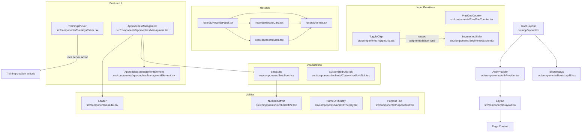

**Diagram sources**
- [layout.tsx:17-30](file://src/app/layout.tsx#L17-L30)
- [AuthProvider.tsx:9-11](file://src/components/AuthProvider.tsx#L9-L11)
- [Layout.tsx:12-94](file://src/components/Layout.tsx#L12-L94)
- [BootstrapJS.tsx:5-9](file://src/components/BootstrapJS.tsx#L5-L9)
- [Loader.tsx:1-3](file://src/components/Loader.tsx#L1-L3)
- [NumberDiffViz.tsx:9-39](file://src/components/NumberDiffViz.tsx#L9-L39)
- [NameOfTheDay.tsx:23-42](file://src/components/NameOfTheDay.tsx#L23-L42)
- [PurposeText.tsx:15-33](file://src/components/PurposeText.tsx#L15-L33)
- [SetsStats.tsx:39-185](file://src/components/SetsStats.tsx#L39-L185)
- [PlusOneCounter.tsx:17-77](file://src/components/PlusOneCounter.tsx#L17-L77)
- [SegmentedSlider.tsx:29-90](file://src/components/SegmentedSlider.tsx#L29-L90)
- [ToggleChip.tsx:24-88](file://src/components/ToggleChip.tsx#L24-L88)
- [CustomizedAxisTick.tsx:4-21](file://src/components/recharts/CustomizedAxisTick.tsx#L4-L21)
- [TrainingsPicker.tsx:21-112](file://src/components/TrainingsPicker.tsx#L21-L112)
- [Managment.tsx:40-178](file://src/components/approaches/Managment.tsx#L40-L178)
- [ManagmentElement.tsx:16-122](file://src/components/approaches/ManagmentElement.tsx#L16-L122)
- [RecordCard.tsx:27-109](file://src/components/records/RecordCard.tsx#L27-L109)
- [RecordMark.tsx:18-51](file://src/components/records/RecordMark.tsx#L18-L51)
- [RecordsPanel.tsx:15-70](file://src/components/records/RecordsPanel.tsx#L15-L70)
- [format.tsx:1-73](file://src/components/records/format.tsx#L1-L73)

**Section sources**
- [layout.tsx:1-30](file://src/app/layout.tsx#L1-L30)

## Core Components
- Layout: Client component that renders a responsive navbar, shows navigation links, displays version badge, and conditionally renders content based on NextAuth session state. It also provides a loading spinner while session initializes and prompts unauthenticated users to sign in.
- AuthProvider: Wraps the app with NextAuth's SessionProvider to expose session data via useSession throughout the client tree.
- BootstrapJS: Ensures Bootstrap JavaScript is loaded after mount for interactive Bootstrap features.
- Loader: Minimal placeholder used during async operations or when data is not yet available.
- TrainingsPicker: Calendar picker for selecting or scheduling trainings; integrates with Next.js navigation and server actions to create new training entries.
- NameOfTheDay and PurposeText: Small presentational components for localized day names and purpose labels with optional capitalization and brackets. **Updated**: `PurposeText` accepts `isDurationBased` and then renders "на длительность" instead of the purpose phrase.
- NumberDiffViz: Visualizes numeric differences between current and previous values with color coding and optional tooltips.
- SetsStats: Displays aggregated set statistics for approach groups or executed exercises, leveraging NumberDiffViz for trend indication. **Updated** with a duration branch.
- CustomizedAxisTick: Recharts axis tick renderer for rotated labels.
- Approaches Management: A form-driven UI to manage exercise sets (approaches), including adding/removing rows, persisting changes via server actions, and showing live stats. **Updated** for duration exercises.
- **New** PlusOneCounter: a minus/value/plus-one stepper with a floating "+1" animation, used for rep counting during execution.
- **New** SegmentedSlider: a generic radio-group slider with a moving thumb, per-option tone and an optional hint line; the execution feedback form drives it from `feedbackOptions.tsx`.
- **New** ToggleChip: a compact `role="switch"` icon chip with an optional spark burst when switched on.
- **New** Records family: `format.tsx` holds the pure formatting helpers, `RecordMark` is the inline badge, `RecordCard` the all-time record card and `RecordsPanel` the home-page block.

**Section sources**
- [Layout.tsx:12-94](file://src/components/Layout.tsx#L12-L94)
- [AuthProvider.tsx:9-11](file://src/components/AuthProvider.tsx#L9-L11)
- [BootstrapJS.tsx:5-9](file://src/components/BootstrapJS.tsx#L5-L9)
- [Loader.tsx:1-3](file://src/components/Loader.tsx#L1-L3)
- [TrainingsPicker.tsx:21-112](file://src/components/TrainingsPicker.tsx#L21-L112)
- [NameOfTheDay.tsx:23-42](file://src/components/NameOfTheDay.tsx#L23-L42)
- [PurposeText.tsx:15-33](file://src/components/PurposeText.tsx#L15-L33)
- [NumberDiffViz.tsx:9-39](file://src/components/NumberDiffViz.tsx#L9-L39)
- [SetsStats.tsx:39-185](file://src/components/SetsStats.tsx#L39-L185)
- [PlusOneCounter.tsx:17-77](file://src/components/PlusOneCounter.tsx#L17-L77)
- [SegmentedSlider.tsx:29-90](file://src/components/SegmentedSlider.tsx#L29-L90)
- [ToggleChip.tsx:24-88](file://src/components/ToggleChip.tsx#L24-L88)
- [CustomizedAxisTick.tsx:4-21](file://src/components/recharts/CustomizedAxisTick.tsx#L4-L21)
- [Managment.tsx:40-178](file://src/components/approaches/Managment.tsx#L40-L178)
- [ManagmentElement.tsx:16-122](file://src/components/approaches/ManagmentElement.tsx#L16-L122)
- [format.tsx:1-73](file://src/components/records/format.tsx#L1-L73)

## Architecture Overview
At runtime, the root layout composes the global providers and shell:
- AuthProvider wraps the entire app to enable session access.
- Layout renders the top-level navigation and guards content visibility based on session status.
- BootstrapJS loads Bootstrap scripts after hydration.

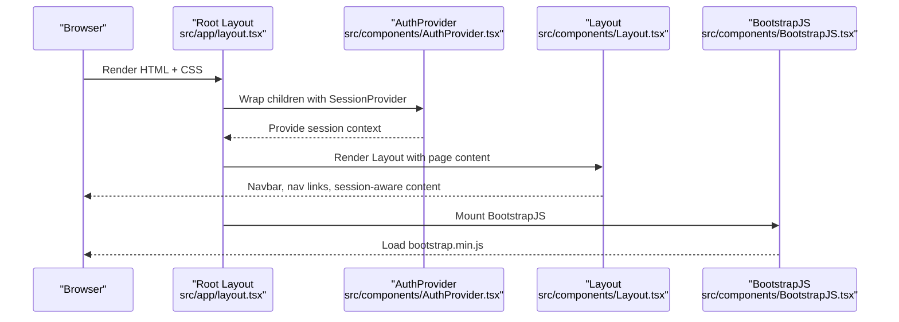

**Diagram sources**
- [layout.tsx:17-30](file://src/app/layout.tsx#L17-L30)
- [AuthProvider.tsx:9-11](file://src/components/AuthProvider.tsx#L9-L11)
- [Layout.tsx:12-94](file://src/components/Layout.tsx#L12-L94)
- [BootstrapJS.tsx:5-9](file://src/components/BootstrapJS.tsx#L5-L9)

## Detailed Component Analysis

### Layout
- Responsibilities:
  - Renders a responsive Bootstrap navbar with brand, version badge, and navigation links.
  - Uses NextAuth’s useSession to determine rendering:
    - Loading state shows a spinner.
    - Authenticated state renders children.
    - Unauthenticated state prompts sign-in.
- Props:
  - children: ReactNode rendered inside the container.
- Integration:
  - Consumed by the root layout to wrap all page content.

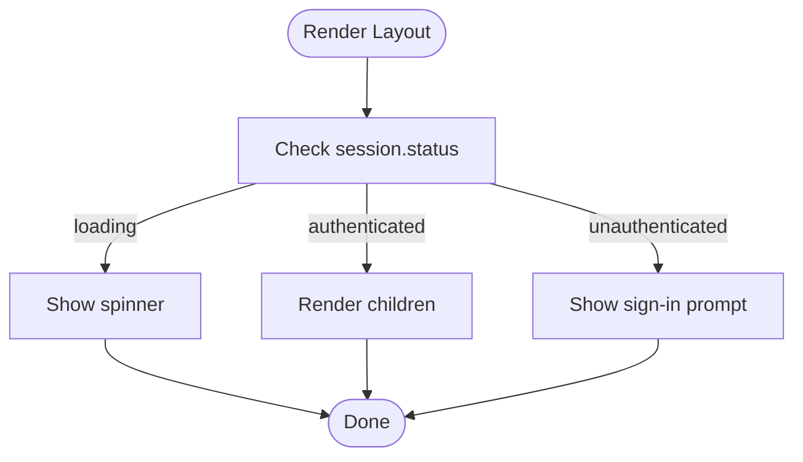

**Diagram sources**
- [Layout.tsx:11-80](file://src/components/Layout.tsx#L11-L80)

**Section sources**
- [Layout.tsx:11-80](file://src/components/Layout.tsx#L11-L80)

### AuthProvider
- Responsibilities:
  - Provides NextAuth session context to the client tree via SessionProvider.
- Usage:
  - Wrapped around Layout in the root layout to make session data available globally.

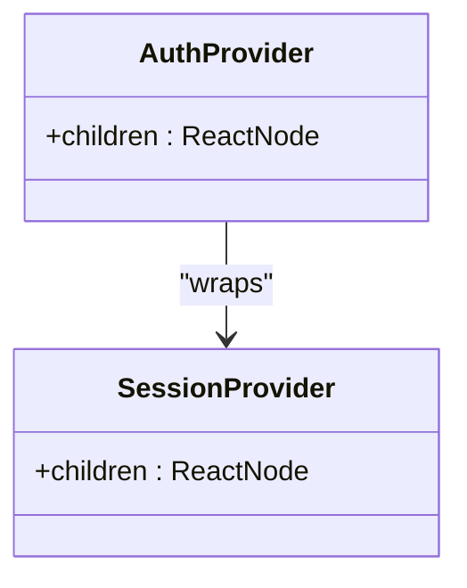

**Diagram sources**
- [AuthProvider.tsx:9-11](file://src/components/AuthProvider.tsx#L9-L11)

**Section sources**
- [AuthProvider.tsx:9-11](file://src/components/AuthProvider.tsx#L9-L11)

### BootstrapJS
- Responsibilities:
  - Loads Bootstrap JavaScript once after mount to enable interactive components (e.g., dropdowns, modals).
- Implementation note:
  - Uses useEffect to require the Bootstrap bundle at runtime.

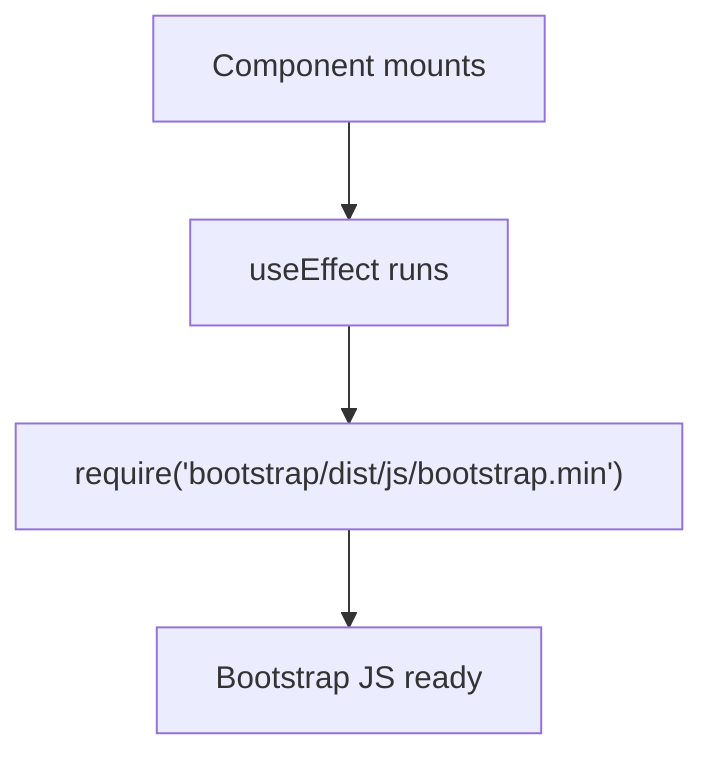

**Diagram sources**
- [BootstrapJS.tsx:5-9](file://src/components/BootstrapJS.tsx#L5-L9)

**Section sources**
- [BootstrapJS.tsx:5-9](file://src/components/BootstrapJS.tsx#L5-L9)

### Loader
- Responsibilities:
  - Simple visual indicator used while data is loading or unavailable.
- Usage:
  - Embedded within components like ApproachesManagement to show a minimal loading state.

**Section sources**
- [Loader.tsx:1-3](file://src/components/Loader.tsx#L1-L3)

### TrainingsPicker
- Responsibilities:
  - Renders a calendar view of trainings with modifiers for planned/completed states.
  - Allows navigating months via URL search params and creating new trainings on empty days.
- Key behaviors:
  - Derives current month from URL query parameters.
  - Builds modifier sets and a date-to-training map for quick lookups.
  - On click:
    - If a training exists, navigates to its detail page.
    - Otherwise, prompts confirmation and creates a new training via a server action.
  - Uses Next.js transitions to avoid blocking UI during navigation.
- Dependencies:
  - react-day-picker for calendar UI.
  - moment for date formatting.
  - Next.js navigation hooks and server actions for persistence.

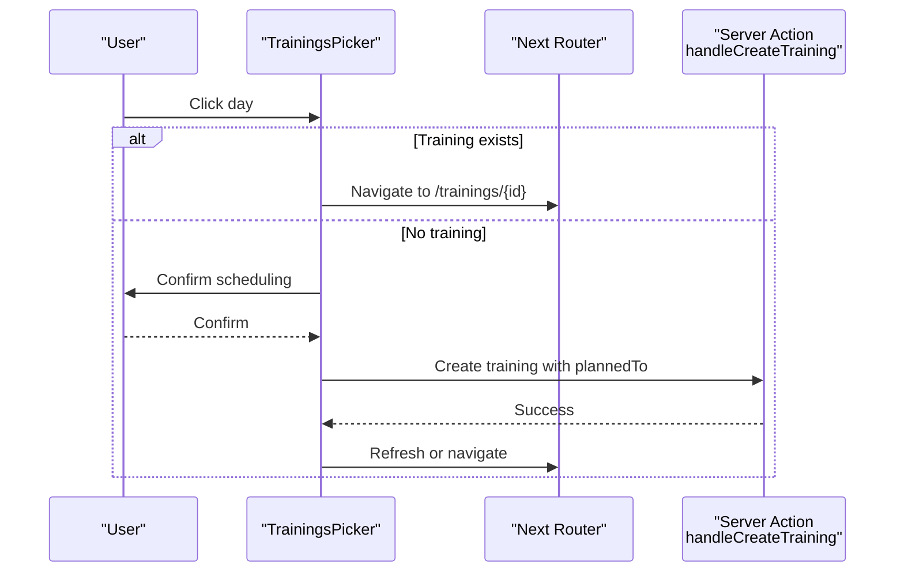

**Diagram sources**
- [TrainingsPicker.tsx:21-112](file://src/components/TrainingsPicker.tsx#L21-L112)

**Section sources**
- [TrainingsPicker.tsx:21-112](file://src/components/TrainingsPicker.tsx#L21-L112)

### NameOfTheDay
- Responsibilities:
  - Displays the day name in Russian with optional first-letter capitalization and brackets.
- Props:
  - date: Date object.
  - firstUp?: boolean to capitalize first letter.
  - brackets?: boolean to wrap text in parentheses.

**Section sources**
- [NameOfTheDay.tsx:23-42](file://src/components/NameOfTheDay.tsx#L23-L42)

### PurposeText
- Responsibilities:
  - Displays localized purpose text based on an enum value.
- Props:
  - purpose: CurrentPurpose enum.
  - firstUp?, brackets?: same styling options as NameOfTheDay.
  - **New** isDurationBased?: when true the component ignores the purpose map and renders "на длительность". Duration exercises are always stored with the LOSS purpose, so without this flag every duration exercise would be labelled "на похудение".

**Section sources**
- [PurposeText.tsx:4-33](file://src/components/PurposeText.tsx#L4-L33)

### NumberDiffViz
- Responsibilities:
  - Shows a number with optional comparison to a previous value.
  - Highlights improvements (green) or regressions (yellow) and optionally shows difference in tooltip.
- Props:
  - current: number.
  - prev?: number.
  - toFixed?: boolean to format decimals.
  - tooltip?: boolean to show diff in title attribute.

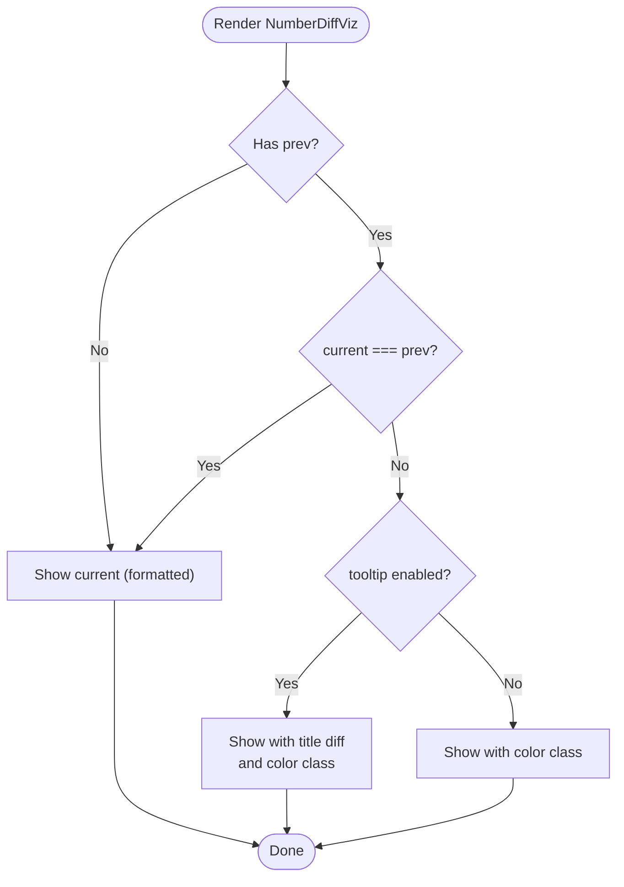

**Diagram sources**
- [NumberDiffViz.tsx:9-39](file://src/components/NumberDiffViz.tsx#L9-L39)

**Section sources**
- [NumberDiffViz.tsx:9-39](file://src/components/NumberDiffViz.tsx#L9-L39)

### SetsStats
- Responsibilities:
  - Presents aggregated statistics for sets (weight sum/mean/max, count sum/mean) with optional comparison to previous stats.
  - Provides specialized renderers for approach groups and executed exercises.
- Components:
  - SetsStatsBase: core list rendering using NumberDiffViz.
  - SetsStatsForApproachGroup: maps group metrics to base stats.
  - SetsStatsForExecutedExercise: compares current execution vs previous group stats.
- **Updated** Duration mode: all three accept `isDurationBased` and `durationParamLabel`. When `isDurationBased` is set, `SetsStatsBase` returns early with a different list — `Σ с` (total seconds from `countSum`), `÷ с` (mean seconds from `countMean`) and, only if the action has a `durationParamLabel`, `MAX <label>` and `÷ <label>` from `weightMax` / `weightMean`. Kilogram rows are not rendered at all, so the same aggregates are simply read with a different meaning.

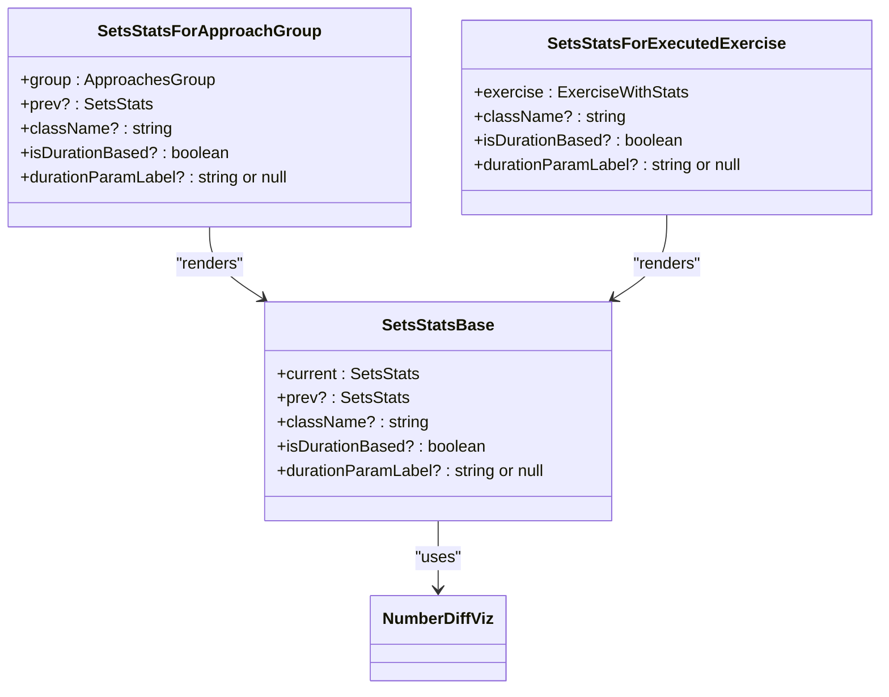

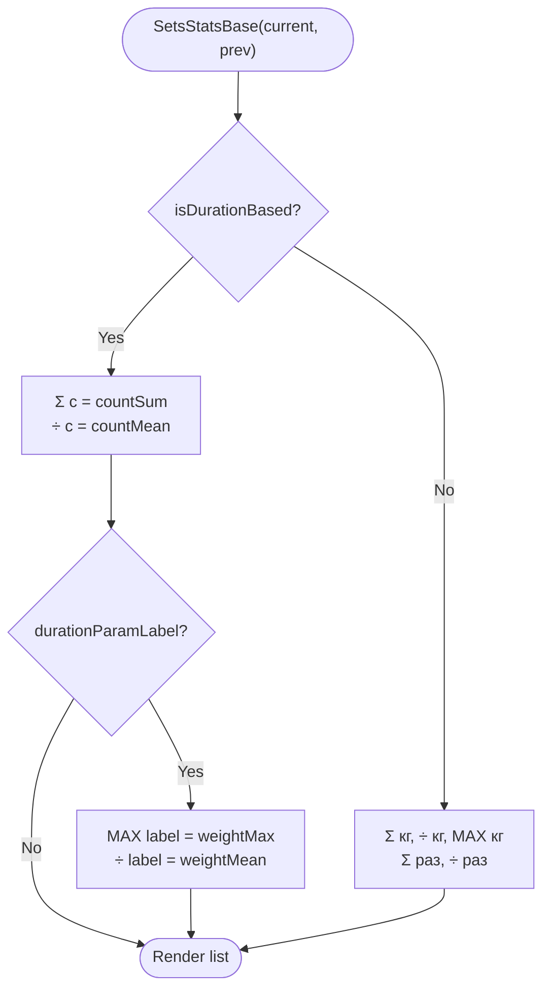

**Diagram sources**
- [SetsStats.tsx:39-127](file://src/components/SetsStats.tsx#L39-L127)
- [SetsStats.tsx:128-185](file://src/components/SetsStats.tsx#L128-L185)
- [NumberDiffViz.tsx:9-39](file://src/components/NumberDiffViz.tsx#L9-L39)

**Section sources**
- [SetsStats.tsx:7-185](file://src/components/SetsStats.tsx#L7-L185)

### CustomizedAxisTick
- Responsibilities:
  - Customizes Recharts axis ticks to rotate labels for better readability.
- Usage:
  - Passed as a custom tick renderer to chart axes.

**Section sources**
- [CustomizedAxisTick.tsx:4-21](file://src/components/recharts/CustomizedAxisTick.tsx#L4-L21)

### Approaches Management
- Responsibilities:
  - Manages a list of approach entries (count, weight, priority, isBoost).
  - Supports adding new entries with sensible defaults derived from the last entry.
  - Removes entries by priority.
  - Submits changes via server actions for create/update flows.
  - Displays aggregated stats using SetsStatsForApproachGroup.
- State and UX:
  - Local state mirrors approach data; updates trigger re-renders.
  - Error handling surfaces messages in an alert.
  - Loading state uses Loader.
- **Updated** Duration mode: `ApproachesManagement` accepts `isDurationBased`, `durationParamLabel` and `durationParamUnit` and forwards them to every row and to the stats block. The "add row" heuristic changes accordingly:
  - regular exercises: `count = max(last.count - 4, 1)`, `weight = last.weight + 5`;
  - duration exercises: the previous seconds and parameter are copied verbatim, and the very first row defaults to 30 seconds with parameter 0.
  `ApproachesManagementElement` swaps the whole input group: instead of "weight × reps" it renders "Длительность [n] с" and, when the action has a `durationParamLabel`, a second numeric input suffixed with `durationParamUnit`. Rows with `isBoost` stay disabled and show a ⚡ button instead of the delete control.

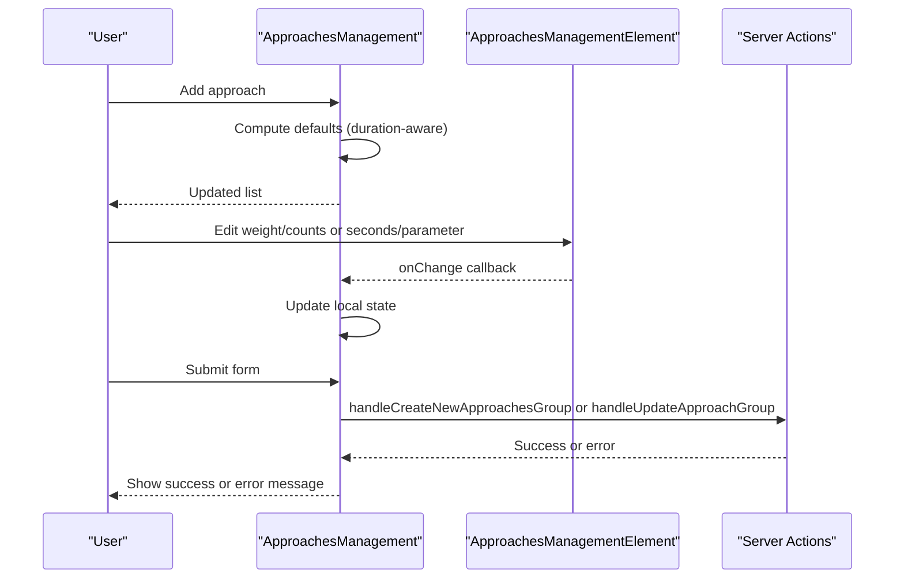

**Diagram sources**
- [Managment.tsx:40-178](file://src/components/approaches/Managment.tsx#L40-L178)
- [ManagmentElement.tsx:16-122](file://src/components/approaches/ManagmentElement.tsx#L16-L122)

**Section sources**
- [Managment.tsx:15-178](file://src/components/approaches/Managment.tsx#L15-L178)
- [ManagmentElement.tsx:8-122](file://src/components/approaches/ManagmentElement.tsx#L8-L122)

### Input Primitives (PlusOneCounter, SegmentedSlider, ToggleChip)
**New** in v3.2.0 to make the execution form usable with one hand on a phone. All three are controlled components: they own no value, only animation state.

- `PlusOneCounter({ value, onChange, min = 0, max = 8 })` — a minus button, the current value and a "+1" button. Each successful increment pushes a `{ id, variant }` entry into a local `pops` array; the floating "+1" elements remove themselves in `onAnimationEnd`. The `variant` cycles through four CSS classes so consecutive pops do not overlap. The value `` uses `key={value}` to force a remount and replay its animation, and `aria-live="polite"` for screen readers.
- `SegmentedSlider<T extends string>({ options, value, onChange, ariaLabel })` — a generic `role="radiogroup"` of `role="radio"` buttons with a single absolutely positioned `seg-slider-thumb` that slides to the selected index (driven by `data-selected` and the `seg-slider-{n}` count class). Each option may define `label`, `ariaLabel`, `hint`, `icon` and a `tone` (`success` / `warning` / `secondary`, exported as `SegmentedSliderTone`). If any option has a `hint`, a hint line is rendered under the slider and aligned left/center/right depending on the selected index. An unknown `value` falls back to index 0 via `Math.max(0, findIndex(...))`.
- `ToggleChip({ checked, onChange, icon, label?, ariaLabel?, tone = "secondary", celebrate = false })` — a `role="switch"` button. Without `label` it becomes icon-only and exposes `ariaLabel` through `title`. When `celebrate` is on and the chip is switched **on**, it emits `SPARKS_PER_BURST = 6` spark elements that clean themselves up in `onAnimationEnd`; switching off never celebrates.

The execution feedback form does not define its own option lists: `src/app/trainings/[id]/execute/components/feedbackOptions.tsx` exports `ratingSliderOptions`, `techniqueSliderOptions`, `refusingSliderOptions` and `cheatingSliderOptions` as `SegmentedSliderOption<...>[]`, mapping the Prisma enums to labels, tones and hints. The technique slider is the interesting case: it collapses two enums (`ExecutionTechnique` and a "technique improved" flag) into a single three-state `TechniqueSliderValue = "WORSE" | "OK" | "BETTER"`.

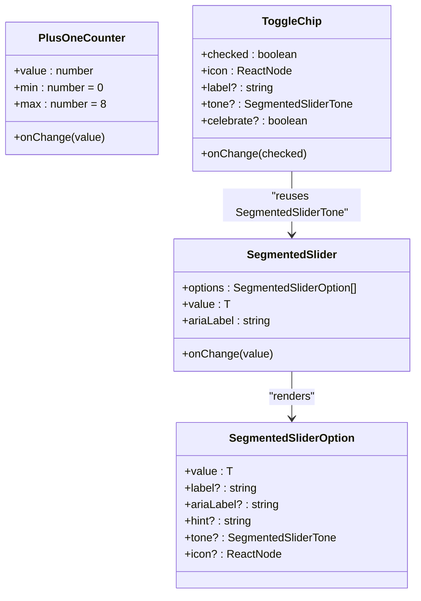

**Diagram sources**
- [PlusOneCounter.tsx:9-77](file://src/components/PlusOneCounter.tsx#L9-L77)
- [SegmentedSlider.tsx:7-90](file://src/components/SegmentedSlider.tsx#L7-L90)
- [ToggleChip.tsx:7-88](file://src/components/ToggleChip.tsx#L7-L88)

**Section sources**
- [PlusOneCounter.tsx:1-77](file://src/components/PlusOneCounter.tsx#L1-L77)
- [SegmentedSlider.tsx:1-90](file://src/components/SegmentedSlider.tsx#L1-L90)
- [ToggleChip.tsx:1-88](file://src/components/ToggleChip.tsx#L1-L88)
- [feedbackOptions.tsx:1-107](file://src/app/trainings/[id]/execute/components/feedbackOptions.tsx#L1-L107)

### Records Components
**New** `src/components/records/` renders personal records in three contexts: the home page panel, the exercise card and the `/records` page.

- `format.tsx` — pure, server-safe helpers with no React state:
  - `isShownRecord(record)` — `isAllTime` records are always shown; period records only when `previousValue !== null`, i.e. the very first result in a period is a baseline, not a record.
  - `recordTypeTitle(type, isDurationBased)` — `"MAX"` for `MAX_WEIGHT` and `"Σ"` for `MAX_VOLUME`; duration-based actions always produce `"Σ"` because only total time is tracked for them.
  - `purposeShortTitle(purpose)` — "сила" / "масса" / "похудение".
  - `recordIcon(type)` — a trophy for `MAX_WEIGHT`, a weight plate for `MAX_VOLUME`.
  - `formatNumber(value)` — rounds to two decimals and inserts thin-space thousand separators.
  - `formatRecordValue(record, isDurationBased)` — `"100 кг × 5"` for a weight record with reps, `"2 450 кг"` for volume and `"300 с"` for a duration record.
  - `formatRecordDelta(record, isDurationBased)` — `+N кг` or `+N с` against `previousValue` (0 when absent).
- `RecordMark` — the inline badge; `withIcon`, `withTitle` and `iconFirst` control which parts render and in which order, and it builds a full Russian `title` tooltip distinguishing an all-time record from a period best.
- `RecordCard` — a client component card for an all-time record linking to the training; clicking it replays a bounce animation, restarted with `requestAnimationFrame` and cleared by an 800 ms timeout that is also cleared on unmount.
- `RecordsPanel` — the home-page block. It filters with `isShownRecord`, returns `null` when nothing is left, then splits into all-time cards and a single calm "Лучшие результаты за период" list, with a link to `/records`.

The `RecordWithAction` type exported from `RecordCard.tsx` (`PersonalRecord & { Action: Pick<Action, "id" | "title" | "alias" | "isDurationBased"> }`) is the contract every page must satisfy — this is why the pages select `isDurationBased` on the nested `Action`.

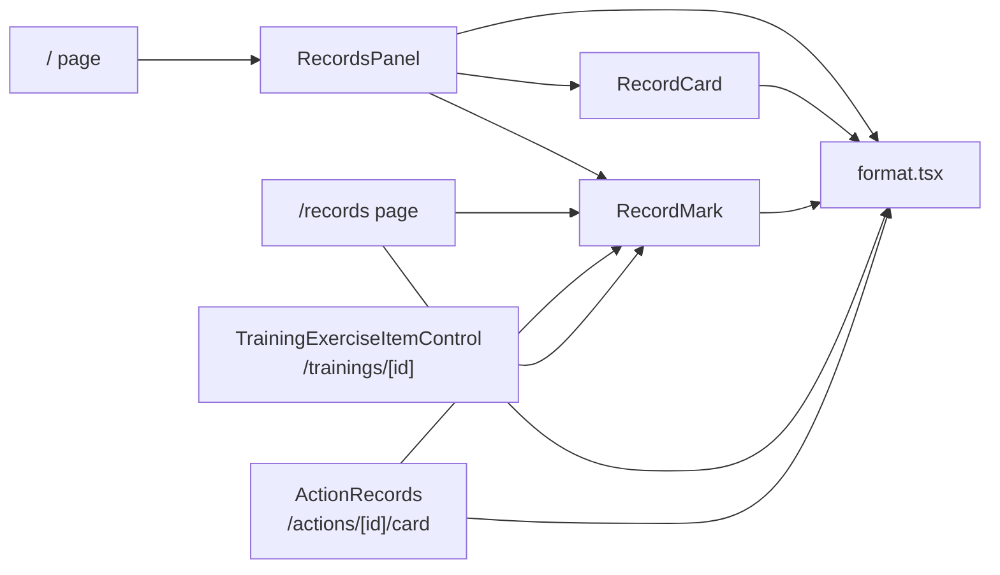

**Diagram sources**
- [format.tsx:12-73](file://src/components/records/format.tsx#L12-L73)
- [RecordMark.tsx:18-51](file://src/components/records/RecordMark.tsx#L18-L51)
- [RecordCard.tsx:17-109](file://src/components/records/RecordCard.tsx#L17-L109)
- [RecordsPanel.tsx:15-70](file://src/components/records/RecordsPanel.tsx#L15-L70)
- [ActionRecords.tsx:1-101](file://src/app/actions/components/ActionRecords.tsx#L1-L101)
- [records_page.tsx:99-330](file://src/app/records/page.tsx#L99-L330)

**Section sources**
- [format.tsx:1-73](file://src/components/records/format.tsx#L1-L73)
- [RecordMark.tsx:1-51](file://src/components/records/RecordMark.tsx#L1-L51)
- [RecordCard.tsx:1-109](file://src/components/records/RecordCard.tsx#L1-L109)
- [RecordsPanel.tsx:1-70](file://src/components/records/RecordsPanel.tsx#L1-L70)
- [records_page.tsx:99-330](file://src/app/records/page.tsx#L99-L330)

## Dependency Analysis
- Global composition:
  - The root layout composes `AuthProvider` and `Layout`, so the NextAuth session context and the navigation shell are available on every page.
  - `Layout` is the only shared component that reads the session (`useSession`) and it gates its children: `/login` and `/register` render unconditionally, every other route renders only when `session.status === "authenticated"`, and an unauthenticated visitor sees links to sign in or register instead of the page body. While the session resolves a Bootstrap spinner is shown — except on the auth pages, which must stay reachable.
- Client-side dependencies:
  - `next-auth/react` for session context (`AuthProvider`, `Layout`).
  - `react-day-picker` and `moment` for calendar interaction and date formatting (`TrainingsPicker`, `RecordCard`, `RecordsPanel`).
  - Bootstrap CSS for styling; Bootstrap JS is loaded lazily after mount by `BootstrapJS`.
  - `recharts` for charts (via `CustomizedAxisTick`).
  - `classnames` for conditional class composition in the newer components (`RecordMark`, `RecordCard`, `PlusOneCounter`, `SegmentedSlider`, `ToggleChip`).
  - `react-icons` for the trophy and weight glyphs used by records.
  - Prisma **types only** — `records/format.tsx` imports `PersonalRecordType` plus the `PersonalRecord` and `Purpose` types. Records arrive already fetched from the server component, so nothing under `src/components/` performs data access.
- Cross-component usage:
  - `SetsStats` depends on `NumberDiffViz` for consistent diff visualization.
  - `ApproachesManagement` depends on `Loader` and `SetsStatsForApproachGroup`, and renders one `ApproachesManagementElement` per approach.
  - `TrainingsPicker` depends on Next.js navigation and server actions.
  - **New** `ToggleChip` imports only the `SegmentedSliderTone` **type** from `SegmentedSlider`. It renders no slider markup, so the coupling is compile-time only and the two can evolve independently.
  - **New** `records/format.tsx` is the single shared leaf of the records family: `RecordMark`, `RecordCard` and `RecordsPanel` all route through `isShownRecord`, `recordTypeTitle`, `recordIcon`, `formatRecordValue` and `formatRecordDelta`. The `/records` page imports `RecordMark` directly and reuses only the `RecordWithAction` type from `RecordCard`.
  - **New** The three input primitives have exactly one runtime consumer, `TrainingExecuteFormItem.tsx` in the training execution flow, plus `feedbackOptions.tsx`, which imports only the `SegmentedSliderOption` type and exports four ready-made option arrays (rating, technique, refusing, cheating).
  - **New** Outside `src/components/` the records family is consumed by `ActionRecords.tsx` (exercise card), `records/page.tsx`, `TrainingExerciseItemControl.tsx` (training editor) and the dashboard `page.tsx`, which renders `RecordsPanel`. `TrainingExerciseItemControl.tsx` also reuses `NumberDiffViz`, making it the second consumer of that helper after `SetsStats`.

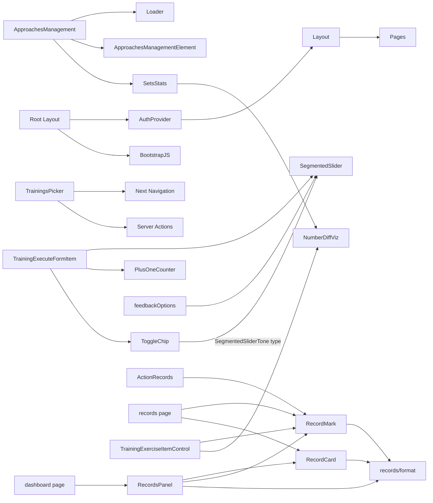

**Diagram sources**
- [layout.tsx:1-30](file://src/app/layout.tsx#L1-L30)
- [Layout.tsx:12-94](file://src/components/Layout.tsx#L12-L94)
- [AuthProvider.tsx:9-11](file://src/components/AuthProvider.tsx#L9-L11)
- [BootstrapJS.tsx:5-9](file://src/components/BootstrapJS.tsx#L5-L9)
- [Managment.tsx:40-178](file://src/components/approaches/Managment.tsx#L40-L178)
- [ManagmentElement.tsx:16-122](file://src/components/approaches/ManagmentElement.tsx#L16-L122)
- [SetsStats.tsx:39-185](file://src/components/SetsStats.tsx#L39-L185)
- [NumberDiffViz.tsx:9-39](file://src/components/NumberDiffViz.tsx#L9-L39)
- [TrainingsPicker.tsx:21-112](file://src/components/TrainingsPicker.tsx#L21-L112)
- [PlusOneCounter.tsx:17-77](file://src/components/PlusOneCounter.tsx#L17-L77)
- [SegmentedSlider.tsx:29-90](file://src/components/SegmentedSlider.tsx#L29-L90)
- [ToggleChip.tsx:24-88](file://src/components/ToggleChip.tsx#L24-L88)
- [TrainingExecuteFormItem.tsx:17-19](file://src/app/trainings/[id]/execute/components/TrainingExecuteFormItem.tsx#L17-L19)
- [feedbackOptions.tsx:9-107](file://src/app/trainings/[id]/execute/components/feedbackOptions.tsx#L9-L107)
- [format.tsx:1-73](file://src/components/records/format.tsx#L1-L73)
- [RecordMark.tsx:1-51](file://src/components/records/RecordMark.tsx#L1-L51)
- [RecordCard.tsx:1-109](file://src/components/records/RecordCard.tsx#L1-L109)
- [RecordsPanel.tsx:1-70](file://src/components/records/RecordsPanel.tsx#L1-L70)
- [ActionRecords.tsx:5-101](file://src/app/actions/components/ActionRecords.tsx#L5-L101)
- [records_page.tsx:10-330](file://src/app/records/page.tsx#L10-L330)
- [TrainingExerciseItemControl.tsx:21-288](file://src/app/trainings/components/TrainingExerciseItemControl.tsx#L21-L288)
- [page.tsx:10-124](file://src/app/page.tsx#L10-L124)

**Section sources**
- [layout.tsx:1-30](file://src/app/layout.tsx#L1-L30)
- [Layout.tsx:12-94](file://src/components/Layout.tsx#L12-L94)

## Performance Considerations
- Minimize re-renders:
  - Use `useMemo` for expensive computations (for example `TrainingsPicker`'s `modifiersMap` and `dataMap`, which would otherwise be rebuilt on every calendar interaction).
  - Keep state updates granular in `ApproachesManagement`, which edits its `approaches` array through immutable copies instead of re-fetching from the server.
- Avoid blocking UI:
  - `TrainingsPicker` uses Next.js transitions so month navigation does not block input.
  - The input primitives never call the server directly — they only lift the new value through `onChange`, so a tap costs a single parent re-render.
- Lazy-load third-party scripts:
  - `BootstrapJS` imports the Bootstrap bundle only after mount to keep it out of the critical render path.
- Animation cost:
  - `PlusOneCounter` removes its floating "+1" pops in `onAnimationEnd` instead of with a timer, so no detached nodes accumulate and no timeout survives unmount.
  - `ToggleChip` renders sparks only when the chip switches **on** and `celebrate` is set; switching off produces no extra DOM.
  - `RecordCard` is the one component that still uses a timer — an 800 ms `setTimeout` restarts the trophy bounce. The timeout is cleared in an unmount effect, so navigating away cannot leak it.
  - `SegmentedSlider` moves a single absolutely-positioned thumb with a CSS `transform` driven by `data-selected`; the option elements themselves are never re-laid-out.
- Efficient comparisons:
  - `NumberDiffViz` avoids heavy computation and relies on simple conditional logic.
  - `records/format.tsx` is pure and allocation-light, which matters because `RecordsPanel` and the `/records` page call it once per record in a list.
- Server/client split:
  - `RecordsPanel` and `RecordMark` are server components; only `RecordCard` is a client component, because it owns the bounce interaction. Keeping the list on the server avoids shipping every record into the browser bundle.
- Chart rendering:
  - `CustomizedAxisTick` rotates labels without extra DOM overhead.

[No sources needed since this section provides general guidance]

## Troubleshooting Guide
- Session-related issues:
  - If `Layout` does not render children on a protected route, verify that the session resolves to `authenticated`. `Layout` intentionally renders children for `/login` and `/register` regardless of the session state, so a blank page on any other path is almost always an unauthenticated session rather than a rendering bug.
  - Ensure `AuthProvider` wraps `Layout` in the root layout; `useSession` cannot resolve without the provider.
  - A permanently visible spinner means the session request never settles — inspect the NextAuth credentials configuration, not `Layout`.
- Bootstrap interactivity not working:
  - Confirm `BootstrapJS` mounts after hydration and that Bootstrap CSS is imported in the root layout.
- TrainingsPicker navigation errors:
  - When clicking a day without a training, confirm the server action is reachable and returns successfully.
  - Verify URL search-param parsing for month and year.
- ApproachesManagement submission errors:
  - Inspect the error state and ensure server actions return proper messages.
  - Validate that the approach data structure matches the expected types.
  - **New** When the "add approach" button produces a row that looks wrong, check `isDurationBased`: duration exercises copy the previous `count` (seconds) and `weight` (difficulty parameter) verbatim, while regular exercises apply the "weight +5, reps −4" heuristic with a floor of one rep. Passing the flag incorrectly yields implausible numbers rather than an error.
- **New** `SegmentedSlider` thumb is mis-sized, missing or on the wrong segment:
  - `globals.css` defines thumb widths only for `.seg-slider-2`, `.seg-slider-3` and `.seg-slider-4`, and only `data-selected="0"` through `"3"` have a `translateX` rule. A slider with five or more options renders without a correctly sized thumb — add the matching CSS before increasing the number of options.
  - An unrecognized `value` silently falls back to the first option, because the selected index is `Math.max(0, options.findIndex(...))`. If the thumb sits on the wrong segment, check that the stored value really is one of the option values (an empty string coming from the form is a common cause).
  - The tone class is `seg-tone-${selected.tone ?? "primary"}`, but `globals.css` only styles `success`, `warning` and `secondary`. The default `primary` therefore inherits the neutral thumb colors — this is expected, not a missing style.
  - Hint alignment is derived from the selected index (`left` for the first option, `right` for the last, `center` otherwise); a hint clipped at the edge of the card usually means the option order changed.
- **New** `PlusOneCounter` stops incrementing:
  - The counter is clamped to `min = 0` and `max = 8` by default and both buttons disable at the bounds. This is intentional, not a stuck state.
  - The float animation is keyed by `value`, so it replays only when the value actually changes. If the animation appears to stop, the parent is probably not applying the `onChange` value.
- **New** `ToggleChip` does not celebrate:
  - Sparks are emitted only when the new state is `true` **and** `celebrate` is set; toggling off is deliberately silent.
  - The chip renders with `role="switch"` and uses `label ?? ariaLabel` as its accessible name, so an icon-only chip without `ariaLabel` is announced as an unnamed switch.
- **New** Records are missing or look wrong:
  - `isShownRecord` hides a period record whose `previousValue` is `null`, because the first result in a period is a baseline rather than an improvement. If a period record seems to have vanished from `RecordsPanel`, this filter is the cause.
  - `RecordCard` prints "Первое выполнение …" instead of a delta when `previousAt` is null. Do not call `formatRecordDelta` on its own: it falls back to `previousValue ?? 0` and would render the whole value as an improvement.
  - Duration exercises must be passed `isDurationBased`; without it `formatRecordValue` renders seconds as kilograms and `recordTypeTitle` renders `MAX` for a record type that duration actions never produce. The flag lives on `Action`, so the query must select `Action.isDurationBased` alongside the record.
  - The `/records` history tab requires `previousValue` to be non-null, and the current tab requires `isAllTime` with `distinct` on action, purpose and type. A record missing from one of the tabs is usually excluded by one of these conditions rather than absent from the database.

**Section sources**
- [Layout.tsx:12-94](file://src/components/Layout.tsx#L12-L94)
- [AuthProvider.tsx:9-11](file://src/components/AuthProvider.tsx#L9-L11)
- [BootstrapJS.tsx:5-9](file://src/components/BootstrapJS.tsx#L5-L9)
- [TrainingsPicker.tsx:21-112](file://src/components/TrainingsPicker.tsx#L21-L112)
- [Managment.tsx:40-178](file://src/components/approaches/Managment.tsx#L40-L178)
- [SegmentedSlider.tsx:29-90](file://src/components/SegmentedSlider.tsx#L29-L90)
- [PlusOneCounter.tsx:17-77](file://src/components/PlusOneCounter.tsx#L17-L77)
- [ToggleChip.tsx:24-88](file://src/components/ToggleChip.tsx#L24-L88)
- [globals.css:166-431](file://src/app/globals.css#L166-L431)
- [format.tsx:1-73](file://src/components/records/format.tsx#L1-L73)
- [RecordCard.tsx:27-109](file://src/components/records/RecordCard.tsx#L27-L109)
- [RecordsPanel.tsx:15-70](file://src/components/records/RecordsPanel.tsx#L15-L70)
- [records_page.tsx:99-330](file://src/app/records/page.tsx#L99-L330)

## Conclusion
The shared components under `src/components/` provide a cohesive foundation for the application's UI:
- Authentication and layout are consistently applied through `AuthProvider` and `Layout`, which also centralize the "must be signed in" gate for every non-auth route.
- Bootstrap integration ensures consistent styling and interactivity, while all component-specific visuals live in `globals.css` rather than in inline styles.
- Utilities like `NumberDiffViz`, `NameOfTheDay` and `PurposeText` offer reusable presentation logic.
- Features such as `TrainingsPicker` and `ApproachesManagement` encapsulate complex interactions while remaining modular and testable.
- **New** The input primitives (`PlusOneCounter`, `SegmentedSlider`, `ToggleChip`) give the training execution form a touch-first vocabulary that is generic enough to be reused: they know nothing about executions and are configured entirely through typed option arrays such as those exported by `feedbackOptions.tsx`.
- **New** The records family follows a clean layering — pure formatting helpers in `records/format.tsx`, a presentational `RecordMark` for inline badges, a client `RecordCard` for the interactive all-time card, and a server `RecordsPanel` that composes them. Every consumer, from the dashboard to the exercise card, renders records identically because they all pass the same `isDurationBased` flag.
- **Updated** Duration-based exercises are now a cross-cutting concern in the UI layer: `PurposeText`, `SetsStats` and `ApproachesManagement` all branch on `isDurationBased`, and any new component that displays weights or repetitions must do the same.
Adopting these components promotes consistency, reduces duplication, and simplifies maintenance across the application.