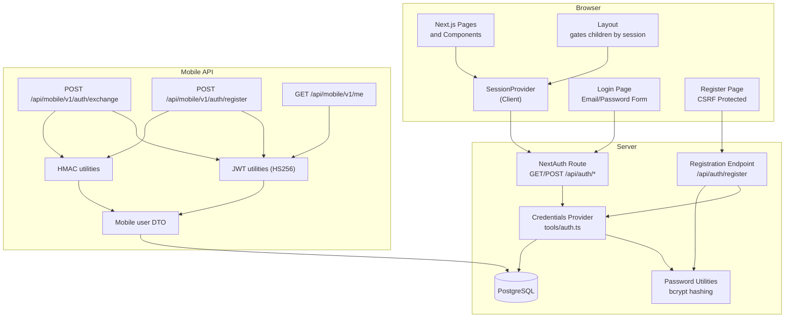
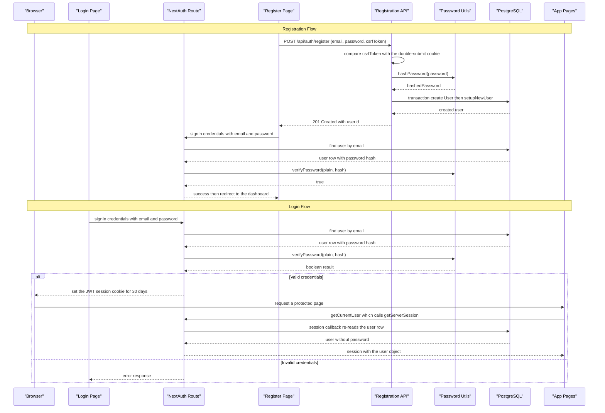
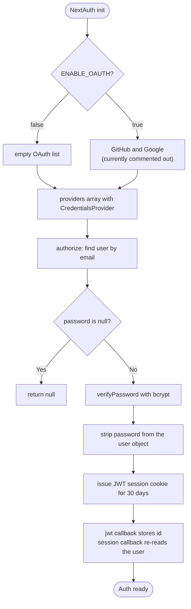
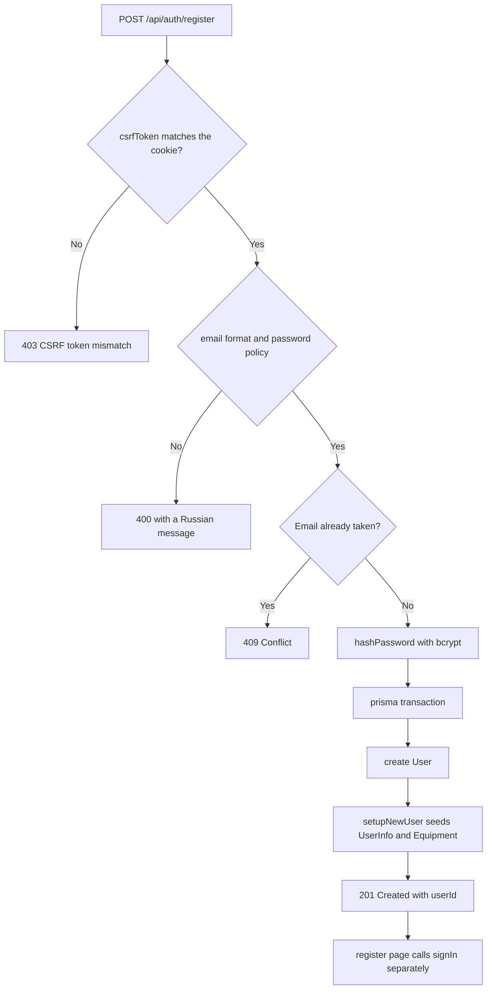
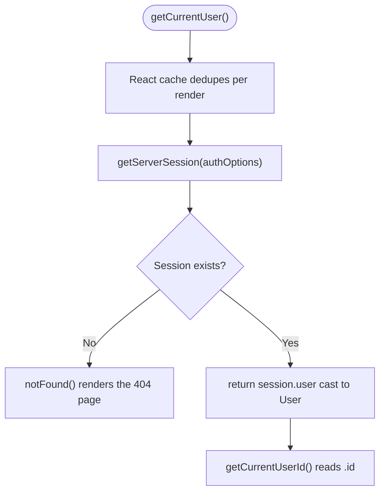
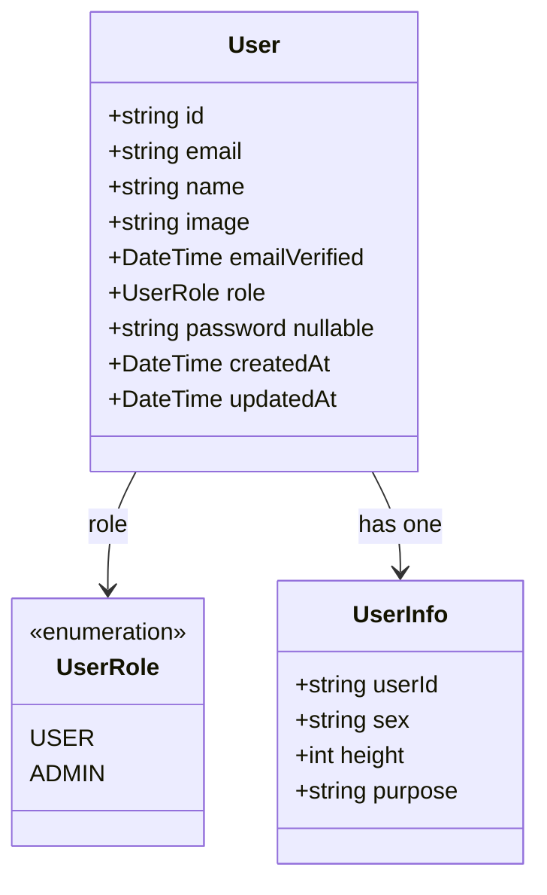
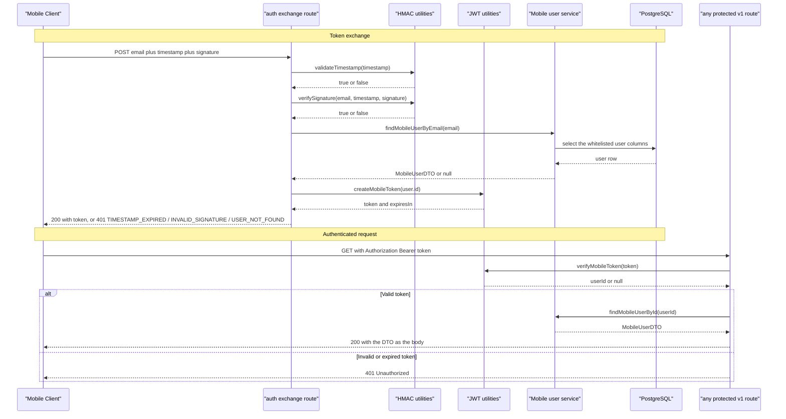
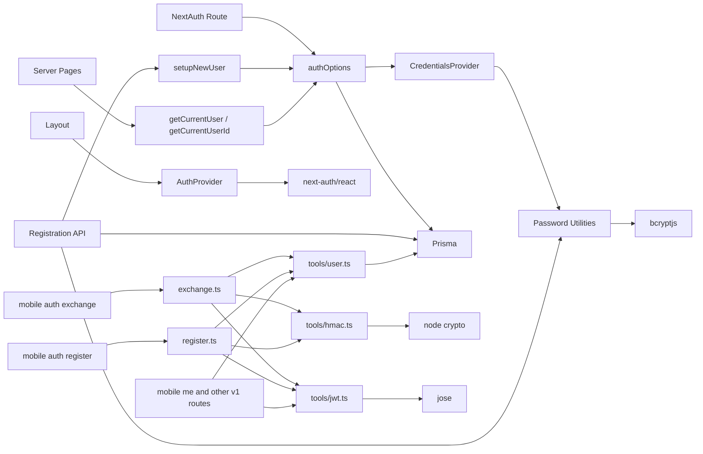

# Authentication and Authorization

<cite>
**Referenced Files in This Document**
- [route.ts (NextAuth)](file://src/app/api/auth/[...nextauth]/route.ts)
- [auth.ts](file://src/tools/auth.ts)
- [password.ts](file://src/tools/password.ts)
- [AuthProvider.tsx](file://src/components/AuthProvider.tsx)
- [Layout.tsx](file://src/components/Layout.tsx)
- [schema.prisma](file://prisma/schema.prisma)
- [login_page.tsx](file://src/app/login/page.tsx)
- [register_page.tsx](file://src/app/register/page.tsx)
- [route.ts (web register)](file://src/app/api/auth/register/route.ts)
- [route.ts (mobile exchange)](file://src/app/api/mobile/v1/auth/exchange/route.ts)
- [route.ts (mobile register)](file://src/app/api/mobile/v1/auth/register/route.ts)
- [route.ts (mobile me)](file://src/app/api/mobile/v1/me/route.ts)
- [route.ts (mobile records)](file://src/app/api/mobile/v1/records/route.ts)
- [exchange.ts](file://src/mobile/exchange.ts)
- [register.ts](file://src/mobile/register.ts)
- [hmac.ts](file://src/mobile/tools/hmac.ts)
- [jwt.ts](file://src/mobile/tools/jwt.ts)
- [user.ts](file://src/mobile/tools/user.ts)
- [actions_page.tsx](file://src/app/actions/[id]/page.tsx)
</cite>

## Update Summary
**Changes Made**
- Documented that OAuth is **disabled at runtime**: `ENABLE_OAUTH = false` in `src/tools/auth.ts` gates the GitHub/Google/VK providers, which are commented out and must not be deleted (the switch back is planned).
- Documented that the **Prisma adapter is commented out** and sessions use the **JWT strategy** with a 30-day `maxAge`; the `Account`, `Session` and `VerificationToken` models remain in `schema.prisma` but are never written to.
- Corrected the registration and login sequence diagrams (no adapter participant) and the `getCurrentUser` flow (it calls `notFound()`, not `redirect("/404")`).
- Expanded the mobile section: the HMAC-SHA256 timestamp exchange (`POST /api/mobile/v1/auth/exchange`), the app-token-protected mobile registration (`POST /api/mobile/v1/auth/register`) and the per-route Bearer verification repeated by every `/api/mobile/v1/*` handler.
- Noted that the two credentials helpers `setupNewUser` (web) and `createMobileUser` (mobile) seed the same default gym equipment independently.

## Table of Contents
1. [Introduction](#introduction)
2. [Project Structure](#project-structure)
3. [Core Components](#core-components)
4. [Architecture Overview](#architecture-overview)
5. [Detailed Component Analysis](#detailed-component-analysis)
6. [Dependency Analysis](#dependency-analysis)
7. [Performance Considerations](#performance-considerations)
8. [Troubleshooting Guide](#troubleshooting-guide)
9. [Conclusion](#conclusion)

## Introduction
MeinGym has **two independent authentication systems** that share only the `User` table.

The web application uses NextAuth.js with a single **CredentialsProvider** (email + password). Sessions are **JWT-based** — there is no session table round-trip — and the Prisma adapter is commented out. Passwords are hashed with `bcryptjs` before storage. Role-based access control is enforced through the `UserRole` enum (`USER` / `ADMIN`), and page-level gating happens in server components via `getCurrentUser()`.

The mobile API under `/api/mobile/v1/*` does **not** use NextAuth at all. A client exchanges its `email` plus an HMAC-SHA256 signature of a fresh Unix timestamp for a short-lived HS256 JWT, then sends that JWT as a `Bearer` token on every subsequent request. There is no password on this path.

> **Important:** OAuth is present in `src/tools/auth.ts` only as commented-out code: the `GitHubProvider` and `GoogleProvider` imports and their entries in a provider list gated behind `const ENABLE_OAUTH = false`. `VkProvider` is a live import that is never used — there is no VK entry, commented or otherwise. The move to email/password is temporary; the commented-out code must be preserved, not deleted.

## Project Structure
Authentication-related code is organized into:
- NextAuth route handler at `src/app/api/auth/[...nextauth]/route.ts` (a 6-line re-export of `authOptions`)
- All web auth configuration in `src/tools/auth.ts`: provider list, session strategy, callbacks, `createUser` event and the `getCurrentUser` / `getCurrentUserId` / `findUserInfo` helpers
- Web registration endpoint at `src/app/api/auth/register/route.ts` plus `src/tools/password.ts`
- Client-side session provider in `src/components/AuthProvider.tsx`, consumed by `src/components/Layout.tsx`
- Login and registration pages with client-side form validation
- Prisma schema defining `User` (with `password` and `role`), `UserRole`, and the inert NextAuth tables `Account` / `Session` / `VerificationToken`
- Mobile auth: `src/mobile/tools/hmac.ts`, `src/mobile/tools/jwt.ts`, `src/mobile/tools/user.ts`, orchestrated by `src/mobile/exchange.ts` and `src/mobile/register.ts` and exposed through the `auth/exchange`, `auth/register` and `me` routes

**Diagram sources**
- [route.ts (NextAuth):1-6](file://src/app/api/auth/[...nextauth]/route.ts#L1-L6)
- [auth.ts:1-173](file://src/tools/auth.ts#L1-L173)
- [route.ts (web register):1-95](file://src/app/api/auth/register/route.ts#L1-L95)
- [password.ts:1-12](file://src/tools/password.ts#L1-L12)
- [login_page.tsx:1-87](file://src/app/login/page.tsx#L1-L87)
- [register_page.tsx:1-162](file://src/app/register/page.tsx#L1-L162)
- [Layout.tsx:12-94](file://src/components/Layout.tsx#L12-L94)
- [route.ts (mobile exchange):1-32](file://src/app/api/mobile/v1/auth/exchange/route.ts#L1-L32)
- [route.ts (mobile register):1-42](file://src/app/api/mobile/v1/auth/register/route.ts#L1-L42)
- [route.ts (mobile me):1-28](file://src/app/api/mobile/v1/me/route.ts#L1-L28)
- [hmac.ts:1-29](file://src/mobile/tools/hmac.ts#L1-L29)
- [jwt.ts:1-31](file://src/mobile/tools/jwt.ts#L1-L31)
- [user.ts:1-143](file://src/mobile/tools/user.ts#L1-L143)

**Section sources**
- [route.ts (NextAuth):1-6](file://src/app/api/auth/[...nextauth]/route.ts#L1-L6)
- [auth.ts:1-173](file://src/tools/auth.ts#L1-L173)
- [route.ts (web register):1-95](file://src/app/api/auth/register/route.ts#L1-L95)
- [password.ts:1-12](file://src/tools/password.ts#L1-L12)

## Core Components
- **NextAuth route handler**: Exposes `GET`/`POST` for all NextAuth flows by delegating to `NextAuth(authOptions)`.
- **Credentials provider**: Looks the user up by email, rejects accounts with a null `password` (OAuth-era users cannot sign in), verifies the hash with `bcryptjs`, and returns the user **with the password field stripped**.
- **`ENABLE_OAUTH` flag**: A module-level constant that spreads an empty array into `providers` while it is `false`. The commented-out GitHub/Google/VK providers live inside that branch.
- **JWT session strategy**: `session: { strategy: "jwt", maxAge: 30 * 24 * 60 * 60 }`. The `jwt` callback copies `user.id` into the token; the `session` callback re-reads the `User` row from the database and removes `password` before exposing it.
- **`createUser` event and `setupNewUser`**: On registration the event seeds a `UserInfo` row and a default "Тренажерный зал" `Equipment` with four rigs (barbell 10/5/200, blocks 5/1/200, dumbbell 5/2.5/50, kettlebell 6/2/30) and three requirements (bench, upbar, simulator).
- **Registration endpoint**: Validates the CSRF double-submit cookie, enforces the password policy, rejects duplicates with 409, and creates the user plus its seed data inside a single transaction.
- **Password utilities**: `hashPassword` / `verifyPassword` over `bcryptjs` with 10 salt rounds.
- **Session helpers**: `auth()` wraps `getServerSession`; `getCurrentUser()` is wrapped in React `cache()` and calls `notFound()` when there is no session; `getCurrentUserId()` returns just the id; `findUserInfo()` lazily creates the `UserInfo` row.
- **Client session provider**: `AuthProvider` wraps the tree in `SessionProvider`; `Layout` reads `useSession()` and hides page content from unauthenticated visitors.
- **Login/Register pages**: Client forms with validation and error handling; the login page performs a full `window.location.assign("/")` instead of `router.push` to avoid a stale router-cache redirect.
- **RBAC enforcement**: Server components compare `user.role` against `UserRole.ADMIN` — for example `/actions/[id]` redirects non-admins to the read-only `/actions/[id]/card`.
- **Mobile HMAC exchange**: `validateTimestamp` (±`MOBILE_TIMESTAMP_WINDOW_SECONDS`, default 300) and `verifySignature` (constant-time comparison of `HMAC_SHA256(email:timestamp)`).
- **Mobile JWT**: `createMobileToken` signs `{ sub: userId }` with HS256 and a `MOBILE_JWT_EXPIRES_IN_SECONDS` lifetime (default 3600); `verifyMobileToken` returns `{ userId }` or `null`.
- **Mobile user DTO**: `src/mobile/tools/user.ts` selects an explicit whitelist of columns — the password is deliberately excluded — and `createMobileUser` seeds the same default equipment as the web flow.

**Section sources**
- [route.ts (NextAuth):1-6](file://src/app/api/auth/[...nextauth]/route.ts#L1-L6)
- [auth.ts:25-173](file://src/tools/auth.ts#L25-L173)
- [route.ts (web register):1-95](file://src/app/api/auth/register/route.ts#L1-L95)
- [password.ts:1-12](file://src/tools/password.ts#L1-L12)
- [login_page.tsx:1-87](file://src/app/login/page.tsx#L1-L87)
- [register_page.tsx:1-162](file://src/app/register/page.tsx#L1-L162)
- [hmac.ts:1-29](file://src/mobile/tools/hmac.ts#L1-L29)
- [jwt.ts:1-31](file://src/mobile/tools/jwt.ts#L1-L31)
- [user.ts:1-143](file://src/mobile/tools/user.ts#L1-L143)

## Architecture Overview
The web side uses NextAuth with a credentials provider and JWT sessions; the mobile side uses its own HMAC-to-JWT exchange. Both are backed by the same PostgreSQL `User` table through Prisma. Passwords are hashed with bcrypt before storage and never leave the server: the credentials `authorize` callback strips the field, the `session` callback strips it again, and the mobile DTO whitelist does not select it at all.

**Diagram sources**
- [route.ts (NextAuth):1-6](file://src/app/api/auth/[...nextauth]/route.ts#L1-L6)
- [auth.ts:66-143](file://src/tools/auth.ts#L66-L143)
- [route.ts (web register):1-95](file://src/app/api/auth/register/route.ts#L1-L95)
- [password.ts:1-12](file://src/tools/password.ts#L1-L12)
- [login_page.tsx:1-87](file://src/app/login/page.tsx#L1-L87)
- [register_page.tsx:1-162](file://src/app/register/page.tsx#L1-L162)

## Detailed Component Analysis

### NextAuth Configuration with Credentials Provider
- **Credentials provider** (`authorize`): requires both `email` and `password`, loads the `User` by email, returns `null` when the user is missing **or when `user.password` is null**, verifies the hash with `verifyPassword`, and finally returns the user object with `password` destructured away.
- **Session strategy**: `strategy: "jwt"` with `maxAge: 30 * 24 * 60 * 60` (30 days). Because there is no adapter, no `Session` row is ever created — the session lives entirely in the signed cookie.
- **`jwt` callback**: on sign-in (`if (user)`) copies `user.id` into `token.sub` and the role into `token.role`, so both survive subsequent requests where `user` is undefined.
- **`session` callback**: when `token.sub` is set it re-reads the `User` row from the database, destructures `password` away and assigns the rest to `session.user`. This means role changes and profile edits are picked up on the next request without re-authentication, at the cost of one database query per session read. If the user has been deleted the callback silently leaves `session.user` as the JWT-derived default.
- **`createUser` event**: fires after a user is created and calls `setupNewUser(user.id)`, which seeds `UserInfo` and the default equipment. In the current flow the user is created by the registration endpoint (which calls `setupNewUser` itself inside its transaction), so the event acts as a safety net rather than the primary path.
- **`pages`**: `signIn` is remapped to `/login`.
- **OAuth providers**: the GitHub and Google imports are commented out, and the provider list is `...(ENABLE_OAUTH ? [ /* GitHubProvider, GoogleProvider */ ] : [])` with `ENABLE_OAUTH = false`. Flipping the constant alone is not enough — the provider bodies must be uncommented too, and re-enabling the Prisma adapter would also require uncommenting `adapter: PrismaAdapter(prisma)`. `VkProvider` is imported unconditionally but never referenced; it is dead weight in the module graph.

**Diagram sources**
- [auth.ts:25-143](file://src/tools/auth.ts#L25-L143)

**Section sources**
- [auth.ts:1-173](file://src/tools/auth.ts#L1-L173)
- [route.ts (NextAuth):1-6](file://src/app/api/auth/[...nextauth]/route.ts#L1-L6)

### Registration Endpoint with CSRF Protection
- **CSRF validation**: implements the double-submit cookie pattern manually. It reads the NextAuth CSRF cookie — trying `__Host-next-auth.csrf-token` first (secure/HTTPS) and falling back to `next-auth.csrf-token` (plain HTTP) — takes the part before the `|` separator and compares it with the `csrfToken` from the request body, returning 403 on mismatch.
- **Input validation**: `email` and `password` must be non-empty strings, the email must match `/^[^\s@]+@[^\s@]+\.[^\s@]+$/`, and the password must be at least 6 characters and contain both a letter (Latin **or** Cyrillic) and a digit. Every failure returns 400 with a Russian message.
- **Uniqueness**: an existing user with the same email yields 409 before any hashing work happens.
- **Password security**: `hashPassword` (bcryptjs, 10 rounds) is called only after all validation passes.
- **Transaction safety**: `prisma.$transaction` creates the `User` and then calls `setupNewUser(createdUser.id, tx)`, so a failure while seeding equipment rolls back the user as well.
- **Response**: `201` with `{ ok: true, userId }`. The endpoint does **not** sign the user in — the registration page performs a separate `signIn("credentials", …)` call afterwards.

**Diagram sources**
- [route.ts (web register):1-95](file://src/app/api/auth/register/route.ts#L1-L95)
- [password.ts:1-12](file://src/tools/password.ts#L1-L12)
- [auth.ts:27-62](file://src/tools/auth.ts#L27-L62)
- [register_page.tsx:47-90](file://src/app/register/page.tsx#L47-L90)

**Section sources**
- [route.ts (web register):1-95](file://src/app/api/auth/register/route.ts#L1-L95)
- [password.ts:1-12](file://src/tools/password.ts#L1-L12)
- [auth.ts:27-62](file://src/tools/auth.ts#L27-L62)

### Password Hashing Utilities
- **bcrypt integration**: `src/tools/password.ts` is a 12-line module wrapping `bcryptjs`.
- **`hashPassword(plain)`**: `bcrypt.hash(plain, 10)` — 10 salt rounds, a deliberate security/performance balance for an interactive login form.
- **`verifyPassword(plain, hash)`**: `bcrypt.compare(plain, hash)`, returning a boolean rather than throwing.
- **No error handling of its own**: both functions let `bcryptjs` exceptions propagate; the callers (the `authorize` callback and the registration route) wrap everything in try/catch and answer 500.

**Section sources**
- [password.ts:1-12](file://src/tools/password.ts#L1-L12)

### Session Management Utilities
- **`auth(...args)`**: a thin `getServerSession(...args, authOptions)` wrapper accepting the three Next.js context shapes (App Router, `getServerSideProps`, Pages API).
- **`getCurrentUser()`**: wrapped in React `cache()` so repeated calls within one server render share a single session lookup. When there is no session it calls **`notFound()`**, which renders the 404 page — it does not redirect to `/404`.
- **`getCurrentUserId()`**: `return (await getCurrentUser()).id`.
- **`findUserInfo(userId)`**: also `cache()`-wrapped; returns the existing `UserInfo` row or lazily creates one with defaults.
- **Type escape hatch**: `session.user` is cast to `User` with a `@ts-ignore`, because the NextAuth session type does not know about the Prisma `User` shape enriched by the `session` callback.

**Diagram sources**
- [auth.ts:145-173](file://src/tools/auth.ts#L145-L173)

**Section sources**
- [auth.ts:145-173](file://src/tools/auth.ts#L145-L173)

### Client-Side Session Provider and Layout Gating
- **`AuthProvider`**: an 11-line client component wrapping its children in NextAuth's `SessionProvider`; it is mounted once in the root layout.
- **`Layout` gating**: `Layout` is the single place that turns session state into UI. It renders children unconditionally on `/login` and `/register`, shows a spinner while `session.status === "loading"` (except on the auth pages), renders children only when `authenticated`, and otherwise shows a prompt with links to sign in or register. The navbar additionally links to `/profile` with the user's name when authenticated.
- **Consequence**: there is no `middleware.ts` in the repository, so protection of web pages is enforced per request by `getCurrentUser()` on the server and by `Layout` on the client — not by an edge redirect.

**Section sources**
- [AuthProvider.tsx:1-11](file://src/components/AuthProvider.tsx#L1-L11)
- [Layout.tsx:12-94](file://src/components/Layout.tsx#L12-L94)

### Login and Registration Pages
- **Login page**: a client form that fetches the CSRF token with `getCsrfToken()` on mount, calls `signIn("credentials", { redirect: false, csrfToken })`, and shows "Неверный email или пароль" for any error. On success it performs a **full page load** via `window.location.assign("/")` rather than `router.push`, because the Next.js router cache can replay the pre-login 404 redirect.
- **Registration page**: fetches the CSRF token from `/api/auth/csrf` with `credentials: "include"`, validates email format, password length (6+), a letter (Latin or Cyrillic), a digit and the password confirmation client-side, then POSTs to `/api/auth/register`.
- **Auto-login after registration**: on `201` the page immediately calls `signIn("credentials", …)`; if that fails it explains that registration succeeded but automatic sign-in did not, and pushes to `/login`.
- **Validation duplication**: the client-side rules in `register_page.tsx` mirror the server-side rules in the registration route. The server is authoritative — the client copy exists only for faster feedback.

**Section sources**
- [login_page.tsx:1-87](file://src/app/login/page.tsx#L1-L87)
- [register_page.tsx:1-162](file://src/app/register/page.tsx#L1-L162)

### Role-Based Access Control (RBAC)
- **Data model**: the `UserRole` enum defines `USER` and `ADMIN`; `User.role` defaults to `USER`. There is no `Permission` table and no role hierarchy — every check is a direct comparison against `UserRole.ADMIN`.
- **Where the role comes from**: the `session` callback re-reads the `User` row on every session access, so `user.role` in a server component is always the current database value; changing a role takes effect on the next request without re-login.
- **Enforcement patterns** (13 files reference `UserRole.ADMIN`):
  - **Hard redirect**: catalog editing pages send non-admins away — `/actions/[id]` redirects to the read-only `/actions/[id]/card`, while `/actions/create`, `/muscles/create` and `/musclesgroups/create` redirect to `/404`.
  - **UI gating**: `{user.role === UserRole.ADMIN && …}` hides `ActionTabs` and other admin controls on the read-only views.
  - **Prop passthrough**: forms receive `control={user.role === UserRole.ADMIN}`, so the same form component renders editable or read-only depending on the role.
- **No API-level RBAC**: server actions and API routes rely on `getCurrentUser()`/`getCurrentUserId()` for *ownership* filtering (`where: { userId }`), not for role checks. Role gating is a page-level concern.
- **Mobile API**: the mobile user DTO exposes `role` as a plain string, but no mobile endpoint branches on it.

**Diagram sources**
- [schema.prisma:14-47](file://prisma/schema.prisma#L14-L47)

**Section sources**
- [schema.prisma:14-47](file://prisma/schema.prisma#L14-L47)
- [actions_page.tsx:10-67](file://src/app/actions/[id]/page.tsx#L10-L67)
- [auth.ts:106-127](file://src/tools/auth.ts#L106-L127)

### Mobile API Authentication Flow (HMAC to JWT)
The mobile API has no passwords and no NextAuth. Trust is established once, out of band, through a shared HMAC secret baked into the app.

- **Token exchange** — `POST /api/mobile/v1/auth/exchange` with `{ email, timestamp, signature }`:
  1. the route validates that all three fields are present and correctly typed (400 otherwise);
  2. `exchangeForToken` normalizes the email (`trim().toLowerCase()`);
  3. `validateTimestamp` rejects requests whose timestamp differs from the server clock by more than `MOBILE_TIMESTAMP_WINDOW_SECONDS` (default 300) with `TIMESTAMP_EXPIRED`;
  4. `verifySignature` recomputes `HMAC_SHA256(MOBILE_HMAC_SECRET, "email:timestamp")` and compares it with `crypto.timingSafeEqual` after a length check — `INVALID_SIGNATURE` on mismatch;
  5. `findMobileUserByEmail` must find the user, otherwise `USER_NOT_FOUND`;
  6. `createMobileToken` signs `{ sub: userId }` with HS256 under `MOBILE_JWT_SECRET` and a `MOBILE_JWT_EXPIRES_IN_SECONDS` lifetime (default 3600), and the route answers `{ token, expiresIn }`.
  All three `MobileAuthError` codes map to HTTP 401; anything unexpected maps to 500.
- **Mobile registration** — `POST /api/mobile/v1/auth/register` performs the same HMAC verification but additionally requires the shared `MOBILE_APP_TOKEN`, accepted either as the `x-app-token` header or as an `appToken` body field (403 `INVALID_APP_TOKEN` when it is missing or wrong). An existing email yields 409 `USER_ALREADY_EXISTS`; otherwise `createMobileUser` creates the `User`, its `UserInfo` and the default equipment in one transaction and the route answers 201 with `{ token, expiresIn, userId }`.
- **Authenticated requests**: there is **no shared middleware or wrapper** — every `/api/mobile/v1/*` handler repeats the same three lines: read the `authorization` header, require the `Bearer ` prefix (401), slice it off and call `verifyMobileToken` (401 on `null`). `verifyMobileToken` never throws: it catches everything and returns `null`, restricting the algorithm to `HS256`.
- **`GET /api/mobile/v1/me`**: after verifying the token it calls `findMobileUserById`, answers 404 if the user has disappeared, and otherwise returns the DTO **directly as the response body** (not wrapped in a `user` key).
- **DTO safety**: `src/mobile/tools/user.ts` builds the response from an explicit `select` whitelist; `password` is not part of it, dates are serialized to ISO strings, and the nested `UserInfo` is limited to `take: 1`.

**Diagram sources**
- [route.ts (mobile exchange):1-32](file://src/app/api/mobile/v1/auth/exchange/route.ts#L1-L32)
- [route.ts (mobile register):1-42](file://src/app/api/mobile/v1/auth/register/route.ts#L1-L42)
- [route.ts (mobile me):1-28](file://src/app/api/mobile/v1/me/route.ts#L1-L28)
- [route.ts (mobile records):1-30](file://src/app/api/mobile/v1/records/route.ts#L1-L30)
- [exchange.ts:1-33](file://src/mobile/exchange.ts#L1-L33)
- [register.ts:1-31](file://src/mobile/register.ts#L1-L31)
- [hmac.ts:1-29](file://src/mobile/tools/hmac.ts#L1-L29)
- [jwt.ts:1-31](file://src/mobile/tools/jwt.ts#L1-L31)
- [user.ts:1-143](file://src/mobile/tools/user.ts#L1-L143)

**Section sources**
- [route.ts (mobile exchange):1-32](file://src/app/api/mobile/v1/auth/exchange/route.ts#L1-L32)
- [route.ts (mobile register):1-42](file://src/app/api/mobile/v1/auth/register/route.ts#L1-L42)
- [route.ts (mobile me):1-28](file://src/app/api/mobile/v1/me/route.ts#L1-L28)
- [exchange.ts:1-33](file://src/mobile/exchange.ts#L1-L33)
- [register.ts:1-31](file://src/mobile/register.ts#L1-L31)
- [hmac.ts:1-29](file://src/mobile/tools/hmac.ts#L1-L29)
- [jwt.ts:1-31](file://src/mobile/tools/jwt.ts#L1-L31)
- [user.ts:1-143](file://src/mobile/tools/user.ts#L1-L143)

### Inert NextAuth Tables
`prisma/schema.prisma` still declares `Account`, `Session` and `VerificationToken`, and `User` still has the `accounts` and `sessions` relations. Because `adapter: PrismaAdapter(prisma)` is commented out and the session strategy is JWT, **nothing writes to these tables at runtime**. They are kept so that re-enabling OAuth does not require a destructive migration. Do not model new features on them and do not assume a `Session` row exists for a logged-in user.

**Section sources**
- [schema.prisma:118-156](file://prisma/schema.prisma#L118-L156)
- [auth.ts:66-68](file://src/tools/auth.ts#L66-L68)

## Dependency Analysis
- **`src/tools/auth.ts`** is the hub of the web side: it imports `next-auth`, `next-auth/providers/credentials`, `next/navigation` (`notFound`), `@prisma/client`, the Prisma singleton from `src/tools/db.ts` and `verifyPassword` from `src/tools/password.ts`. The OAuth provider imports and `PrismaAdapter` are commented out, so `@next-auth/prisma-adapter` is not part of the runtime graph.
- **The registration route** depends on `hashPassword`, on `setupNewUser` from `src/tools/auth.ts` and on `next/headers` for the CSRF cookie — it is the only route that reaches into the auth module for a non-session helper.
- **Server pages** depend on `getCurrentUser()` / `getCurrentUserId()`; because both are React `cache()`-wrapped, a page and its nested server components pay for the session lookup only once per request.
- **`src/components/AuthProvider.tsx`** depends on `next-auth/react`; `src/components/Layout.tsx` depends on `AuthProvider` being mounted above it.
- **Mobile side** forms a small, self-contained graph: routes → `src/mobile/exchange.ts` / `src/mobile/register.ts` → `src/mobile/tools/{hmac,jwt,user}.ts` → `src/tools/db.ts`. It uses Node's built-in `crypto` for HMAC and `jose` for JWT, and shares **no code at all** with `src/tools/auth.ts`.
- **Shared surface**: the only thing the two systems share is the `User` table (and the `UserRole` enum). `src/mobile/tools/user.ts` duplicates the default-equipment seeding that `setupNewUser` performs, so a change to the starter gym must be made in both places.

**Diagram sources**
- [route.ts (NextAuth):1-6](file://src/app/api/auth/[...nextauth]/route.ts#L1-L6)
- [auth.ts:1-173](file://src/tools/auth.ts#L1-L173)
- [route.ts (web register):1-95](file://src/app/api/auth/register/route.ts#L1-L95)
- [password.ts:1-12](file://src/tools/password.ts#L1-L12)
- [AuthProvider.tsx:1-11](file://src/components/AuthProvider.tsx#L1-L11)
- [Layout.tsx:1-15](file://src/components/Layout.tsx#L1-L15)
- [route.ts (mobile exchange):1-32](file://src/app/api/mobile/v1/auth/exchange/route.ts#L1-L32)
- [route.ts (mobile register):1-42](file://src/app/api/mobile/v1/auth/register/route.ts#L1-L42)
- [route.ts (mobile me):1-28](file://src/app/api/mobile/v1/me/route.ts#L1-L28)
- [exchange.ts:1-33](file://src/mobile/exchange.ts#L1-L33)
- [register.ts:1-31](file://src/mobile/register.ts#L1-L31)
- [hmac.ts:1-29](file://src/mobile/tools/hmac.ts#L1-L29)
- [jwt.ts:1-31](file://src/mobile/tools/jwt.ts#L1-L31)
- [user.ts:1-143](file://src/mobile/tools/user.ts#L1-L143)

**Section sources**
- [route.ts (NextAuth):1-6](file://src/app/api/auth/[...nextauth]/route.ts#L1-L6)
- [auth.ts:1-173](file://src/tools/auth.ts#L1-L173)
- [route.ts (web register):1-95](file://src/app/api/auth/register/route.ts#L1-L95)
- [password.ts:1-12](file://src/tools/password.ts#L1-L12)
- [user.ts:100-143](file://src/mobile/tools/user.ts#L100-L143)

## Performance Considerations
- **Session retrieval**: `getServerSession` only verifies the JWT cookie — there is no session-table lookup. However the `session` callback then issues one `findUnique` on `User`, so each authenticated request performs exactly one extra query. `getCurrentUser()` is `cache()`-wrapped, which collapses repeated calls inside a single server render into one.
- **Password hashing**: bcrypt with 10 salt rounds costs roughly 50–100 ms per hash. It runs only on login and on registration, never on a normal page render, so it does not affect request latency elsewhere. Do not raise the cost factor without measuring the login route.
- **Registration**: the uniqueness check, the hash and the transaction run sequentially; the transaction itself creates at least six rows (user, user info, one equipment, four rigs, three requirements).
- **Mobile JWT verification** is pure CPU (HMAC-SHA256 over a short payload) with no I/O; the only database call per mobile request is the user or domain lookup performed by the route.
- **Mobile token lifetime** defaults to one hour (`MOBILE_JWT_EXPIRES_IN_SECONDS=3600`). There is no refresh endpoint, so the client must re-run the HMAC exchange when a request returns 401. A very long lifetime would make a leaked token unrecoverable, since nothing is stored server-side that could be revoked.
- **HMAC timestamp window** defaults to 300 s, which bounds replay of an exchange request to five minutes. Widening it weakens that protection without any performance gain.
- **CSRF protection** costs one cookie read and one string comparison.

## Troubleshooting Guide
- **Missing environment variables**: `DATABASE_PRISMA_URL` / `DATABASE_URL_NON_POOLING` and `NEXTAUTH_SECRET` are required for the web side; `MOBILE_HMAC_SECRET`, `MOBILE_JWT_SECRET` and `MOBILE_APP_TOKEN` for the mobile side. `jwt.ts` and `hmac.ts` throw immediately when their secret is unset — the message names the variable.
- **"Неверный email или пароль" on a valid account**: the credentials provider returns `null` in three distinct cases — no such email, `user.password` is `NULL`, or the hash does not match. Users created before the password column existed (or by the mobile registration flow) have no password and therefore **cannot** sign in on the web; they need a password set first.
- **403 "CSRF token mismatch" on registration**: the cookie and the body token must agree. On HTTPS NextAuth prefixes the cookie with `__Host-`; on plain HTTP it does not. If the deployment sits behind a proxy that downgrades the scheme, only one of the two names will exist. The cookie value also carries a `|hash` suffix — only the part before `|` is compared.
- **Session not available in a client component**: confirm `AuthProvider` wraps the tree in the root layout and that cookies are enabled. Remember that `Layout` deliberately renders nothing for unauthenticated visitors on non-auth routes, which looks identical to a blank-page bug.
- **A 404 instead of a redirect to `/login`**: `getCurrentUser()` calls `notFound()`, not `redirect()`. An expired or missing session on a server page produces the 404 page. `/actions/create`, `/muscles/create` and `/musclesgroups/create` additionally `redirect("/404")` for non-admins, so the same URL is expected for both "not signed in" and "not an admin".
- **Role change not taking effect**: it should take effect on the next request, because the `session` callback re-reads the user. If it does not, check that the `jwt` callback stored `token.sub` — without it the session callback skips the database read entirely.
- **Mobile `TIMESTAMP_EXPIRED`**: the client clock and the server clock differ by more than `MOBILE_TIMESTAMP_WINDOW_SECONDS`. The signature is computed over `"<email>:<timestamp>"` with the **normalized** (trimmed, lower-cased) email; signing the raw user input produces `INVALID_SIGNATURE` instead.
- **Mobile `INVALID_SIGNATURE` with a correct secret**: `verifySignature` compares hex digests with `timingSafeEqual` after a length check, so a non-hex or wrong-length signature fails. Make sure the client sends the digest as lowercase hex, not base64.
- **Mobile `INVALID_APP_TOKEN` (403)**: `MOBILE_APP_TOKEN` must be set on the server **and** must match the `x-app-token` header or the `appToken` body field. If the server variable is empty the check always fails.
- **Mobile 401 on every request**: `verifyMobileToken` swallows all errors and returns `null`, so an expired token, a wrong `MOBILE_JWT_SECRET` and a malformed token are indistinguishable from the outside. Temporarily log inside the `catch` to tell them apart. Tokens are not renewable — re-run the exchange.
- **Mobile 404 from `/me`**: the token was valid but the user row no longer exists.
- **Password validation errors**: the policy is 6+ characters, at least one letter (Latin or Cyrillic) and at least one digit. The client and server implement the same rules independently; a mismatch usually means one of them was changed.

**Section sources**
- [auth.ts:83-143](file://src/tools/auth.ts#L83-L143)
- [route.ts (web register):1-95](file://src/app/api/auth/register/route.ts#L1-L95)
- [route.ts (mobile exchange):1-32](file://src/app/api/mobile/v1/auth/exchange/route.ts#L1-L32)
- [route.ts (mobile register):1-42](file://src/app/api/mobile/v1/auth/register/route.ts#L1-L42)
- [route.ts (mobile me):1-28](file://src/app/api/mobile/v1/me/route.ts#L1-L28)
- [hmac.ts:1-29](file://src/mobile/tools/hmac.ts#L1-L29)
- [jwt.ts:1-31](file://src/mobile/tools/jwt.ts#L1-L31)
- [Layout.tsx:75-91](file://src/components/Layout.tsx#L75-L91)

## Conclusion
MeinGym runs two deliberately separate authentication systems.

The web application uses NextAuth with a single credentials provider, JWT sessions with a 30-day lifetime and bcrypt-hashed passwords. Registration is a hand-rolled endpoint with manual CSRF double-submit validation that creates the user and seeds its starter equipment in one transaction. Because the Prisma adapter is disabled, the `Account`, `Session` and `VerificationToken` tables are dead weight kept for a future return to OAuth — a return that only requires uncommenting code and flipping `ENABLE_OAUTH`.

The mobile API trusts a shared HMAC secret instead of a password: the client proves it holds the secret by signing a fresh timestamp, receives a short-lived HS256 JWT, and presents that JWT on every request. Verification is stateless, so there is nothing to revoke and no refresh flow — the client simply exchanges again.

Authorization is intentionally simple. A single `UserRole` enum with two values, checked directly in server components, gates the exercise catalog; everything else is protected by ownership filtering on `userId`. There is no middleware, no permission table and no API-level role enforcement, which keeps the model easy to reason about but means any new admin-only surface must add its own `user.role !== UserRole.ADMIN` check.

The main maintenance risks to keep in mind are the duplicated default-equipment seeding between `setupNewUser` and `createMobileUser`, the duplicated password policy between the registration page and the registration route, and the repeated Bearer-token boilerplate in every mobile route.