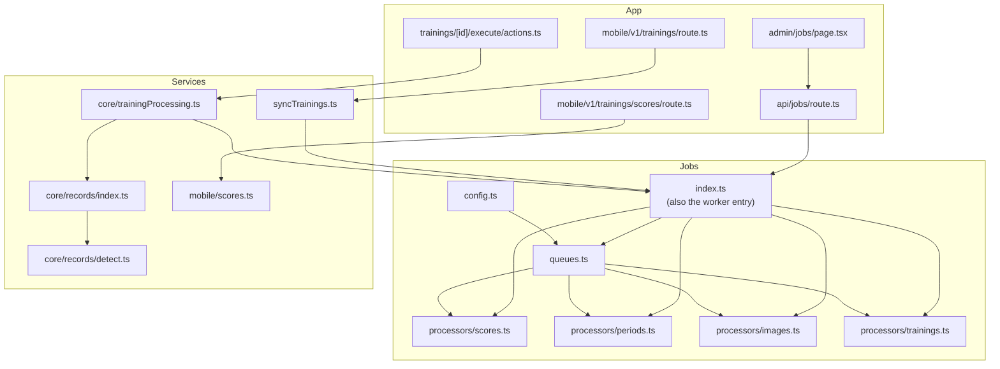
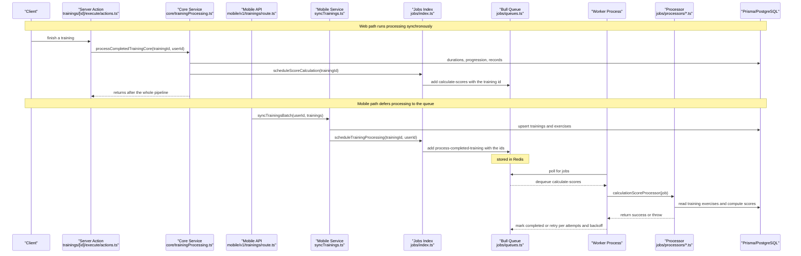
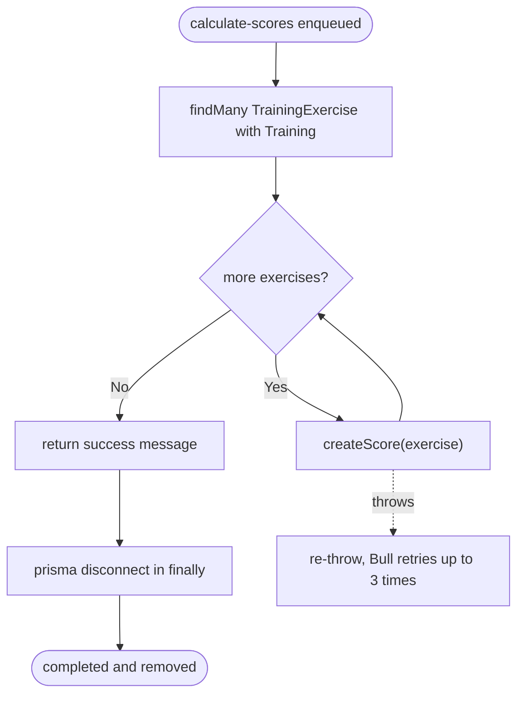
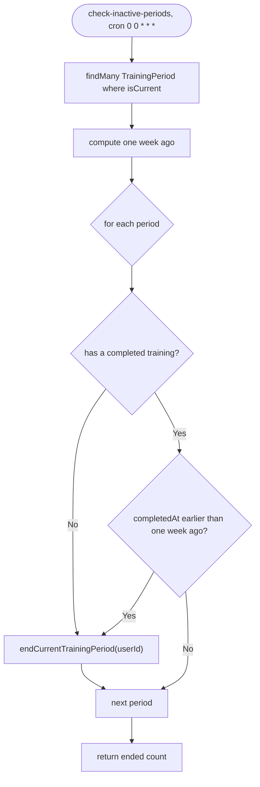
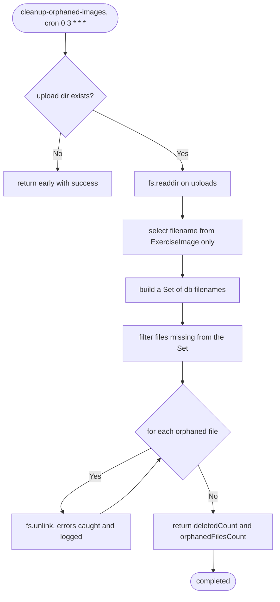
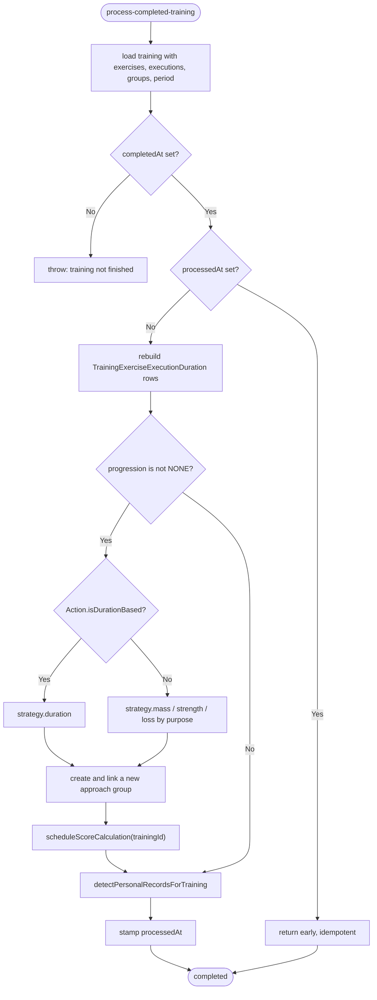
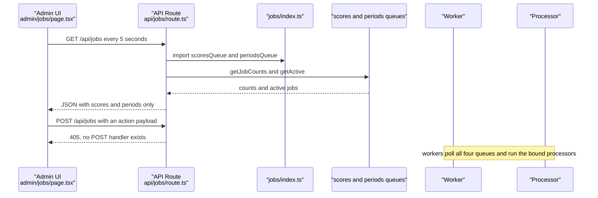
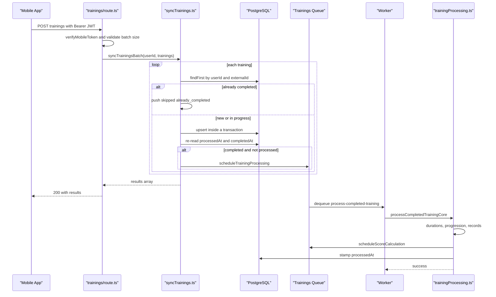
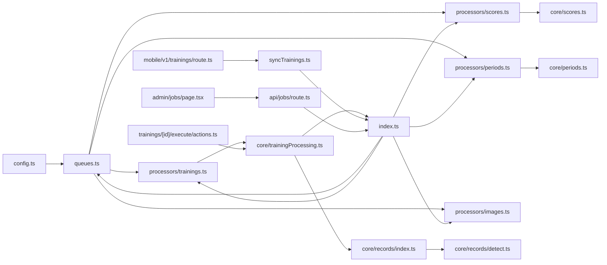

# Background Job System

<cite>
**Referenced Files in This Document**
- [src/jobs/index.ts](file://src/jobs/index.ts)
- [src/jobs/queues.ts](file://src/jobs/queues.ts)
- [src/jobs/config.ts](file://src/jobs/config.ts)
- [src/jobs/README.md](file://src/jobs/README.md)
- [src/jobs/processors/scores.ts](file://src/jobs/processors/scores.ts)
- [src/jobs/processors/periods.ts](file://src/jobs/processors/periods.ts)
- [src/jobs/processors/images.ts](file://src/jobs/processors/images.ts)
- [src/jobs/processors/trainings.ts](file://src/jobs/processors/trainings.ts)
- [src/app/api/jobs/route.ts](file://src/app/api/jobs/route.ts)
- [src/app/admin/jobs/page.tsx](file://src/app/admin/jobs/page.tsx)
- [src/app/trainings/[id]/execute/actions.ts](file://src/app/trainings/[id]/execute/actions.ts)
- [src/mobile/syncTrainings.ts](file://src/mobile/syncTrainings.ts)
- [src/mobile/scores.ts](file://src/mobile/scores.ts)
- [src/core/trainingProcessing.ts](file://src/core/trainingProcessing.ts)
- [src/core/scores.ts](file://src/core/scores.ts)
- [src/core/periods.ts](file://src/core/periods.ts)
- [src/core/records/index.ts](file://src/core/records/index.ts)
- [src/core/records/detect.ts](file://src/core/records/detect.ts)
- [src/tools/db.ts](file://src/tools/db.ts)
- [src/app/api/mobile/v1/trainings/route.ts](file://src/app/api/mobile/v1/trainings/route.ts)
- [src/app/api/mobile/v1/trainings/scores/route.ts](file://src/app/api/mobile/v1/trainings/scores/route.ts)
- [src/app/api/muscle-images/route.ts](file://src/app/api/muscle-images/route.ts)
- [prisma/schema.prisma](file://prisma/schema.prisma)
- [package.json](file://package.json)
</cite>

## Update Summary
**Changes Made**
- Corrected the trigger chain for score calculation: `scheduleScoreCalculation` is called from `src/core/trainingProcessing.ts`, **not** from the training execution server action. The web action `handleProcessCompletedTraining` runs `processCompletedTrainingCore` **synchronously** and never touches the queue directly.
- Documented that `npm run workers` executes `src/jobs/index.ts` itself — there is no separate worker file — and that importing `@/jobs` from anywhere (including the Next.js server) both binds all four processors and registers the two cron jobs as a module side effect.
- Added the personal-records step to the training processing flow: `processCompletedTrainingCore` now calls `detectPersonalRecordsForTraining` after the progression block and before stamping `processedAt`.
- Documented the duration-exercise branch in the progression strategy selection (`isDurationBased` is checked before the `Purpose` switch).
- Noted the monitoring gap: `GET /api/jobs` reports only the `scores` and `periods` queues, and the admin page's "update all actions" button posts to a route that has no `POST` handler (405).
- Added the synchronous mobile scores endpoint (`POST /api/mobile/v1/trainings/scores`) as a deliberate exception to the "heavy work goes to Bull" rule.
- Fixed all line-range references against the current sources.

## Table of Contents
1. [Introduction](#introduction)
2. [Project Structure](#project-structure)
3. [Core Components](#core-components)
4. [Architecture Overview](#architecture-overview)
5. [Detailed Component Analysis](#detailed-component-analysis)
6. [Mobile Training Sync Integration](#mobile-training-sync-integration)
7. [Dependency Analysis](#dependency-analysis)
8. [Performance Considerations](#performance-considerations)
9. [Troubleshooting Guide](#troubleshooting-guide)
10. [Conclusion](#conclusion)

## Introduction
This document explains the Bull queue architecture used for asynchronous processing in the application. It focuses on four queues:
- **Scores**: calculates exercise scores after a completed training has been processed.
- **Periods**: checks and ends inactive training periods on a daily schedule.
- **Images**: cleans up orphaned image files on a daily schedule.
- **Trainings**: processes a completed training synchronized from a mobile device.

The system uses Redis as the message broker, Bull for queue management and Prisma for database access. Jobs are scheduled from core services (not from route handlers directly), processed by whichever Node process imported `@/jobs`, and monitored through an admin page and an API endpoint.

Two facts about this setup are easy to get wrong and worth stating up front:

1. **The worker *is* `src/jobs/index.ts`.** `package.json` defines `"workers": "node --import tsx src/jobs/index.ts"`. There is no dedicated worker file; running the entry point both binds the processors (through `queues.ts`) and registers the recurring jobs.
2. **Importing `@/jobs` has side effects.** Lines 59 and 62 of `index.ts` call `scheduleCheckInactivePeriods()` and `scheduleCleanupOrphanedImages()` at module scope. Every process that imports the module — the worker, the Next.js server (via `src/core/trainingProcessing.ts`, `src/mobile/syncTrainings.ts` or `src/app/api/jobs/route.ts`) — attempts to register the two cron jobs. Bull keys repeatable jobs by queue, job name and cron expression, so the duplicates collapse into a single repeatable job rather than running twice. The same import also binds all four `.process()` handlers, which means the Next.js server will consume queued jobs as well unless it is kept away from Redis.

## Project Structure
The background job system is implemented under `src/jobs` with a clear separation of concerns:
- `config.ts` — Redis connection settings, queue names, job names and the shared `defaultJobOptions`
- `queues.ts` — instantiates the four Bull queues and binds exactly one processor to each job name at module load
- `processors/*.ts` — one module per job type, each a thin adapter around a core service
- `index.ts` — the entry point: side-effect-imports the processors, re-exports the queues, exposes the four `schedule*` helpers and registers the two cron jobs at import time
- `README.md` — the operational guide referenced by `AGENTS.md`
- Monitoring lives outside `src/jobs`: `src/app/api/jobs/route.ts` and `src/app/admin/jobs/page.tsx`

Producers of jobs are **core services and mobile services**, never route handlers: `src/core/trainingProcessing.ts` schedules score calculation and `src/mobile/syncTrainings.ts` schedules training processing.

**Diagram sources**
- [src/jobs/config.ts:1-41](file://src/jobs/config.ts#L1-L41)
- [src/jobs/queues.ts:1-26](file://src/jobs/queues.ts#L1-L26)
- [src/jobs/index.ts:1-73](file://src/jobs/index.ts#L1-L73)
- [src/jobs/processors/scores.ts:1-36](file://src/jobs/processors/scores.ts#L1-L36)
- [src/jobs/processors/periods.ts:1-65](file://src/jobs/processors/periods.ts#L1-L65)
- [src/jobs/processors/images.ts:1-70](file://src/jobs/processors/images.ts#L1-L70)
- [src/jobs/processors/trainings.ts:1-28](file://src/jobs/processors/trainings.ts#L1-L28)
- [src/app/api/jobs/route.ts:1-50](file://src/app/api/jobs/route.ts#L1-L50)
- [src/app/admin/jobs/page.tsx:1-203](file://src/app/admin/jobs/page.tsx#L1-L203)
- [src/app/trainings/[id]/execute/actions.ts:283-290](file://src/app/trainings/[id]/execute/actions.ts#L283-L290)
- [src/mobile/syncTrainings.ts:1-236](file://src/mobile/syncTrainings.ts#L1-L236)
- [src/mobile/scores.ts:1-173](file://src/mobile/scores.ts#L1-L173)
- [src/core/trainingProcessing.ts:1-194](file://src/core/trainingProcessing.ts#L1-L194)
- [src/core/records/index.ts:1-17](file://src/core/records/index.ts#L1-L17)
- [src/core/records/detect.ts:1-126](file://src/core/records/detect.ts#L1-L126)
- [src/app/api/mobile/v1/trainings/route.ts:1-102](file://src/app/api/mobile/v1/trainings/route.ts#L1-L102)
- [src/app/api/mobile/v1/trainings/scores/route.ts:1-100](file://src/app/api/mobile/v1/trainings/scores/route.ts#L1-L100)
- [package.json:26-26](file://package.json#L26-L26)

**Section sources**
- [src/jobs/config.ts:1-41](file://src/jobs/config.ts#L1-L41)
- [src/jobs/queues.ts:1-26](file://src/jobs/queues.ts#L1-L26)
- [src/jobs/index.ts:1-73](file://src/jobs/index.ts#L1-L73)

## Core Components
- **Configuration** (`config.ts`): Redis host/port from `REDIS_HOST` / `REDIS_PORT` (defaulting to `localhost:6379`), the four queue names, the four job names, and `defaultJobOptions` — 3 attempts, exponential backoff with a 5 s base delay, and `removeOnComplete: true`.
- **Queues** (`queues.ts`): creates `scoresQueue`, `periodsQueue`, `imagesQueue` and `trainingsQueue` against the shared Redis config and immediately calls `.process(jobName, processor)` on each. Every queue has exactly one named job and one handler; there are no concurrency options, so each queue processes one job at a time per process.
- **Index** (`index.ts`): side-effect-imports the four processor modules, re-exports the queues, and provides the scheduling helpers. Its module body also **invokes** the two cron helpers, which is what makes importing the module a state-changing operation.
- **Processors**: each one is a thin wrapper — destructure `job.data`, call a core service, log, return `{ success, message }`, re-throw on failure and `await prisma.$disconnect()` in a `finally` block. Only `scores.ts` contains loop logic of its own; the others delegate entirely.
- **Monitoring**: `GET /api/jobs` reports counts and active jobs; `src/app/admin/jobs/page.tsx` polls it every 5 seconds.

Key behaviors:
- `defaultJobOptions` is applied to **all four** `add()` calls; the two cron helpers spread it and add a `repeat: { cron }` entry.
- Recurring jobs use cron expressions: `0 0 * * *` (midnight) for period checks and `0 3 * * *` (03:00) for image cleanup.
- Score calculation is scheduled from `processCompletedTrainingCore`, i.e. after a training has been fully processed — not when an individual exercise is completed.
- Training processing is scheduled from `syncTrainingsBatch` only when the training has `completedAt` set and `processedAt` still null.
- Because `removeOnComplete: true`, successful jobs disappear from Redis; only failed and active jobs remain inspectable.

**Section sources**
- [src/jobs/config.ts:1-41](file://src/jobs/config.ts#L1-L41)
- [src/jobs/queues.ts:1-26](file://src/jobs/queues.ts#L1-L26)
- [src/jobs/index.ts:1-73](file://src/jobs/index.ts#L1-L73)
- [src/jobs/processors/scores.ts:1-36](file://src/jobs/processors/scores.ts#L1-L36)
- [src/jobs/processors/trainings.ts:1-28](file://src/jobs/processors/trainings.ts#L1-L28)
- [src/app/api/jobs/route.ts:1-50](file://src/app/api/jobs/route.ts#L1-L50)

## Architecture Overview
The background job system integrates with the Next.js app through core services. Workers run as a separate long-lived Node process and consume jobs from Redis. Monitoring is available through an API endpoint and an admin page.

**Diagram sources**
- [src/app/trainings/[id]/execute/actions.ts:283-290](file://src/app/trainings/[id]/execute/actions.ts#L283-L290)
- [src/core/trainingProcessing.ts:31-194](file://src/core/trainingProcessing.ts#L31-L194)
- [src/app/api/mobile/v1/trainings/route.ts:60-102](file://src/app/api/mobile/v1/trainings/route.ts#L60-L102)
- [src/mobile/syncTrainings.ts:210-224](file://src/mobile/syncTrainings.ts#L210-L224)
- [src/jobs/index.ts:16-24](file://src/jobs/index.ts#L16-L24)
- [src/jobs/index.ts:65-73](file://src/jobs/index.ts#L65-L73)
- [src/jobs/queues.ts:8-26](file://src/jobs/queues.ts#L8-L26)
- [src/jobs/processors/scores.ts:1-36](file://src/jobs/processors/scores.ts#L1-L36)

## Detailed Component Analysis

### Scores Queue and Processor
Purpose:
- Calculate and persist a `TrainingExerciseScore` for every exercise of a training once the training has been processed.

Flow:
- `processCompletedTrainingCore` (in `src/core/trainingProcessing.ts`) calls `scheduleScoreCalculation(trainingId)` at the end of its progression block. **No server action or route handler schedules this job directly** — the web action `handleProcessCompletedTraining` calls the core function synchronously, and the core function enqueues the score job.
- The worker dequeues `calculate-scores` and runs `calculationScoreProcessor`.
- The processor loads all `TrainingExercise` rows for the training (including the parent `Training`), then loops and calls `createScore(exercise)` from `src/core/scores` one by one.
- On success it returns `{ success: true, message }`; on failure it logs and re-throws so Bull retries. `prisma.$disconnect()` always runs in `finally`.

Retry strategy:
- Uses `defaultJobOptions`: 3 attempts with exponential backoff starting at 5 s.

Caveats worth knowing:
- The loop is **not** atomic. If `createScore` throws on the fifth exercise, the first four scores are already committed and the retry recomputes them; `createScore` must therefore be idempotent.
- The processor logs one line per exercise (`console.log("exercise", …)` and `console.log("item", …)`), which is noisy on large trainings.
- The score job is only enqueued when the progression block runs. A training whose user has progression disabled still gets its personal records detected, but no score job.

**Diagram sources**
- [src/jobs/processors/scores.ts:1-36](file://src/jobs/processors/scores.ts#L1-L36)
- [src/jobs/index.ts:16-24](file://src/jobs/index.ts#L16-L24)
- [src/core/trainingProcessing.ts:183-185](file://src/core/trainingProcessing.ts#L183-L185)

**Section sources**
- [src/jobs/processors/scores.ts:1-36](file://src/jobs/processors/scores.ts#L1-L36)
- [src/jobs/index.ts:16-24](file://src/jobs/index.ts#L16-L24)
- [src/core/trainingProcessing.ts:183-185](file://src/core/trainingProcessing.ts#L183-L185)

### Periods Queue and Processor
Purpose:
- Check current training periods and end those inactive for more than a week.

Flow:
- Registered as a repeatable job with cron `0 0 * * *` (daily at midnight) by `scheduleCheckInactivePeriods()`.
- The processor finds every `TrainingPeriod` with `isCurrent: true`, including only its most recent completed training (`where: { completedAt: { not: null } }, orderBy: { completedAt: "desc" }, take: 1`). Sorting and limiting happen in the database, not in application code.
- `oneWeekAgo` is computed by subtracting seven calendar days from `new Date()`.
- A period is ended when it has **no** completed training at all, or when that training's `completedAt` is older than `oneWeekAgo`. Ending delegates to `endCurrentTrainingPeriod(period.userId)` from `src/core/periods`.
- Returns a summary counting how many periods were ended.

Note that the "no completed training" branch ends a freshly opened period as soon as the job runs — a period created today with no trainings yet is considered inactive immediately.

**Diagram sources**
- [src/jobs/processors/periods.ts:1-65](file://src/jobs/processors/periods.ts#L1-L65)
- [src/jobs/index.ts:27-40](file://src/jobs/index.ts#L27-L40)

**Section sources**
- [src/jobs/processors/periods.ts:1-65](file://src/jobs/processors/periods.ts#L1-L65)
- [src/jobs/index.ts:27-40](file://src/jobs/index.ts#L27-L40)

### Images Queue and Processor
Purpose:
- Clean up orphaned image files stored under `public/uploads` that are no longer referenced in the database.

Flow:
- Registered as a repeatable job with cron `0 3 * * *` (daily at 03:00) by `scheduleCleanupOrphanedImages()`.
- If `UPLOAD_DIR` (`path.join(process.cwd(), "public", "uploads")`) does not exist, the processor returns early with a success message.
- It reads the directory with `fs.readdir`, selects **every** `ExerciseImage.filename` from the database, builds a `Set` and deletes each file whose name is not in the set.
- Individual `fs.unlink` failures are caught and logged, so one locked file does not abort the run. The job returns `{ success, message, deletedCount, orphanedFilesCount }`.

> **Known defect.** The whitelist is built from `ExerciseImage` **only**, but `public/uploads` is also the target of `POST /api/muscle-images`, which stores `MuscleImage` files in the very same directory. Every muscle image is therefore treated as orphaned and deleted by the nightly job. Fixing this means adding `prisma.muscleImage.findMany({ select: { filename: true } })` to the set — and checking any future image model that writes to `public/uploads`.

**Diagram sources**
- [src/jobs/processors/images.ts:1-70](file://src/jobs/processors/images.ts#L1-L70)
- [src/jobs/index.ts:43-56](file://src/jobs/index.ts#L43-L56)
- [src/app/api/muscle-images/route.ts:14-75](file://src/app/api/muscle-images/route.ts#L14-L75)

**Section sources**
- [src/jobs/processors/images.ts:1-70](file://src/jobs/processors/images.ts#L1-L70)
- [src/jobs/index.ts:43-56](file://src/jobs/index.ts#L43-L56)
- [src/app/api/muscle-images/route.ts:14-75](file://src/app/api/muscle-images/route.ts#L14-L75)

### Trainings Queue and Processor
Purpose:
- Run the full post-training pipeline for a training that was completed on a mobile device: execution durations, progression, score scheduling and personal records.

Flow:
- `POST /api/mobile/v1/trainings` verifies the Bearer token, validates the batch (non-empty, at most `MAX_BATCH_SIZE = 20`, otherwise 413) and hands it to `syncTrainingsBatch`.
- `syncTrainingsBatch` upserts each training in its own transaction, then — **after the transaction commits** — re-reads `{ processedAt, completedAt }` and calls `scheduleTrainingProcessing(trainingId, userId)` only when the training is completed and not yet processed. A failure on one item is caught and reported in the `results` array without aborting the batch.
- The worker dequeues `process-completed-training` and runs `trainingProcessingProcessor`, which is a 28-line wrapper around `processCompletedTrainingCore(trainingId, userId)`.
- `processCompletedTrainingCore` then:
  1. loads the training with its exercises, executions, approach groups, actions and period (including `ProgressionStrategySimpleOpts`);
  2. throws if `completedAt` is null and **returns immediately if `processedAt` is already set** — this is the idempotency guard that makes Bull retries safe;
  3. rebuilds `TrainingExerciseExecutionDuration` rows from the executions ordered by `executedAt`, measuring the gap from `training.startedAt` and then from the previous execution (deleting the old rows first, inside a transaction);
  4. if `userInfo.trainingProgression !== TrainingProgression.NONE`, loops over the exercises, skips boost approaches, picks a progression strategy and writes a new approach group per exercise, then calls `scheduleScoreCalculation(trainingId)`;
  5. calls `detectPersonalRecordsForTraining(trainingId, userId)` — deliberately **outside** the progression condition, so records are recorded even when progression is off;
  6. stamps `processedAt`.
- **Strategy selection** checks `exercise.Action.isDurationBased` **before** the `Purpose` switch. Duration exercises always carry `purpose = LOSS`, so without this ordering they would be progressed by `strategy.loss` instead of `strategy.duration`.

**Diagram sources**
- [src/jobs/processors/trainings.ts:10-28](file://src/jobs/processors/trainings.ts#L10-L28)
- [src/core/trainingProcessing.ts:31-194](file://src/core/trainingProcessing.ts#L31-L194)
- [src/core/records/detect.ts:18-60](file://src/core/records/detect.ts#L18-L60)
- [src/mobile/syncTrainings.ts:210-224](file://src/mobile/syncTrainings.ts#L210-L224)

**Section sources**
- [src/jobs/processors/trainings.ts:1-28](file://src/jobs/processors/trainings.ts#L1-L28)
- [src/jobs/index.ts:65-73](file://src/jobs/index.ts#L65-L73)
- [src/core/trainingProcessing.ts:31-194](file://src/core/trainingProcessing.ts#L31-L194)
- [src/core/records/index.ts:1-17](file://src/core/records/index.ts#L1-L17)
- [src/core/records/detect.ts:1-126](file://src/core/records/detect.ts#L1-L126)

### Scheduling and Integration Points
| Helper | Queue | Job name | Payload | Trigger |
|---|---|---|---|---|
| `scheduleScoreCalculation(trainingId)` | scores | `calculate-scores` | `{ trainingId }` | from `processCompletedTrainingCore`, inside the progression branch |
| `scheduleTrainingProcessing(trainingId, userId)` | trainings | `process-completed-training` | `{ trainingId, userId }` | from `syncTrainingsBatch`, after the upsert transaction commits |
| `scheduleCheckInactivePeriods()` | periods | `check-inactive-periods` | `{}` | cron `0 0 * * *`, registered at module import |
| `scheduleCleanupOrphanedImages()` | images | `cleanup-orphaned-images` | `{}` | cron `0 3 * * *`, registered at module import |

Integration notes:
- The only two producers are core/mobile **services**. Neither `src/app/api/**` nor any server action calls a `schedule*` helper directly.
- The web path is synchronous: `handleProcessCompletedTraining` in `src/app/trainings/[id]/execute/actions.ts` awaits `processCompletedTrainingCore` in the request. Only the score calculation it triggers is deferred to Bull.
- `handleCompleteTrainingManually` marks the training and its exercises as completed but does **not** run any processing; the user must trigger processing separately.
- Period checks and image cleanup are registered once per process at import time and repeated daily by Bull's repeatable-job mechanism.

Monitoring:
- `GET /api/jobs` inspects **only** `scoresQueue` and `periodsQueue`; the `images` and `trainings` queues are not reported.
- The route exports **only** `GET`. The admin page nevertheless posts `{ action: "update-all-actions" }` to `/api/jobs` from its "Обновить все упражнения" button, which answers 405. The page's `JobsStatus` interface also still declares `queues: { actions, users }`, which does not match the `{ scores, periods }` payload the route returns.

**Diagram sources**
- [src/app/admin/jobs/page.tsx:1-203](file://src/app/admin/jobs/page.tsx#L1-L203)
- [src/app/api/jobs/route.ts:1-50](file://src/app/api/jobs/route.ts#L1-L50)

**Section sources**
- [src/jobs/index.ts:16-73](file://src/jobs/index.ts#L16-L73)
- [src/core/trainingProcessing.ts:183-185](file://src/core/trainingProcessing.ts#L183-L185)
- [src/mobile/syncTrainings.ts:210-224](file://src/mobile/syncTrainings.ts#L210-L224)
- [src/app/trainings/[id]/execute/actions.ts:283-303](file://src/app/trainings/[id]/execute/actions.ts#L283-L303)
- [src/app/api/jobs/route.ts:1-50](file://src/app/api/jobs/route.ts#L1-L50)
- [src/app/admin/jobs/page.tsx:1-203](file://src/app/admin/jobs/page.tsx#L1-L203)

## Mobile Training Sync Integration
Mobile synchronization is the only production path that uses the trainings queue. The web UI processes a completed training synchronously, so the queue exists to keep the sync HTTP request fast.

### Mobile Sync Flow
1. **Authentication**: the mobile client sends a Bearer JWT obtained from `/api/mobile/v1/auth/exchange`; the route verifies it with `verifyMobileToken` and reads `payload.userId`.
2. **Request validation**: the body must carry a non-empty `trainings` array. More than `MAX_BATCH_SIZE` (20) entries is rejected with HTTP 413 before any database work starts.
3. **Upsert**: each item is matched by the `@@unique([userId, externalId])` constraint. An existing training whose `completedAt` is already set is skipped with `status: "skipped"`, `reason: "already_completed"`. Otherwise the row and its children (`TrainingExercise`, `TrainingMuscleStat`, `TrainingExerciseExecutionDuration`, `TrainingWarmUp`) are rewritten inside one transaction.
4. **Error isolation**: every item is processed in its own `try/catch`; a failure yields `status: "error"` for that item only and the batch continues.
5. **Background processing**: after the transaction commits, the training is re-read; if `completedAt` is set and `processedAt` is null, `scheduleTrainingProcessing(trainingId, userId)` enqueues the job.
6. **Worker execution**: the trainings processor calls `processCompletedTrainingCore`, which rebuilds execution durations, applies progression, schedules score calculation and detects personal records, then stamps `processedAt`.

### Key Features
- **Idempotency**: the `processedAt` column guards against repeated processing; a re-synced training that was already processed is not enqueued again.
- **Batch limit**: 20 trainings per request keeps each transaction small and bounds the number of queued jobs.
- **Post-commit scheduling**: the job is only enqueued once the upsert transaction has committed, so the worker can never read an uncommitted training.
- **Partial failure**: the response is a per-item results array, never an all-or-nothing outcome.

### Synchronous exception: score submission
`POST /api/mobile/v1/trainings/scores` deliberately does **not** use a queue. `calculateTrainingScores` in `src/mobile/scores.ts` accepts up to `MAX_EXERCISES_PER_REQUEST` (50) exercises and computes scores inline, returning them in the response body. The computation is bounded and read-mostly, so deferring it would only complicate the mobile client. This is the documented exception to the "heavy work goes to Bull" rule.

**Diagram sources**
- [src/app/api/mobile/v1/trainings/route.ts:60-102](file://src/app/api/mobile/v1/trainings/route.ts#L60-L102)
- [src/mobile/syncTrainings.ts:64-236](file://src/mobile/syncTrainings.ts#L64-L236)
- [src/jobs/index.ts:65-73](file://src/jobs/index.ts#L65-L73)
- [src/jobs/processors/trainings.ts:10-28](file://src/jobs/processors/trainings.ts#L10-L28)
- [src/core/trainingProcessing.ts:31-194](file://src/core/trainingProcessing.ts#L31-L194)

**Section sources**
- [src/app/api/mobile/v1/trainings/route.ts:60-102](file://src/app/api/mobile/v1/trainings/route.ts#L60-L102)
- [src/mobile/syncTrainings.ts:64-236](file://src/mobile/syncTrainings.ts#L64-L236)
- [src/mobile/scores.ts:1-173](file://src/mobile/scores.ts#L1-L173)
- [src/jobs/index.ts:65-73](file://src/jobs/index.ts#L65-L73)
- [prisma/schema.prisma:399-450](file://prisma/schema.prisma#L399-L450)

## Dependency Analysis
The job system has clear boundaries and minimal coupling:
- `config.ts` reads the environment and owns the queue names, job names and default job options. It depends on nothing else in the module.
- `queues.ts` instantiates the four Bull queues and immediately binds one processor per queue to its job name. This is where processors are actually registered.
- `index.ts` imports the four processor modules as bare side-effect imports (lines 1–4) and then re-exports the queues from `queues.ts`. The bare imports are redundant — the processors only export functions and never self-register — but they make the module safe to import on its own.
- Processors depend on Prisma and on core services only: `scores.ts` → `core/scores.ts`, `periods.ts` → `core/periods.ts`, `images.ts` → the filesystem, `trainings.ts` → `core/trainingProcessing.ts`.
- Application code reaches the queues exclusively through the helpers exported by `index.ts`. No route or server action imports `queues.ts` directly.

Note the cycle between `core/trainingProcessing.ts` and `jobs/index.ts`: the core service calls `scheduleScoreCalculation`, while the trainings processor calls back into `processCompletedTrainingCore`. It is a deliberate layering compromise — the scheduling helper lives with the queues so that both the mobile sync path and the core service use the same entry point.

**Diagram sources**
- [src/jobs/config.ts:1-41](file://src/jobs/config.ts#L1-L41)
- [src/jobs/queues.ts:1-26](file://src/jobs/queues.ts#L1-L26)
- [src/jobs/index.ts:1-73](file://src/jobs/index.ts#L1-L73)
- [src/jobs/processors/scores.ts:1-36](file://src/jobs/processors/scores.ts#L1-L36)
- [src/jobs/processors/periods.ts:1-65](file://src/jobs/processors/periods.ts#L1-L65)
- [src/jobs/processors/images.ts:1-70](file://src/jobs/processors/images.ts#L1-L70)
- [src/jobs/processors/trainings.ts:1-28](file://src/jobs/processors/trainings.ts#L1-L28)
- [src/core/scores.ts:80-102](file://src/core/scores.ts#L80-L102)
- [src/core/periods.ts:93-166](file://src/core/periods.ts#L93-L166)
- [src/core/records/index.ts:1-17](file://src/core/records/index.ts#L1-L17)
- [src/core/trainingProcessing.ts:1-194](file://src/core/trainingProcessing.ts#L1-L194)
- [src/app/trainings/[id]/execute/actions.ts:283-289](file://src/app/trainings/[id]/execute/actions.ts#L283-L289)
- [src/app/api/mobile/v1/trainings/route.ts:1-102](file://src/app/api/mobile/v1/trainings/route.ts#L1-L102)
- [src/mobile/syncTrainings.ts:1-236](file://src/mobile/syncTrainings.ts#L1-L236)
- [src/app/api/jobs/route.ts:1-50](file://src/app/api/jobs/route.ts#L1-L50)
- [src/app/admin/jobs/page.tsx:1-203](file://src/app/admin/jobs/page.tsx#L1-L203)

**Section sources**
- [src/jobs/config.ts:1-41](file://src/jobs/config.ts#L1-L41)
- [src/jobs/queues.ts:1-26](file://src/jobs/queues.ts#L1-L26)
- [src/jobs/index.ts:1-73](file://src/jobs/index.ts#L1-L73)

## Performance Considerations
- **The web path is synchronous by design.** `handleProcessCompletedTraining` awaits `processCompletedTrainingCore` inside the server action, so the durations rebuild, the progression loop and record detection all run in the request. Only score calculation is deferred to the scores queue. If training processing grows heavier, this is the first thing to move into the trainings queue.
- **Default job options matter.** `defaultJobOptions` sets `removeOnComplete: true` with `attempts: 3` and exponential backoff. Completed jobs vanish from Redis, which keeps memory flat but also removes any historical record of successful runs.
- **Processors disconnect Prisma in `finally`.** Each processor calls `prisma.$disconnect()` after the job body. With a single shared `prisma` instance from `src/tools/db.ts`, this forces a reconnect on the next job in the same worker process — acceptable for the current low volume, but a bottleneck if the queues ever become hot.
- **Mobile sync batches are capped at 20 trainings per request**, bounding both transaction size and the number of jobs enqueued from a single HTTP call.
- **The two cron jobs are cheap.** `check-inactive-periods` reads only open periods and `cleanup-orphaned-images` performs one directory listing plus a single `findMany` selecting only `filename`. Neither scales with training volume.
- **Score calculation is the only per-exercise loop in the workers.** `calculationScoreProcessor` loads every `TrainingExercise` of a training and calls `createScore` sequentially; a training with many exercises produces a long-running job.

## Troubleshooting Guide
Common issues and resolutions:
- **Redis connectivity**: verify `REDIS_HOST` and `REDIS_PORT`; Bull blocks silently on an unreachable broker rather than throwing at import time.
- **Jobs never execute**: `npm run workers` must be running. Remember that the Next.js server also binds the processors as soon as it imports `@/jobs`, so jobs can be consumed by whichever process reached them first — check both sets of logs.
- **Cron jobs running twice or not at all**: both repeatable jobs are registered at module scope in `index.ts` (lines 59 and 62). Bull de-duplicates repeatable jobs by queue, name and cron expression, so multiple importing processes do not multiply executions. To re-register after changing a cron expression, clear the existing repeatable job from Redis first — the old key survives code changes.
- **Muscle images disappearing**: `cleanupImagesProcessor` builds its whitelist from `ExerciseImage.filename` only, but `public/uploads` is also written by `POST /api/muscle-images`. Every `MuscleImage` file is treated as orphaned and deleted at 03:00. Until the processor is taught about `MuscleImage`, either disable the cron job or move muscle images to their own directory.
- **Successful jobs are invisible**: `removeOnComplete: true` deletes finished jobs. Use `GET /api/jobs` for live counts, or query Redis directly, if you need to confirm a job ran.
- **Admin page shows nothing for images or trainings**: `GET /api/jobs` imports only `scoresQueue` and `periodsQueue`, so the other two queues are never reported. The page's `JobsStatus` interface still describes the removed `actions` and `users` queues.
- **The "update all actions" button fails with 405**: the admin page posts to `/api/jobs`, but that route exports only `GET`. There is no `POST` handler.
- **Mobile sync skips a training**: the response item carries `status: "skipped"` with `reason: "already_completed"`. This is expected — the upsert never overwrites a training that already has `completedAt`.
- **A synced training never gets processed**: check `Training.processedAt`. The job is only enqueued when `completedAt` is set and `processedAt` is null; `processCompletedTrainingCore` also returns early if `processedAt` is already stamped, so a half-failed run cannot be retried without clearing the column.
- **Scores missing after a web training**: `scheduleScoreCalculation` is called from inside the `trainingProgression !== NONE` branch of `processCompletedTrainingCore`. Users with progression disabled get personal records but no scores.
- **Retries exhausting**: with `attempts: 3` and exponential backoff, a permanently failing job lands in the failed set after roughly a minute. Processor logs contain the stack trace re-thrown from the `catch`.

Operational tips:
- Use the admin dashboard to refresh queue stats, keeping in mind that it covers only two of the four queues.
- Review job return values and stack traces to diagnose failures.
- Adjust retry strategies per queue if specific jobs need different backoff behavior; the shared `defaultJobOptions` currently applies to all four.
- Monitor mobile sync batch sizes and tune `MAX_BATCH_SIZE` for your deployment scale.

**Section sources**
- [src/jobs/index.ts:1-73](file://src/jobs/index.ts#L1-L73)
- [src/jobs/config.ts:1-41](file://src/jobs/config.ts#L1-L41)
- [src/jobs/processors/images.ts:1-70](file://src/jobs/processors/images.ts#L1-L70)
- [src/app/api/muscle-images/route.ts:14-75](file://src/app/api/muscle-images/route.ts#L14-L75)
- [src/app/api/jobs/route.ts:1-50](file://src/app/api/jobs/route.ts#L1-L50)
- [src/app/admin/jobs/page.tsx:1-203](file://src/app/admin/jobs/page.tsx#L1-L203)
- [src/core/trainingProcessing.ts:31-194](file://src/core/trainingProcessing.ts#L31-L194)
- [src/mobile/syncTrainings.ts:64-236](file://src/mobile/syncTrainings.ts#L64-L236)
- [package.json:26-26](file://package.json#L26-L26)

## Conclusion
The background job system is small and easy to reason about: four Bull queues, one processor each, all names and options centralized in `config.ts`, and a single module (`index.ts`) that both binds the processors and exposes the scheduling helpers. Everything an application module needs is a one-line import of `@/jobs`.

Three properties are worth keeping in mind when extending it. First, `src/jobs/index.ts` *is* the worker — `npm run workers` runs the entry point, so adding a queue means adding a processor import, a `queues.ts` binding and a helper in `index.ts`. Second, importing `@/jobs` has side effects: it registers both cron jobs and binds all processors in whichever process performs the import, including the Next.js server. Third, the web training-completion path is synchronous and only defers score calculation; the trainings queue is used exclusively by mobile sync, which needs it to keep the HTTP request fast.

Two defects are documented above and should be fixed before they cause visible damage: the nightly image cleanup deletes every `MuscleImage` because the whitelist covers only `ExerciseImage`, and the admin monitoring page reports just two of the four queues while its action button posts to a route with no `POST` handler.