# Core Business Logic

<cite>
**Referenced Files in This Document**
- [scores.ts](file://src/core/scores.ts)
- [approaches.ts](file://src/core/approaches.ts)
- [stats.ts](file://src/core/stats.ts)
- [types.ts](file://src/core/types.ts)
- [simple.ts](file://src/core/progression/strategy/simple.ts)
- [difficulty.ts](file://src/core/difficulty.ts)
- [recalculate.ts](file://src/core/difficulty/recalculate.ts)
- [boostStrategy.ts](file://src/core/difficulty/boostStrategy.ts)
- [extraApproachesBoost.ts](file://src/core/difficulty/extraApproachesBoost.ts)
- [scorer.ts](file://src/core/trainingTime/scorer.ts)
- [avgScorer.ts](file://src/core/trainingTime/avgScorer.ts)
- [mlScorer.ts](file://src/core/trainingTime/mlScorer.ts)
- [estimate.ts](file://src/core/trainingTime/estimate.ts)
- [periods.ts](file://src/core/periods.ts)
- [exercises.ts](file://src/core/exercises.ts)
- [trainingMuscles.ts](file://src/core/trainingMuscles.ts)
- [trainingProcessing.ts](file://src/core/trainingProcessing.ts)
- [index.ts (records)](file://src/core/records/index.ts)
- [types.ts (records)](file://src/core/records/types.ts)
- [engine.ts (records)](file://src/core/records/engine.ts)
- [valuation.ts (records)](file://src/core/records/valuation.ts)
- [evaluate.ts (records)](file://src/core/records/evaluate.ts)
- [detect.ts (records)](file://src/core/records/detect.ts)
- [recalculate.ts (records)](file://src/core/records/recalculate.ts)
</cite>

## Table of Contents
1. [Introduction](#introduction)
2. [Project Structure](#project-structure)
3. [Core Components](#core-components)
4. [Architecture Overview](#architecture-overview)
5. [Detailed Component Analysis](#detailed-component-analysis)
6. [Dependency Analysis](#dependency-analysis)
7. [Performance Considerations](#performance-considerations)
8. [Troubleshooting Guide](#troubleshooting-guide)
9. [Conclusion](#conclusion)

## Introduction
This document explains the pure business logic layer in src/core/, focusing on:
- Scoring normalization and purpose-driven scoring coefficients (STRENGTH, MASS, LOSS)
- Progression strategies for STRENGTH, MASS, LOSS and duration-based exercises with a simple strategy class
- Statistics computation for approach groups and training muscle involvement, including the duration-based mode
- Training time scoring via average-based and ML-based scorers
- Periodization management and how progression options are tracked per period
- Personal records detection and full recalculation (records/*)
- Orchestration of a completed training (trainingProcessing.ts)

The core modules are intentionally pure TypeScript with minimal external dependencies, making them easy to understand, test, and reuse across the application.

## Project Structure
The core business logic is organized by concern:
- scores.ts: Normalization and scoring per purpose
- approaches.ts: Approach group creation and linking per purpose (including the duration defaults)
- stats.ts: Aggregation of set-level data into approach group statistics
- types.ts: Shared type definitions used across core modules
- progression/strategy/simple.ts: Simple progression strategy implementation (strength, mass, loss, duration)
- difficulty.ts and difficulty/*: Difficulty calculation, boost handling, and recalculation utilities
- trainingTime/*: Training time scoring abstractions, the purpose-based estimate, and the scorer implementations
- periods.ts: Training period lifecycle and progression option persistence
- exercises.ts: Exercise creation with purpose-specific initialization plus base-metric calculation and recalculation
- trainingMuscles.ts: Muscle involvement statistics for a training session
- trainingProcessing.ts: Orchestration of a completed training (durations, progression, scores, records)
- records/*: Personal records — candidate building, valuation, evaluation, detection, and recalculation

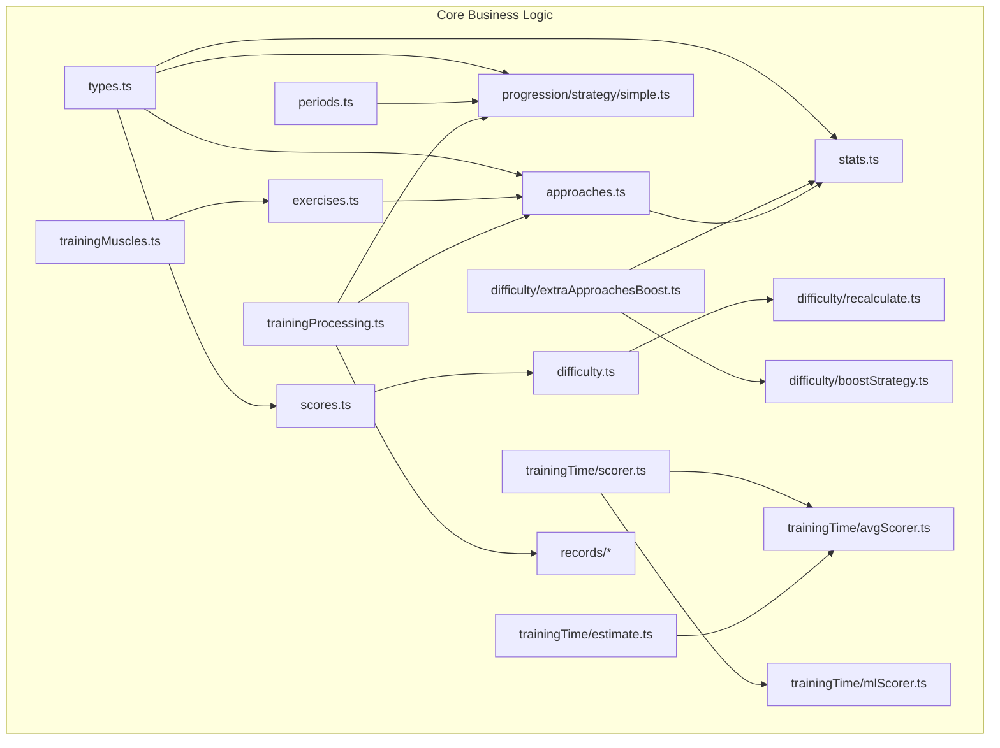

**Diagram sources**
- [scores.ts:1-121](file://src/core/scores.ts#L1-L121)
- [approaches.ts:1-219](file://src/core/approaches.ts#L1-L219)
- [stats.ts:1-101](file://src/core/stats.ts#L1-L101)
- [types.ts:1-19](file://src/core/types.ts#L1-L19)
- [simple.ts:1-429](file://src/core/progression/strategy/simple.ts#L1-L429)
- [difficulty.ts:1-32](file://src/core/difficulty.ts#L1-L32)
- [recalculate.ts:1-72](file://src/core/difficulty/recalculate.ts#L1-L72)
- [boostStrategy.ts:1-12](file://src/core/difficulty/boostStrategy.ts#L1-L12)
- [extraApproachesBoost.ts:1-99](file://src/core/difficulty/extraApproachesBoost.ts#L1-L99)
- [scorer.ts:1-8](file://src/core/trainingTime/scorer.ts#L1-L8)
- [avgScorer.ts:1-41](file://src/core/trainingTime/avgScorer.ts#L1-L41)
- [mlScorer.ts:1-86](file://src/core/trainingTime/mlScorer.ts#L1-L86)
- [estimate.ts:1-18](file://src/core/trainingTime/estimate.ts#L1-L18)
- [periods.ts:1-195](file://src/core/periods.ts#L1-L195)
- [exercises.ts:1-248](file://src/core/exercises.ts#L1-L248)
- [trainingMuscles.ts:1-144](file://src/core/trainingMuscles.ts#L1-L144)
- [trainingProcessing.ts:1-194](file://src/core/trainingProcessing.ts#L1-L194)
- [index.ts (records):1-17](file://src/core/records/index.ts#L1-L17)

**Section sources**
- [scores.ts:1-121](file://src/core/scores.ts#L1-L121)
- [approaches.ts:1-219](file://src/core/approaches.ts#L1-L219)
- [stats.ts:1-101](file://src/core/stats.ts#L1-L101)
- [types.ts:1-19](file://src/core/types.ts#L1-L19)
- [simple.ts:1-429](file://src/core/progression/strategy/simple.ts#L1-L429)
- [difficulty.ts:1-32](file://src/core/difficulty.ts#L1-L32)
- [recalculate.ts:1-72](file://src/core/difficulty/recalculate.ts#L1-L72)
- [boostStrategy.ts:1-12](file://src/core/difficulty/boostStrategy.ts#L1-L12)
- [scorer.ts:1-8](file://src/core/trainingTime/scorer.ts#L1-L8)
- [avgScorer.ts:1-41](file://src/core/trainingTime/avgScorer.ts#L1-L41)
- [mlScorer.ts:1-86](file://src/core/trainingTime/mlScorer.ts#L1-L86)
- [estimate.ts:1-18](file://src/core/trainingTime/estimate.ts#L1-L18)
- [periods.ts:1-195](file://src/core/periods.ts#L1-L195)
- [exercises.ts:1-248](file://src/core/exercises.ts#L1-L248)
- [trainingMuscles.ts:1-144](file://src/core/trainingMuscles.ts#L1-L144)
- [trainingProcessing.ts:1-194](file://src/core/trainingProcessing.ts#L1-L194)
- [index.ts (records):1-17](file://src/core/records/index.ts#L1-L17)

## Core Components
- Scoring normalization and purpose-driven coefficients:
  - Log-normalizes key metrics (sum, mean, max, total count, mean count)
  - Applies purpose-specific weights to compute a single score
  - Provides preview scoring using aggregated approach group data before execution
- Approach group statistics:
  - Computes aggregate stats from sets (length, sum, mean, max, counts)
  - Handles different rigs (e.g., OTHER uses user weight)
  - Duration-based mode: counts hold seconds and weights hold the difficulty parameter, bodyweight is never added
- Progression strategy:
  - Simple strategy class with methods for strength, mass, loss, and duration
  - Adjusts sets based on executed performance and configuration
- Difficulty calculation:
  - Combines action base difficulty with preview score
  - Supports recalculation at exercise and training levels
  - Boost strategies (for example, extra approaches) can raise the difficulty of a training
- Training time scoring:
  - Abstract scorer interface with average-based and ML-based implementations
  - Purpose-based per-set estimate shared by the average scorer and the mobile preview endpoint
- Periodization:
  - Create/end/get current periods with associated progression options
- Exercises and muscles:
  - Purpose-aware exercise creation with default approach groups
  - Base metric calculation from muscle size factors and its recalculation per muscle
  - Recompute muscle involvement stats per training session
- Training processing:
  - Orchestrates a completed training: per-set durations, progression, score scheduling, personal records
- Personal records:
  - Builds record candidates from executions, evaluates them against previous bests, and persists all-time and period records

**Section sources**
- [scores.ts:1-121](file://src/core/scores.ts#L1-L121)
- [approaches.ts:1-219](file://src/core/approaches.ts#L1-L219)
- [stats.ts:1-101](file://src/core/stats.ts#L1-L101)
- [simple.ts:1-429](file://src/core/progression/strategy/simple.ts#L1-L429)
- [difficulty.ts:1-32](file://src/core/difficulty.ts#L1-L32)
- [recalculate.ts:1-72](file://src/core/difficulty/recalculate.ts#L1-L72)
- [extraApproachesBoost.ts:1-99](file://src/core/difficulty/extraApproachesBoost.ts#L1-L99)
- [scorer.ts:1-8](file://src/core/trainingTime/scorer.ts#L1-L8)
- [avgScorer.ts:1-41](file://src/core/trainingTime/avgScorer.ts#L1-L41)
- [mlScorer.ts:1-86](file://src/core/trainingTime/mlScorer.ts#L1-L86)
- [estimate.ts:1-18](file://src/core/trainingTime/estimate.ts#L1-L18)
- [periods.ts:1-195](file://src/core/periods.ts#L1-L195)
- [exercises.ts:1-248](file://src/core/exercises.ts#L1-L248)
- [trainingMuscles.ts:1-144](file://src/core/trainingMuscles.ts#L1-L144)
- [trainingProcessing.ts:1-194](file://src/core/trainingProcessing.ts#L1-L194)
- [index.ts (records):1-17](file://src/core/records/index.ts#L1-L17)

## Architecture Overview
The core layer is composed of cohesive modules that interact through well-defined interfaces and shared types. The following diagram maps the primary relationships between scoring, progression, difficulty, and time scoring components.

```mermaid
classDiagram
class Scores {
+normLogFn(val) number
+norm(item) ActionHistoryDataNormalized
+scoreNormalized(purpose, data) {score, coefficients}
+createScore(exercise) Promise~TrainingExerciseScore~
+previewScore(purpose, approachGroup) number
}
class Stats {
+calculateStats(setsData, actionRig, userWeight, isDurationBased) SetsStats
+findInfoForCalculateStatsForApproach(approachGroupId) InfoForCalculatingStats
+findInfoForCalculationStatsForAction(actionId, userId, tx) InfoForCalculatingStats
+getRawQueryForApproachGroup(groupId) string
}
class Approaches {
+createApproachGroup(tx, approaches, actionId, userId) ApproachesGroup
+linkNewApproachGroupToActionByPurpose(tx, purpose, actionByPurposeId, newGroup) void
+createMassInitial(userId, actionId, actionRig, bigCount, tx) ActionMass
+createStrengthInitial(userId, actionId, tx) ActionStrength
+createLossInitial(userId, actionId, actionRig, bigCount, tx) ActionLoss
+createDurationInitial(userId, actionId, tx) ActionLoss
}
class ProgressionStrategySimple {
+strength(planned, executed) SetData[]
+mass(planned, executed) SetData[]
+loss(planned, executed) SetData[]
+duration(planned, executed) SetData[]
}
class Difficulty {
+calculateExerciseDifficulty(input) number
+calculateTrainingDifficulty(exercises) number
}
class Recalculate {
+recalculateExerciseDifficulty(exerciseId) Promise~number~
+recalculateTrainingDifficulty(trainingId) Promise~number~
+recalculateExerciseAndTrainingDifficulty(exerciseId, trainingId) Promise~{exerciseDifficulty, trainingDifficulty}~
}
class TrainingTimeScorer {
<<abstract>>
+score(trainingId) Promise~number[]~
}
class AvgScorer {
+score(trainingId) Promise~number[]~
}
class MLScorer {
-_predict(trainingId) Promise~number[] or null~
+score(trainingId) Promise~number[]~
}
class Estimate {
+PurposesToMinsMap Record~Purpose, number~
+estimateExerciseTimeInMins(purpose, approachesCount) number
}
class Periods {
+createTrainingPeriod(userId, opts) TrainingPeriod
+endCurrentTrainingPeriod(userId) TrainingPeriod|null
+getCurrentTrainingPeriod(userId) TrainingPeriod|null
+getCurrentTrainingPeriodWithOptions(userId) {currentPeriod, progressionOpts}
+getUserTrainingPeriods(userId) TrainingPeriod[]
+updateProgressionStrategySimpleOpts(id, opts) void
}
class Exercises {
+calcActionBase(agonistSizeFactors, synergistSizeFactors) number
+recalcBaseForMuscle(muscleId) Promise~void~
+createExercise(trainingId, actionId, purpose, userId, tx) TrainingExercise
}
class TrainingMuscles {
+recomputeTrainingMuscleStats(trainingId, tx) void
+fetchTrainingMuscleStats(trainingId) any[]
}
class TrainingProcessing {
+processCompletedTrainingCore(trainingId, userId) Promise~void~
}
class RecordsEngine {
+buildRecordCandidates(params) RecordCandidate[]
}
class RecordsValuation {
+filterRecordableExecutions(executions, approaches) RecordableExecution[]
+filterDurationRecordableExecutions(executions, approaches) RecordableExecution[]
+valuateMaxWeight(executions) MaxWeightResult or null
+valuateVolume(executions) number or null
+valuateDurationVolume(executions) number or null
}
class RecordsEvaluate {
+evaluateRecord(candidate, lastAllTime, lastInPeriod) NewPersonalRecordEntry or null
}
class Records {
+detectPersonalRecordsForTraining(trainingId, userId) Promise~number~
+recalculatePersonalRecordsForUser(userId) Promise~number~
}
Scores --> Stats : "uses"
Approaches --> Stats : "uses"
Difficulty --> Scores : "uses previewScore"
Recalculate --> Difficulty : "uses"
AvgScorer --|> TrainingTimeScorer
MLScorer --|> TrainingTimeScorer
AvgScorer --> Estimate : "uses"
Periods --> ProgressionStrategySimple : "uses defaults"
Exercises --> Approaches : "creates initial groups"
TrainingMuscles --> Exercises : "relies on actions/muscles"
TrainingProcessing --> ProgressionStrategySimple : "applies progression"
TrainingProcessing --> Approaches : "relinks approach groups"
TrainingProcessing --> Records : "detects records"
Records --> RecordsEngine : "builds candidates"
RecordsEngine --> RecordsValuation : "values executions"
Records --> RecordsEvaluate : "compares with previous bests"
```

**Diagram sources**
- [scores.ts:1-121](file://src/core/scores.ts#L1-L121)
- [stats.ts:1-101](file://src/core/stats.ts#L1-L101)
- [approaches.ts:1-219](file://src/core/approaches.ts#L1-L219)
- [simple.ts:1-429](file://src/core/progression/strategy/simple.ts#L1-L429)
- [difficulty.ts:1-32](file://src/core/difficulty.ts#L1-L32)
- [recalculate.ts:1-72](file://src/core/difficulty/recalculate.ts#L1-L72)
- [scorer.ts:1-8](file://src/core/trainingTime/scorer.ts#L1-L8)
- [avgScorer.ts:1-41](file://src/core/trainingTime/avgScorer.ts#L1-L41)
- [mlScorer.ts:1-86](file://src/core/trainingTime/mlScorer.ts#L1-L86)
- [estimate.ts:1-18](file://src/core/trainingTime/estimate.ts#L1-L18)
- [periods.ts:1-195](file://src/core/periods.ts#L1-L195)
- [exercises.ts:1-248](file://src/core/exercises.ts#L1-L248)
- [trainingMuscles.ts:1-144](file://src/core/trainingMuscles.ts#L1-L144)
- [trainingProcessing.ts:1-194](file://src/core/trainingProcessing.ts#L1-L194)
- [engine.ts (records):1-91](file://src/core/records/engine.ts#L1-L91)
- [valuation.ts (records):1-89](file://src/core/records/valuation.ts#L1-L89)
- [evaluate.ts (records):1-57](file://src/core/records/evaluate.ts#L1-L57)
- [detect.ts (records):1-126](file://src/core/records/detect.ts#L1-L126)
- [recalculate.ts (records):1-149](file://src/core/records/recalculate.ts#L1-L149)

## Detailed Component Analysis

### Scoring Normalization and Purpose Coefficients
- Normalization applies a logarithmic transform to raw metrics to stabilize variance and handle scale differences.
- Purpose-specific coefficients define how each metric contributes to the final score:
  - STRENGTH emphasizes maximum and sum, penalizes excessive mean reps
  - MASS emphasizes mean and count metrics, adds small max contribution
  - LOSS emphasizes total and mean counts, includes max as a secondary factor
- Preview scoring allows estimating difficulty or expected score before execution using aggregated approach group data.

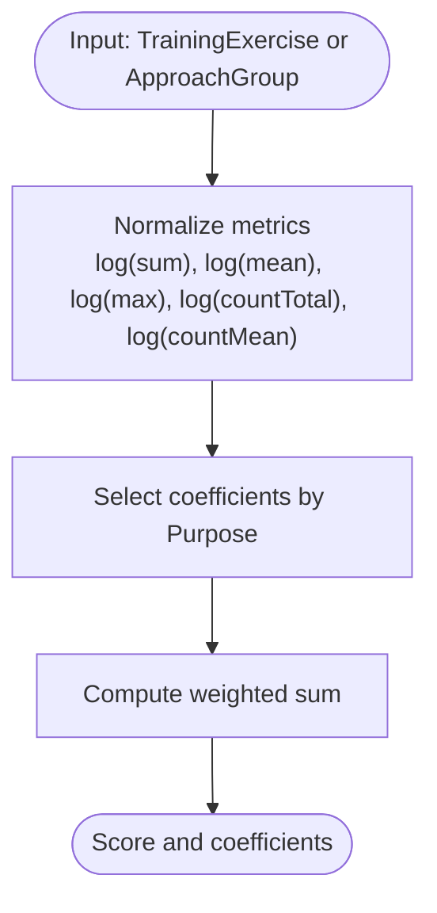

**Diagram sources**
- [scores.ts:24-27](file://src/core/scores.ts#L24-L27)
- [scores.ts:53-79](file://src/core/scores.ts#L53-L79)
- [scores.ts:108-121](file://src/core/scores.ts#L108-L121)

**Section sources**
- [scores.ts:1-121](file://src/core/scores.ts#L1-L121)

### Approach Groups and Statistics Computation
- Approach groups aggregate planned or executed sets into meaningful statistics:
  - Length (number of sets)
  - Weight sum, mean, max
  - Total and mean rep counts
- For rigs like OTHER, actual weight equals user bodyweight plus set weight offset.
- Default approach templates exist for STRENGTH, MASS, LOSS, and duration-based purposes (`ApproachesDurationDefault` — three 30-second sets at zero weight).
- **Updated** Duration-based mode: `calculateStats` accepts an `isDurationBased` flag. When it is set, the count fields are interpreted as seconds, the weight fields as the difficulty parameter, and the user's bodyweight is never added — even for the OTHER rig. `findInfoForCalculationStatsForAction` returns the flag and skips the bodyweight lookup for such actions.

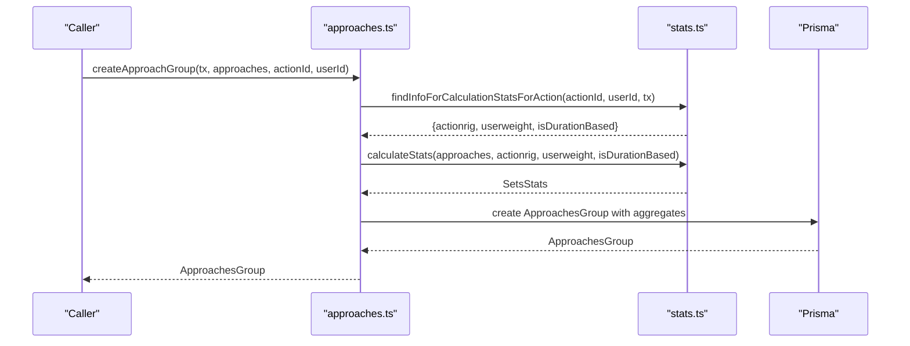

**Diagram sources**
- [approaches.ts:49-82](file://src/core/approaches.ts#L49-L82)
- [stats.ts:32-56](file://src/core/stats.ts#L32-L56)
- [stats.ts:57-101](file://src/core/stats.ts#L57-L101)

**Section sources**
- [approaches.ts:1-219](file://src/core/approaches.ts#L1-L219)
- [stats.ts:1-101](file://src/core/stats.ts#L1-L101)
- [types.ts:1-19](file://src/core/types.ts#L1-L19)

### Progression Strategy (Simple)
- Strength:
  - Builds working and preparing sets based on last successful sets
  - Increases weight or reps depending on performance; ensures last set targets 1 rep
  - Adjusts for one-dumbbell constraints (even counts)
- Mass:
  - Iterates through planned sets, increases weight when rep thresholds are met
  - Optionally adds a drop set at lower weight with higher reps
  - Adjusts for big-count mode and one-dumbbell constraints
- Loss:
  - Increases mean reps per set until reaching a cap; may add extra sets
  - Caps total sets and adjusts weight incrementally if exceeded
  - Ensures even counts for one-dumbbell
- **New** Duration (for `Action.isDurationBased`):
  - Uses "time first, then parameter": the mean duration per set grows by `durationStepSec` until `durationMaxSec` is reached
  - On reaching the ceiling the duration is reset to `durationMaxSec - 2 × durationStepSec` and the difficulty grows instead — by `durationParamStep` when the action declares `durationParamLabel`, otherwise by adding one more set
  - The number of sets follows the planned sets, or `durationSetsCount` for the first progression, and never exceeds `durationMaxSets`
  - Defaults: `durationSetsCount` 1, `durationStepSec` 30, `durationMaxSec` 600, `durationParamStep` 1, `durationMaxSets` 5
  - The strategy is constructed with the action flags (`rig`, `bigCount`, `oneDumbbell`, `isDurationBased`, `durationParamLabel`) and the period's progression options

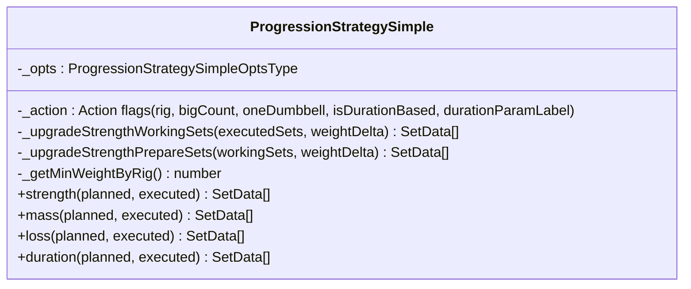

**Diagram sources**
- [simple.ts:82-217](file://src/core/progression/strategy/simple.ts#L82-L217)
- [simple.ts:261-274](file://src/core/progression/strategy/simple.ts#L261-L274)
- [simple.ts:234-260](file://src/core/progression/strategy/simple.ts#L234-L260)
- [simple.ts:276-339](file://src/core/progression/strategy/simple.ts#L276-L339)
- [simple.ts:341-381](file://src/core/progression/strategy/simple.ts#L341-L381)
- [simple.ts:393-428](file://src/core/progression/strategy/simple.ts#L393-L428)

**Section sources**
- [simple.ts:1-429](file://src/core/progression/strategy/simple.ts#L1-L429)

### Difficulty Calculation and Recalculation
- Exercise difficulty combines action base difficulty with preview score derived from approach group aggregates.
- Training difficulty sums individual exercise difficulties.
- Recalculation functions update database fields for both exercise and training difficulty.

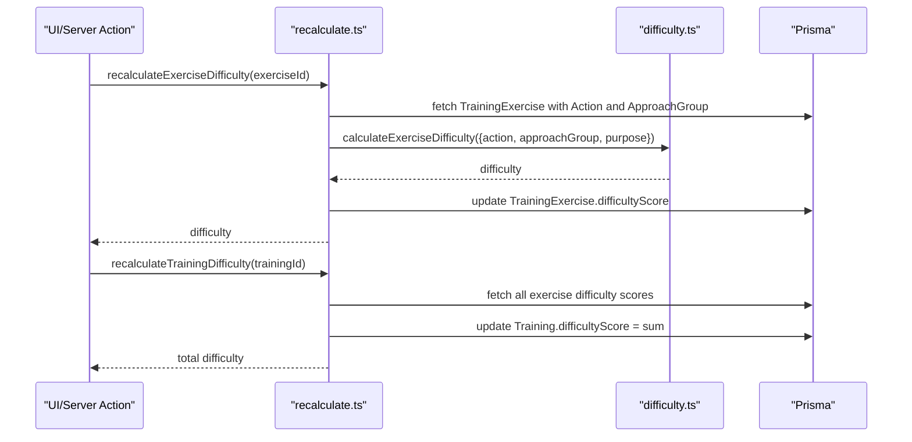

**Diagram sources**
- [difficulty.ts:16-32](file://src/core/difficulty.ts#L16-L32)
- [recalculate.ts:11-38](file://src/core/difficulty/recalculate.ts#L11-L38)
- [recalculate.ts:39-64](file://src/core/difficulty/recalculate.ts#L39-L64)

**Section sources**
- [difficulty.ts:1-32](file://src/core/difficulty.ts#L1-L32)
- [recalculate.ts:1-72](file://src/core/difficulty/recalculate.ts#L1-L72)
- [boostStrategy.ts:1-12](file://src/core/difficulty/boostStrategy.ts#L1-L12)

### Training Time Scoring
- Abstract scorer defines a common interface for scoring training duration.
- **Updated** The per-set time norm lives in `trainingTime/estimate.ts`: `PurposesToMinsMap` (STRENGTH 5, MASS 3.5, LOSS 2 minutes per set) and `estimateExerciseTimeInMins(purpose, approachesCount)`. The same helper backs the mobile scores preview endpoint, so planned and calculated times stay consistent.
- Average scorer estimates time per exercise with that helper, sums minutes and seconds for the training, and persists `timeScoreInMins`, `timeScoreInSecs`, and `timeScoredAt`.
- ML scorer builds an NDJSON feature payload from a raw SQL query, posts it to an external model service (`http://127.0.0.1:{port}/predict`, default port 5001) and persists the predicted seconds. `_predict` returns `null` unless the service answers with HTTP 200, and any error is logged and swallowed — the scorer then returns an empty list without writing to the training.

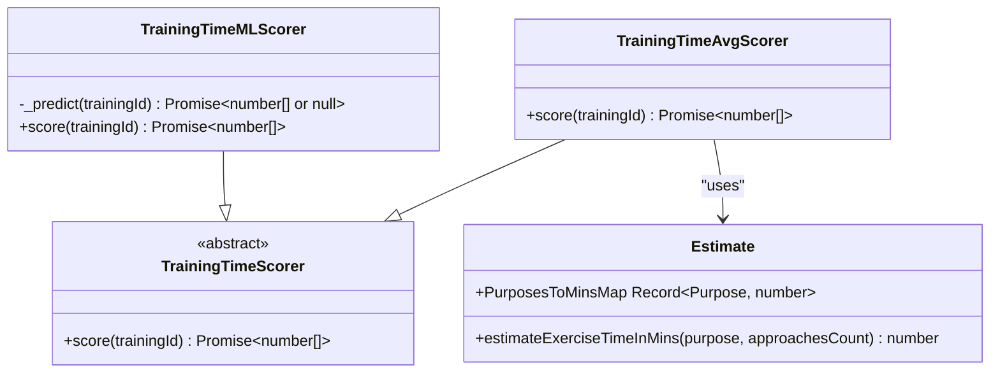

**Diagram sources**
- [scorer.ts:1-8](file://src/core/trainingTime/scorer.ts#L1-L8)
- [avgScorer.ts:6-40](file://src/core/trainingTime/avgScorer.ts#L6-L40)
- [mlScorer.ts:41-86](file://src/core/trainingTime/mlScorer.ts#L41-L86)
- [estimate.ts:1-18](file://src/core/trainingTime/estimate.ts#L1-L18)

**Section sources**
- [scorer.ts:1-8](file://src/core/trainingTime/scorer.ts#L1-L8)
- [avgScorer.ts:1-41](file://src/core/trainingTime/avgScorer.ts#L1-L41)
- [mlScorer.ts:1-86](file://src/core/trainingTime/mlScorer.ts#L1-L86)
- [estimate.ts:1-18](file://src/core/trainingTime/estimate.ts#L1-L18)

### Periodization and Progression Options
- Creates a new training period, marking previous current period as ended.
- Persists progression options for the simple strategy within the period.
- Retrieves current period and its progression options, or lists all periods for a user.
- Updates progression options for existing records.

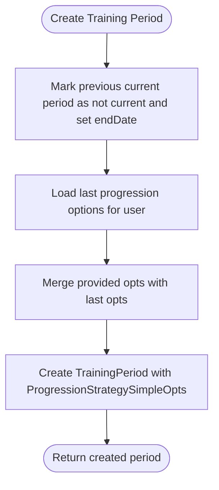

**Diagram sources**
- [periods.ts:43-92](file://src/core/periods.ts#L43-L92)
- [periods.ts:93-123](file://src/core/periods.ts#L93-L123)
- [periods.ts:124-140](file://src/core/periods.ts#L124-L140)
- [periods.ts:141-173](file://src/core/periods.ts#L141-L173)
- [periods.ts:174-186](file://src/core/periods.ts#L174-L186)
- [periods.ts:187-195](file://src/core/periods.ts#L187-L195)

**Section sources**
- [periods.ts:1-195](file://src/core/periods.ts#L1-L195)

### Exercises and Muscle Involvement
- Exercise creation validates purpose compatibility and initializes purpose-specific action records with default approach groups.
- **Updated** Duration-based actions override the requested purpose to LOSS before any branching, and their initial group is created by `createDurationInitial`.
- **Updated** The module also owns the base metric: `calcActionBase` applies `0.7 × Σ agonist sizeFactor + 0.3 × Σ synergist sizeFactor`, and `recalcBaseForMuscle` rewrites `Action.base` for every action linked to a muscle as an agonist or synergist inside one transaction.
- Muscle stats recompute counts for agonist, synergist, and stabilizer roles across exercises in a training session.
- Fetching muscle stats returns enriched data including muscle titles and group titles, sorted by usage and role priority.

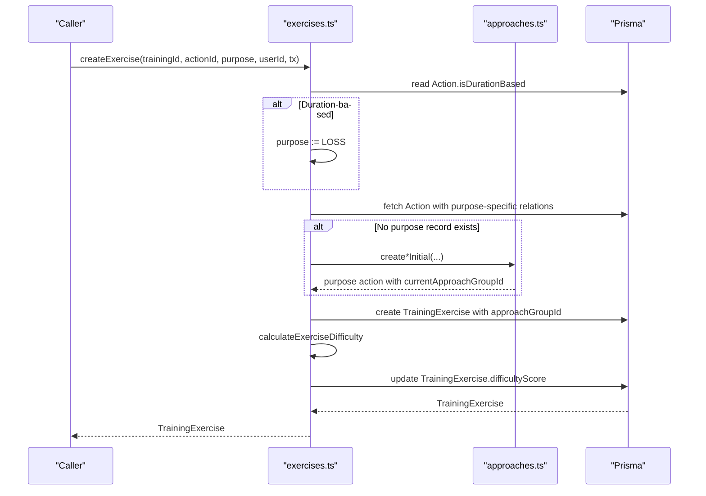

**Diagram sources**
- [exercises.ts:117-248](file://src/core/exercises.ts#L117-L248)
- [approaches.ts:117-219](file://src/core/approaches.ts#L117-L219)

**Section sources**
- [exercises.ts:1-248](file://src/core/exercises.ts#L1-L248)
- [trainingMuscles.ts:1-144](file://src/core/trainingMuscles.ts#L1-L144)

### Training Processing Orchestration
`processCompletedTrainingCore(trainingId, userId)` is the single entry point used both by the web completion flow and by the background `trainings` queue processor.

Steps:
1. Loads the user info (progression setting and parameters), the training with its exercises, executions, actions, approach groups, and period. Throws when the training is not completed and returns immediately when `processedAt` is already set, which makes the whole routine safe to re-run from a queue retry only before the flag is written.
2. Stores per-set execution durations (`TrainingExerciseExecutionDuration`): non-passed executions with `executedAt` are ordered ascending and the gap to the previous timestamp (starting from `Training.startedAt`) becomes the set's `seconds`. Existing rows for the training are deleted first.
3. When the user's progression setting is not `NONE`, builds a `ProgressionStrategySimple` per exercise and applies it:
   - planned sets skip boost approaches, executed sets skip passed ones, zero-load ones, and boost executions;
   - the duration branch is checked **before** the purpose branch — `if (exercise.Action.isDurationBased) strategy.duration(...)`, otherwise `mass` / `strength` / `loss` by purpose;
   - the upgraded sets become a new approach group which is linked back to the purpose-specific action record.
4. Schedules the score calculation job (only inside the progression branch).
5. **New** Detects personal records via `detectPersonalRecordsForTraining` — this runs regardless of the progression setting.
6. Marks the training as processed by setting `processedAt`.

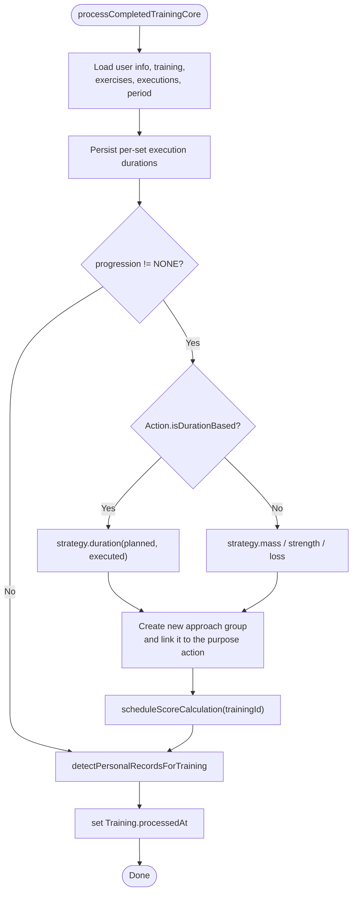

**Diagram sources**
- [trainingProcessing.ts:31-194](file://src/core/trainingProcessing.ts#L31-L194)
- [simple.ts:393-428](file://src/core/progression/strategy/simple.ts#L393-L428)
- [detect.ts (records):18-126](file://src/core/records/detect.ts#L18-L126)

**Section sources**
- [trainingProcessing.ts:1-194](file://src/core/trainingProcessing.ts#L1-L194)

### Personal Records
The `records/` folder is a small pipeline of pure functions plus two database-facing entry points.

- `types.ts` — `RecordCandidate`, `NewPersonalRecordEntry`, `LastRecordRef`.
- `valuation.ts` — filters executions worth counting (`filterRecordableExecutions`, `filterDurationRecordableExecutions`) and computes the metric values (`valuateMaxWeight`, `valuateVolume`, `valuateDurationVolume`).
- `engine.ts` — `buildRecordCandidates` turns the executions of one exercise into MAX_WEIGHT and MAX_VOLUME candidates; duration-based exercises yield only MAX_VOLUME (the total number of seconds).
- `evaluate.ts` — `evaluateRecord` compares a candidate with the last all-time and last period records and decides whether an entry must be created.
- `detect.ts` — `detectPersonalRecordsForTraining` for a single training; idempotent because the training's records are deleted and recreated inside the transaction (30s timeout).
- `recalculate.ts` — `recalculatePersonalRecordsForUser` rebuilds the whole history by replaying completed trainings ascending (120s timeout, batches of 500). Exposed through `src/scripts/update-personal-records.ts` and the `update-personal-records` npm script.

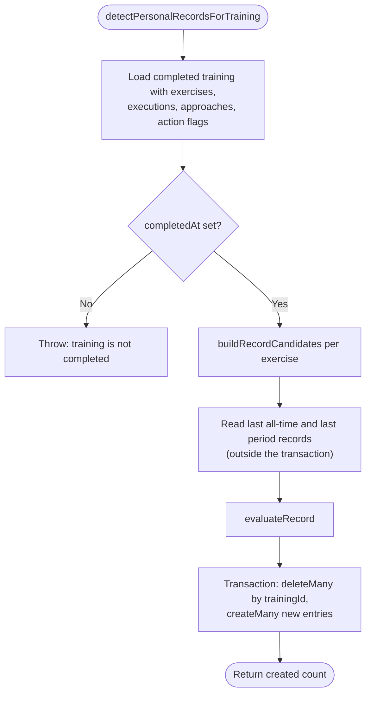

**Diagram sources**
- [detect.ts (records):18-126](file://src/core/records/detect.ts#L18-L126)
- [engine.ts (records):20-91](file://src/core/records/engine.ts#L20-L91)
- [evaluate.ts (records):36-57](file://src/core/records/evaluate.ts#L36-L57)

**Section sources**
- [index.ts (records):1-17](file://src/core/records/index.ts#L1-L17)
- [types.ts (records):1-31](file://src/core/records/types.ts#L1-L31)
- [valuation.ts (records):1-89](file://src/core/records/valuation.ts#L1-L89)
- [engine.ts (records):1-91](file://src/core/records/engine.ts#L1-L91)
- [evaluate.ts (records):1-57](file://src/core/records/evaluate.ts#L1-L57)
- [detect.ts (records):1-126](file://src/core/records/detect.ts#L1-L126)
- [recalculate.ts (records):1-149](file://src/core/records/recalculate.ts#L1-L149)

## Dependency Analysis
- scores.ts depends on Prisma for creating TrainingExerciseScore records and uses shared types.
- approaches.ts relies on stats.ts for computing aggregates and Prisma for persistence.
- difficulty.ts uses scores.ts preview scoring; recalculate.ts orchestrates updates; extraApproachesBoost.ts implements the boost strategy interface on top of stats.ts.
- trainingTime scorers depend on Prisma and, for ML, an external HTTP endpoint; avgScorer uses the shared estimate helper.
- periods.ts integrates progression options and Prisma for lifecycle management.
- exercises.ts coordinates purpose-specific initialization via approaches.ts and owns the base-metric recalculation.
- trainingMuscles.ts reads action-muscle relationships and persists aggregated stats.
- trainingProcessing.ts is the orchestrator: approaches.ts, progression strategy, the jobs layer, and records.
- records/* depends only on Prisma and its own pure helpers, which keeps the valuation and evaluation logic unit-testable.

```mermaid
graph LR
Scores["scores.ts"] --> PrismaA["Prisma (scores)"]
Approaches["approaches.ts"] --> Stats["stats.ts"]
Approaches --> PrismaB["Prisma (approaches)"]
Difficulty["difficulty.ts"] --> Scores
Recalc["recalculate.ts"] --> Difficulty
Boost["extraApproachesBoost.ts"] --> Stats
AvgScorer["avgScorer.ts"] --> Estimate["estimate.ts"]
AvgScorer --> PrismaC["Prisma (time)"]
MLScorer["mlScorer.ts"] --> PrismaD["Prisma (features)"]
MLScorer --> External["External ML Service"]
Periods["periods.ts"] --> PrismaE["Prisma (periods)"]
Exercises["exercises.ts"] --> Approaches
Exercises --> PrismaF["Prisma (exercises)"]
TrainingMuscles["trainingMuscles.ts"] --> PrismaG["Prisma (muscles)"]
Processing["trainingProcessing.ts"] --> Approaches
Processing --> Simple["progression/strategy/simple.ts"]
Processing --> Records["records/*"]
Processing --> Jobs["jobs (score queue)"]
Records --> PrismaH["Prisma (personalRecord)"]
```

**Diagram sources**
- [scores.ts:1-121](file://src/core/scores.ts#L1-L121)
- [approaches.ts:1-219](file://src/core/approaches.ts#L1-L219)
- [stats.ts:1-101](file://src/core/stats.ts#L1-L101)
- [difficulty.ts:1-32](file://src/core/difficulty.ts#L1-L32)
- [recalculate.ts:1-72](file://src/core/difficulty/recalculate.ts#L1-L72)
- [extraApproachesBoost.ts:1-99](file://src/core/difficulty/extraApproachesBoost.ts#L1-L99)
- [avgScorer.ts:1-41](file://src/core/trainingTime/avgScorer.ts#L1-L41)
- [mlScorer.ts:1-86](file://src/core/trainingTime/mlScorer.ts#L1-L86)
- [estimate.ts:1-18](file://src/core/trainingTime/estimate.ts#L1-L18)
- [periods.ts:1-195](file://src/core/periods.ts#L1-L195)
- [exercises.ts:1-248](file://src/core/exercises.ts#L1-L248)
- [trainingMuscles.ts:1-144](file://src/core/trainingMuscles.ts#L1-L144)
- [trainingProcessing.ts:1-194](file://src/core/trainingProcessing.ts#L1-L194)
- [index.ts (records):1-17](file://src/core/records/index.ts#L1-L17)

**Section sources**
- [scores.ts:1-121](file://src/core/scores.ts#L1-L121)
- [approaches.ts:1-219](file://src/core/approaches.ts#L1-L219)
- [stats.ts:1-101](file://src/core/stats.ts#L1-L101)
- [difficulty.ts:1-32](file://src/core/difficulty.ts#L1-L32)
- [recalculate.ts:1-72](file://src/core/difficulty/recalculate.ts#L1-L72)
- [avgScorer.ts:1-41](file://src/core/trainingTime/avgScorer.ts#L1-L41)
- [mlScorer.ts:1-86](file://src/core/trainingTime/mlScorer.ts#L1-L86)
- [periods.ts:1-195](file://src/core/periods.ts#L1-L195)
- [exercises.ts:1-248](file://src/core/exercises.ts#L1-L248)
- [trainingMuscles.ts:1-144](file://src/core/trainingMuscles.ts#L1-L144)
- [trainingProcessing.ts:1-194](file://src/core/trainingProcessing.ts#L1-L194)
- [detect.ts (records):1-126](file://src/core/records/detect.ts#L1-L126)

## Performance Considerations
- Log normalization reduces sensitivity to outliers and stabilizes gradients for scoring.
- Approach group aggregation computes O(n) over sets; ensure efficient input sizes.
- ML scorer performs network I/O; consider caching or fallback to average scorer on failure.
- Recalculation functions batch updates where possible to minimize round trips.
- Muscle stats recomputation runs only when training has not started; avoid redundant work.
- Records detection performs one indexed lookup per candidate and keeps all reads outside the write transaction, so the transaction stays short (30s timeout instead of the 5s default).
- Full records recalculation replays the entire training history of a user in one transaction (120s timeout) with batched inserts of 500 rows — run it as a maintenance script, not from a request.
- `recalcBaseForMuscle` batches the muscle link lookups and runs all action updates in a single transaction.

**Section sources**
- [detect.ts (records):1-126](file://src/core/records/detect.ts#L1-L126)
- [recalculate.ts (records):1-149](file://src/core/records/recalculate.ts#L1-L149)
- [exercises.ts:52-115](file://src/core/exercises.ts#L52-L115)

## Troubleshooting Guide
- If preview scoring yields unexpected values, verify approach group aggregates and rig handling (OTHER uses user weight, unless the action is duration-based).
- When difficulty recalculation fails, check that action base and approach group data exist for the exercise.
- For training time scoring errors, ensure the ML service is reachable and responding with predictions; otherwise, rely on average scorer results.
- If muscle stats are missing, confirm that exercises have valid action-muscle relationships and that the training has not started.
- If a training is not progressing, check `UserInfo.trainingProgression`: with `NONE` no approach group is rebuilt and no score job is scheduled, but personal records are still detected.
- If a duration-based exercise progresses by weight instead of time, verify `Action.isDurationBased`; the duration branch is evaluated before the purpose branch.
- If personal records look wrong after editing history, re-run `npm run update-personal-records` — detection is per-training and does not re-evaluate older trainings.

**Section sources**
- [scores.ts:108-121](file://src/core/scores.ts#L108-L121)
- [stats.ts:32-56](file://src/core/stats.ts#L32-L56)
- [recalculate.ts:11-38](file://src/core/difficulty/recalculate.ts#L11-L38)
- [mlScorer.ts:63-85](file://src/core/trainingTime/mlScorer.ts#L63-L85)
- [trainingMuscles.ts:4-110](file://src/core/trainingMuscles.ts#L4-L110)
- [trainingProcessing.ts:31-194](file://src/core/trainingProcessing.ts#L31-L194)
- [recalculate.ts (records):1-149](file://src/core/records/recalculate.ts#L1-L149)

## Conclusion
The core business logic layer encapsulates essential workout analytics and planning capabilities:
- Purpose-driven scoring normalizes diverse metrics into comparable scores
- Simple progression strategies adapt load intelligently based on performance, including a dedicated duration progression
- Difficulty calculations combine movement complexity with execution potential
- Training time scorers provide both heuristic and ML-based estimates on top of a shared purpose-based time norm
- Periodization tracks progression options and lifecycle state
- Muscle involvement statistics support targeted analysis and visualization
- A single processing orchestrator ties execution durations, progression, scoring, and personal records together
- Personal records add an achievement layer that is both incrementally detectable and fully reproducible

These modules are designed for clarity, testability, and extensibility, enabling robust workout tracking and progressive overload across STRENGTH, MASS, and LOSS goals as well as duration-based exercises.

[No sources needed since this section summarizes without analyzing specific files]