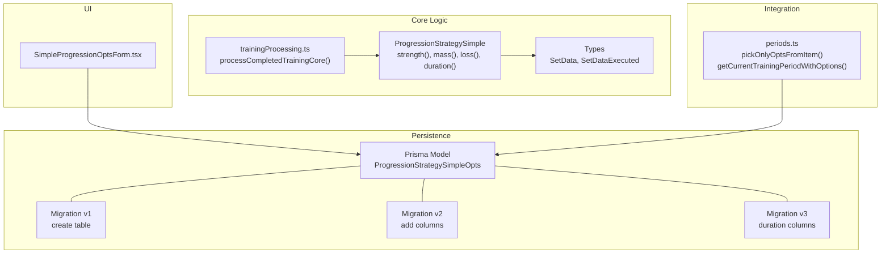
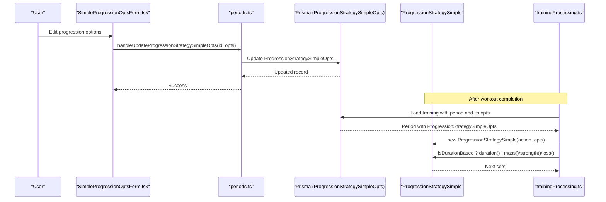
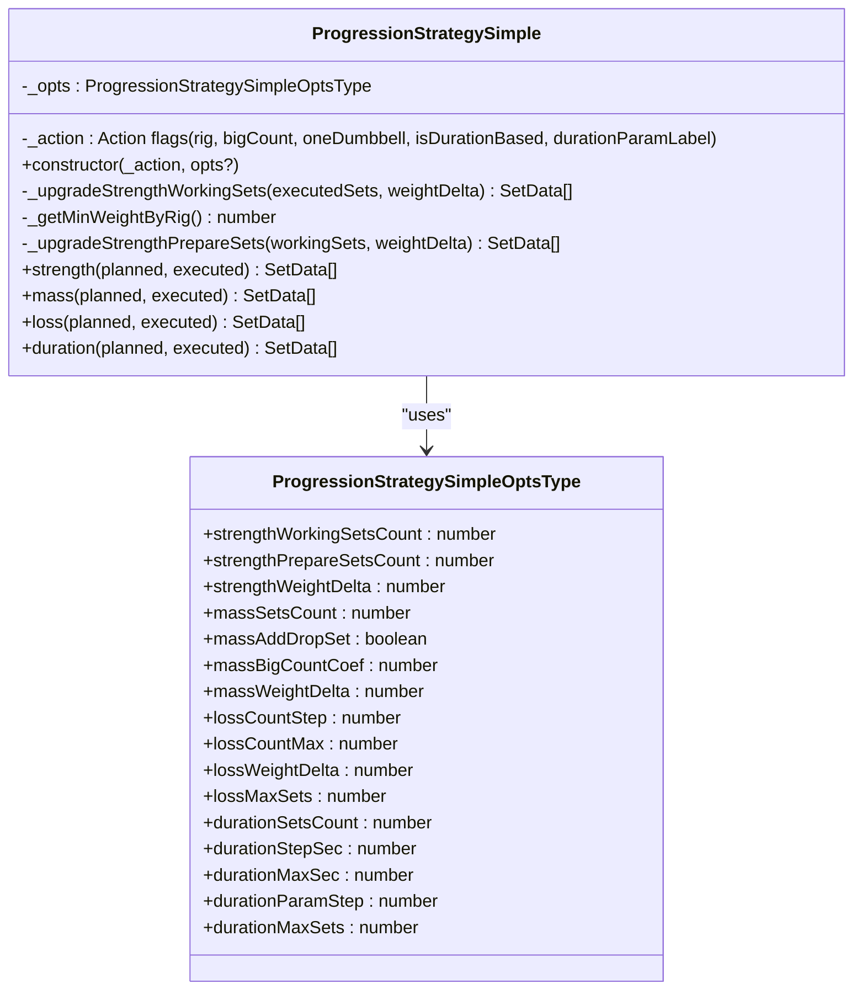
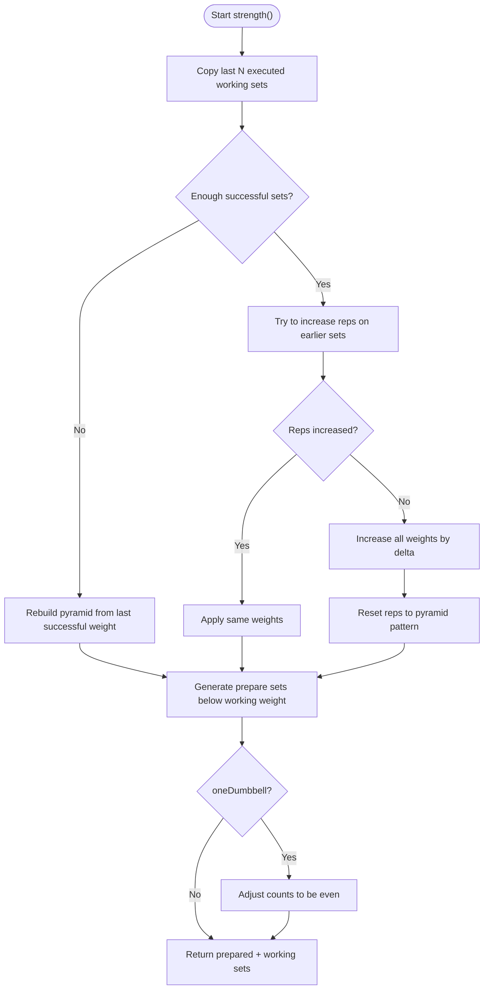
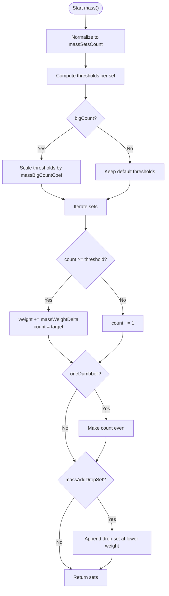
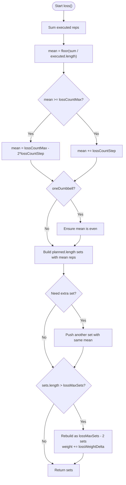
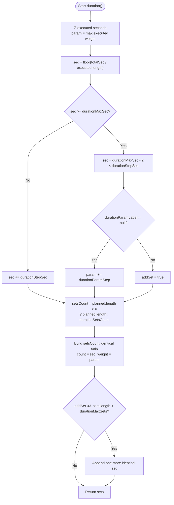
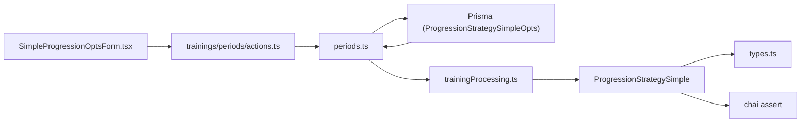

# Progression Strategies

<cite>
**Referenced Files in This Document**
- [simple.ts](file://src/core/progression/strategy/simple.ts)
- [types.ts](file://src/core/types.ts)
- [SimpleProgressionOptsForm.tsx](file://src/app/progression/SimpleProgressionOptsForm.tsx)
- [periods.ts](file://src/core/periods.ts)
- [actions.ts](file://src/app/trainings/periods/actions.ts)
- [trainingProcessing.ts](file://src/core/trainingProcessing.ts)
- [schema.prisma](file://prisma/schema.prisma)
- [migration.sql](file://prisma/migrations/20250430093143_progression_simple_opts/migration.sql)
- [migration.sql](file://prisma/migrations/20250430114209_add_progression_opts/migration.sql)
- [migration.sql](file://prisma/migrations/20260903132404_add_duration_exercises/migration.sql)
- [simple.test.ts](file://src/tests/core/progression/strategy/simple.test.ts)
- [simple-one-dumbbell.test.ts](file://src/tests/core/progression/strategy/simple-one-dumbbell.test.ts)
- [duration.test.ts](file://src/tests/core/progression/strategy/duration.test.ts)
</cite>

## Table of Contents
1. [Introduction](#introduction)
2. [Project Structure](#project-structure)
3. [Core Components](#core-components)
4. [Architecture Overview](#architecture-overview)
5. [Detailed Component Analysis](#detailed-component-analysis)
6. [Dependency Analysis](#dependency-analysis)
7. [Performance Considerations](#performance-considerations)
8. [Troubleshooting Guide](#troubleshooting-guide)
9. [Conclusion](#conclusion)

## Introduction
This document explains the simple progression strategy used by MeinGym to automatically adjust future sets for three training goals — strength, mass (hypertrophy), and loss (endurance) — plus a dedicated progression for duration-based exercises. The strategy is implemented as a pure TypeScript class with configurable options stored per user and per training period. It uses a pyramid approach for strength, a tree-pattern rep scheme for mass (with optional drop sets), increasing repetition targets for loss, and a "time first, then parameter" scheme for duration-based movements.

## Project Structure
The progression logic lives in the core module under src/core/progression/strategy/simple.ts. Configuration defaults are defined there and persisted via Prisma model ProgressionStrategySimpleOpts linked to TrainingPeriod. A client-side form allows users to edit these options. The strategy is applied from src/core/trainingProcessing.ts when a training is completed. Tests validate behavior across different exercise types, including one-dumbbell constraints and duration-based exercises.



**Diagram sources**
- [simple.ts:24-62](file://src/core/progression/strategy/simple.ts#L24-L62)
- [types.ts:10-19](file://src/core/types.ts#L10-L19)
- [trainingProcessing.ts:97-185](file://src/core/trainingProcessing.ts#L97-L185)
- [schema.prisma:692-724](file://prisma/schema.prisma#L692-L724)
- [migration.sql:1-24](file://prisma/migrations/20250430093143_progression_simple_opts/migration.sql#L1-L24)
- [migration.sql:1-7](file://prisma/migrations/20250430114209_add_progression_opts/migration.sql#L1-L7)
- [migration.sql:1-11](file://prisma/migrations/20260903132404_add_duration_exercises/migration.sql#L1-L11)
- [SimpleProgressionOptsForm.tsx:1-252](file://src/app/progression/SimpleProgressionOptsForm.tsx#L1-L252)
- [periods.ts:11-42](file://src/core/periods.ts#L11-L42)

**Section sources**
- [simple.ts:24-62](file://src/core/progression/strategy/simple.ts#L24-L62)
- [types.ts:10-19](file://src/core/types.ts#L10-L19)
- [schema.prisma:692-724](file://prisma/schema.prisma#L692-L724)
- [migration.sql:1-24](file://prisma/migrations/20250430093143_progression_simple_opts/migration.sql#L1-L24)
- [migration.sql:1-7](file://prisma/migrations/20250430114209_add_progression_opts/migration.sql#L1-L7)
- [migration.sql:1-11](file://prisma/migrations/20260903132404_add_duration_exercises/migration.sql#L1-L11)
- [SimpleProgressionOptsForm.tsx:1-252](file://src/app/progression/SimpleProgressionOptsForm.tsx#L1-L252)
- [periods.ts:11-42](file://src/core/periods.ts#L11-L42)

## Core Components
- ProgressionStrategySimple: Implements strength(), mass(), loss(), and duration() methods that compute next session’s sets based on executed sets and action attributes.
- ProgressionStrategySimpleOptsType: Configurable parameters controlling set counts, deltas, and goal-specific thresholds. Defaults are provided.
- Types: SetData and SetDataExecuted define input/output structures for sets.

Key behaviors:
- Strength: Pyramid of working sets plus preparatory sets; last working set always targets 1 rep; gradual weight increase when reps are met.
- Mass: Tree-pattern reps where each set has a threshold; if exceeded, increase weight by delta and reset reps to target; optional drop set at lower weight.
- Loss: Increase mean reps per set until hitting max; then add an extra set and gradually increase weight while maintaining rep targets.
- **New** Duration: Increase the mean seconds per set until hitting the time ceiling; then reset the time and raise the difficulty parameter, or add an extra set when the exercise has no parameter.

**Section sources**
- [simple.ts:24-62](file://src/core/progression/strategy/simple.ts#L24-L62)
- [simple.ts:82-216](file://src/core/progression/strategy/simple.ts#L82-L216)
- [simple.ts:261-274](file://src/core/progression/strategy/simple.ts#L261-L274)
- [simple.ts:276-339](file://src/core/progression/strategy/simple.ts#L276-L339)
- [simple.ts:341-381](file://src/core/progression/strategy/simple.ts#L341-L381)
- [simple.ts:393-428](file://src/core/progression/strategy/simple.ts#L393-L428)
- [types.ts:10-19](file://src/core/types.ts#L10-L19)

## Architecture Overview
The strategy is invoked after a training execution to generate the next plan. Options are loaded from the current training period’s ProgressionStrategySimpleOpts record. The UI exposes a form to update these options.



**Diagram sources**
- [SimpleProgressionOptsForm.tsx:1-60](file://src/app/progression/SimpleProgressionOptsForm.tsx#L1-L60)
- [periods.ts:187-195](file://src/core/periods.ts#L187-L195)
- [periods.ts:141-173](file://src/core/periods.ts#L141-L173)
- [schema.prisma:692-724](file://prisma/schema.prisma#L692-L724)
- [trainingProcessing.ts:136-164](file://src/core/trainingProcessing.ts#L136-L164)
- [simple.ts:64-80](file://src/core/progression/strategy/simple.ts#L64-L80)

## Detailed Component Analysis

### ProgressionStrategySimple Class
The class encapsulates all progression logic. Its constructor takes an Action subset (`rig`, `bigCount`, `oneDumbbell`, `isDurationBased`, `durationParamLabel`) plus optional overrides for the defaults, and exposes one method per training goal as well as a dedicated `duration()` method.

> **Note**: The former `strengthAllowed` restriction was removed; every exercise/action now supports the STRENGTH purpose, so the strategy no longer needs that flag.

> **New**: `isDurationBased` and `durationParamLabel` are read from the action to drive `duration()`. The method itself is dispatched by `trainingProcessing.ts`, not chosen inside the strategy — the caller checks `exercise.Action.isDurationBased` **before** the `purpose` branches.



**Diagram sources**
- [simple.ts:24-62](file://src/core/progression/strategy/simple.ts#L24-L62)
- [simple.ts:64-80](file://src/core/progression/strategy/simple.ts#L64-L80)
- [simple.ts:82-216](file://src/core/progression/strategy/simple.ts#L82-L216)
- [simple.ts:218-232](file://src/core/progression/strategy/simple.ts#L218-L232)
- [simple.ts:234-259](file://src/core/progression/strategy/simple.ts#L234-L259)
- [simple.ts:261-428](file://src/core/progression/strategy/simple.ts#L261-L428)

#### Strength Progression
- Builds a pyramid of working sets with decreasing reps and increasing weights.
- Prepares warm-up sets below working weights with higher reps.
- If not enough successful sets were completed, rebuilds the pyramid using the last successful weight.
- Ensures the final working set targets 1 rep.
- For one-dumbbell exercises, enforces even total reps per set.



**Diagram sources**
- [simple.ts:82-216](file://src/core/progression/strategy/simple.ts#L82-L216)
- [simple.ts:234-259](file://src/core/progression/strategy/simple.ts#L234-L259)
- [simple.ts:261-274](file://src/core/progression/strategy/simple.ts#L261-L274)

**Section sources**
- [simple.ts:82-216](file://src/core/progression/strategy/simple.ts#L82-L216)
- [simple.ts:218-232](file://src/core/progression/strategy/simple.ts#L218-L232)
- [simple.ts:234-259](file://src/core/progression/strategy/simple.ts#L234-L259)
- [simple.ts:261-274](file://src/core/progression/strategy/simple.ts#L261-L274)

#### Mass Progression
- Normalizes to a fixed number of sets.
- Uses thresholds per set; if count exceeds threshold, increase weight by delta and reset reps to target; otherwise increment reps.
- Supports “big count” exercises by scaling thresholds with a coefficient.
- Optionally appends a drop set at lower weight with high reps.
- Enforces even reps for one-dumbbell exercises.



**Diagram sources**
- [simple.ts:276-339](file://src/core/progression/strategy/simple.ts#L276-L339)

**Section sources**
- [simple.ts:276-339](file://src/core/progression/strategy/simple.ts#L276-L339)

#### Loss Progression
- Computes mean reps across executed sets.
- Increases mean by lossCountStep unless it reaches lossCountMax; then resets to a lower baseline and adds an extra set.
- Maintains uniform reps across sets; increases weight once set count grows beyond lossMaxSets.
- Enforces even reps for one-dumbbell exercises.



**Diagram sources**
- [simple.ts:341-381](file://src/core/progression/strategy/simple.ts#L341-L381)

**Section sources**
- [simple.ts:341-381](file://src/core/progression/strategy/simple.ts#L341-L381)

#### Duration Progression
**New** in v3.3.0 for exercises flagged `Action.isDurationBased`. For those actions the set fields are repurposed: `count` holds **seconds** and `weight` holds an arbitrary **difficulty parameter** (0 when the action has no `durationParamLabel`). The scheme is "time first, then parameter":

- Mean executed time is `floor(Σ seconds / executed.length)`.
- While the mean is below `durationMaxSec`, it grows by `durationStepSec` and the parameter stays untouched.
- Once the mean reaches `durationMaxSec`, time is reset to `durationMaxSec - 2 × durationStepSec` and progression moves to the parameter:
  - if `durationParamLabel` is set, the parameter grows by `durationParamStep`;
  - otherwise an extra set is appended (never exceeding `durationMaxSets`).
- The number of sets follows the previous plan (`planned.length`), falling back to `durationSetsCount` when nothing was planned.
- Unlike strength/mass/loss, `duration()` never touches `oneDumbbell` or rig-specific minimum weights.



**Diagram sources**
- [simple.ts:383-428](file://src/core/progression/strategy/simple.ts#L383-L428)
- [trainingProcessing.ts:136-164](file://src/core/trainingProcessing.ts#L136-L164)

**Section sources**
- [simple.ts:383-428](file://src/core/progression/strategy/simple.ts#L383-L428)
- [trainingProcessing.ts:136-164](file://src/core/trainingProcessing.ts#L136-L164)
- [schema.prisma:715-720](file://prisma/schema.prisma#L715-L720)

### Configuration and Persistence
- ProgressionStrategySimpleOptsType defines all tunable parameters with sensible defaults exported as `ProgressionStrategySimpleOptsDefaults`.
- Prisma model ProgressionStrategySimpleOpts stores options per user and per training period (`trainingPeriodId` is unique, both relations cascade on delete).
- Migration files create the table, add columns for weight deltas and loss-specific thresholds, and — in `20260903132404_add_duration_exercises` — add the five duration columns.
- periods.ts provides helpers to pick only relevant fields and fetch current options.

> **Updated**: The TypeScript and database defaults for `lossCountStep` intentionally differ — the code default is `4` while the column default is `2`. Rows created through `createTrainingPeriod` always carry the code default, because the record is built from `ProgressionStrategySimpleOptsDefaults`.

Defaults per goal:

| Group | Option | Default |
|---|---|---|
| Strength | `strengthWorkingSetsCount` / `strengthPrepareSetsCount` / `strengthWeightDelta` | 4 / 2 / 5 |
| Mass | `massSetsCount` / `massBigCountCoef` / `massWeightDelta` / `massAddDropSet` | 4 / 1.8 / 2.5 / true |
| Loss | `lossCountStep` / `lossCountMax` / `lossWeightDelta` / `lossMaxSets` | 4 / 16 / 1.25 / 6 |
| **Duration (new)** | `durationSetsCount` / `durationStepSec` / `durationMaxSec` / `durationParamStep` / `durationMaxSets` | 1 / 30 / 600 / 1 / 5 |

A new period never starts from a blank slate: `createTrainingPeriod` closes the previous period, loads the user's most recent `ProgressionStrategySimpleOpts`, narrows it with `pickOnlyOptsFromItem`, merges the optional overrides passed by the caller, and creates the new options row inside the same `trainingPeriod.create` call.

```mermaid
erDiagram
USER ||--o{ PROGRESSION_STRATEGY_SIMPLE_OPTS : "has many"
TRAINING_PERIOD ||--|| PROGRESSION_STRATEGY_SIMPLE_OPTS : "has one"
PROGRESSION_STRATEGY_SIMPLE_OPTS {
int id PK
string userId FK
int trainingPeriodId UK FK
int strengthWorkingSetsCount
int strengthPrepareSetsCount
float strengthWeightDelta
int massSetsCount
float massBigCountCoef
float massWeightDelta
bool massAddDropSet
int lossCountStep
int lossCountMax
float lossWeightDelta
int lossMaxSets
int durationSetsCount
int durationStepSec
int durationMaxSec
float durationParamStep
int durationMaxSets
datetime createdAt
datetime updatedAt
}
```

**Diagram sources**
- [schema.prisma:692-724](file://prisma/schema.prisma#L692-L724)
- [migration.sql:1-24](file://prisma/migrations/20250430093143_progression_simple_opts/migration.sql#L1-L24)
- [migration.sql:1-7](file://prisma/migrations/20250430114209_add_progression_opts/migration.sql#L1-L7)
- [migration.sql:1-11](file://prisma/migrations/20260903132404_add_duration_exercises/migration.sql#L1-L11)

**Section sources**
- [simple.ts:24-62](file://src/core/progression/strategy/simple.ts#L24-L62)
- [schema.prisma:692-724](file://prisma/schema.prisma#L692-L724)
- [migration.sql:1-24](file://prisma/migrations/20250430093143_progression_simple_opts/migration.sql#L1-L24)
- [migration.sql:1-7](file://prisma/migrations/20250430114209_add_progression_opts/migration.sql#L1-L7)
- [migration.sql:1-11](file://prisma/migrations/20260903132404_add_duration_exercises/migration.sql#L1-L11)
- [periods.ts:11-42](file://src/core/periods.ts#L11-L42)
- [periods.ts:43-92](file://src/core/periods.ts#L43-L92)

### UI Integration
- SimpleProgressionOptsForm renders inputs for all options, binds them to a single `useState<ProgressionStrategySimpleOptsType>` object, and submits updates via the `handleUpdateProgressionStrategySimpleOpts` server action, which delegates to `updateProgressionStrategySimpleOpts` and revalidates `/profile`.
- Values map directly to ProgressionStrategySimpleOptsType fields; `handleInputChange` derives the field name from the input and coerces `checkbox` to boolean and `number` inputs to `Number`.
- **New**: a fourth group of inputs (lines 188–244) covers `durationSetsCount`, `durationStepSec`, `durationMaxSec`, `durationParamStep` and `durationMaxSets`, separated from the loss group by an `<hr />`.
- The form falls back to `ProgressionStrategySimpleOptsDefaults` when no persisted options are supplied, so a missing record never renders empty inputs.

**Section sources**
- [SimpleProgressionOptsForm.tsx:1-252](file://src/app/progression/SimpleProgressionOptsForm.tsx#L1-L252)
- [SimpleProgressionOptsForm.tsx:188-244](file://src/app/progression/SimpleProgressionOptsForm.tsx#L188-L244)
- [actions.ts:27-33](file://src/app/trainings/periods/actions.ts#L27-L33)
- [periods.ts:187-195](file://src/core/periods.ts#L187-L195)

### Test Coverage Highlights
- Validates strength pyramid building, prepare sets generation, and progressive weight increases.
- Confirms mass progression thresholds, weight increments, and optional drop sets.
- Verifies loss progression mean rep increases, cap handling, and set count adjustments.
- Ensures one-dumbbell exercises enforce even reps across all strategies.
- **New**: `duration.test.ts` covers both parameter flavours of `duration()` — with a difficulty parameter (seconds grow by `durationStepSec`, the planned set count is respected, the parameter steps up and time resets at the ceiling) and without one (only seconds grow, an extra set is appended at the ceiling, and `durationMaxSets` is never exceeded). A guard loop asserts the scheme converges instead of oscillating.

**Section sources**
- [simple.test.ts:41-142](file://src/tests/core/progression/strategy/simple.test.ts#L41-L142)
- [simple.test.ts:144-158](file://src/tests/core/progression/strategy/simple.test.ts#L144-L158)
- [simple.test.ts:160-190](file://src/tests/core/progression/strategy/simple.test.ts#L160-L190)
- [simple.test.ts:192-235](file://src/tests/core/progression/strategy/simple.test.ts#L192-L235)
- [simple-one-dumbbell.test.ts:38-72](file://src/tests/core/progression/strategy/simple-one-dumbbell.test.ts#L38-L72)
- [duration.test.ts:56-160](file://src/tests/core/progression/strategy/duration.test.ts#L56-L160)

## Dependency Analysis
- ProgressionStrategySimple depends on:
  - Types: SetData, SetDataExecuted, CurrentPurpose (all from `src/core/types.ts`)
  - Action attributes: rig, bigCount, oneDumbbell, **isDurationBased, durationParamLabel**
  - `chai`'s `assert` — used at runtime, not only in tests: every public method starts with `assert.isAbove(executed.length, 0)`, so calling a strategy with no executed sets throws immediately
- Caller: `trainingProcessing.ts` is the only production caller. It builds the strategy with `new ProgressionStrategySimple(action, opts)` and dispatches on `Action.isDurationBased` first, then on `TrainingExercise.purpose`.
- Data flow:
  - UI updates options -> server action -> periods.ts persists via Prisma -> `getCurrentTrainingPeriodWithOptions` fetches them at processing time -> strategy computes next sets -> the caller writes them back as planned approaches.
- Options inheritance: `createTrainingPeriod` copies the previous period's options forward through `pickOnlyOptsFromItem`, so tuning survives period rotation.
- External dependencies:
  - Prisma ORM for persistence
  - Chai assert for runtime preconditions



**Diagram sources**
- [SimpleProgressionOptsForm.tsx:52-56](file://src/app/progression/SimpleProgressionOptsForm.tsx#L52-L56)
- [actions.ts:27-33](file://src/app/trainings/periods/actions.ts#L27-L33)
- [periods.ts:187-195](file://src/core/periods.ts#L187-L195)
- [periods.ts:141-173](file://src/core/periods.ts#L141-L173)
- [trainingProcessing.ts:97-185](file://src/core/trainingProcessing.ts#L97-L185)
- [simple.ts:64-80](file://src/core/progression/strategy/simple.ts#L64-L80)
- [types.ts:10-19](file://src/core/types.ts#L10-L19)

**Section sources**
- [SimpleProgressionOptsForm.tsx:1-60](file://src/app/progression/SimpleProgressionOptsForm.tsx#L1-L60)
- [actions.ts:27-33](file://src/app/trainings/periods/actions.ts#L27-L33)
- [periods.ts:11-42](file://src/core/periods.ts#L11-L42)
- [periods.ts:43-92](file://src/core/periods.ts#L43-L92)
- [periods.ts:141-173](file://src/core/periods.ts#L141-L173)
- [periods.ts:187-195](file://src/core/periods.ts#L187-L195)
- [trainingProcessing.ts:97-185](file://src/core/trainingProcessing.ts#L97-L185)
- [simple.ts:1-4](file://src/core/progression/strategy/simple.ts#L1-L4)
- [simple.ts:64-80](file://src/core/progression/strategy/simple.ts#L64-L80)
- [types.ts:10-19](file://src/core/types.ts#L10-L19)

## Performance Considerations
- The strategy performs O(n) operations over executed sets to compute means and build new set lists.
- Memory usage is minimal, creating small arrays of SetData objects.
- Avoid excessive re-computation by caching options per period and reusing strategy instances.
- Options are read once per training inside `processCompletedTrainingCore` via `getCurrentTrainingPeriodWithOptions`, not once per exercise — keep it that way when adding new callers.
- `duration()` and `loss()` are cheaper than `strength()`: they skip sorting and the rig-based minimum-weight lookup entirely.

[No sources needed since this section provides general guidance]

## Troubleshooting Guide
- Unexpected low reps or weights:
  - Verify executed sets contain sufficient successful attempts; insufficient success triggers pyramid rebuild with lower weights.
- One-dumbbell exercises showing odd reps:
  - Ensure oneDumbbell flag is set correctly; the strategy enforces even reps for strength, mass, and loss. `duration()` does not.
- Mass progression not increasing weight:
  - Check thresholds and massBigCountCoef; ensure counts meet or exceed thresholds before weight increases.
- Loss progression stuck at max reps:
  - When reaching lossCountMax, the strategy resets mean and adds an extra set; verify lossMaxSets and lossWeightDelta.
- "Assertion failed: expected executed.length to be above 0":
  - A goal method was called with an empty executed-sets array. `trainingProcessing.ts` filters out unexecuted and boost approaches before the call; if the array ends up empty the exercise is skipped rather than upgraded.
- Duration exercise progressing with the wrong goal:
  - `isDurationBased` is checked **before** the purpose branches in `trainingProcessing.ts`. If a duration action still goes through `loss()`, the flag is missing from the `Action` selected for the exercise.
- Duration time never growing:
  - `durationMaxSec` must exceed `2 × durationStepSec`; otherwise the reset value `durationMaxSec - 2 × durationStepSec` is zero or negative.
- Duration parameter stuck at 0:
  - `durationParamLabel` must be set on the action. Without it `duration()` deliberately grows the set count instead of the parameter, capped by `durationMaxSets`.
- Duration sets recorded as repetitions:
  - For duration actions `count` means seconds and `weight` means the difficulty parameter. Check the exercise was created through `createExercise` with `isDurationBased: true`, which also forces the purpose to LOSS.

**Section sources**
- [simple.ts:82-216](file://src/core/progression/strategy/simple.ts#L82-L216)
- [simple.ts:218-232](file://src/core/progression/strategy/simple.ts#L218-L232)
- [simple.ts:276-339](file://src/core/progression/strategy/simple.ts#L276-L339)
- [simple.ts:341-381](file://src/core/progression/strategy/simple.ts#L341-L381)
- [simple.ts:383-428](file://src/core/progression/strategy/simple.ts#L383-L428)
- [trainingProcessing.ts:97-185](file://src/core/trainingProcessing.ts#L97-L185)
- [simple-one-dumbbell.test.ts:38-72](file://src/tests/core/progression/strategy/simple-one-dumbbell.test.ts#L38-L72)
- [duration.test.ts:56-160](file://src/tests/core/progression/strategy/duration.test.ts#L56-L160)

## Conclusion
The simple progression strategy offers a clear, configurable framework for advancing strength, mass, and loss goals, and — since v3.3.0 — duration-based exercises as well. By leveraging pyramid-based strength plans, tree-pattern hypertrophy schemes, progressive endurance targets, and a "time first, then parameter" scheme for timed movements, it adapts to user performance while respecting equipment constraints. Options live per training period and are inherited when a new period is created, so tuning is never lost. The strategy stays pure and side-effect free; all persistence and dispatch decisions belong to `trainingProcessing.ts`, and the test suite covers each goal, the one-dumbbell constraint, and both duration flavours.

[No sources needed since this section summarizes without analyzing specific files]