# Scoring and Analytics

<cite>
**Referenced Files in This Document**
- [scores.ts](file://src/core/scores.ts)
- [schema.prisma](file://prisma/schema.prisma)
- [difficulty.ts](file://src/core/difficulty.ts)
- [stats.ts](file://src/core/stats.ts)
- [exercises.ts](file://src/core/exercises.ts)
- [estimate.ts](file://src/core/trainingTime/estimate.ts)
- [avgScorer.ts](file://src/core/trainingTime/avgScorer.ts)
- [trainingProcessing.ts](file://src/core/trainingProcessing.ts)
- [scores.ts (mobile)](file://src/mobile/scores.ts)
- [route.ts (mobile scores)](file://src/app/api/mobile/v1/trainings/scores/route.ts)
- [scores.test.ts](file://src/tests/core/scores.test.ts)
- [scores.ts (job processor)](file://src/jobs/processors/scores.ts)
</cite>

## Table of Contents
1. [Introduction](#introduction)
2. [Project Structure](#project-structure)
3. [Core Components](#core-components)
4. [Architecture Overview](#architecture-overview)
5. [Detailed Component Analysis](#detailed-component-analysis)
6. [Dependency Analysis](#dependency-analysis)
7. [Performance Considerations](#performance-considerations)
8. [Troubleshooting Guide](#troubleshooting-guide)
9. [Conclusion](#conclusion)

## Introduction
This document explains how exercise performance is normalized and scored using log-scaling and purpose-specific coefficients. It focuses on the normalization function, the scoring matrix per training purpose, and the creation of TrainingExerciseScore records. The system computes five normalized metrics—liftedSumNorm, liftedMeanNorm, liftedMaxNorm, liftedCountTotalNorm, and liftedCountMeanNorm—and combines them with a purpose-driven coefficient matrix to produce a single score.

Two consumers reuse the same pipeline without touching the database: `calculateExerciseDifficulty` multiplies the preview score by the action's base metric, and — **new** in v3.3.0 — the mobile endpoint `POST /api/mobile/v1/trainings/scores` returns a pure preview of both the difficulty and the estimated training time before a workout is even created.

**Updated** for duration-based exercises: the aggregates that feed scoring are produced by `calculateStats`, which switches to a duration branch when `Action.isDurationBased` is set. In that branch `count` means seconds and `weight` means an arbitrary difficulty parameter, and body weight is never added.

## Project Structure
The scoring logic resides in the core module and integrates with the database schema via Prisma. Background jobs trigger score calculation for completed trainings. Difficulty calculations reuse the same normalization and scoring pipeline to estimate difficulty before execution, and the mobile API exposes that preview over HTTP.

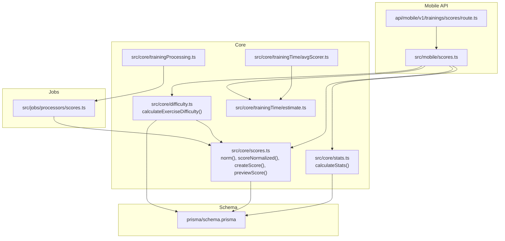

**Diagram sources**
- [scores.ts:1-121](file://src/core/scores.ts#L1-L121)
- [difficulty.ts:1-32](file://src/core/difficulty.ts#L1-L32)
- [stats.ts:57-101](file://src/core/stats.ts#L57-L101)
- [estimate.ts:1-18](file://src/core/trainingTime/estimate.ts#L1-L18)
- [avgScorer.ts:1-41](file://src/core/trainingTime/avgScorer.ts#L1-L41)
- [trainingProcessing.ts:97-194](file://src/core/trainingProcessing.ts#L97-L194)
- [scores.ts:1-173 (mobile)](file://src/mobile/scores.ts#L1-L173)
- [route.ts:1-100 (mobile scores)](file://src/app/api/mobile/v1/trainings/scores/route.ts#L1-L100)
- [scores.ts:1-36 (job processor)](file://src/jobs/processors/scores.ts#L1-L36)
- [schema.prisma:595-617](file://prisma/schema.prisma#L595-L617)

**Section sources**
- [scores.ts:1-121](file://src/core/scores.ts#L1-L121)
- [schema.prisma:595-617](file://prisma/schema.prisma#L595-L617)
- [difficulty.ts:1-32](file://src/core/difficulty.ts#L1-L32)
- [scores.ts:1-36 (job processor)](file://src/jobs/processors/scores.ts#L1-L36)

## Core Components
- Log-normalization: A simple logarithmic transform applied to each metric to compress dynamic ranges and stabilize variance.
- Purpose-specific coefficients: A matrix that weights the normalized metrics differently depending on whether the goal is STRENGTH, MASS, or LOSS.
- Score computation: Weighted sum of normalized metrics using the selected coefficient set.
- Record creation: Persist normalized values, coefficients, and final score into TrainingExerciseScore.
- Preview scoring: Pre-compute an approximate score using approach group aggregates prior to actual execution.
- **Updated** Aggregate computation: `calculateStats` turns raw sets into the `sum / mean / max / countTotal / countMean` aggregates consumed by `previewScore`; it takes an `isDurationBased` flag that switches the meaning of the set fields.
- **New** Mobile preview: `calculateTrainingScores` composes `calculateStats`, `estimateExerciseTimeInMins` and `calculateExerciseDifficulty` into a read-only estimate for a set of exercises the mobile app is about to add to a training.

Key responsibilities:
- normLogFn: Applies log scaling to raw metrics.
- norm: Normalizes all five metrics from a TrainingExercise.
- scoreNormalized: Computes weighted score using purpose-specific coefficients and returns the coefficients actually used.
- createScore: Persists normalized data and score to the database.
- previewScore: Estimates score from planned/approach aggregates.
- calculateExerciseDifficulty: `action.base × previewScore(purpose, approachGroup)`.
- calculateTrainingScores: Mobile-facing, non-persisting preview of time and difficulty scores.

**Section sources**
- [scores.ts:24-51](file://src/core/scores.ts#L24-L51)
- [scores.ts:80-121](file://src/core/scores.ts#L80-L121)
- [difficulty.ts:16-32](file://src/core/difficulty.ts#L16-L32)
- [stats.ts:57-101](file://src/core/stats.ts#L57-L101)
- [scores.ts:110-173 (mobile)](file://src/mobile/scores.ts#L110-L173)

## Architecture Overview
The scoring pipeline is pure and deterministic, operating on TrainingExercise data and persisting results. `processCompletedTrainingCore` schedules the job, and the background worker computes scores after training completion. Difficulty estimation reuses the same normalization and scoring functions to provide pre-execution insights — both inside the web app and, since v3.3.0, over the mobile API.

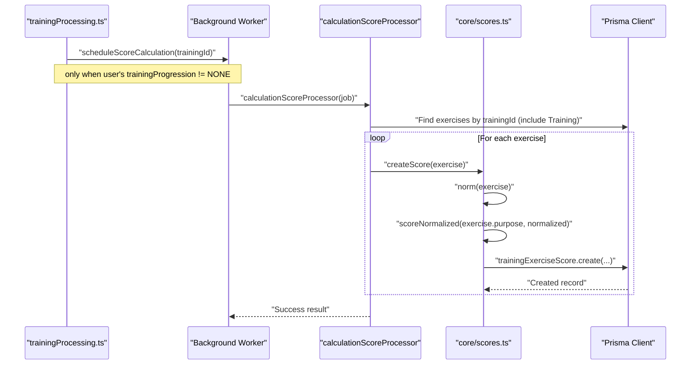

**Diagram sources**
- [trainingProcessing.ts:97-194](file://src/core/trainingProcessing.ts#L97-L194)
- [scores.ts:1-36 (job processor)](file://src/jobs/processors/scores.ts#L1-L36)
- [scores.ts:80-102](file://src/core/scores.ts#L80-L102)
- [schema.prisma:595-617](file://prisma/schema.prisma#L595-L617)

## Detailed Component Analysis

### Log-Normalization Function
- Purpose: Stabilize scale differences across metrics by applying a natural logarithm to positive values; zero maps to zero.
- Input: Single numeric metric value.
- Output: Normalized value suitable for linear combination with coefficients.
- Because `Math.log` of a value below 1 is negative, small metrics normalize to negative numbers — this is intentional and interacts with the negative STRENGTH coefficient on `liftedCountMeanNorm`.

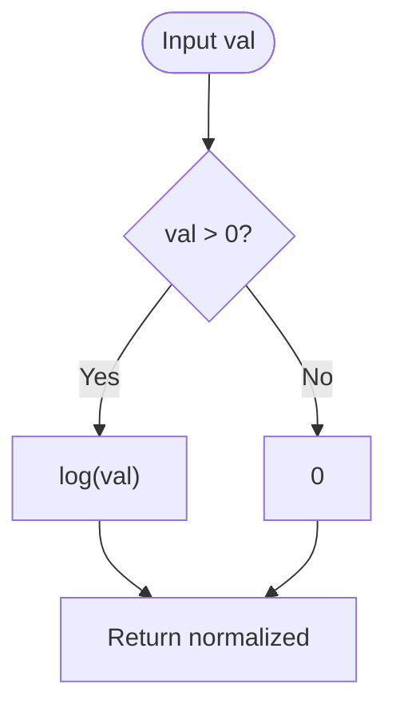

**Diagram sources**
- [scores.ts:24-26](file://src/core/scores.ts#L24-L26)

**Section sources**
- [scores.ts:24-26](file://src/core/scores.ts#L24-L26)

### Normalization of Five Metrics
- Inputs: liftedSum, liftedMean, liftedMax, liftedCountTotal, liftedCountMean from TrainingExercise.
- Process: Apply log-normalization to each metric independently.
- Outputs: liftedSumNorm, liftedMeanNorm, liftedMaxNorm, liftedCountTotalNorm, liftedCountMeanNorm.
- Those five aggregate columns are themselves written earlier by the approach-group statistics produced by `calculateStats`, so a duration-based exercise stores seconds where a regular one stores kilograms.

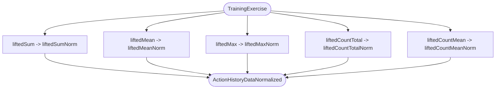

**Diagram sources**
- [scores.ts:8-36](file://src/core/scores.ts#L8-L36)

**Section sources**
- [scores.ts:8-36](file://src/core/scores.ts#L8-L36)
- [stats.ts:57-101](file://src/core/stats.ts#L57-L101)

### Purpose-Specific Coefficients Matrix
- STRENGTH: Emphasizes max and sum (0.5 each), penalizes high count mean (−0.5), ignores mean weight and count total.
- MASS: Emphasizes mean weight (0.5), with smaller contributions from count mean and sum (0.25 each) and max (0.1); ignores count total.
- LOSS: Emphasizes counts and max (0.5 each), ignores mean weight and sum.

Coefficients are stored inline in the exported `ScoreCoefficients` record and used to compute the weighted score. The exact matrix:

| Metric | STRENGTH | MASS | LOSS |
|---|---|---|---|
| `liftedMaxNorm` | 0.5 | 0.1 | 0.5 |
| `liftedSumNorm` | 0.5 | 0.25 | 0 |
| `liftedMeanNorm` | 0 | 0.5 | 0 |
| `liftedCountTotalNorm` | 0 | 0 | 0.5 |
| `liftedCountMeanNorm` | −0.5 | 0.25 | 0.5 |

Duration-based exercises are always scored with the LOSS row, because `createExercise` forces their purpose to LOSS.

**Diagram sources**
- [scores.ts:53-78](file://src/core/scores.ts#L53-L78)

**Section sources**
- [scores.ts:53-78](file://src/core/scores.ts#L53-L78)
- [exercises.ts:117-131](file://src/core/exercises.ts#L117-L131)

### Score Computation
- Inputs: Purpose and normalized metrics.
- Process: Multiply each normalized metric by its corresponding coefficient and sum them up.
- Output: Numeric score and the coefficients used.
- The loop guards with `if (data[k])`, so a metric that normalized to exactly 0 is skipped rather than contributing a zero term — the result is identical, but it also means a `NaN` metric would be silently dropped.

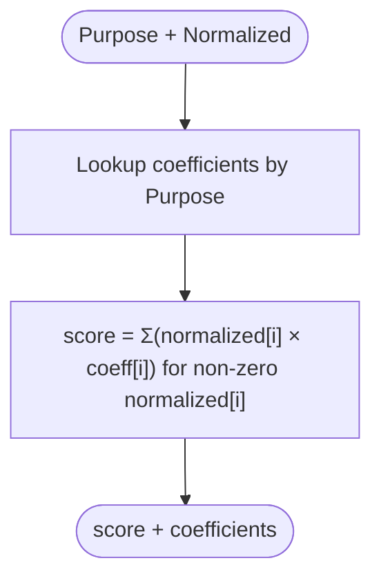

**Diagram sources**
- [scores.ts:38-51](file://src/core/scores.ts#L38-L51)

**Section sources**
- [scores.ts:38-51](file://src/core/scores.ts#L38-L51)

### Creating TrainingExerciseScore Records
- Trigger: `processCompletedTrainingCore` calls `scheduleScoreCalculation(trainingId)` after a training is completed and processed. The call sits inside the `trainingProgression !== NONE` branch, so users who disabled progression get no score rows.
- Steps:
  - Load every `TrainingExercise` of the training together with its `Training` (needed for `userId`).
  - Normalize metrics.
  - Compute score with purpose-specific coefficients.
  - Persist normalized values, coefficients, and score into TrainingExerciseScore.
- `createdAt` is taken from `exercise.completedAt`, falling back to `new Date()`; this keeps score history aligned with when the exercise was actually finished rather than when the job ran.
- The processor disconnects Prisma in a `finally` block and rethrows on failure so Bull can retry the job.

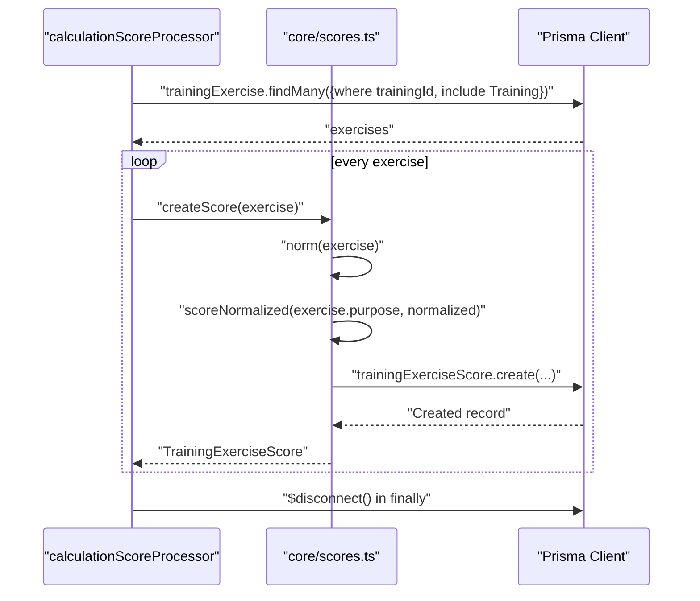

**Diagram sources**
- [scores.ts:4-36 (job processor)](file://src/jobs/processors/scores.ts#L4-L36)
- [scores.ts:80-102](file://src/core/scores.ts#L80-L102)
- [schema.prisma:595-617](file://prisma/schema.prisma#L595-L617)

**Section sources**
- [scores.ts:80-102](file://src/core/scores.ts#L80-L102)
- [scores.ts:4-36 (job processor)](file://src/jobs/processors/scores.ts#L4-L36)
- [trainingProcessing.ts:97-194](file://src/core/trainingProcessing.ts#L97-L194)
- [schema.prisma:595-617](file://prisma/schema.prisma#L595-L617)

### Preview Scoring (Pre-Execution)
- Purpose: Estimate difficulty and expected score before actual execution using approach group aggregates.
- Inputs: Purpose and aggregate metrics (sum, mean, max, countTotal, countMean).
- Process: Same normalization and coefficient weighting as post-execution scoring.
- Usage: Combined with action base to calculate exercise/training difficulty (`calculateExerciseDifficulty`, `calculateTrainingDifficulty`), and reused verbatim by the mobile preview endpoint.
- `previewScore` returns only the score, not the coefficients — nothing is persisted.

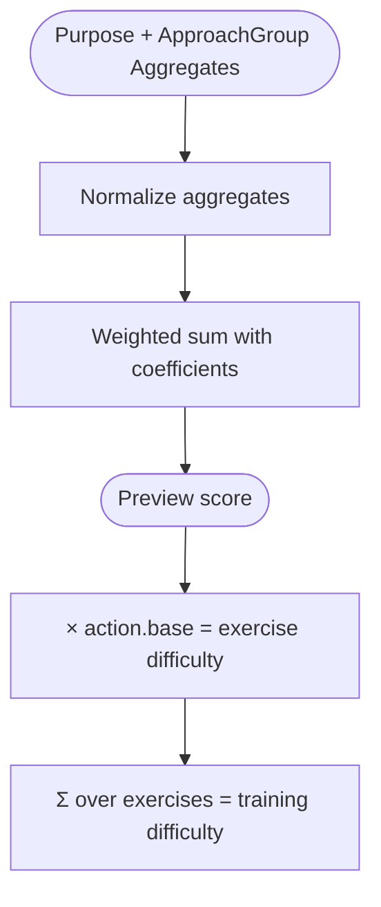

**Diagram sources**
- [scores.ts:104-121](file://src/core/scores.ts#L104-L121)
- [difficulty.ts:16-32](file://src/core/difficulty.ts#L16-L32)

**Section sources**
- [scores.ts:104-121](file://src/core/scores.ts#L104-L121)
- [difficulty.ts:1-32](file://src/core/difficulty.ts#L1-L32)

### Duration-Based Exercises in Scoring
**New** in v3.3.0. When `Action.isDurationBased` is true the set fields are repurposed, and every stage of the pipeline has to know about it:

- `calculateStats(setsData, actionRig, userWeight, isDurationBased = false)` takes a fourth argument. In the duration branch body weight is never added, `countTotal` accumulates seconds, `sum` accumulates `parameter × seconds`, `mean` accumulates the parameter and `weightMax` is the highest parameter. Sets with zero seconds are skipped.
- `findInfoForCalculationStatsForAction` skips the body-weight lookup when `rig === OTHER && isDurationBased`, so a duration exercise never fails with "не найдено ни одной записи веса".
- `getRawQueryForApproachGroup` selects `A."isDurationBased"` alongside the rig and the latest body weight, so the approach-group recalculation path gets the flag too.
- The purpose is forced to LOSS at creation time, which selects the LOSS coefficient row: counts and max dominate, tonnage is ignored — exactly what a timed exercise needs.

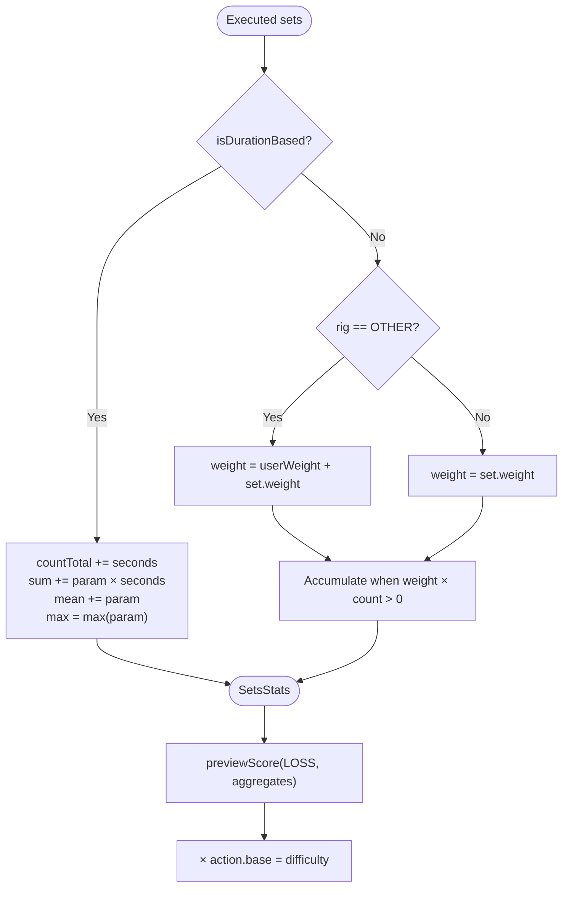

**Diagram sources**
- [stats.ts:57-101](file://src/core/stats.ts#L57-L101)
- [scores.ts:104-121](file://src/core/scores.ts#L104-L121)
- [difficulty.ts:16-20](file://src/core/difficulty.ts#L16-L20)

**Section sources**
- [stats.ts:6-55](file://src/core/stats.ts#L6-L55)
- [stats.ts:57-101](file://src/core/stats.ts#L57-L101)
- [exercises.ts:117-131](file://src/core/exercises.ts#L117-L131)
- [scores.ts:53-78](file://src/core/scores.ts#L53-L78)

### Mobile Preview Scores Endpoint
**New** in v3.3.0. `POST /api/mobile/v1/trainings/scores` lets the mobile app price a workout before creating it. The calculation is deliberately pure: nothing is created or updated.

- Authentication: the standard mobile `Authorization: Bearer <JWT>` check via `verifyMobileToken`.
- Validation: zod schema `{ exercises: [{ id, purpose, approaches: [{ weight, count, priority?, isBoost? }] }] }`; at least one exercise, at most `MAX_EXERCISES_PER_REQUEST` (50) — exceeding it returns HTTP 413, and a malformed field returns HTTP 400 with a path like `exercises[0].approaches[1].weight: Expected number, received string`.
- `loadActionsForScoring` selects only `id`, `base`, `rig`, `isDurationBased` for all requested ids in a single query and throws `MobileScoresInputError` (mapped to HTTP 400) listing the unknown ids.
- `loadUserWeightIfRequired` fetches the latest body weight only when at least one action is `rig === OTHER && !isDurationBased`; if none matches it returns 0 without a query, and if one matches but no weight record exists it raises HTTP 400.
- For each exercise the purpose is overridden to LOSS for duration actions, then `calculateStats`, `estimateExerciseTimeInMins` and `calculateExerciseDifficulty` produce `approachesCount`, `timeScoreInMins`, `timeScoreInSecs` and `difficultyScore`.
- The response also carries training-level totals: `timeScoreInMins` is the sum over exercises, `timeScoreInSecs` is `mins × 60`, and `difficultyScore` is the sum of exercise difficulties.

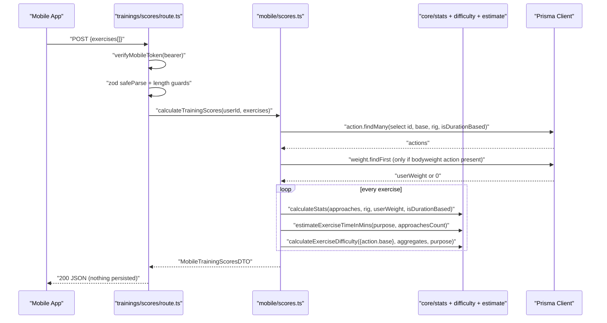

**Diagram sources**
- [route.ts:45-100 (mobile scores)](file://src/app/api/mobile/v1/trainings/scores/route.ts#L45-L100)
- [scores.ts:53-101 (mobile)](file://src/mobile/scores.ts#L53-L101)
- [scores.ts:110-173 (mobile)](file://src/mobile/scores.ts#L110-L173)

**Section sources**
- [route.ts:1-100 (mobile scores)](file://src/app/api/mobile/v1/trainings/scores/route.ts#L1-L100)
- [scores.ts:1-173 (mobile)](file://src/mobile/scores.ts#L1-L173)
- [stats.ts:57-101](file://src/core/stats.ts#L57-L101)
- [estimate.ts:4-18](file://src/core/trainingTime/estimate.ts#L4-L18)
- [difficulty.ts:16-20](file://src/core/difficulty.ts#L16-L20)

### Database Model: TrainingExerciseScore
- Fields include timestamp, user/action/purpose linkage, normalized metrics, coefficients JSON, and final score.
- `trainingExerciseId` defaults to 0 and every numeric column defaults to 0, so partial writes never produce nulls.
- Indexed by `(userId, actionId, purpose, createdAt)` for efficient querying.
- Relationships link back to User, Action, and TrainingExercise, all with `onDelete: Cascade`.

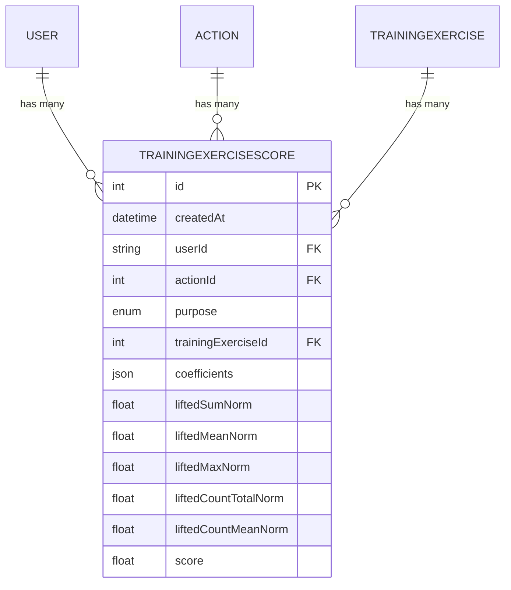

**Diagram sources**
- [schema.prisma:595-617](file://prisma/schema.prisma#L595-L617)

**Section sources**
- [schema.prisma:595-617](file://prisma/schema.prisma#L595-L617)

## Dependency Analysis
- Core scoring depends only on Prisma client for persistence and type definitions from the generated client.
- Job processor orchestrates batch score creation per training; it is scheduled by `trainingProcessing.ts`.
- Difficulty module consumes preview scoring to estimate difficulty without requiring executed data.
- **Updated** `core/stats.ts` sits upstream: it produces the aggregates that `previewScore` consumes and is the single place that knows about the duration branch.
- **New** `mobile/scores.ts` is a pure composition layer over `core/stats.ts`, `core/difficulty.ts` and `core/trainingTime/estimate.ts`; it imports nothing from the jobs or the web pages, so it stays testable in isolation.
- The dependency direction is strictly one-way: routes → mobile/core services → Prisma. No core module imports from `src/app` or `src/mobile`.

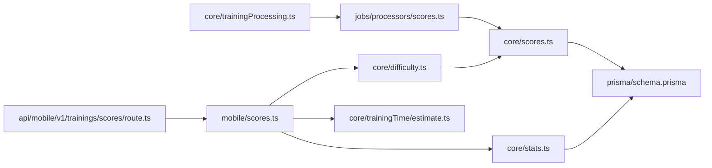

**Diagram sources**
- [scores.ts:1-2 (job processor)](file://src/jobs/processors/scores.ts#L1-L2)
- [scores.ts:1-6](file://src/core/scores.ts#L1-L6)
- [difficulty.ts:1-2](file://src/core/difficulty.ts#L1-L2)
- [stats.ts:1-4](file://src/core/stats.ts#L1-L4)
- [scores.ts:1-8 (mobile)](file://src/mobile/scores.ts#L1-L8)
- [route.ts:1-8 (mobile scores)](file://src/app/api/mobile/v1/trainings/scores/route.ts#L1-L8)
- [trainingProcessing.ts:1-20](file://src/core/trainingProcessing.ts#L1-L20)
- [schema.prisma:595-617](file://prisma/schema.prisma#L595-L617)

**Section sources**
- [scores.ts:1-36 (job processor)](file://src/jobs/processors/scores.ts#L1-L36)
- [scores.ts:1-121](file://src/core/scores.ts#L1-L121)
- [difficulty.ts:1-32](file://src/core/difficulty.ts#L1-L32)
- [stats.ts:1-101](file://src/core/stats.ts#L1-L101)
- [scores.ts:1-173 (mobile)](file://src/mobile/scores.ts#L1-L173)
- [route.ts:1-100 (mobile scores)](file://src/app/api/mobile/v1/trainings/scores/route.ts#L1-L100)
- [schema.prisma:595-617](file://prisma/schema.prisma#L595-L617)

## Performance Considerations
- Log normalization is O(1) per metric; overall normalization is O(1) since the number of metrics is fixed.
- Score computation is a constant-time weighted sum over five metrics.
- Batch processing in the job processor avoids repeated overhead per training.
- Indexing on TrainingExerciseScore supports fast retrieval by user, action, purpose, and time.
- The mobile preview endpoint resolves all requested actions in a **single** `findMany` and fetches body weight at most once per request, keeping the whole handler at two or three queries regardless of how many exercises are priced.
- `MAX_EXERCISES_PER_REQUEST` (50) caps the payload; the guard runs before zod parsing so oversized bodies are rejected with HTTP 413 without building the schema result.
- Scoring stays off the HTTP request path for real trainings — only the mobile *preview* is synchronous, and it writes nothing.

[No sources needed since this section provides general guidance]

## Troubleshooting Guide
- If scores are not created:
  - Ensure the background worker is running and processing jobs (`npm run workers`, Redis must be up).
  - Check the user's `trainingProgression` setting: `scheduleScoreCalculation` is only called when it is not `NONE`.
  - Verify that TrainingExercise records have valid purpose and aggregated metrics.
- If preview scores seem off:
  - Confirm approach group aggregates reflect realistic planned sets.
  - Check purpose selection matches intended goal.
- If difficulty estimates are unexpected:
  - Validate action base values (`Action.base` is derived from muscle size factors) and approach group aggregates.
  - Review purpose-specific coefficients for alignment with goals.
- If a duration exercise scores like a heavy lift:
  - `calculateStats` must receive `isDurationBased = true`. When the flag is missing, seconds are treated as repetitions and the difficulty parameter as kilograms, inflating `liftedSumNorm`.
- If the mobile preview returns 400 "User has no weight records required for bodyweight exercises":
  - At least one requested action has `rig = OTHER` and is not duration-based, and the user has no `Weight` rows. Create a body weight record or drop that exercise from the request.
- If the mobile preview returns 400 "Unknown exercise ids":
  - The message lists every id that has no `Action` row. Ids come from `GET /api/mobile/v1/exercises`; a stale local catalog is the usual cause.
- If the mobile preview returns 413:
  - More than 50 exercises were sent in one request; split the call.
- If the mobile preview returns a difficulty of 0:
  - Either `Action.base` is 0 (the action has no agonist/synergist muscles mapped) or every aggregate normalized to 0 (all sets empty).

**Section sources**
- [scores.ts:4-36 (job processor)](file://src/jobs/processors/scores.ts#L4-L36)
- [trainingProcessing.ts:97-194](file://src/core/trainingProcessing.ts#L97-L194)
- [difficulty.ts:16-32](file://src/core/difficulty.ts#L16-L32)
- [stats.ts:57-101](file://src/core/stats.ts#L57-L101)
- [scores.ts:53-101 (mobile)](file://src/mobile/scores.ts#L53-L101)
- [route.ts:45-100 (mobile scores)](file://src/app/api/mobile/v1/trainings/scores/route.ts#L45-L100)

## Conclusion
The scoring system uses robust log-normalization and purpose-specific coefficients to convert raw exercise metrics into comparable scores. It persists detailed normalized data and coefficients for historical analysis, while also enabling pre-execution difficulty estimation. Since v3.3.0 the same pure functions back two additional paths: duration-based exercises, whose seconds-and-parameter semantics are handled once in `calculateStats` and never leak into the scoring formulas, and the mobile preview endpoint, which prices a workout over HTTP without writing a single row. The design stays modular and one-way — routes and jobs depend on core, never the reverse — and database indexing keeps historical retrieval fast.