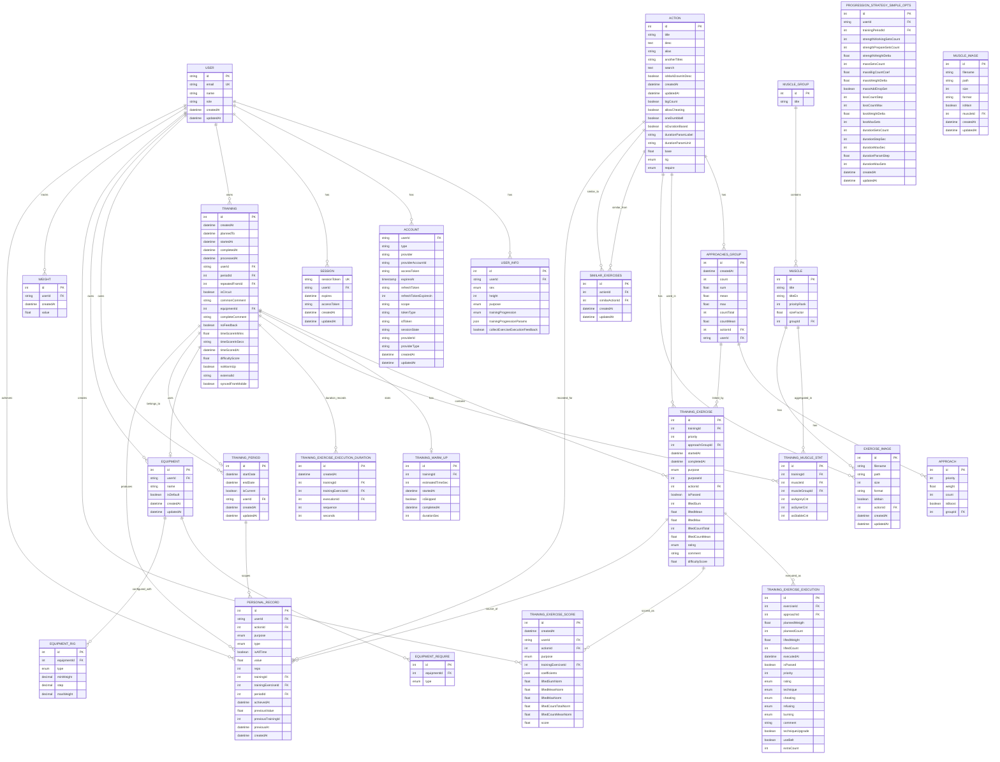
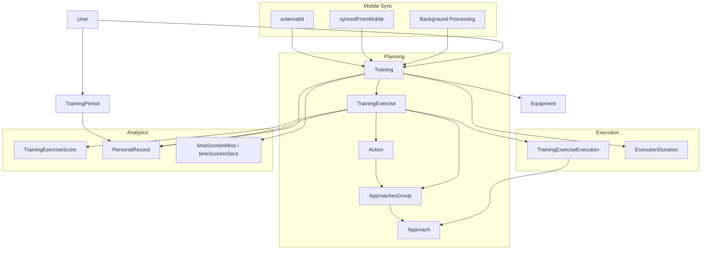
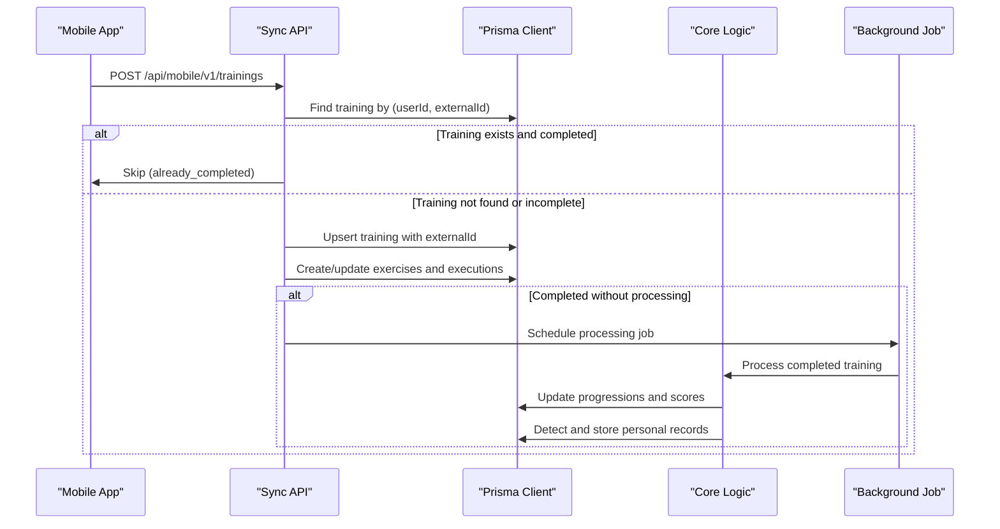
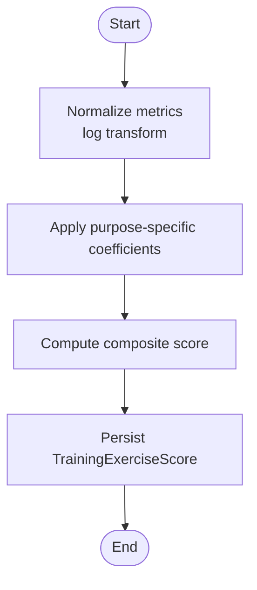
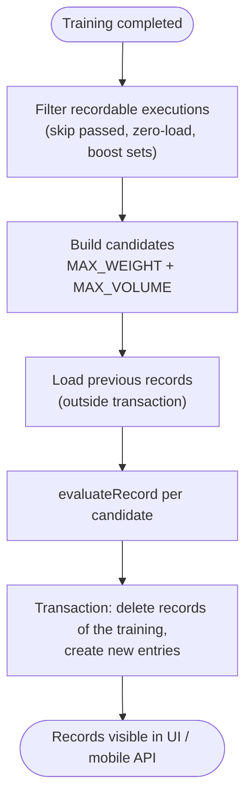
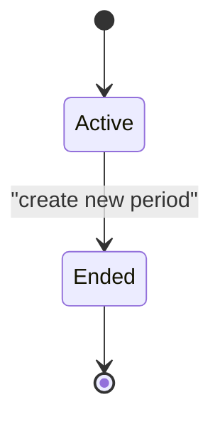
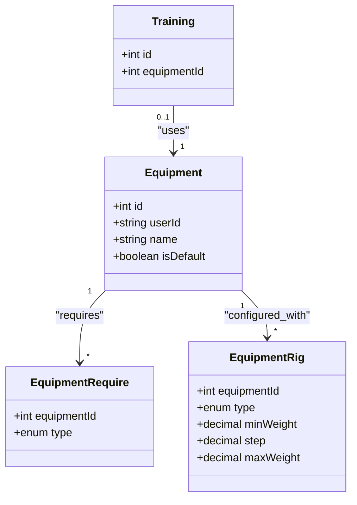
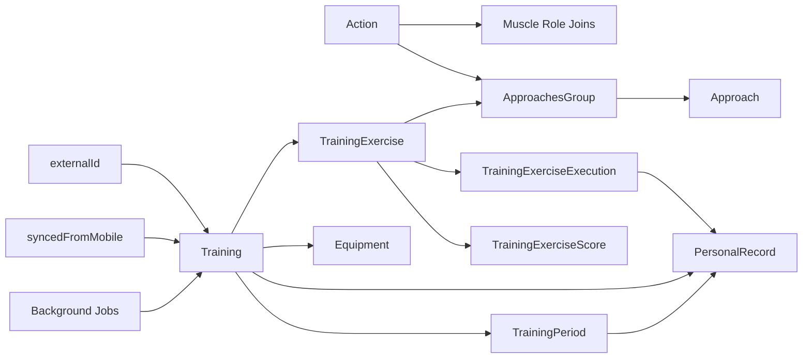

# Data Model

<cite>
**Referenced Files in This Document**
- [schema.prisma](file://prisma/schema.prisma)
- [syncTrainings.ts](file://src/mobile/syncTrainings.ts)
- [route.ts (mobile trainings)](file://src/app/api/mobile/v1/trainings/route.ts)
- [trainingProcessing.ts](file://src/core/trainingProcessing.ts)
- [config.ts](file://src/jobs/config.ts)
- [queues.ts](file://src/jobs/queues.ts)
- [trainings processor](file://src/jobs/processors/trainings.ts)
- [weights.ts](file://src/mobile/weights.ts)
- [weight_user_date_index migration](file://prisma/migrations/20260808225012_weight_user_date_index/migration.sql)
- [scores.ts](file://src/core/scores.ts)
- [periods.ts](file://src/core/periods.ts)
- [avgScorer.ts](file://src/core/trainingTime/avgScorer.ts)
- [page.tsx (training execute)](file://src/app/trainings/[id]/execute/page.tsx)
- [actions page.tsx](file://src/app/actions/page.tsx)
- [exercises.ts (core)](file://src/core/exercises.ts)
- [actions.ts (muscles)](file://src/app/muscles/actions.ts)
- [index.ts (records)](file://src/core/records/index.ts)
- [detect.ts (records)](file://src/core/records/detect.ts)
- [recalculate.ts (records)](file://src/core/records/recalculate.ts)
- [evaluate.ts (records)](file://src/core/records/evaluate.ts)
- [engine.ts (records)](file://src/core/records/engine.ts)
- [valuation.ts (records)](file://src/core/records/valuation.ts)
- [types.ts (records)](file://src/core/records/types.ts)
- [add_personal_records migration](file://prisma/migrations/20260816193013_add_personal_records/migration.sql)
- [add_duration_exercises migration](file://prisma/migrations/20260903132404_add_duration_exercises/migration.sql)
- [muscle_classification migration](file://prisma/migrations/20260707120000_muscle_classification/migration.sql)
</cite>

## Update Summary
**Changes Made**
- Added the PersonalRecord model: personal records per user/exercise/purpose with MAX_WEIGHT and MAX_VOLUME types, all-time and per-period variants, and three supporting indexes
- Added duration-based exercises: Action.isDurationBased, Action.durationParamLabel, Action.durationParamUnit (seconds are stored in Approach.count / Execution.liftedCount, the optional difficulty parameter in weight / liftedWeight)
- Extended ProgressionStrategySimpleOpts with duration options (durationSetsCount, durationStepSec, durationMaxSec, durationParamStep, durationMaxSets)
- Action.base is now derived from Muscle.sizeFactor (0.7 × Σ agonist sizeFactors + 0.3 × Σ synergist sizeFactors) and is recalculated for all linked exercises when a muscle is updated
- Previously added: mobile synchronization support (externalId, syncedFromMobile), batch training sync API with JWT authentication, optimized weight indexes, and Bull/Redis job processing

## Table of Contents
1. [Introduction](#introduction)
2. [Project Structure](#project-structure)
3. [Core Components](#core-components)
4. [Architecture Overview](#architecture-overview)
5. [Detailed Component Analysis](#detailed-component-analysis)
6. [Dependency Analysis](#dependency-analysis)
7. [Performance Considerations](#performance-considerations)
8. [Troubleshooting Guide](#troubleshooting-guide)
9. [Conclusion](#conclusion)

## Introduction
This document provides a comprehensive overview of the Prisma data model used by MeinGym, focusing on User, Action (exercises), Training lifecycle, Execution tracking, Scoring, Personal Records, Periods, Equipment, and the Mobile Synchronization system. It explains key relationships, enums, indexes, and how core business logic interacts with the schema, including duration-based exercises, muscle-size-driven exercise "base" scoring, and performance optimizations.

## Project Structure
The data model is defined in a single Prisma schema file and evolved through numerous migrations. The most relevant entities for this document are:
- Identity and profiles: User, UserInfo, Account, Session
- Exercise catalog: Action, MuscleGroup, Muscle, and muscle-role mappings
- Planning and execution: Training, TrainingExercise, ApproachesGroup, Approach, TrainingExerciseExecution
- Progression and periodization: TrainingPeriod, ProgressionStrategySimpleOpts
- Scoring: TrainingExerciseScore
- Personal records: PersonalRecord with the PersonalRecordType enum (MAX_WEIGHT, MAX_VOLUME)
- Equipment: Equipment, EquipmentRequire, EquipmentRig
- Supporting assets: ExerciseImage, MuscleImage
- Time tracking: TrainingExerciseExecutionDuration, TrainingWarmUp
- **Mobile synchronization**: External ID tracking and sync status flags

**Diagram sources**
- [schema.prisma](file://prisma/schema.prisma)

**Section sources**
- [schema.prisma](file://prisma/schema.prisma)

## Core Components
- User and profile: User stores identity and role; UserInfo stores personal attributes and preferences such as purpose, progression settings, and feedback collection flag.
- Action (exercise): Catalog entry with metadata, muscle roles, rig and requirement tags, duration-based flags, a base metric derived from muscle size factors, and a search index.
- Approaches and groups: Plan sets per exercise via ApproachesGroup and Approach; used to pre-plan weights and reps (for duration-based exercises: seconds and an optional difficulty parameter).
- Training lifecycle: Training represents a workout plan; TrainingExercise links an Action to a Training with purpose-specific aggregation fields; TrainingExerciseExecution records actual performance per Approach.
- Scoring: TrainingExerciseScore captures normalized metrics and computed scores per exercise and purpose.
- Personal records: PersonalRecord stores derived best results (max weight of a set, total volume) per user, exercise, purpose and type, both all-time and within a training period.
- Periods: TrainingPeriod segments user history with optional progression strategy options.
- Equipment: Per-user equipment sets with required types and rig configurations; linked to Training.
- **Mobile synchronization**: External ID tracking and sync status flags for mobile app integration.

**Section sources**
- [schema.prisma](file://prisma/schema.prisma)

## Architecture Overview
The data model supports planning, execution, analytics, and mobile synchronization:
- Planning: Actions define exercises; ApproachesGroup and Approach define planned sets; TrainingExercise ties an Action into a Training with purpose context and aggregates.
- Execution: TrainingExerciseExecution records each set's planned vs. actual values and qualitative flags; durations are tracked separately.
- Analytics: Scores are computed from TrainingExercise aggregates and persisted in TrainingExerciseScore; personal records are derived from executions when a training is processed; time scoring uses ApproachesGroup counts.
- **Mobile Sync**: External IDs enable upsert operations; syncedFromMobile flags track data origin; batch processing with background jobs ensures reliable synchronization.

**Diagram sources**
- [schema.prisma](file://prisma/schema.prisma)
- [avgScorer.ts](file://src/core/trainingTime/avgScorer.ts)
- [detect.ts (records)](file://src/core/records/detect.ts)

## Detailed Component Analysis

### User and Profile
- User holds authentication-related relations (Account, Session) and owns UserInfo, Training, TrainingPeriod, Equipment, and scores.
- UserInfo includes sex, height, purpose, progression settings, and a flag to control feedback collection during execution.

Key relationships:
- One-to-one profile: User → UserInfo
- Authentication: User ↔ Account, User ↔ Session

**Section sources**
- [schema.prisma](file://prisma/schema.prisma)

### Action (Exercises) and Muscles
- Action models an exercise with descriptive fields, flags (bigCount, allowCheating, oneDumbbell), and a base metric derived from the sizes of the involved muscles.
- Muscle relationships are modeled via four join tables: Agony, Synergy, Stabilizer, Antagonist. These capture nuanced biomechanical roles per exercise.
- Search optimization: A GIN trigram index on Action.search enables fast fuzzy searches.

**Updated** Base metric is computed from `Muscle.sizeFactor`:
- `Action.base = 0.7 × Σ sizeFactor(agonists) + 0.3 × Σ sizeFactor(synergists)` (implemented as `calcActionBase` in `src/core/exercises.ts`).
- `Muscle.sizeFactor` (default 0.5) and `Muscle.priorityRank` (default 1) classify each muscle; changing a muscle triggers `recalcBaseForMuscle`, which rewrites `base` for every action linked to it (see `handleMuscleUpdate` in `src/app/muscles/actions.ts`).

**Updated** Duration-based exercises:
- `Action.isDurationBased` marks time-based movements (planks, holds, cardio intervals).
- `Action.durationParamLabel` / `Action.durationParamUnit` describe the optional difficulty parameter of such an exercise (for example, an extra load with its unit).
- For these actions seconds are stored in `Approach.count` / `TrainingExerciseExecution.liftedCount`, while the difficulty parameter is stored in `Approach.weight` / `TrainingExerciseExecution.liftedWeight`; their purpose is always normalized to LOSS.

Additional features:
- Similar exercises via SimilarExercises self-referencing relation.
- Images: ExerciseImage linked to Action.

**Section sources**
- [schema.prisma](file://prisma/schema.prisma)
- [exercises.ts (core)](file://src/core/exercises.ts)
- [actions.ts (muscles)](file://src/app/muscles/actions.ts)
- [actions page.tsx](file://src/app/actions/page.tsx)

### ApproachesGroup and Approach
- ApproachesGroup defines a set of planned repetitions and weights for an Action per user/purpose context; it maintains aggregate statistics (sum, mean, max, counts).
- Approach items represent individual sets within a group with priority, weight, count, and optional boost flag.

Usage:
- TrainingExercise references an ApproachesGroup to inherit planned structure.
- Execution records link back to specific Approaches.

**Section sources**
- [schema.prisma](file://prisma/schema.prisma)

### Training Lifecycle and Mobile Synchronization
- Training encapsulates a workout with timestamps (plannedTo, startedAt, completedAt, processedAt), comments, circuit mode, and optional repeat linkage.
- TrainingExercise binds an Action to a Training with purpose context and aggregates for lifted metrics and ratings.
- Execution: TrainingExerciseExecution records per-set details, including planned vs. actual, quality flags (rating, technique, cheating, refusing, burning), belt usage, and extra reps.
- Duration: TrainingExerciseExecutionDuration tracks per-execution timing sequences.
- Warm-up: Optional TrainingWarmUp associated with Training.

**Updated** Added mobile synchronization capabilities:
- **externalId**: Unique identifier for mobile sync upsert operations
- **syncedFromMobile**: Boolean flag indicating if training originated from mobile app
- **Compound unique constraint**: Ensures uniqueness of (userId, externalId) pairs
- **Batch sync API**: Supports up to 20 trainings per request with background processing

Execution creation flow:
- When starting execution, missing executions are created per Approach for each exercise.
- Mobile sync validates existing completed trainings and skips updates to prevent data corruption.

**Diagram sources**
- [syncTrainings.ts](file://src/mobile/syncTrainings.ts)
- [route.ts (mobile trainings)](file://src/app/api/mobile/v1/trainings/route.ts)
- [trainingProcessing.ts](file://src/core/trainingProcessing.ts)

**Section sources**
- [schema.prisma](file://prisma/schema.prisma)
- [syncTrainings.ts](file://src/mobile/syncTrainings.ts)
- [route.ts (mobile trainings)](file://src/app/api/mobile/v1/trainings/route.ts)

### Scoring
- TrainingExerciseScore stores normalized metrics and a composite score per exercise and purpose.
- Normalization applies log transforms to aggregated metrics; coefficients differ by purpose (Strength, Mass, Loss).
- Preview scoring can be computed from ApproachesGroup aggregates before execution.

**Diagram sources**
- [scores.ts](file://src/core/scores.ts)

**Section sources**
- [schema.prisma](file://prisma/schema.prisma)
- [scores.ts](file://src/core/scores.ts)

### Personal Records
**New** `PersonalRecord` stores achievements derived from completed trainings. Each record is scoped by user, action and purpose, and carries a `type` from `PersonalRecordType`:
- `MAX_WEIGHT` — the heaviest single set (`valuateMaxWeight`); sets with more than 3 repetitions are ignored, ties are resolved in favor of the higher rep count.
- `MAX_VOLUME` — the summed tonnage of the exercise (`valuateVolume` = Σ weight × count, rounded to 2 decimals). For duration-based actions only `MAX_VOLUME` is produced and equals the total number of seconds.

Key fields:
- `isAllTime` — `true` for an all-time record, `false` for a record inside the current `TrainingPeriod`.
- `value` / `reps` — the achieved result and the repetitions performed with it.
- `trainingId`, `trainingExerciseId`, `periodId` — provenance and period scoping.
- `achievedAt` — the completion timestamp of the source training; it is stable across recalculations, unlike `id` and `createdAt`.
- `previousValue`, `previousTrainingId`, `previousAt` — the record that was beaten; when `previousValue` is `null` the entry is a "base" record: the first measured result for that combination, kept as a comparison baseline rather than an achievement.

Evaluation rules (`evaluateRecord`):
- No previous all-time record → create an all-time "base" record.
- Strictly greater than the last all-time value → create an all-time record with the previous one attached.
- Otherwise, for a training inside a period: no previous period record → period "base"; strictly greater → period record; equal or lower → nothing.

Lifecycle:
- `detectPersonalRecordsForTraining` runs during training processing (independent of the progression setting). Previous records are read outside the transaction; inside it all records of the training are deleted and recreated, which makes retries idempotent. The transaction timeout is 30 seconds.
- `recalculatePersonalRecordsForUser` rebuilds the whole history by replaying completed trainings in ascending order; it deletes existing records first and inserts in batches of 500 with a 120-second transaction timeout. It is exposed through the `update-personal-records` npm script.

**Diagram sources**
- [engine.ts (records)](file://src/core/records/engine.ts)
- [valuation.ts (records)](file://src/core/records/valuation.ts)
- [evaluate.ts (records)](file://src/core/records/evaluate.ts)
- [detect.ts (records)](file://src/core/records/detect.ts)
- [recalculate.ts (records)](file://src/core/records/recalculate.ts)

**Section sources**
- [schema.prisma](file://prisma/schema.prisma)
- [add_personal_records migration](file://prisma/migrations/20260816193013_add_personal_records/migration.sql)
- [index.ts (records)](file://src/core/records/index.ts)
- [types.ts (records)](file://src/core/records/types.ts)
- [trainingProcessing.ts](file://src/core/trainingProcessing.ts)

### Periods and Progression
- TrainingPeriod segments user history with start/end dates and a current flag; only one period should be current at a time.
- ProgressionStrategySimpleOpts configures automatic progression parameters per period.
- Business logic ensures that creating a new period marks the previous one as ended and copies or defaults progression options.
- **Updated** The options now include duration-specific parameters (`durationSetsCount`, `durationStepSec`, `durationMaxSec`, `durationParamStep`, `durationMaxSets`) that drive progression of duration-based exercises; they are preserved when a new period copies the previous options.

**Diagram sources**
- [periods.ts](file://src/core/periods.ts)

**Section sources**
- [schema.prisma](file://prisma/schema.prisma)
- [periods.ts](file://src/core/periods.ts)

### Equipment
- Equipment belongs to a user and can be marked default; it lists required types (via EquipmentRequire) and configured rigs (via EquipmentRig) with weight ranges and steps.
- Training optionally references an Equipment to contextualize the workout environment.

**Diagram sources**
- [schema.prisma](file://prisma/schema.prisma)

**Section sources**
- [schema.prisma](file://prisma/schema.prisma)

### Mobile Synchronization System
**New** Comprehensive mobile sync infrastructure:
- **JWT Authentication**: Secure token-based authentication for mobile clients
- **Batch Processing**: Up to 20 trainings per request with atomic transactions
- **Upsert Logic**: Creates new trainings or updates existing ones based on externalId
- **Conflict Resolution**: Skips updates to already completed trainings to prevent data corruption
- **Background Processing**: Uses Bull/Redis queue system for asynchronous training processing
- **Validation**: Input validation and error handling for robust sync operations

Key components:
- `syncTrainingsBatch`: Core sync logic with transactional safety
- `processCompletedTrainingCore`: Extracted processing logic for background jobs
- `scheduleTrainingProcessing`: Queue management for async processing
- Mobile API routes with proper authentication and validation

**Section sources**
- [syncTrainings.ts](file://src/mobile/syncTrainings.ts)
- [trainingProcessing.ts](file://src/core/trainingProcessing.ts)
- [config.ts](file://src/jobs/config.ts)
- [queues.ts](file://src/jobs/queues.ts)
- [trainings processor](file://src/jobs/processors/trainings.ts)

## Dependency Analysis
Key dependency chains:
- Training → TrainingExercise → ApproachesGroup → Approach → TrainingExerciseExecution
- TrainingExercise → TrainingExerciseScore (analytics)
- TrainingExerciseExecution → PersonalRecord (achievements, via training processing)
- Action → Muscle role joins (Agony/Synergy/Stabilizer/Antagonist)
- Muscle.sizeFactor → Action.base (recalculated for all linked actions on muscle update)
- Training → TrainingPeriod (progression segmentation)
- Training → Equipment (contextual setup)
- **Mobile Sync**: externalId → Training (upsert operations)
- **Background Jobs**: Training completion → Job queue → Processing → Score calculation + personal records detection

Indexes and search:
- Action.search uses a GIN trigram index for efficient fuzzy matching.
- TrainingPeriod has a composite index on (userId, isCurrent) for quick current-period queries.
- TrainingExerciseScore has an index on (userId, actionId, purpose, createdAt) for history queries.
- **Weight queries**: Optimized index on (userId, createdAt) for mobile weight sync performance.
- **PersonalRecord**: three indexes — (userId, actionId, purpose, type, achievedAt DESC) for "last record of an exercise" lookups during detection, (userId, trainingId) for idempotent re-creation, and (userId, achievedAt DESC) for the records feed.

**Diagram sources**
- [schema.prisma](file://prisma/schema.prisma)

**Section sources**
- [schema.prisma](file://prisma/schema.prisma)

## Performance Considerations
- Use the GIN trigram index on Action.search for fast fuzzy searches across titles and aliases.
- Leverage existing indexes on TrainingPeriod (userId, isCurrent) and TrainingExerciseScore (userId, actionId, purpose, createdAt) for efficient queries.
- Avoid N+1 queries when loading actions with related muscles and images; prefer include/select patterns demonstrated in the actions page.
- For execution creation, batch insertions reduce round-trips.
- **Mobile sync performance**: Batch processing limits (20 trainings per request) prevent overwhelming the server.
- **Weight query optimization**: New index on Weight(userId, createdAt) improves mobile weight list performance.
- **Background processing**: Asynchronous job processing prevents blocking API responses.
- **Personal records**: detection reads only the last record per (action, purpose, type[, period]) using the composite index and keeps the read outside the write transaction (30s timeout). Full recalculation replays every completed training inside a single transaction with a 120s timeout and inserts in batches of 500, so it should stay a maintenance operation rather than a request-time one.
- **Action.base recalculation**: `recalcBaseForMuscle` updates every action linked to a muscle in one statement-level loop; it runs on muscle edits only, never per request.

**Section sources**
- [weights.ts](file://src/mobile/weights.ts)
- [weight_user_date_index migration](file://prisma/migrations/20260808225012_weight_user_date_index/migration.sql)
- [detect.ts (records)](file://src/core/records/detect.ts)
- [recalculate.ts (records)](file://src/core/records/recalculate.ts)
- [exercises.ts (core)](file://src/core/exercises.ts)

## Troubleshooting Guide
Common issues and checks:
- Missing executions: Ensure createExecutions runs when entering execution mode; verify that each TrainingExercise has corresponding TrainingExerciseExecution entries per Approach.
- Score computation: Confirm that TrainingExercise aggregates (liftedSum, liftedMean, liftedMax, counts) are updated before scoring; check job queues for background processing.
- Current period management: Verify that creating a new period updates the previous period's isCurrent flag and sets endDate.
- Equipment constraints: Validate that EquipmentRequire and EquipmentRig entries match allowed ActionRequire and ActionRig enums.
- **Mobile sync issues**: Check externalId uniqueness and ensure completed trainings are not being overwritten.
- **Background job failures**: Monitor Redis/Bull queue health and check job processing logs.
- **Weight sync performance**: Verify the new Weight(userId, createdAt) index is properly utilized.
- **Missing personal records**: detection requires `Training.completedAt` (it throws otherwise) and counts only executions that are not passed, have `liftedCount > 0` and — for ordinary exercises — `liftedWeight > 0`; boost approaches are excluded. Duration-based exercises drop the weight requirement because their difficulty parameter may legitimately be zero. Re-processing a training deletes and recreates its records, so `id` and `createdAt` change while `achievedAt` stays stable — mobile clients should sync by `achievedAt`, not by `id`.
- **Records without a delta**: an entry with `previousValue = null` is a deliberate "base" record (the first ever result for that exercise/purpose/type). The records page shows such entries only on the "Действующие" tab (current all-time bests), the history tab lists records with `previousValue != null`, and the mobile API returns everything so the client can filter on its own.
- **Unexpected Action.base**: base depends on `Muscle.sizeFactor` of agonists and synergists only; after editing muscle sizes run the muscle update action (which calls `recalcBaseForMuscle`) so linked exercises are refreshed.
- **Duration-based exercise behaves like a weight exercise**: check `Action.isDurationBased`; when it is set, the purpose is forced to LOSS, seconds live in the count fields and progression goes through the `duration()` branch.

**Section sources**
- [page.tsx (training execute)](file://src/app/trainings/[id]/execute/page.tsx)
- [scores.ts](file://src/core/scores.ts)
- [periods.ts](file://src/core/periods.ts)
- [valuation.ts (records)](file://src/core/records/valuation.ts)
- [detect.ts (records)](file://src/core/records/detect.ts)
- [exercises.ts (core)](file://src/core/exercises.ts)

## Conclusion
The Prisma schema models a robust fitness application with clear separation between planning (Actions, Approaches), execution (Training, TrainingExercise, TrainingExerciseExecution), and analytics (TrainingExerciseScore, PersonalRecord). The mobile synchronization system provides secure, efficient data exchange between mobile apps and the backend, while maintaining data integrity through externalId-based upserts and background processing. Periodization and equipment configuration provide flexibility for personalized training programs. Exercises can now be either load-based or duration-based, the base metric of an exercise is derived from the sizes of its muscles, and personal records add an achievement layer (all-time and per-period, MAX_WEIGHT and MAX_VOLUME) computed during training processing and reproducible at any time by full recalculation. Indexes and normalization strategies support efficient search, scoring, and record lookup workflows.