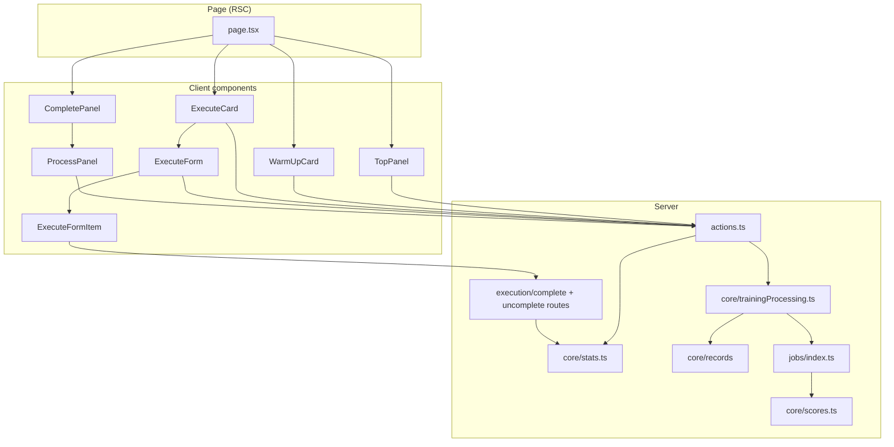
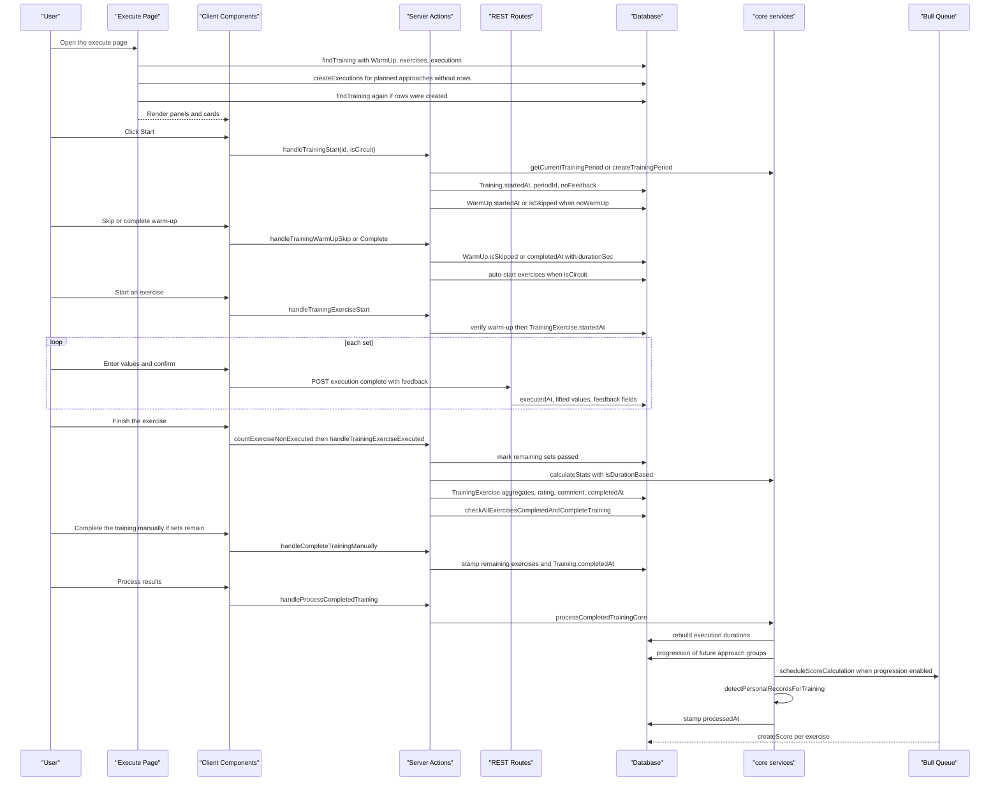
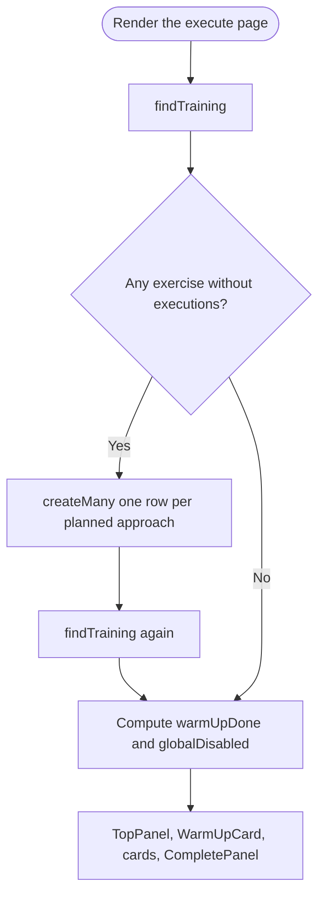
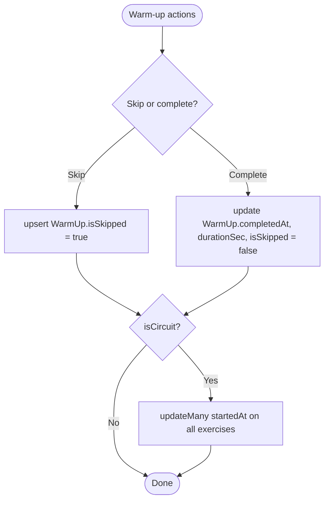
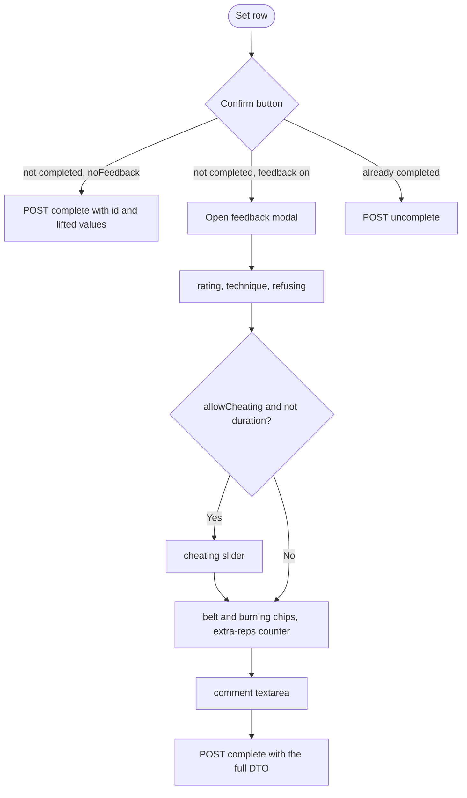
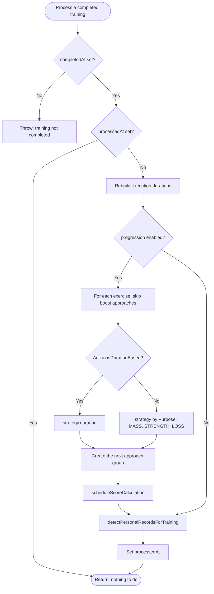
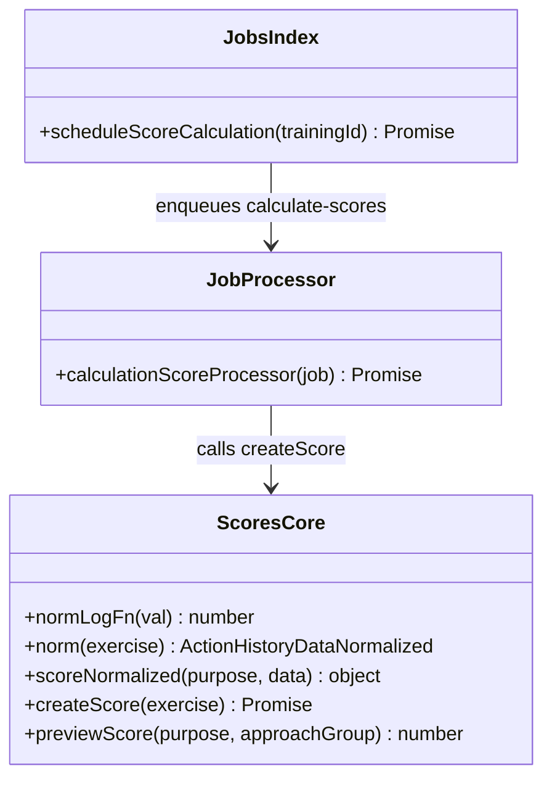
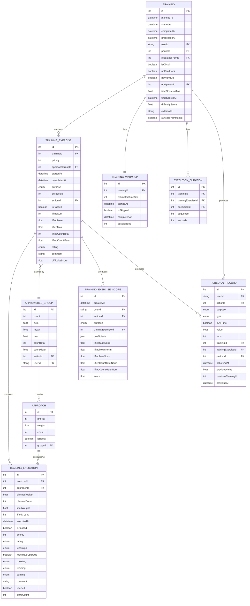
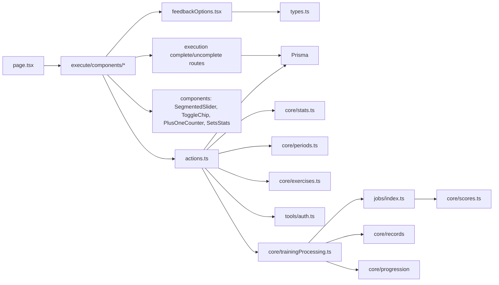

# Training Execution Flow

<cite>
**Referenced Files in This Document**
- [page.tsx](file://src/app/trainings/[id]/execute/page.tsx)
- [actions.ts](file://src/app/trainings/[id]/execute/actions.ts)
- [types.ts](file://src/app/trainings/[id]/execute/types.ts)
- [TrainingExecuteTopPanel.tsx](file://src/app/trainings/[id]/execute/components/TrainingExecuteTopPanel.tsx)
- [TrainingWarmUpCard.tsx](file://src/app/trainings/[id]/execute/components/TrainingWarmUpCard.tsx)
- [TrainingExecuteCard.tsx](file://src/app/trainings/[id]/execute/components/TrainingExecuteCard.tsx)
- [TrainingExecuteForm.tsx](file://src/app/trainings/[id]/execute/components/TrainingExecuteForm.tsx)
- [TrainingExecuteFormItem.tsx](file://src/app/trainings/[id]/execute/components/TrainingExecuteFormItem.tsx)
- [feedbackOptions.tsx](file://src/app/trainings/[id]/execute/components/feedbackOptions.tsx)
- [TrainingExecuteCompletePanel.tsx](file://src/app/trainings/[id]/execute/components/TrainingExecuteCompletePanel.tsx)
- [TrainingProcessPanel.tsx](file://src/app/trainings/[id]/execute/components/TrainingProcessPanel.tsx)
- [TrainingRepeatForm.tsx](file://src/app/trainings/[id]/execute/components/TrainingRepeatForm.tsx)
- [TrainingExerciseReplaceButton.tsx](file://src/app/trainings/[id]/execute/components/TrainingExerciseReplaceButton.tsx)
- [complete/route.ts](file://src/app/api/trainings/exercise/execution/complete/route.ts)
- [uncomplete/route.ts](file://src/app/api/trainings/exercise/execution/uncomplete/route.ts)
- [stats.ts](file://src/core/stats.ts)
- [trainingProcessing.ts](file://src/core/trainingProcessing.ts)
- [trainingMuscles.ts](file://src/core/trainingMuscles.ts)
- [trainings/exercises/actions.ts](file://src/app/trainings/exercises/actions.ts)
- [records/index.ts](file://src/core/records/index.ts)
- [records/detect.ts](file://src/core/records/detect.ts)
- [scores.ts](file://src/core/scores.ts)
- [scores processor](file://src/jobs/processors/scores.ts)
- [jobs index](file://src/jobs/index.ts)
- [SegmentedSlider.tsx](file://src/components/SegmentedSlider.tsx)
- [ToggleChip.tsx](file://src/components/ToggleChip.tsx)
- [PlusOneCounter.tsx](file://src/components/PlusOneCounter.tsx)
- [SetsStats.tsx](file://src/components/SetsStats.tsx)
- [schema.prisma](file://prisma/schema.prisma)
</cite>

## Update Summary
**Changes Made**
- Added the missing per-set feedback layer: `TrainingExecuteFormItem.tsx`, `TrainingExecuteForm.tsx`, `TrainingExecuteCard.tsx` and `feedbackOptions.tsx` were absent from the previous revision even though they carry the whole set-completion UX.
- Documented the `noFeedback` fast path, which posts a minimal payload and skips both the set modal and the exercise modal.
- Added **duration-based exercises** (`Action.isDurationBased`): the input row swaps weight/reps for a difficulty parameter plus seconds, the belt and extra-reps controls are hidden, cheating is hidden, and `calculateStats` receives a fourth `isDurationBased` argument that changes the aggregation semantics.
- Corrected the post-processing flow. `scheduleScoreCalculation` is called from `processCompletedTrainingCore` **inside** the progression branch — not from the server action and not when progression is disabled. Personal-record detection was added as a separate step that always runs.
- Corrected the completion path: `handleCompleteTrainingManually` only stamps `completedAt`; it performs **no** processing. Processing is a second, explicit user action.
- Fixed every `actions.ts` line range. The previous `303-355` reference pointed into `handleReplaceExercise`, not into completion logic.
- Fixed the Prisma model ranges in the ER diagram and added `PersonalRecord`, `TrainingWarmUp` and `TrainingExerciseExecutionDuration`.
- Clarified that `TrainingMuscleStat` is a planning-time artifact recomputed by `recomputeTrainingMuscleStats`, not an output of execution or post-processing.
- Noted that `ExecutionRating.TENSION` is not reachable from the new segmented slider, which exposes only EASY / OK / HARD.

## Table of Contents
1. [Introduction](#introduction)
2. [Project Structure](#project-structure)
3. [Core Components](#core-components)
4. [Architecture Overview](#architecture-overview)
5. [Detailed Component Analysis](#detailed-component-analysis)
6. [Dependency Analysis](#dependency-analysis)
7. [Performance Considerations](#performance-considerations)
8. [Troubleshooting Guide](#troubleshooting-guide)
9. [Conclusion](#conclusion)

## Introduction
This document describes the end-to-end workflow of a training session: opening the execute page, starting the training, clearing the warm-up gate, recording each set with its feedback, completing each exercise, completing the training and finally post-processing it into progression, scores and personal records.

The flow mixes three kinds of endpoints, and knowing which one carries which mutation is the key to reading the code:

- **Server Actions** (`actions.ts`, `"use server"`) own everything that changes structure or lifecycle: warm-up, starting the training, starting/passing an exercise, aggregating an exercise, completing the training, processing results, replacing an exercise.
- **REST routes** own the atomic per-set mutation: `POST /api/trainings/exercise/execution/complete` and `.../uncomplete`. These are called from the client with `postApi` because a set is saved independently of any surrounding form.
- **Bull** owns exactly one thing in this flow: score calculation, which is the only step deferred off the request.

Everything else — durations, progression and personal records — runs synchronously inside `processCompletedTrainingCore`, awaited by the server action.

## Project Structure
The execute route is a single page plus a folder of client components and one server-action module:

```
src/app/trainings/[id]/execute/
├── page.tsx                 # RSC: loads the training, creates missing execution rows
├── actions.ts               # "use server": all lifecycle mutations
├── types.ts                 # human-readable labels for the feedback enums
└── components/
    ├── TrainingExecuteTopPanel.tsx      # "Начать" button, status banners
    ├── TrainingWarmUpCard.tsx           # skip / complete warm-up
    ├── TrainingExecuteCard.tsx          # one exercise: header, start/pass, replace
    ├── TrainingExecuteForm.tsx          # set list, "Еще подход!", "Закончили!" + exercise modal
    ├── TrainingExecuteFormItem.tsx      # one set: inputs, complete button, feedback modal
    ├── feedbackOptions.tsx              # SegmentedSlider option sets per feedback enum
    ├── TrainingExecuteCompletePanel.tsx # manual completion, confetti, process/repeat
    ├── TrainingProcessPanel.tsx         # "Обработать результаты" button
    ├── TrainingRepeatForm.tsx           # shown once processedAt is set
    └── TrainingExerciseReplaceButton.tsx
```



Note that the per-set REST route does **not** call `calculateStats`; aggregation happens later, in `handleTrainingExerciseExecuted`, when the exercise is closed.

**Diagram sources**
- [page.tsx:91-129](file://src/app/trainings/[id]/execute/page.tsx#L91-L129)
- [actions.ts:1-15](file://src/app/trainings/[id]/execute/actions.ts#L1-L15)
- [TrainingExecuteCard.tsx:1-127](file://src/app/trainings/[id]/execute/components/TrainingExecuteCard.tsx#L1-L127)
- [TrainingExecuteForm.tsx:1-25](file://src/app/trainings/[id]/execute/components/TrainingExecuteForm.tsx#L1-L25)
- [TrainingExecuteFormItem.tsx:1-45](file://src/app/trainings/[id]/execute/components/TrainingExecuteFormItem.tsx#L1-L45)
- [complete/route.ts:1-9](file://src/app/api/trainings/exercise/execution/complete/route.ts#L1-L9)

**Section sources**
- [page.tsx:1-129](file://src/app/trainings/[id]/execute/page.tsx#L1-L129)
- [actions.ts:1-355](file://src/app/trainings/[id]/execute/actions.ts#L1-L355)

## Core Components
- **Execute page** (`page.tsx`): a server component that loads the training with warm-up, exercises, actions, approach groups and executions ordered by priority; creates any missing execution rows; derives `warmUpDone` and `globalDisabled` and passes them down.
- **Server actions** (`actions.ts`): twelve exported actions covering warm-up skip/complete, training start, exercise start/pass, non-executed counting, exercise aggregation, adding an ad-hoc approach, manual completion, processing and exercise replacement.
- **Set feedback UI** (`TrainingExecuteFormItem.tsx` + `feedbackOptions.tsx`): one row per set, with a modal that collects rating, technique, refusing, cheating, belt, burning, extra reps and a comment.
- **Exercise UI** (`TrainingExecuteForm.tsx` + `TrainingExecuteCard.tsx`): renders the set list, the "one more set" button, the completed-exercise summary (including `SetsStatsForExecutedExercise`) and the exercise-level rating modal.
- **Completion UI** (`TrainingExecuteCompletePanel.tsx`, `TrainingProcessPanel.tsx`): manual completion with confetti, then either "process results" or, once processed, "repeat training".
- **Per-set REST routes**: `complete` writes lifted values plus all feedback fields and sets `executedAt`; `uncomplete` clears `executedAt`.
- **Post-processing** (`core/trainingProcessing.ts`): durations, progression, score scheduling and personal records.

Key responsibilities:
- **State transitions**: `plannedTo` → `startedAt` → `completedAt` → `processedAt` on `Training`; `startedAt` → `completedAt`/`isPassed` on `TrainingExercise`; `executedAt`/`isPassed` on `TrainingExerciseExecution`.
- **Warm-up gating**: no exercise can be started or passed until the warm-up is skipped or completed.
- **Execution linkage**: each set links to an `Approach` (`approachId` is nullable for ad-hoc sets); stats are aggregated per exercise, not per training.
- **Feedback model**: `rating`, `technique`, `techniqueUpgrade`, `cheating`, `refusing`, `burning`, `useBelt`, `extraCount`, `comment`.
- **Post-processing**: durations, progression of future approach groups, score job, personal records, then `processedAt`.

**Section sources**
- [page.tsx:30-129](file://src/app/trainings/[id]/execute/page.tsx#L30-L129)
- [actions.ts:17-355](file://src/app/trainings/[id]/execute/actions.ts#L17-L355)
- [complete/route.ts:11-66](file://src/app/api/trainings/exercise/execution/complete/route.ts#L11-L66)
- [uncomplete/route.ts:1-15](file://src/app/api/trainings/exercise/execution/uncomplete/route.ts#L1-L15)

## Architecture Overview
The system is layered: RSC page → client components → server actions / REST routes → Prisma → core services → Bull.



**Diagram sources**
- [page.tsx:91-129](file://src/app/trainings/[id]/execute/page.tsx#L91-L129)
- [actions.ts:17-304](file://src/app/trainings/[id]/execute/actions.ts#L17-L304)
- [complete/route.ts:26-66](file://src/app/api/trainings/exercise/execution/complete/route.ts#L26-L66)
- [trainingProcessing.ts:31-194](file://src/core/trainingProcessing.ts#L31-L194)
- [jobs index:16-24](file://src/jobs/index.ts#L16-L24)
- [scores processor:4-36](file://src/jobs/processors/scores.ts#L4-L36)

**Section sources**
- [page.tsx:30-129](file://src/app/trainings/[id]/execute/page.tsx#L30-L129)
- [actions.ts:17-304](file://src/app/trainings/[id]/execute/actions.ts#L17-L304)
- [trainingProcessing.ts:31-194](file://src/core/trainingProcessing.ts#L31-L194)

## Detailed Component Analysis

### Execute Page Lifecycle
`page.tsx` is a server component with three steps:

1. `findTraining(id)` loads the training with `WarmUp` and a `select` over `TrainingExercise` (ordered by `priority`) that includes the full `Action`, the `ApproachGroup` with its `Approaches`, and `TrainingExerciseExecution` ordered by `priority`.
2. `createExecutions(training)` walks every exercise that has **no** execution rows and materializes one row per planned approach, copying `count`/`weight` into `plannedCount`/`plannedWeigth` and zeroing the lifted values. It uses `createMany` for a single round trip and returns whether anything was inserted.
3. If rows were inserted the training is re-fetched, so the render always sees a complete set of executions.

Two derived flags drive the whole UI:
- `warmUpDone` = the warm-up row exists and is either skipped or completed.
- `globalDisabled` = the training has not started **or** is already completed.

Exercise cards receive `disabled = globalDisabled || !warmUpDone`; the warm-up card receives only `globalDisabled`; the completion panel renders only once `startedAt` is set.



**Diagram sources**
- [page.tsx:30-129](file://src/app/trainings/[id]/execute/page.tsx#L30-L129)

**Section sources**
- [page.tsx:30-129](file://src/app/trainings/[id]/execute/page.tsx#L30-L129)

### Warm-Up Handling
The warm-up row is created by `handleTrainingStart`, never by the warm-up actions themselves:

- `handleTrainingStart(id, isCircuit)` resolves the user's current `TrainingPeriod` (creating one if absent), then updates the training with `startedAt`, `periodId` and `noFeedback = !userInfo.collectExerciseExecutionFeedback`. It then updates `TrainingWarmUp`: `{ isSkipped: true }` when `training.noWarmUp`, otherwise `{ startedAt: now }`. Only in the `noWarmUp && isCircuit` case are all exercises auto-started — the code comments this explicitly: *"do not auto-start exercises even for circuit until warm-up done"*.
- `handleTrainingWarmUpSkip(trainingId, isCircuit)` **upserts** the row with `isSkipped: true` and, for circuits, stamps `startedAt` on every exercise.
- `handleTrainingWarmUpComplete(trainingId, trainingStartedAt, isCircuit)` **updates** (does not upsert) the row with `completedAt`, `isSkipped: false` and `durationSec = max(0, floor((now - trainingStartedAt) / 1000))`; for circuits it also auto-starts every exercise. The `trainingStartedAt` argument comes from the client, which passes `warmUp.startedAt!`.

Both start and pass of an individual exercise re-check the warm-up in the database and throw a Russian error message if it is neither skipped nor completed, so the gate is enforced server-side and not only through the `disabled` prop.



**Diagram sources**
- [actions.ts:17-37](file://src/app/trainings/[id]/execute/actions.ts#L17-L37)
- [actions.ts:39-63](file://src/app/trainings/[id]/execute/actions.ts#L39-L63)
- [actions.ts:65-102](file://src/app/trainings/[id]/execute/actions.ts#L65-L102)
- [TrainingWarmUpCard.tsx:18-33](file://src/app/trainings/[id]/execute/components/TrainingWarmUpCard.tsx#L18-L33)

**Section sources**
- [actions.ts:17-102](file://src/app/trainings/[id]/execute/actions.ts#L17-L102)
- [actions.ts:104-153](file://src/app/trainings/[id]/execute/actions.ts#L104-L153)
- [TrainingWarmUpCard.tsx:1-84](file://src/app/trainings/[id]/execute/components/TrainingWarmUpCard.tsx#L1-L84)

### Per-Set Feedback Capture
`TrainingExecuteFormItem` renders one row per `TrainingExerciseExecution` and is the only place that talks to the per-set REST routes.

State is initialized from the execution row: `liftedWeight`/`liftedCount` from `plannedWeigth`/`plannedCount`, `extraCount` from `exec.extraCount ?? 0`, `isCompleted` from `!!exec.executedAt`. The feedback fields start at neutral defaults (`rating = OK`, `techniqueState = "OK"`, `cheating = NO`, `refusing = NO`, `useBelt = false`, `burning = false`).

The confirm button calls `onComplete`, which branches three ways:

| Condition | Behaviour |
|---|---|
| not completed and `noFeedback` | posts `{ id, liftedWeight, liftedCount }` only — no modal |
| not completed and feedback enabled | opens the feedback modal |
| already completed | posts to the `uncomplete` route, clearing `executedAt` |

The modal is submitted by `closeModal`, which posts the full `TrainingsExerciseCompleteDTO`. Two mappings are worth noting:

- Technique is captured as a **single three-position slider** (`WORSE` / `OK` / `BETTER`) and split across two columns on write: `technique = WORSE ? FLAW : OK` and `techniqueUpgrade = (BETTER)`.
- Cheating is force-reset on write when the action forbids it: `cheating: action.allowCheating ? cheating : ExecutionCheating.NO`.

The burning toggle maps a boolean to the `ExecutionBurning` enum (`YES`/`NO`). The comment is read from an uncontrolled textarea via a ref at submit time, so it is not part of React state.

Controls hidden for duration-based exercises (`isDuration = action.isDurationBased`):
- the cheating slider (`action.allowCheating && !isDuration`)
- the belt `ToggleChip`
- the `PlusOneCounter` for `extraCount` (capped by `EXTRA_COUNT_MAX = 8`)

The burning `ToggleChip` is always rendered and is the only control passed `celebrate`, which triggers its spark animation on activation.



**Diagram sources**
- [TrainingExecuteFormItem.tsx:45-162](file://src/app/trainings/[id]/execute/components/TrainingExecuteFormItem.tsx#L45-L162)
- [TrainingExecuteFormItem.tsx:272-382](file://src/app/trainings/[id]/execute/components/TrainingExecuteFormItem.tsx#L272-L382)
- [feedbackOptions.tsx:17-107](file://src/app/trainings/[id]/execute/components/feedbackOptions.tsx#L17-L107)
- [complete/route.ts:26-66](file://src/app/api/trainings/exercise/execution/complete/route.ts#L26-L66)
- [uncomplete/route.ts:8-15](file://src/app/api/trainings/exercise/execution/uncomplete/route.ts#L8-L15)

**Section sources**
- [TrainingExecuteFormItem.tsx:1-385](file://src/app/trainings/[id]/execute/components/TrainingExecuteFormItem.tsx#L1-L385)
- [feedbackOptions.tsx:1-107](file://src/app/trainings/[id]/execute/components/feedbackOptions.tsx#L1-L107)
- [types.ts:1-36](file://src/app/trainings/[id]/execute/types.ts#L1-L36)
- [complete/route.ts:11-66](file://src/app/api/trainings/exercise/execution/complete/route.ts#L11-L66)

### Duration-Based Exercises in the Execution UI
Duration exercises invert the meaning of the two numeric columns: `TrainingExerciseExecution.count` holds **seconds** and `weight` holds a **difficulty parameter** (incline, resistance level, tempo — whatever `Action.durationParamLabel` names).

The input row reflects this. For `action.isDurationBased`:
- if `action.durationParamLabel` is set, an extra input group is rendered as `label` / value / `durationParamUnit`, bound to `liftedWeight` with `step 0.5`;
- a fixed "Длительность" input bound to `liftedCount` with `step 1` and a trailing "с" suffix.

For a normal exercise the row is the familiar weight / `x` / reps triple with a `GiWeight` icon.

Both variants colour the value green when the lifted figure exceeds the plan and amber when it falls short, and mute it once the set is passed.

Aggregation in `calculateStats(setsData, actionRig, userWeight, isDurationBased)` also branches. With `isDurationBased` the body-weight addition (`userWeight + set.weight` for `ActionRig.OTHER`) is skipped entirely, a set only counts when `count > 0` seconds were recorded, and the aggregates become: `countTotal` = total seconds, `weightSum` = Σ(param × seconds), `weightMean` = Σparam / set count, `weightMax` = the highest parameter seen.

**Section sources**
- [TrainingExecuteFormItem.tsx:162-259](file://src/app/trainings/[id]/execute/components/TrainingExecuteFormItem.tsx#L162-L259)
- [stats.ts:57-101](file://src/core/stats.ts#L57-L101)
- [stats.ts:32-55](file://src/core/stats.ts#L32-L55)
- [SetsStats.tsx:154-166](file://src/components/SetsStats.tsx#L154-L166)

### Exercise Completion and Aggregation
Closing an exercise is a two-step interaction.

`showModal` in `TrainingExecuteForm` first calls `countExerciseNonExecuted(exercise.id)`. If sets remain without `executedAt`, the browser `confirm` dialog asks whether to finish anyway; cancelling aborts. With `noFeedback` the exercise is closed immediately via `handleTrainingExerciseExecuted(exercise, null, null)`; otherwise the exercise-level modal collects a `TrainingRating` (four options: EASY, OK, HARD, IMPOSSIBLE) and a comment, and `submit` passes both to the action.

`handleTrainingExerciseExecuted` then:
1. marks every not-yet-executed set of the exercise `isPassed = true` (so they are excluded from the aggregates);
2. inside a transaction, loads the remaining `isPassed = false` executions, maps them to `SetData`, fetches `findInfoForCalculationStatsForAction(actionId, userId, tx)` and calls `calculateStats(sets, info.actionrig, info.userweight, info.isDurationBased)`;
3. writes `completedAt`, `liftedSum`, `liftedMean`, `liftedCountTotal`, `liftedCountMean`, `liftedMax` plus, conditionally, `rating` and `comment` (only when truthy, so a null rating never overwrites the default);
4. in a second transaction calls `checkAllExercisesCompletedAndCompleteTraining(trainingId, tx)`, which stamps `Training.completedAt` when no exercise lacks one.

The action returns a `ServerActionResult` (`{ ok, error }`) rather than throwing, and the form renders `completeError` inline.

`handleAddExecutionApproach` supports adding an unplanned set: it finds the highest-priority execution of the exercise, copies its planned values, increments `priority` and creates a row with `approachId: null`.

Skipping an exercise entirely goes through `handleTrainingExercisePass`, which sets `startedAt`, `completedAt` and `isPassed = true` in one transaction and then runs the same all-done check.

Once completed, `TrainingExecuteForm` renders a summary: the completion time, `TrainingRatingEmoji`, elapsed minutes, the sum of `extraCount` across sets, a belt icon if any set used one, and `SetsStatsForExecutedExercise` — which receives `isDurationBased` and `durationParamLabel` from the action so the comparison against the planned group reads correctly.

**Section sources**
- [actions.ts:126-153](file://src/app/trainings/[id]/execute/actions.ts#L126-L153)
- [actions.ts:155-232](file://src/app/trainings/[id]/execute/actions.ts#L155-L232)
- [actions.ts:234-281](file://src/app/trainings/[id]/execute/actions.ts#L234-L281)
- [TrainingExecuteForm.tsx:25-79](file://src/app/trainings/[id]/execute/components/TrainingExecuteForm.tsx#L25-L79)
- [TrainingExecuteForm.tsx:96-229](file://src/app/trainings/[id]/execute/components/TrainingExecuteForm.tsx#L96-L229)

### Training Completion and Post-Processing
Completion and processing are **two separate user actions**, and this is the most frequently misunderstood part of the flow.

- `handleCompleteTrainingManually(trainingId)` — the amber "Завершить!" button — only closes the training: it marks every exercise without `completedAt` as completed and passed, and stamps `Training.completedAt`. It performs **no** aggregation, **no** progression and **no** scoring.
- `handleProcessCompletedTraining(trainingId)` — the green "Обработать результаты" button, rendered by `TrainingProcessPanel` only while `processedAt` is null — resolves the user id and awaits `processCompletedTrainingCore(trainingId, userId)` synchronously, then revalidates the route.

`processCompletedTrainingCore` is shared with the mobile sync path (where it runs inside a Bull worker) and proceeds as follows:

1. Load `UserInfo`; throw if `Training.completedAt` is not set.
2. Return immediately if `processedAt` is already set — this is the idempotency guard that makes retries safe.
3. Rebuild `TrainingExerciseExecutionDuration` rows from the executions ordered by `executedAt`, producing a per-training sequence of rest/work intervals.
4. If `userInfo.trainingProgression !== NONE`, iterate the exercises and create the next approach group. Boost approaches (`approach.isBoost`) are skipped. The strategy is selected by checking `exercise.Action.isDurationBased` **first** — duration exercises always carry `purpose = LOSS` but must be progressed by `strategy.duration(...)`, so the duration test precedes the `Purpose` switch. Each iteration ends in a transaction creating the group and linking it to the action.
5. Still inside that branch, `scheduleScoreCalculation(trainingId)` enqueues the scoring job. **With progression disabled no scores are produced.**
6. Outside the branch, so it always runs: `detectPersonalRecordsForTraining(trainingId, userId)`.
7. Finally stamp `Training.processedAt`.

Once `processedAt` is set, `TrainingExecuteCompletePanel` swaps `TrainingProcessPanel` for `TrainingRepeatForm`.



**Diagram sources**
- [trainingProcessing.ts:31-194](file://src/core/trainingProcessing.ts#L31-L194)
- [actions.ts:283-304](file://src/app/trainings/[id]/execute/actions.ts#L283-L304)
- [jobs index:16-24](file://src/jobs/index.ts#L16-L24)

**Section sources**
- [actions.ts:283-304](file://src/app/trainings/[id]/execute/actions.ts#L283-L304)
- [trainingProcessing.ts:31-194](file://src/core/trainingProcessing.ts#L31-L194)
- [TrainingExecuteCompletePanel.tsx:64-114](file://src/app/trainings/[id]/execute/components/TrainingExecuteCompletePanel.tsx#L64-L114)
- [TrainingProcessPanel.tsx:1-34](file://src/app/trainings/[id]/execute/components/TrainingProcessPanel.tsx#L1-L34)

### Score Calculation (Background Job)
`scheduleScoreCalculation(trainingId)` adds a `calculate-scores` job with `{ trainingId }` and the shared `defaultJobOptions` (`attempts: 3`, exponential backoff from 5 s, `removeOnComplete: true`).

`calculationScoreProcessor` loads every `TrainingExercise` of the training including the parent `Training`, then calls `createScore(exercise)` sequentially, logging each step. Errors are logged and re-thrown so Bull can retry; `prisma.$disconnect()` runs in `finally`.

`createScore` normalizes the exercise metrics with `norm` (log-scaled where appropriate), applies the purpose-specific `ScoreCoefficients` and writes one `TrainingExerciseScore` row per exercise, storing the coefficients actually used as JSON so historical scores remain explainable. `previewScore` is the pure, side-effect-free variant used by planning UIs.



**Diagram sources**
- [scores.ts:24-78](file://src/core/scores.ts#L24-L78)
- [scores.ts:80-102](file://src/core/scores.ts#L80-L102)
- [scores.ts:108-121](file://src/core/scores.ts#L108-L121)
- [scores processor:4-36](file://src/jobs/processors/scores.ts#L4-L36)
- [jobs index:16-24](file://src/jobs/index.ts#L16-L24)

**Section sources**
- [scores.ts:1-121](file://src/core/scores.ts#L1-L121)
- [scores processor:1-36](file://src/jobs/processors/scores.ts#L1-L36)
- [jobs index:16-24](file://src/jobs/index.ts#L16-L24)

### Personal Records
Record detection runs at the end of every processed training, independently of the progression setting. `detectPersonalRecordsForTraining(trainingId, userId)` is idempotent: it deletes the training's own records before re-detecting them, so a retry is safe as long as `processedAt` has not yet been stamped.

Two record types are tracked per `(user, action, purpose, type)` tuple, in both an all-time and a current-period flavour:
- `MAX_WEIGHT` — the heaviest single set, with `reps` recorded for the UI. Sets above `MAX_WEIGHT_MAX_COUNT_FOR_RECORD = 3` reps are skipped by `valuateMaxWeight`, so a record is never "100 kg × 5" — high-rep sets count only towards volume; when two sets weigh the same, the one with more reps wins;
- `MAX_VOLUME` — the exercise tonnage, i.e. Σ(weight × reps).

For duration-based exercises the value semantics change to seconds, and the UI renders the type title as "Σ" regardless of the enum.

Each record stores a historical snapshot of what it beat: `previousValue`, `previousTrainingId` and `previousAt`. A record with `previousValue = null` is a *base* — the first result in history or in the period. `isShownRecord` hides only **period** bases: every all-time record is shown, because the check is `record.isAllTime ? true : record.previousValue !== null`. The read filter uses `achievedAt < completedAt` so that the training's own rows are excluded without needing the delete to happen first.

**Section sources**
- [records/index.ts:1-17](file://src/core/records/index.ts#L1-L17)
- [records/detect.ts:18-126](file://src/core/records/detect.ts#L18-L126)
- [records/valuation.ts:1-50](file://src/core/records/valuation.ts#L1-L50)
- [records/format.tsx:11-16](file://src/components/records/format.tsx#L11-L16)
- [schema.prisma:619-671](file://prisma/schema.prisma#L619-L671)

### Replacing an Exercise
`handleReplaceExercise(exerciseId, newActionId)` is available mid-training from `TrainingExerciseReplaceButton`. It rejects the replacement if the target action already appears in the training, otherwise it runs a transaction that creates the new exercise with the **same purpose** as the old one (via `createExercise`) and deletes the old row — cascading away its executions. Like the aggregation action it returns a `ServerActionResult` instead of throwing.

**Section sources**
- [actions.ts:306-355](file://src/app/trainings/[id]/execute/actions.ts#L306-L355)
- [TrainingExerciseReplaceButton.tsx:1-48](file://src/app/trainings/[id]/execute/components/TrainingExerciseReplaceButton.tsx#L1-L48)

### Data Model and Lifecycle States
- **Training lifecycle**: `plannedTo` → `startedAt` → `completedAt` → `processedAt`, plus `timeScoreInMins`/`timeScoreInSecs`/`timeScoredAt` for the pacing score and `difficultyScore`.
- **Exercise lifecycle**: `startedAt` → `completedAt`, with `isPassed` marking a skipped or force-closed exercise.
- **Set lifecycle**: `executedAt` is the single source of truth for "this set happened"; the `uncomplete` route clears it. `isPassed` marks a set excluded from aggregation.
- **Feedback fields on a set**: `rating`, `technique`, `techniqueUpgrade`, `cheating`, `refusing`, `burning`, `useBelt`, `extraCount`, `comment`.
- **Derived per-training data produced by this flow**: `TrainingExerciseExecutionDuration` (rest/work sequence), `TrainingExerciseScore` and `PersonalRecord`. `TrainingMuscleStat` also hangs off `Training`, but it is recomputed while *planning* — `recomputeTrainingMuscleStats` runs from the training-exercise actions and when a training is repeated, never from execution or processing.



**Diagram sources**
- [schema.prisma:399-450](file://prisma/schema.prisma#L399-L450)
- [schema.prisma:452-491](file://prisma/schema.prisma#L452-L491)
- [schema.prisma:500-534](file://prisma/schema.prisma#L500-L534)
- [schema.prisma:347-391](file://prisma/schema.prisma#L347-L391)
- [schema.prisma:595-617](file://prisma/schema.prisma#L595-L617)
- [schema.prisma:627-671](file://prisma/schema.prisma#L627-L671)
- [schema.prisma:793-811](file://prisma/schema.prisma#L793-L811)
- [schema.prisma:813-825](file://prisma/schema.prisma#L813-L825)

**Section sources**
- [schema.prisma:399-534](file://prisma/schema.prisma#L399-L534)
- [schema.prisma:595-671](file://prisma/schema.prisma#L595-L671)
- [schema.prisma:793-825](file://prisma/schema.prisma#L793-L825)
- [trainingMuscles.ts:4-109](file://src/core/trainingMuscles.ts#L4-L109)
- [trainings/exercises/actions.ts:11-60](file://src/app/trainings/exercises/actions.ts#L11-L60)

## Dependency Analysis
- The page depends on nothing but Prisma and its child components; all mutation logic sits in `actions.ts`.
- `actions.ts` depends on Prisma, `core/stats` for aggregation, `core/periods` for the training period, `core/exercises` for replacement, `tools/auth` for the user id and `core/trainingProcessing` for post-processing. It never imports `@/jobs` directly.
- `core/trainingProcessing.ts` is the only module in this flow that imports `@/jobs`, and it does so for `scheduleScoreCalculation` alone.
- The per-set REST routes depend only on Prisma and the `@prisma/client` enums; they are deliberately logic-free.
- Client components import the shared primitives from `src/components` (`SegmentedSlider`, `ToggleChip`, `PlusOneCounter`, `SetsStats`) and the option sets from the local `feedbackOptions.tsx`, which in turn reads the label maps from the local `types.ts`.



**Diagram sources**
- [actions.ts:1-15](file://src/app/trainings/[id]/execute/actions.ts#L1-L15)
- [page.tsx:1-18](file://src/app/trainings/[id]/execute/page.tsx#L1-L18)
- [TrainingExecuteFormItem.tsx:1-34](file://src/app/trainings/[id]/execute/components/TrainingExecuteFormItem.tsx#L1-L34)
- [feedbackOptions.tsx:1-15](file://src/app/trainings/[id]/execute/components/feedbackOptions.tsx#L1-L15)
- [complete/route.ts:1-9](file://src/app/api/trainings/exercise/execution/complete/route.ts#L1-L9)
- [trainingProcessing.ts:1-20](file://src/core/trainingProcessing.ts#L1-L20)

**Section sources**
- [actions.ts:1-15](file://src/app/trainings/[id]/execute/actions.ts#L1-L15)
- [trainingProcessing.ts:1-20](file://src/core/trainingProcessing.ts#L1-L20)

## Performance Considerations
- **Execution rows are created in one `createMany`**, and the page re-queries only when something was actually inserted, so a resumed training costs one round trip.
- **`findTraining` uses an explicit `select`** on `TrainingExercise` rather than a full include, keeping the payload to the columns the cards render.
- **Sorting is done by the database**: both `TrainingExercise` and `TrainingExerciseExecution` are ordered by `priority` in the query, never in application code.
- **Aggregation happens once per exercise**, not per set. The per-set route writes a single row; `calculateStats` runs only when the exercise is closed.
- **Post-processing is synchronous in the web path.** Durations, progression and record detection all run inside the awaited server action, so a training with many exercises produces a visibly slow "Обработать результаты" click. Only score calculation is offloaded to Bull. The mobile sync path defers the whole thing to the trainings queue for exactly this reason.
- **Two transactions per exercise close**: one for the aggregates and one for the all-done check. They are small, but the second one re-reads every exercise of the training.
- **`removeOnComplete: true`** keeps Redis flat but erases successful score jobs; failures remain inspectable through the attempts setting.

**Section sources**
- [page.tsx:30-89](file://src/app/trainings/[id]/execute/page.tsx#L30-L89)
- [actions.ts:163-250](file://src/app/trainings/[id]/execute/actions.ts#L163-L250)
- [trainingProcessing.ts:31-194](file://src/core/trainingProcessing.ts#L31-L194)

## Troubleshooting Guide
- **"Нельзя начать упражнения, пока разминка не завершена или не пропущена"** — thrown by `handleTrainingExerciseStart` and `handleTrainingExercisePass`. The `TrainingWarmUp` row is missing, or neither `isSkipped` nor `completedAt` is set. Since `handleTrainingStart` creates the row, this usually means the training was never started through the UI.
- **The warm-up card offers no buttons** — `isDone` is true (skipped or completed) or `globalDisabled` is true because the training has not started or is already completed. The card explains the latter case inline.
- **Fractional weights are truncated** — the weight inputs use `step 0.5`, but both `updateLiftedWeight` and `updateLiftedCount` parse with `parseInt`, so entering `10.5` stores `10`. Use the 0.5 step only if this handler is changed to `parseFloat`.
- **`ExecutionRating.TENSION` never appears** — the segmented slider exposes only EASY, OK and HARD. `TENSION` is still a valid enum value (alongside the deprecated `TENSION_OK`/`TENSION_FLAW`) and can exist in historical rows, but the current UI cannot produce it.
- **Cheating is always NO** — the slider only renders when `action.allowCheating`, and the payload forces `ExecutionCheating.NO` otherwise. Check the action, not the execution.
- **A completed set cannot be edited** — inputs are disabled while `isCompleted`; the confirm button turns into an "uncomplete" action that clears `executedAt`, after which the row becomes editable again.
- **No belt or extra-reps controls** — expected for duration-based exercises, where both are hidden together with the cheating slider.
- **Aggregates look too low** — sets without `executedAt` are marked `isPassed` before aggregation and are excluded. Confirm the sets actually have `executedAt`.
- **Duration exercise stats are in seconds** — `liftedCountTotal` is total seconds and `liftedSum` is Σ(parameter × seconds); `liftedMax` is the highest parameter, not a weight. `SetsStatsForExecutedExercise` needs `isDurationBased` and `durationParamLabel` to label this correctly.
- **Training completed but nothing changed** — `handleCompleteTrainingManually` only stamps `completedAt`. Progression, scores and records require the separate "Обработать результаты" action.
- **No scores after processing** — `scheduleScoreCalculation` is inside the `trainingProgression !== NONE` branch. Users with progression disabled get personal records but no `TrainingExerciseScore` rows.
- **Processing does nothing on the second attempt** — `processedAt` is set, so `processCompletedTrainingCore` returns immediately. Clear the column to force a re-run.
- **"Тренировка еще не завершена"** — processing was attempted before `completedAt` was stamped.
- **Score job failures** — check the worker logs; the processor re-throws after logging, and with `attempts: 3` and a 5 s exponential backoff a permanently failing job lands in the failed set within about a minute. Ensure every exercise has `completedAt` and valid aggregates.
- **Exercise replacement rejected with "Это упражнение уже присутствует в тренировке"** — the target action is already part of the training; remove the duplicate first.

**Section sources**
- [actions.ts:104-153](file://src/app/trainings/[id]/execute/actions.ts#L104-L153)
- [actions.ts:163-232](file://src/app/trainings/[id]/execute/actions.ts#L163-L232)
- [actions.ts:283-304](file://src/app/trainings/[id]/execute/actions.ts#L283-L304)
- [TrainingExecuteFormItem.tsx:152-162](file://src/app/trainings/[id]/execute/components/TrainingExecuteFormItem.tsx#L152-L162)
- [feedbackOptions.tsx:17-37](file://src/app/trainings/[id]/execute/components/feedbackOptions.tsx#L17-L37)
- [trainingProcessing.ts:31-194](file://src/core/trainingProcessing.ts#L31-L194)
- [scores processor:4-36](file://src/jobs/processors/scores.ts#L4-L36)

## Conclusion
The execution flow is deliberately split between three mechanisms, and each one is used for what it is good at. Server Actions carry every structural and lifecycle mutation and can therefore be awaited, transactional and revalidating. The two per-set REST routes stay trivial so that saving a set is a single fast write from an optimistic client component. Bull takes only the work that is genuinely deferrable — score calculation.

Two design points are worth remembering when changing this flow. First, the warm-up gate is enforced twice: visually through `disabled` props derived in `page.tsx`, and authoritatively by a database check inside `handleTrainingExerciseStart` and `handleTrainingExercisePass`. Second, completion and processing are separate steps. `handleCompleteTrainingManually` never aggregates, never progresses and never scores; `handleProcessCompletedTraining` does all of it, guarded by `processedAt` so it is safe to call twice.

The duration-based exercise support threads through every layer of the flow — input row, feedback controls, `calculateStats`, the progression strategy, scoring and personal records — always keyed on `Action.isDurationBased` and always checked *before* the `Purpose` switch, because duration exercises carry `purpose = LOSS` while needing their own progression method. Any new purpose-dependent logic added to this flow must preserve that ordering.
